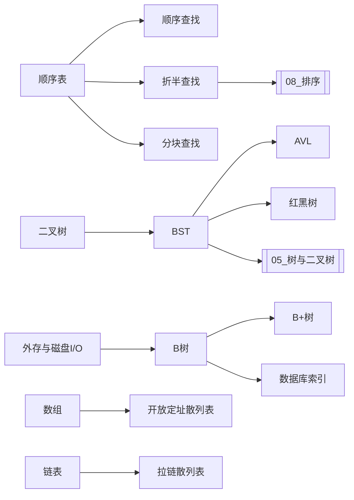

# 第7章 查找（视频讲解整理）

> 本文档基于王道2026数据结构课程第七章18个视频的语音字幕，结合《2026年数据结构考研复习指导》教材内容整理。
>
> 视频列表：
> 1. 069 7.1 查找的基本概念
> 2. 070 7.2.1 顺序查找
> 3. 071 7.2.2 折半查找
> 4. 072 7.2.3 分块查找
> 5. 073 7.3.1 二叉排序树
> 6. 074 7.3.2_1 平衡二叉树
> 7. 075 7.3.2_2 平衡二叉树的删除
> 8. 076 7.3.3_1 红黑树的定义和性质
> 9. 077 7.3.3_2 红黑树的插入
> 10. 078 7.3.3_3 红黑树的删除
> 11. 079 7.4.1_1 B树
> 12. 080 7.4.1_2 B树的插入删除
> 13. 081 7.4.2 B+树
> 14. 082 7.5.1 散列表的基本概念
> 15. 083 7.5.2 散列函数的构造
> 16. 084 7.5.3_1 处理冲突的方法_拉链法
> 17. 085 7.5.3_2 处理冲突的方法_开放定址法
> 18. 086 7.5.4 散列查找的性能分析

> [!important] 全章定位（先看这条，决定精力分配）
> 查找是 408 数据结构中**算法密度和手算密度双高**的一章：线性查找（3种）、树形查找（BST/AVL/红黑树/B树/B+树）、散列表（散列函数+2种冲突处理+性能分析）全在这一章。
> - **折半查找、BST、AVL、散列表**是 ★★★★★：会画过程、会算 ASL、会分析复杂度、会写核心算法；
> - **B树、B+树、分块查找**是 ★★★★☆：会判断结构性质，会完成插入删除过程，会比较异同；
> - **红黑树**是 ★★★☆☆：熟记性质，理解插入调整，能判断树是否合法（删除了解即可）；
> - 这一章和第5章"树"深度绑定：BST/AVL/红黑树都是二叉树的应用，B树/B+树是多路平衡查找树，判定树本质是二叉树。

---

> [!important] 本章必背 5 条（30 秒版）
> 1. 折半查找要求**顺序存储且元素有序**，时间复杂度 O(log n)。
> 2. B 树每个结点关键字有上下限；B+ 树把记录放在叶子结点，叶子之间成链表。
> 3. 散列冲突处理：开放定址法（线性/平方/双散列）与拉链法，装填因子 α 影响查找长度。
> 4. ASL 要区分“查找成功”和“查找失败”两种平均查找长度。
> 5. 二叉排序树中序遍历即有序序列；平衡二叉树左右子树高度差 ≤1。
>
> **读法**：先背这 5 条 → 看知识地图 → 做文末自测；卡住再回对应小节。


## 一、查找的基本概念（视频069，★★★ 概念不能混淆）

### 1.1 什么是查找

**查找**是指在数据集合中寻找满足某种条件的数据元素的过程。

查找结果有两种：
- **查找成功**：找到满足条件的数据元素；
- **查找失败**：数据集合中不存在满足条件的元素。

查找问题通常关注三个问题：
1. 数据采用什么结构保存；
2. 使用什么规则缩小查找范围；
3. 查找过程中进行了多少次关键字比较。

### 1.2 查找表

由同一类型的数据元素或记录组成、用于查找的数据集合称为**查找表**。

查找表上的常见操作：查找、插入、删除、修改、遍历。

#### 1.2.1 静态查找表

若查找表只进行查找，或插入、删除极少，则称为**静态查找表**。

适合方法：顺序查找、折半查找、分块查找、静态散列表。

#### 1.2.2 动态查找表

若查找过程中还要频繁执行插入和删除，则称为**动态查找表**。

适合方法：二叉排序树、平衡二叉树、红黑树、散列表、B树和B+树。

> [!warning] 易错点
> "静态"与"动态"描述的是**查找表上的操作特点**，不是说数据一定存放在静态数组或动态内存中。

### 1.3 关键字

- **关键字**：数据元素中能够参与查找的数据项；
- **主关键字**：能够唯一标识一个数据元素的关键字（如学号、身份证号）；
- **次关键字**：不能唯一标识数据元素的关键字（如班级、姓名）。

> [!tip] 题目判断
> 若题目说"查找结果必须唯一"，通常隐含关键字是主关键字；若允许返回一组记录，则可能是次关键字。

### 1.4 查找长度与平均查找长度 ASL（★★★★ 全章核心公式）

一次查找过程中，进行的**关键字比较次数**称为该次查找的查找长度。

**平均查找长度**（Average Search Length，ASL）：

$$
ASL=\sum_{i=1}^{n}P_iC_i
$$

- $n$：可能出现的查找结果数量；
- $P_i$：第 $i$ 种查找结果出现的概率；
- $C_i$：第 $i$ 种情况下的关键字比较次数。

若各元素被查找的概率相同：$P_i=\frac{1}{n}$，则 $ASL=\frac{1}{n}\sum_{i=1}^{n}C_i$。

#### 成功 ASL 与失败 ASL（必须区分）

$$
ASL_{成功}=\sum P_iC_i
$$

$$
ASL_{失败}=\sum Q_jD_j
$$

- $P_i$ 是查找到第 $i$ 个已有元素的概率；
- $Q_j$ 是关键字落入第 $j$ 个失败区间的概率；
- $C_i$ 是成功查找时的比较次数；
- $D_j$ 是失败查找时的比较次数。

> [!danger] ASL计算的第一原则
> 先问清楚题目统计的是什么：
> - 只统计与表中真实元素的比较，还是把"哨兵"比较也计算在内；
> - 成功与失败是否等概率；
> - 各关键字的查找概率是否相等。
> 口径不同，数值可能不同。

---

## 二、顺序查找（视频070，★★★ 理解+会算ASL）

### 2.1 基本思想

顺序查找又称**线性查找**。从查找表的一端开始，依次比较当前元素的关键字与目标关键字，相等则查找成功，扫描结束仍未找到则查找失败。

适用范围最广：顺序表、单链表、双链表、无序表、有序表都能用。它是对存储结构要求最低的查找方法。

### 2.2 一般无序线性表的顺序查找

```c
// 普通写法（从下标0开始）
int SequentialSearch(int data[], int length, int target) {
    for(int i = 0; i < length; i++) {
        if(data[i] == target)
            return i;       // 查找成功，返回下标
    }
    return -1;              // 扫描结束仍未找到
}
```

时间复杂度：最好 $O(1)$，最坏 $O(n)$，平均 $O(n)$。空间复杂度 $O(1)$。

### 2.3 带哨兵的顺序查找（★ 教材标准写法）

教材采用 1 号到 $n$ 号位置存储有效元素，并将 **0 号位置作为"哨兵"**。

```c
typedef struct {
    int *element;    // element[1]~element[n] 存有效元素，element[0] 是哨兵
    int length;      // 查找表长度
} SSTable;

// 带哨兵的顺序查找
int Search_Seq(SSTable ST, int key) {
    ST.element[0] = key;              // ★ 哨兵：把目标关键字放到0号位置
    int i;
    for(i = ST.length; ST.element[i] != key; i--);  // 从后往前找，无需判断i>=0
    return i;                          // 返回0表示查找失败（哨兵位置），否则返回元素位置
}
```

> [!important] 哨兵的作用（★ 选择题高频）
> 哨兵的作用是**免去查找过程中每一步都要检测整个表是否查找完毕**（即不用写 `i >= 1` 的边界判断），从而提高查找效率约一倍。
> - 查找成功：返回元素所在位置（1~n）；
> - 查找失败：返回 0（哨兵位置）。

### 2.4 顺序查找的 ASL（★★★ 会算）

#### 成功 ASL（等概率）

$$
ASL_{成功}=\sum_{i=1}^{n}P_iC_i=\frac{1}{n}\sum_{i=1}^{n}(n-i+1)=\frac{n+1}{2}
$$

> 解释：从后往前找，第 $i$ 个元素（从后数第 $i$ 个）需要比较 $i$ 次。第1个位置（最前面）需要比较 $n$ 次，第 $n$ 个位置（最后面）需要比较 1 次。平均 $\frac{n+1}{2}$。

#### 失败 ASL

查找失败时，必须扫描完整个表，比较次数为 $n+1$（含哨兵比较）或 $n$（不含哨兵，取决于口径）。

> [!warning] 口径问题
> 带哨兵的写法：失败时比较 $n+1$ 次（$n$ 个元素 + 1 次哨兵匹配）；
> 不带哨兵的写法：失败时比较 $n$ 次。
> 考研题通常会明确说明是否带哨兵，按题目口径计算。

### 2.5 有序表的顺序查找（★ 了解）

若查找表是有序的，查找失败时可以提前终止（当遇到比目标大的元素时就知道不存在了），失败 ASL 会降低。但成功 ASL 不变。

> [!note] 视频强调
> 顺序查找的优点是对表结构无要求、对元素有序性无要求；缺点是 ASL 大、查找效率低。当 $n$ 较大时不宜使用。

---

## 三、折半查找（视频071，★★★★★ 全章最高频之一）

### 3.1 基本思想与适用条件

折半查找又称**二分查找**。它**只适用于有序的顺序表**：
- **有序**：关键字必须递增或递减排列；
- **顺序表**：必须用数组存储（需要随机访问中间元素，链表不行）。

### 3.2 算法执行过程

用三个指针：`low`（区间左端）、`high`（区间右端）、`mid`（中间位置）。

```
1. low = 1, high = n（或 low = 0, high = n-1，取决于下标起点）；
2. 当 low <= high 时：
   a. mid = (low + high) / 2（向下取整）；
   b. 若 key == R[mid].key：查找成功，返回 mid；
   c. 若 key < R[mid].key：目标在左半区，high = mid - 1；
   d. 若 key > R[mid].key：目标在右半区，low = mid + 1；
3. 循环结束（low > high）：查找失败。
```

### 3.3 核心代码（★ 能默写）

```c
// 折半查找（有序顺序表，下标从1开始）
int Binary_Search(SSTable L, int key) {
    int low = 1, high = L.length, mid;
    while(low <= high) {
        mid = (low + high) / 2;           // ★ 向下取整
        if(L.element[mid] == key)
            return mid;                     // 查找成功
        else if(L.element[mid] > key)
            high = mid - 1;                // 目标在左半区
        else
            low = mid + 1;                 // 目标在右半区
    }
    return 0;                               // 查找失败
}
```

> [!warning] 易错点
> 1. `mid = (low + high) / 2` 是**向下取整**（C 语言整数除法自动向下取整）；
> 2. 循环条件是 `low <= high`，不是 `low < high`（否则会漏掉最后一个元素）；
> 3. 更新边界是 `high = mid - 1` 和 `low = mid + 1`，不是 `high = mid` / `low = mid`（否则会死循环）。

### 3.4 查找判定树（★★★★★ 选择题最高频考点）

折半查找的过程可以用一棵二叉树来描述，称为**查找判定树**。

- 树中每个**圆形节点**表示一个表中元素（查找成功节点）；
- 树中每个**方形节点**（外部节点）表示一个失败区间（查找失败节点）；
- 从根到某个成功节点的路径长度 = 查找该元素的关键字比较次数；
- 从根到某个失败节点的路径长度 = 该失败区间的关键字比较次数。

#### 判定树的构造特性（★ 记结论）

当 `mid = (low + high) / 2` 向下取整时：

> **对于任何一个节点，它的右子树中的节点数，要么比左子树多一个，要么左右相等；不可能左子树比右子树多。**

这是因为：当区间有偶数个元素时，刨除 mid 后剩余奇数个，左半区比右半区少一个。

> [!important] 判定树的性质（★ 选择题直接用）
> 1. 折半查找的判定树是一棵**平衡二叉树**（但不是所有平衡二叉树都是折半查找判定树）；
> 2. 判定树中**只有最下面一层是不满的**，其余各层都是满的；
> 3. $n$ 个元素的判定树高度为 $\lceil \log_2(n+1) \rceil$（或 $\lfloor \log_2 n \rfloor + 1$）；
> 4. 失败节点数 = 成功节点数 + 1 = $n + 1$。

### 3.5 折半查找的 ASL（★★★★ 会手算）

#### 成功 ASL

对于 $n$ 个元素的判定树，第 $h$ 层有 $2^{h-1}$ 个节点（最后一层可能不满），每个节点需要比较 $h$ 次。

$$
ASL_{成功}=\frac{1}{n}\sum_{i=1}^{n}C_i
$$

**例**：$n=11$ 的判定树（4层）：
- 第1层：1个节点，比较1次；
- 第2层：2个节点，比较2次；
- 第3层：4个节点，比较3次；
- 第4层：4个节点，比较4次；

$$
ASL_{成功}=\frac{1}{11}(1\times1+2\times2+4\times3+4\times4)=\frac{33}{11}=3
$$

#### 失败 ASL

失败节点数 = $n+1$。每个失败节点的比较次数 = 其路径长度（到失败节点的父节点为止）。

$$
ASL_{失败}=\frac{1}{n+1}\sum D_j
$$

> [!tip] 手算技巧
> 算 ASL 时，先画判定树，再按层统计：每层节点数 × 该层比较次数，最后除以总节点数。不要死记公式，公式只是辅助。

### 3.6 复杂度分析

- **时间复杂度**：$O(\log_2 n)$（判定树高度）；
- **空间复杂度**：$O(1)$（只需三个指针）；
- 折半查找要求**有序**且**顺序存储**，插入删除需要移动大量元素，因此**只适合静态查找表**。

> [!warning] 折半查找 vs 顺序查找
> - 折半查找时间 $O(\log n)$，但要求有序+顺序表；
> - 顺序查找时间 $O(n)$，但无任何要求；
> - 当 $n$ 较小时，顺序查找可能更快（常数因子小）；当 $n$ 较大时，折半查找优势明显。

---

## 四、分块查找（视频072，★★★★ 理解+会算ASL）

### 4.1 基本思想

分块查找又称**索引顺序查找**，是顺序查找和折半查找的结合。

基本做法：
1. 将查找表分成若干块，**块内元素可以无序**，但**块与块之间必须有序**（第 $i$ 块中所有元素的关键字都小于第 $i+1$ 块中所有元素的关键字）；
2. 建立一个**索引表**，每个索引项记录每块的**最大关键字**和**块的起始地址**；
3. 查找时：先在索引表中用折半查找（或顺序查找）确定目标在哪一块，再在块内用顺序查找。

### 4.2 查找过程

```
1. 查索引表：用折半查找（或顺序查找）找到目标关键字所在的块；
2. 查块内：在该块内用顺序查找找到目标元素；
3. 两步都失败则查找失败。
```

### 4.3 分块查找的 ASL（★★★ 会算）

设：
- 索引表有 $b$ 块；
- 每块有 $s$ 个元素；
- 总元素数 $n = b \times s$。

$$
ASL_{分块}=ASL_{索引}+ASL_{块内}
$$

#### 情况1：索引表用顺序查找

$$
ASL=\frac{b+1}{2}+\frac{s+1}{2}=\frac{b+s}{2}+1=\frac{n/s+s}{2}+1
$$

当 $s=\sqrt{n}$ 时，ASL 取最小值 $\sqrt{n}+1$。

#### 情况2：索引表用折半查找

$$
ASL=\lceil\log_2(b+1)\rceil+\frac{s+1}{2}
$$

> [!important] 分块查找的特点（★ 选择题）
> 1. 块内无序、块间有序——这是分块查找的核心特征；
> 2. 查找效率介于顺序查找和折半查找之间；
> 3. 插入删除只需在块内操作（块内无序，插入删除方便），适合**动态查找表**；
> 4. 索引表本身是有序的，可以用折半查找。

> [!tip] 视频类比
> 分块查找就像查字典：先查拼音索引（确定在哪一页/哪一块），再在那一页里逐个找（块内顺序查找）。拼音索引就是"索引表"，每一页就是一个"块"。

---

## 五、二叉排序树 BST（视频073，★★★★★ 必会代码+手算）

### 5.1 定义

二叉排序树（Binary Search Tree，BST），又称二叉查找树，满足：
- 左子树中所有节点的关键字 **小于** 根节点的关键字；
- 右子树中所有节点的关键字 **大于** 根节点的关键字；
- 左子树和右子树**递归地**满足上述性质。

> [!important] 核心性质（★ 记）
> **对二叉排序树进行中序遍历，可以得到一个递增的有序序列。**
> 因为中序遍历是"左-根-右"，而 BST 的性质是"左<根<右"，二者完全对应。

### 5.2 BST 的查找（★ 能默写）

从根节点出发，若当前节点非空且目标关键字大于当前节点，则往右子树走；若小于则往左子树走；相等则查找成功；走到空则查找失败。

```c
// 非递归查找
BSTNode* BST_Search(BiTree T, int key) {
    while(T != NULL && key != T->data) {
        if(key < T->data)
            T = T->lchild;    // 往左走
        else
            T = T->rchild;    // 往右走
    }
    return T;                  // 找到返回节点指针，失败返回NULL
}
```

```c
// 递归查找
BSTNode* BST_Search_Recur(BiTree T, int key) {
    if(T == NULL) return NULL;
    if(key == T->data) return T;
    if(key < T->data)
        return BST_Search_Recur(T->lchild, key);
    else
        return BST_Search_Recur(T->rchild, key);
}
```

> [!note] 空间复杂度
> 非递归：$O(1)$ 辅助空间；递归：$O(h)$（$h$ 为树高，递归栈深度）。

### 5.3 BST 的插入（★ 能默写）

插入原则：新节点一定作为**叶子节点**插入。

```c
// 在BST中插入关键字key（递归实现）
bool BST_Insert(BiTree &T, int key) {
    if(T == NULL) {                              // 找到空位置，插入新节点
        T = (BSTNode*)malloc(sizeof(BSTNode));
        T->data = key;
        T->lchild = T->rchild = NULL;
        return true;
    }
    if(key == T->data)
        return false;                            // 关键字已存在，插入失败
    if(key < T->data)
        return BST_Insert(T->lchild, key);      // 往左子树插
    else
        return BST_Insert(T->rchild, key);      // 往右子树插
}
```

> [!warning] 易错点
> 1. 插入的新节点一定是**叶子节点**（不会插到中间）；
> 2. 若关键字已存在，插入失败（BST 中不允许重复关键字）；
> 3. 插入操作可能破坏树的平衡性（这就是为什么需要 AVL 和红黑树）。

### 5.4 BST 的构造（★ 了解过程）

从空树开始，依次将每个关键字插入 BST，即可构造一棵二叉排序树。

> [!important] 构造顺序影响树的形态（★ 选择题高频）
> **同样的关键字集合，插入顺序不同，构造出的 BST 形态可能完全不同。**
> - 若按递增顺序插入：BST 退化为右斜树（高度 $n$，查找效率 $O(n)$）；
> - 若按递减顺序插入：BST 退化为左斜树；
> - 若插入顺序随机：平均树高约 $O(\log n)$。
>
> 这就是 BST 的最大问题：**查找效率不稳定**，最坏情况退化为顺序查找。AVL 和红黑树就是为了解决这个问题。

### 5.5 BST 的删除（★★★ 手算必会）

删除节点分三种情况：

#### 情况1：被删节点是叶子节点
直接删除，将其父节点的对应指针置空。

#### 情况2：被删节点只有一棵子树（左或右）
用其子树**替代**该节点的位置（将父节点的指针直接指向其子节点）。

#### 情况3：被删节点有左右两棵子树（★ 最常考）
用**中序前驱**或**中序后继**替代被删节点，然后删除那个前驱/后继节点。

- **中序前驱**：被删节点左子树中**最右下**的节点（左子树中关键字最大的节点）；
- **中序后继**：被删节点右子树中**最左下**的节点（右子树中关键字最小的节点）。

> [!important] 删除的核心思想（★ 记）
> 用中序前驱/后继替代被删节点后，那个前驱/后继节点一定是**叶子节点或只有一棵子树**（因为它是最左/最右的节点），所以删除它就转化为情况1或情况2。

### 5.6 BST 的查找效率分析

- **最好情况**：BST 是平衡的，树高 $h=\lceil\log_2(n+1)\rceil$，查找效率 $O(\log n)$；
- **最坏情况**：BST 退化为斜树，树高 $h=n$，查找效率 $O(n)$；
- **平均情况**：随机构造的 BST，平均查找长度约为 $O(\log n)$。

> [!warning] BST 的 ASL
> BST 的成功 ASL 取决于树的形态，没有统一公式。必须根据具体的树计算：每个节点的比较次数 = 该节点的层数（根为第1层）。

---

## 六、平衡二叉树 AVL（视频074-075，★★★★★ 手算旋转必会）

### 6.1 定义

平衡二叉树（AVL 树，取自发明者 Adelson-Velsky 和 Landis）满足：
- 树上**每个节点**的左子树和右子树的高度差的绝对值不超过 1；
- 左子树和右子树都是平衡二叉树。

**平衡因子**（Balance Factor，BF）：节点的左子树高度减去右子树高度。

$$
BF = h_L - h_R
$$

AVL 树中每个节点的平衡因子只能是 **-1、0、1**。

> [!important] 核心性质（★ 记）
> 1. AVL 树首先是一棵 BST（满足左<根<右），其次才是平衡的；
> 2. 平衡因子 = 左子树高 - 右子树高，取值 {-1, 0, 1}；
> 3. $n$ 个节点的 AVL 树最大高度约为 $1.44\log_2(n+2)$（仍为 $O(\log n)$）；
> 4. 空树的高度定义为 0 或 -1（不同教材口径不同，考研通常空树高度为 0，叶子节点高度为 1）。

### 6.2 四种失衡类型与旋转（★★★★★ 手算必会，全章最高频）

插入节点后，若某个节点的平衡因子变为 ±2，则该节点为**最小不平衡子树的根**。需要通过旋转恢复平衡。

#### LL 型（在根的左孩子的左子树插入）→ **右单旋**

```
失衡节点A，左孩子B，在B的左子树插入导致A的BF=2。
旋转：将B作为新根，A作为B的右孩子，B原来的右子树作为A的左子树。
```

```
      A                 B
     / \               / \
    B   AR    →       BL  A
   / \                   / \
  BL  BR               BR  AR
```

#### RR 型（在根的右孩子的右子树插入）→ **左单旋**

```
失衡节点A，右孩子B，在B的右子树插入导致A的BF=-2。
旋转：将B作为新根，A作为B的左孩子，B原来的左子树作为A的右子树。
```

```
    A                   B
   / \                 / \
  AL  B       →       A   BR
     / \             / \
    BL  BR          AL  BL
```

#### LR 型（在根的左孩子的右子树插入）→ **先左旋后右旋**

```
失衡节点A，左孩子B，在B的右孩子C的子树插入。
第一步：对B做左单旋（C取代B）；
第二步：对A做右单旋（C取代A）。
最终C成为新根。
```

```
      A              A                C
     / \            / \              / \
    B   AR   →     C   AR    →     B   A
   / \            / \              / \ / \
  BL  C          B  CR            BL CL CR AR
     / \        / \
    CL  CR     BL  CL
```

#### RL 型（在根的右孩子的左子树插入）→ **先右旋后左旋**

```
失衡节点A，右孩子B，在B的左孩子C的子树插入。
第一步：对B做右单旋（C取代B）；
第二步：对A做左单旋（C取代A）。
最终C成为新根。
```

> [!important] 旋转的记忆口诀（★ 记）
> - **LL → 右单旋**（L的反方向是R，右单旋）；
> - **RR → 左单旋**（R的反方向是L，左单旋）；
> - **LR → 先左旋后右旋**（先处理L孩子的R失衡，再整体右旋）；
> - **RL → 先右旋后左旋**（先处理R孩子的L失衡，再整体左旋）。
>
> 更简单的记法：**哪个方向长了，就往反方向旋**。LL（左边长）→ 往右旋；RR（右边长）→ 往左旋；LR/RL 是双旋，先旋孩子再旋根。

> [!warning] 旋转后必须重新计算平衡因子
> 旋转后，相关节点的子树发生了变化，必须重新计算平衡因子。考研手算题通常只要求画出旋转后的树，不要求写代码。

### 6.3 AVL 的插入过程（★★★★ 手算）

```
1. 按 BST 的规则插入新节点（新节点一定是叶子）；
2. 从新节点向上回溯，找到第一个平衡因子变为 ±2 的节点（最小不平衡子树的根）；
3. 判断失衡类型（LL/RR/LR/RL）；
4. 执行对应旋转；
5. 旋转后，该子树恢复平衡，且高度与插入前相同，因此上层节点无需再调整。
```

> [!important] 关键性质（★ 记）
> **旋转后，最小不平衡子树的高度恢复到插入前的高度，因此上层所有节点的平衡因子都不会再改变。** 这就是为什么只需调整最小不平衡子树，不需要继续向上调整。

### 6.4 AVL 的删除（视频075，★★★ 了解）

删除比插入复杂：
1. 按 BST 的规则删除节点；
2. 从被删节点的父节点向上回溯，检查每个节点的平衡因子；
3. 若发现失衡，执行旋转；
4. **删除后旋转可能导致上层节点继续失衡**（与插入不同，删除后子树高度可能降低，影响上层），因此需要**继续向上回溯检查**，直到根节点。

> [!note] 视频强调
> AVL 删除在考研中考察频率低于插入，主要考**插入后的旋转**。删除了解过程即可，重点是理解"删除后可能需要多次旋转，而插入只需一次"。

### 6.5 AVL 的查找效率

- 时间复杂度：$O(\log n)$（树高始终为 $O(\log n)$）；
- 空间复杂度：$O(n)$；
- 插入删除的时间复杂度：$O(\log n)$（查找位置 $O(\log n)$ + 旋转 $O(1)$）。

> [!important] BST vs AVL 对比（★ 记结论）
> | | BST | AVL |
> |---|---|---|
> | 查找最好 | $O(\log n)$ | $O(\log n)$ |
> | 查找最坏 | $O(n)$（斜树） | $O(\log n)$ |
> | 插入删除 | 简单 | 需旋转，较复杂 |
> | 适用场景 | 数据基本不变 | 频繁插入删除 |

---

## 七、红黑树（视频076-078，★★★ 熟记性质+理解插入）

### 7.1 定义与性质（★★★ 五条性质必须背）

红黑树（Red-Black Tree，RBT）是一种**自平衡二叉排序树**，每个节点增加一个存储位表示节点颜色（红或黑）。

红黑树满足以下**五条性质**：
1. 每个节点要么是**红色**，要么是**黑色**；
2. **根节点是黑色**；
3. 叶子节点（NULL节点，外部节点）都是**黑色**；
4. **红色节点的两个子节点都是黑色**（即不存在两个连续的红色节点）；
5. 对每个节点，从该节点到其所有后代叶子节点的简单路径上，**黑色节点的数目相同**（黑高相同）。

> [!important] 核心结论（★ 记）
> 1. 红黑树首先是一棵 BST；
> 2. 红黑树的**黑高**（从根到叶子的黑色节点数，不含根）记为 $bh$；
> 3. 从根到叶子的最长路径不超过最短路径的 **2 倍**（因为最短路径全黑，最长路径红黑交替）；
> 4. $n$ 个节点的红黑树高度 $h \le 2\log_2(n+1)$，仍为 $O(\log n)$；
> 5. 红黑树的平衡性**弱于 AVL**（AVL 是严格平衡，红黑树是近似平衡），但插入删除的**旋转次数更少**，实际应用更广泛（C++ STL 的 map/set、Java 的 TreeMap 底层都是红黑树）。

### 7.2 红黑树的插入（视频077，★★ 理解调整过程）

插入步骤：
1. 按 BST 规则插入新节点，**新节点初始颜色为红色**（因为插红色不会破坏性质5，只可能破坏性质4）；
2. 若新节点是根节点，将其改为黑色（性质2）；
3. 若新节点的父节点是黑色，无需调整（性质4未被破坏）；
4. 若新节点的父节点是红色（破坏性质4），需要调整。根据**叔叔节点**（父节点的兄弟节点）的颜色分三种情况：

#### 情况1：叔叔节点是红色 → **变色**

将父节点和叔叔节点改为黑色，祖父节点改为红色。然后将祖父节点作为新节点继续向上检查。

#### 情况2：叔叔节点是黑色，且新节点是父节点的左孩子（LL型）→ **右旋+变色**

对祖父节点做右单旋，然后将父节点改为黑色，祖父节点改为红色。

#### 情况3：叔叔节点是黑色，且新节点是父节点的右孩子（LR型）→ **左旋+右旋+变色**

先对父节点做左单旋（转化为情况2），再对祖父节点做右单旋，最后变色。

> [!note] 镜像情况
> 以上是父节点为祖父左孩子的情况。若父节点为祖父右孩子，则有对应的 RR/RL 镜像情况，方向相反。

> [!important] 插入调整的核心思想（★ 理解）
> - 新节点默认红色（尽量不破坏黑高）；
> - 叔叔红 → 变色（向上传递）；
> - 叔叔黑 → 旋转+变色（一次解决，不再向上传）；
> - 最多旋转 2 次（AVL 插入也最多旋转 2 次，但红黑树的变色操作更多）。

### 7.3 红黑树的删除（视频078，★ 了解即可）

删除比插入更复杂，考研考察频率极低。核心思路：
1. 按 BST 规则删除节点；
2. 若删除的是红色节点，不影响平衡，无需调整；
3. 若删除的是黑色节点，会破坏黑高，需要通过**旋转+变色**调整；
4. 删除调整可能需要多次旋转，最多 3 次。

> [!warning] 考研要求
> 红黑树的删除在 408 中**几乎不考**。重点掌握：五条性质、插入调整的三种情况、能判断一棵树是否是合法红黑树。删除了解思路即可。

### 7.4 AVL vs 红黑树（★ 选择题对比）

| | AVL | 红黑树 |
|---|---|---|
| 平衡严格度 | 严格平衡（BF∈{-1,0,1}） | 近似平衡（最长路径≤2倍最短路径） |
| 树高 | $1.44\log n$ | $2\log n$ |
| 插入旋转 | 最多2次 | 最多2次（但变色多） |
| 删除旋转 | 可能多次（向上传） | 最多3次 |
| 查找效率 | 略高（树更矮） | 略低 |
| 插入删除效率 | 略低（旋转多） | 略高（旋转少） |
| 实际应用 | 较少 | 广泛（STL map/set） |

> [!tip] 记忆
> **读多写少用 AVL，读少写多用红黑树。** 考研主要考手算旋转和性质判断，不考代码实现。

---

## 八、B树与B+树（视频079-081，★★★★ 手算插入删除必会）

### 8.1 B树的定义（视频079，★★★★ 五条性质必须背）

B树（Balance Tree，多路平衡查找树）是一种**多路平衡查找树**。一棵 $m$ 阶 B 树满足：

1. 每个节点**最多有 $m$ 棵子树**（即最多有 $m-1$ 个关键字）；
2. 若根节点不是终端节点，则**至少有 2 棵子树**（至少 1 个关键字）；
3. 除根节点外的所有非叶节点，**至少有 $\lceil m/2 \rceil$ 棵子树**（即至少有 $\lceil m/2 \rceil - 1$ 个关键字）；
4. 所有的**叶子节点都在同一层**（平衡的体现）；
5. 节点中的关键字**从小到大有序排列**，且 $k_i$ 左边子树的所有关键字都小于 $k_i$，右边子树的所有关键字都大于 $k_i$。

> [!important] B树的关键字数与子树数关系（★ 记）
> 若一个节点有 $n$ 个关键字，则它有 $n+1$ 棵子树。
> - 关键字数范围（除根）：$\lceil m/2 \rceil - 1 \le n \le m-1$；
> - 子树数范围（除根）：$\lceil m/2 \rceil \le n+1 \le m$；
> - 根节点关键字数：$1 \le n \le m-1$（根至少1个关键字）。

> [!warning] 易错点
> 1. B树的**叶子节点**是指最底层的节点（含关键字的节点），不是 NULL 指针。B树中所有叶子节点在同一层；
> 2. B树的节点中，关键字之间是子树指针，关键字数 = 子树数 - 1；
> 3. $m$ 阶 B 树的 $m$ 表示**最多子树数**，不是最多关键字数。

### 8.2 B树的高度（★★ 会算）

含 $n$ 个关键字的 $m$ 阶 B 树的高度范围：

$$
\log_m(n+1) \le h \le \log_{\lceil m/2 \rceil}\frac{n+1}{2}+1
$$

> 推导：最低高度 = 每个节点都满（$m-1$ 个关键字）；最高高度 = 每个节点都最少（除根外 $\lceil m/2 \rceil-1$ 个关键字）。

### 8.3 B树的查找（★ 理解）

B树的查找是**多路查找**：在节点内用顺序查找（或折半查找）找到关键字或确定在哪棵子树，然后沿子树指针向下一层查找。

查找过程 = **节点内查找 + 沿指针向下**，类似分块查找的"索引表+块内"结构。

### 8.4 B树的插入（视频080，★★★★ 手算必会）

插入步骤：
1. 查找插入位置（在最底层的某个叶子节点中）；
2. 将关键字插入该节点，保持节点内有序；
3. 若插入后该节点关键字数 $\le m-1$，插入完成；
4. 若插入后该节点关键字数 $= m$（超过上限），需要**分裂**：
   - 取中间关键字（第 $\lceil m/2 \rceil$ 个）；
   - 将中间关键字**上移**到父节点；
   - 中间关键字左边的关键字留在左节点，右边的关键字分到右节点；
   - 若父节点也因此超过上限，继续向上分裂，直到根节点；
   - 若根节点分裂，则树的高度加 1（新建一个根节点）。

> [!important] 分裂的核心（★ 记）
> **中间关键字上移，左右分裂成两个节点。** 分裂后两个节点的关键字数都满足下限要求（因为原节点有 $m$ 个关键字，分裂后左 $\lceil m/2 \rceil-1$ 个，右 $m-\lceil m/2 \rceil$ 个，都 ≥ 下限）。

### 8.5 B树的删除（视频080，★★★ 手算）

删除分两种情况：

#### 情况1：删除最底层节点（叶子节点）中的关键字

- 若删除后该节点关键字数 ≥ 下限（$\lceil m/2 \rceil-1$），直接删除；
- 若删除后关键字数 < 下限，需要调整：
  - **兄弟够借**：若左右兄弟节点关键字数 > 下限，则从兄弟借一个关键字（通过父节点中转：兄弟的关键字上移到父节点，父节点的对应关键字下移到当前节点）；
  - **兄弟不够借**：若左右兄弟关键字数都 = 下限，则与父节点的对应关键字**合并**成一个节点（当前节点 + 父节点关键字 + 兄弟节点），合并后父节点关键字数减 1。若父节点因此低于下限，继续向上调整。

#### 情况2：删除非最底层节点中的关键字

用该关键字的**前驱或后继**替代它（前驱 = 左子树中最右下的关键字，后继 = 右子树中最左下的关键字），然后删除那个前驱/后继（转化为情况1）。

> [!important] 删除的核心思想（★ 记）
> - 非叶节点的关键字 → 用前驱/后继替代 → 转化为删叶子节点；
> - 叶子节点删后不够 → 先看兄弟能不能借 → 不能借就合并；
> - 合并可能导致父节点不够 → 继续向上调整，直到根。

### 8.6 B+树的定义（视频081，★★★★ 与B树对比）

B+树是 B 树的变种，广泛用于**数据库索引**（MySQL 的 InnoDB 引擎用 B+树）。

一棵 $m$ 阶 B+树满足：
1. 每个节点最多 $m$ 棵子树；
2. 非根节点至少 $\lceil m/2 \rceil$ 棵子树；
3. **所有关键字都出现在叶子节点中**（非叶节点的关键字是其子树中最大/最小关键字的副本，用于索引）；
4. **叶子节点之间用指针链接**（形成一个有序链表）；
5. 所有叶子节点在同一层。

> [!important] B树 vs B+树（★★★★ 选择题最高频对比）
> | | B树 | B+树 |
> |---|---|---|
> | 关键字分布 | 所有节点都含关键字，关键字不重复 | 非叶节点是叶子节点的副本，关键字可重复 |
> | 叶子节点 | 不含子树指针，是最底层节点 | 含全部关键字，且用链表链接 |
> | 查找 | 找到即停（可能在非叶节点找到） | 必须查到叶子节点（所有关键字都在叶子） |
> | 范围查询 | 需要中序遍历 | 沿叶子链表顺序扫描，效率高 |
> | 节点关键字数 | $n$ 个关键字，$n+1$ 棵子树 | $n$ 个关键字，$n$ 棵子树（子树数=关键字数） |
> | 应用 | 文件系统 | 数据库索引（MySQL InnoDB） |

> [!tip] 记忆
> **B+树的"+"表示"增强"**：所有关键字都在叶子（更完整）、叶子链表（范围查询更快）、非叶节点只做索引（更矮）。数据库用 B+树就是因为范围查询和顺序扫描效率高。

---

## 九、散列表（视频082-086，★★★★★ 全章最高频之一）

### 9.1 基本概念（视频082，★★★ 理解）

**散列表**（Hash Table，哈希表）：根据关键字而直接进行访问的数据结构。通过**散列函数**将关键字映射到表中的一个位置，从而实现 $O(1)$ 的查找。

核心思想：**关键字 → 散列函数 → 存储地址**。

$$
Addr = H(key)
$$

- **散列函数**：将关键字映射到存储地址的函数；
- **散列表**：存储数据元素的连续存储空间；
- **装填因子** $\alpha$：表中已存入的记录数 / 散列表的长度。

$$
\alpha = \frac{n}{m}
$$

> [!important] 装填因子的意义（★ 记）
> $\alpha$ 越大，表越满，发生冲突的概率越大，查找效率越低。$\alpha$ 是影响散列表查找效率的**最主要因素**。
> - 开放定址法：$\alpha$ 必须 < 1（表不能满，满了就无法插入）；
> - 拉链法：$\alpha$ 可以 > 1（链表可以无限延长）。

### 9.2 散列函数的构造（视频083，★★★ 会用）

好的散列函数应满足：
1. **计算简单**（不能比查找本身还慢）；
2. **分布均匀**（关键字尽量均匀分布到各个地址，减少冲突）。

常见构造方法：

#### 9.2.1 直接定址法

$$
H(key) = a \times key + b
$$

- 优点：简单、不会产生冲突；
- 缺点：关键字分布必须连续，否则空间浪费大；
- 适用：关键字分布基本连续的情况（如年份、年龄）。

#### 9.2.2 除留余数法（★★★ 最常用）

$$
H(key) = key \bmod p
$$

- $p$ 是一个不大于散列表长度 $m$ 的质数（或不含小于 20 的质因子的合数）；
- 选 $p$ 为质数是为了让关键字分布更均匀；
- 这是考研中**最常考**的散列函数。

> [!warning] 易错点
> $p$ 必须不大于散列表长度 $m$（否则映射出的地址超出表范围）。通常取 $p$ 为小于等于 $m$ 的最大质数。

#### 9.2.3 数字分析法

提取关键字中分布较均匀的若干位作为散列地址。适用于关键字已知且位数较多的情况（如手机号、学号）。

#### 9.2.4 平方取中法

取关键字平方后的中间几位作为散列地址。适用于关键字的每一位都不够均匀的情况。

#### 9.2.5 折叠法

将关键字分割成位数相同的几部分，然后取这几部分的叠加和（舍去进位）作为散列地址。适用于关键字位数特别多的情况。

### 9.3 处理冲突的方法（★★★★★ 手算必会）

**冲突**：不同的关键字通过散列函数映射到同一个地址。处理冲突的方法分为两大类：**拉链法**和**开放定址法**。

#### 9.3.1 拉链法（视频084，★★★★ 理解+会画）

将所有散列地址相同的关键字存储在同一个**单链表**中。散列表的每个位置是一个链表的头指针。

```
散列表（数组，每个元素是链表头指针）：
  0 → [key1] → [key5] → NULL
  1 → [key2] → NULL
  2 → NULL
  3 → [key3] → [key4] → [key6] → NULL
  ...
```

- 查找：先算散列地址，再在对应链表中顺序查找；
- 插入：先算散列地址，再在对应链表中插入（头插或尾插）；
- 删除：在链表中删除节点。

> [!important] 拉链法的特点（★ 记）
> 1. 不会产生"堆积"（二次聚集），冲突只在同一链表内；
> 2. 装填因子 $\alpha$ 可以 > 1（链表可以无限长）；
> 3. 删除操作简单（链表中删节点即可）；
> 4. 适合经常插入删除的场景；
> 5. 指针需要额外空间，但当记录较大时，指针开销相对小。

#### 9.3.2 开放定址法（视频085，★★★★★ 手算最高频）

当发生冲突时，在散列表中**寻找下一个空的位置**来存放冲突的关键字。

通用公式：

$$
H_i = (H(key) + d_i) \bmod m
$$

- $H(key)$ 是初始散列地址；
- $d_i$ 是增量序列；
- $m$ 是散列表长度；
- $i = 1, 2, 3, \ldots$。

根据增量序列的不同，分为三种：

##### ① 线性探测法（★★★★★ 最常考）

$$
d_i = 0, 1, 2, 3, \ldots, m-1
$$

即冲突后依次检查下一个位置，直到找到空位置或查完整个表。

> [!warning] 线性探测法的问题：堆积（聚集）
> 线性探测法容易产生**堆积**（Primary Clustering）：即本来不冲突的关键字，因为前面的位置被占了，也被迫往后移，导致大量关键字聚集在一起，降低查找效率。

##### ② 平方探测法（二次探测法，★★★ 常考）

$$
d_i = 0^2, 1^2, -1^2, 2^2, -2^2, \ldots, k^2, -k^2
$$

即冲突后检查 $+1, -1, +4, -4, +9, -9, \ldots$ 的位置。

> [!important] 平方探测法的特点（★ 记）
> 1. 可以避免堆积（不会出现线性探测那种连续聚集）；
> 2. 但**不能探测到表中所有位置**（只能探测到约一半的位置），因此可能存在空位置但探测不到；
> 3. 散列表长度 $m$ 必须是 **$4k+3$ 形式的质数**，才能保证探测到所有位置（考研不要求这个证明，了解即可）。

##### ③ 伪随机探测法

$$
d_i = \text{伪随机数序列}
$$

用一个伪随机数生成器产生增量序列。实际应用少，考研了解即可。

> [!danger] 开放定址法的删除（★ 易错点）
> 开放定址法中**不能简单地物理删除**节点！因为删除后会留下空位置，导致后面因冲突而放在后面的关键字无法被找到（查找时遇到空位置就停止了）。
>
> 正确做法：**逻辑删除**（给被删节点加一个删除标记，查找时跳过该节点但不停止），或者在删除后重新散列（Rehash）。

### 9.4 散列查找的性能分析（视频086，★★★★ 会算ASL）

散列查找的效率取决于三个因素：
1. **散列函数**是否均匀；
2. **处理冲突的方法**；
3. **装填因子** $\alpha$（最主要因素）。

#### 9.4.1 拉链法的 ASL

设散列表长度为 $m$，已存入 $n$ 个记录，装填因子 $\alpha = n/m$。

- 每个链表的平均长度为 $\alpha$；
- 成功 ASL ≈ $1 + \alpha/2$（先算散列地址 1 次，再在链表中平均找 $\alpha/2$ 个）；
- 失败 ASL ≈ $\alpha$（链表平均长度）。

> 注：以上是近似公式，考研手算题通常给出具体的散列表，按实际链表长度计算。

#### 9.4.2 开放定址法的 ASL

开放定址法的 ASL 与装填因子 $\alpha$ 和冲突处理方法有关，没有简单的统一公式。考研手算题通常给出具体的散列表和插入序列，要求：
1. 按插入顺序画出散列表；
2. 计算每个关键字的比较次数；
3. 计算成功 ASL 和失败 ASL。

> [!important] 散列表 ASL 手算步骤（★ 记）
> **成功 ASL**：对每个已存入的关键字，计算从初始散列地址开始到找到该关键字的比较次数（包括初始位置和每次冲突后的探测），然后求平均。
>
> **失败 ASL**：对每个可能的散列地址（0~m-1），计算从该地址开始到遇到第一个空位置的比较次数，然后求平均（失败查找一定是在遇到空位置时停止）。

> [!warning] 失败 ASL 的口径
> 失败 ASL 的分母是散列表长度 $m$（不是关键字数 $n$），因为失败情况有 $m$ 种（每个初始地址对应一种失败情况）。但有些教材口径不同，考研题通常会明确说明。

### 9.5 散列表的复杂度

- 查找、插入、删除的**平均时间复杂度**：$O(1)$（理想情况）；
- 最坏情况：$O(n)$（所有关键字都冲突，退化为顺序查找）；
- 空间复杂度：$O(m)$（散列表本身）。

> [!important] 散列表的适用场景（★ 记）
> 散列表适合**关键字范围大但实际关键字少**、且**需要快速查找**的场景。不适合：
> - 需要范围查询（如"查找所有大于100的关键字"）——散列表不支持；
> - 需要有序遍历——散列表是无序的；
> - 关键字分布极不均匀——冲突严重，效率低。

---

## 本章考研总结

### 知识体系

```
查找
├── 基本概念
│   ├── 查找表（静态/动态）
│   ├── 关键字（主/次）
│   └── ASL（成功/失败）
├── 线性结构查找
│   ├── 顺序查找（带哨兵，ASL=(n+1)/2）
│   ├── 折半查找（有序顺序表，判定树，O(log n)）
│   └── 分块查找（块内无序、块间有序，索引表+块内）
├── 树形结构查找
│   ├── 二叉排序树 BST（中序递增，插入删除，最坏O(n)）
│   ├── 平衡二叉树 AVL（BF∈{-1,0,1}，四种旋转）
│   ├── 红黑树（五条性质，插入调整，近似平衡）
│   ├── B树（多路平衡，m阶，分裂合并）
│   └── B+树（关键字全在叶子，叶子链表，数据库索引）
└── 散列结构
    ├── 散列函数（除留余数法最常用）
    ├── 冲突处理
    │   ├── 拉链法（链表，无堆积，α可>1）
    │   └── 开放定址法（线性探测/平方探测，有堆积，α<1）
    └── 性能分析（ASL计算，装填因子α最关键）
```

### 考研高频考点（★星级）

| 优先级 | 考点 | 考察形式 |
|---|---|---|
| ★★★★★ | 折半查找判定树与ASL | 选择题：画判定树、算ASL、判断判定树合法性 |
| ★★★★★ | BST的插入删除与查找效率 | 选择题+大题：构造BST、删除节点、算ASL |
| ★★★★★ | AVL的四种旋转 | 选择题：插入后旋转、判断失衡类型 |
| ★★★★★ | 散列表的构造与ASL | 选择题+大题：画散列表、算成功/失败ASL |
| ★★★★☆ | B树的插入删除（分裂合并） | 选择题：插入后分裂、删除后合并/借位 |
| ★★★★☆ | B+树与B树的对比 | 选择题：异同点、应用场景 |
| ★★★★☆ | 分块查找的ASL | 选择题：算ASL、最优块大小 |
| ★★★☆☆ | 红黑树的性质与插入调整 | 选择题：判断合法性、插入后变色旋转 |
| ★★★☆☆ | 顺序查找的哨兵优化 | 选择题：哨兵作用、ASL计算 |
| ★★★☆☆ | 查找基本概念（静态/动态表、ASL） | 选择题：概念辨析 |

### 需要掌握的代码

| 文件 | 重要度 | 说明 |
|---|---|---|
| 01-顺序查找.cpp | ★★★ | 带哨兵的顺序查找，ASL计算 |
| 02-折半查找.cpp | ★★★★★ | 折半查找核心代码，判定树ASL |
| 03-分块查找.cpp | ★★★ | 索引表+块内顺序查找 |
| 04-二叉排序树BST.cpp | ★★★★★ | 查找、插入、删除、构造 |
| 05-平衡二叉树AVL.cpp | ★★★★ | 插入+四种旋转（手算为主） |
| 06-散列表拉链法.cpp | ★★★★★ | 拉链法构造、查找、ASL |
| 07-散列表开放定址法.cpp | ★★★★★ | 线性探测/平方探测、ASL |

> 红黑树、B树、B+树考研主要考手算和性质判断，不考代码实现，因此不单独写代码文件。

### 易错点清单

1. **折半查找只适用于有序顺序表**：链表不能用折半查找（无法随机访问中间元素），无序表也不能用。
2. **折半查找判定树的右子树节点数 ≥ 左子树**：因为 mid 向下取整，偶数个元素时左半区比右半区少一个。不要画反了。
3. **BST 中序遍历是递增序列**：这是 BST 最核心的性质，删除有左右子树的节点时用中序前驱/后继替代。
4. **AVL 旋转方向**：LL→右单旋，RR→左单旋，LR→先左后右，RL→先右后左。记反了旋转后树就不合法。
5. **红黑树五条性质**：根黑、叶子黑、红节点的孩子黑、黑高相同、节点非红即黑。判断合法性时逐条检查。
6. **B树的叶子节点在同一层**：B树的"叶子节点"是含关键字的最底层节点，不是 NULL。所有叶子节点必须在同一层。
7. **B+树所有关键字都在叶子节点**：非叶节点的关键字是副本，用于索引。查找必须查到叶子节点。
8. **开放定址法不能物理删除**：删除后留空会导致后面的关键字找不到。必须逻辑删除或重新散列。
9. **散列表失败 ASL 的分母是 m（表长），不是 n（关键字数）**：失败情况有 m 种（每个初始地址一种）。
10. **装填因子 α 是影响散列表效率的最主要因素**：α 越大冲突越多。开放定址法 α 必须 < 1，拉链法 α 可 > 1。
11. **除留余数法的 p 必须 ≤ 表长 m**：通常取小于等于 m 的最大质数。p > m 会导致地址越界。
12. **顺序查找带哨兵时失败比较 n+1 次**：不含哨兵时失败比较 n 次。按题目口径计算。

### 复习建议（严格老师视角）

1. **折半查找判定树是本章第一高频考点**，必须练到"给 n 个元素就能立刻画出判定树、算出成功和失败 ASL"的程度。判定树的右子树≥左子树这个特性要刻进脑子里。
2. **AVL 旋转必须手算练熟**：LL/RR/LR/RL 四种类型，给一个插入序列能一步步画出旋转过程。这是选择题送分题，不能丢。
3. **散列表是本章第二高频考点**，尤其是开放定址法（线性探测）的散列表构造和 ASL 计算。必须练到"给插入序列+散列函数+表长，能一步步画出散列表，再算成功和失败 ASL"。失败 ASL 的分母是 m 不是 n，这个坑每年都有人踩。
4. **BST 的删除（尤其是有左右子树的情况）**要练熟：用中序前驱或后继替代，然后删前驱/后继。这个操作在大题中可能出现。
5. **B树的插入分裂和删除合并/借位**要手算练几道题。B树是多路树，和二叉树思路不同，刚开始容易晕，多画几遍就熟了。
6. **红黑树和 B+树**以性质记忆和对比为主，不要求写代码。红黑树的插入调整了解三种情况即可，删除几乎不考。
7. **代码方面**：BST 的查找插入删除必须能手写；折半查找必须能手写；散列表的拉链法和开放定址法要能写出核心框架。AVL 的旋转代码了解即可（考研不考 AVL 代码实现，考手算）。
8. **ASL 计算贯穿全章**：顺序查找、折半查找、分块查找、BST、散列表都要算 ASL。每种结构的 ASL 计算方法不同，必须分别掌握，不要混淆。

---

## 资料依据

- 王道2026数据结构考研复习指导（第七章 查找，PDF第281—348页）
- 王道2026数据结构课程视频（069–086，共18个视频）

---

*本文档由视频字幕与教材内容融合整理，适用于 408 数据结构第七章复习。建议配合代码文件 `03-代码\07-查找\` 一起学习。*

## 旧版补充：进阶操作、边界变式与综合复习

### 4.8 折半查找的边界变式

408综合题可能不只要求“是否存在”，还可能要求查找边界。

#### 4.8.1 查找第一个大于等于 target 的位置

```cpp
int LowerBound(const int data[], int length, int target) {
    int low = 0;
    int high = length;                 // 使用左闭右开区间 [low, high)

    while (low < high) {
        int middle = low + (high - low) / 2;

        if (data[middle] < target) {
            low = middle + 1;
        } else {
            high = middle;
        }
    }

    return low;                        // 可能等于 length
}
```

返回第一个满足：

$$
data[index]\ge target
$$

的位置。

#### 4.8.2 查找第一个大于 target 的位置

```cpp
int UpperBound(const int data[], int length, int target) {
    int low = 0;
    int high = length;

    while (low < high) {
        int middle = low + (high - low) / 2;

        if (data[middle] <= target) {
            low = middle + 1;
        } else {
            high = middle;
        }
    }

    return low;
}
```

返回第一个满足：

$$
data[index]>target
$$

的位置。

#### 4.8.3 统计 target 出现次数

$$
count=upper\_bound(target)-lower\_bound(target)
$$

---


### 5.2.8 AVL 插入代码框架

```cpp
##include <algorithm>

struct AVLNode {
    int key;
    int height;
    AVLNode* leftChild;
    AVLNode* rightChild;
};

int Height(AVLNode* node) {
    return node == nullptr ? 0 : node->height;
}

void UpdateHeight(AVLNode* node) {
    if (node == nullptr) {
        return;
    }

    node->height =
        std::max(Height(node->leftChild), Height(node->rightChild)) + 1;
}

int BalanceFactor(AVLNode* node) {
    return node == nullptr
        ? 0
        : Height(node->leftChild) - Height(node->rightChild);
}

AVLNode* RotateRight(AVLNode* root) {
    AVLNode* newRoot = root->leftChild;
    AVLNode* middleSubtree = newRoot->rightChild;

    newRoot->rightChild = root;
    root->leftChild = middleSubtree;

    UpdateHeight(root);
    UpdateHeight(newRoot);

    return newRoot;
}

AVLNode* RotateLeft(AVLNode* root) {
    AVLNode* newRoot = root->rightChild;
    AVLNode* middleSubtree = newRoot->leftChild;

    newRoot->leftChild = root;
    root->rightChild = middleSubtree;

    UpdateHeight(root);
    UpdateHeight(newRoot);

    return newRoot;
}

AVLNode* InsertAVL(AVLNode* root, int target) {
    // 第一步：按照普通 BST 规则插入
    if (root == nullptr) {
        return new AVLNode{target, 1, nullptr, nullptr};
    }

    if (target < root->key) {
        root->leftChild = InsertAVL(root->leftChild, target);
    } else if (target > root->key) {
        root->rightChild = InsertAVL(root->rightChild, target);
    } else {
        return root;                               // 默认不插入重复关键字
    }

    // 第二步：更新当前结点高度
    UpdateHeight(root);

    // 第三步：计算平衡因子并判断失衡类型
    int balance = BalanceFactor(root);

    // LL：在左孩子的左子树中插入
    if (balance > 1 && target < root->leftChild->key) {
        return RotateRight(root);
    }

    // RR：在右孩子的右子树中插入
    if (balance < -1 && target > root->rightChild->key) {
        return RotateLeft(root);
    }

    // LR：先将左孩子左旋，再将当前结点右旋
    if (balance > 1 && target > root->leftChild->key) {
        root->leftChild = RotateLeft(root->leftChild);
        return RotateRight(root);
    }

    // RL：先将右孩子右旋，再将当前结点左旋
    if (balance < -1 && target < root->rightChild->key) {
        root->rightChild = RotateRight(root->rightChild);
        return RotateLeft(root);
    }

    return root;                                  // 当前结点仍平衡
}
```

---


### 5.2.10 AVL 删除

删除步骤：

1. 先按普通 BST 规则删除；
2. 从删除位置向根回溯；
3. 更新沿途结点高度；
4. 若发现失衡，根据子树平衡因子旋转；
5. 删除可能导致多个祖先连续失衡，因此可能需要多次调整。

> [!note] 与插入的区别
> 插入时调整最小不平衡子树后，整体高度通常恢复；删除时一次旋转后子树高度仍可能下降，所以还要继续向上检查。

---


### 5.3.5 红黑树删除

> [!note] 考研优先级较低的扩展内容
> 红黑树删除调整较复杂。基础复习阶段应先掌握性质、合法性判断和插入调整；删除可在强化阶段学习。

删除红结点通常不改变路径黑高，较容易处理。

删除黑结点可能造成一条路径少一个黑结点，常用“双重黑”思想进行修复。调整会根据兄弟结点颜色及兄弟孩子颜色分情况进行旋转和变色。

基础复习应记住：

- 红黑树删除最终仍要恢复五条性质；
- 修复的本质是恢复各条路径相同的黑高；
- 根结点最终必须为黑色。

---


### 6.7 B树删除

删除比插入更复杂。

#### 6.7.1 删除关键字位于最底层非叶结点

直接删除，然后检查结点是否下溢。

#### 6.7.2 删除关键字位于内部结点

不能简单挖空。

可用：

- 中序前驱；
- 中序后继。

替换内部关键字，再到最底层删除前驱或后继。

#### 6.7.3 删除后不下溢

若删除后关键字数仍不少于：

$$
t-1
$$

则结束。

#### 6.7.4 向兄弟借关键字

若当前结点下溢，但相邻兄弟关键字数大于最小值，则：

1. 父结点中的分隔关键字下移到当前结点；
2. 兄弟结点中最靠近父分隔关键字的关键字上移到父结点；
3. 必要时同时移动对应子树指针。

#### 6.7.5 与兄弟合并

若相邻兄弟也只有最少关键字，无法借用，则：

1. 将父结点中的分隔关键字下移；
2. 当前结点、父分隔关键字和兄弟结点合并；
3. 父结点减少一个关键字和一个孩子；
4. 父结点可能继续下溢，向上递归处理。

#### 6.7.6 根结点收缩

若根结点最终没有关键字但还有唯一孩子，则该孩子成为新根，树高减 1。

> [!tip] 删除的本质
> 先“删除到底”，再通过“借关键字或合并”从下向上处理下溢。

---


### 7.3 B树与B+树比较

| 维度 | B树 | B+树 |
|---|---|---|
| 记录存放位置 | 内部结点和最底层结点均可能保存 | 所有记录只在叶结点 |
| 非叶结点作用 | 索引兼数据 | 仅作索引 |
| 一次查找终点 | 可能在任意层结束 | 必须到叶层 |
| 叶结点之间 | 通常不要求链接 | 有序链表连接 |
| 范围查询 | 需要中序式访问多个子树 | 沿叶链顺序扫描，效率高 |
| 单结点索引数量 | 较少 | 通常更多，扇出更大 |
| 树高 | 可能略高 | 通常更低 |
| 典型应用 | 多路动态查找 | 数据库、文件系统索引 |

> [!important] 必背区别
> B+树所有记录都在叶结点；非叶结点只保存索引；所有查找都必须到叶层；叶结点有序链接。

---


### 9.6 开放定址法的删除

不能将被删除位置直接恢复为“从未使用”。

原因：

- 其他发生冲突的关键字可能越过该位置存放在后面；
- 查找时若遇到真正空位置，会认为探测链结束；
- 直接清空会错误截断探测链。

因此通常设置三种状态：

```cpp
enum class SlotState {
    Empty,          // 从未使用，查找可终止
    Occupied,       // 当前存放有效元素
    Deleted         // 曾使用但已删除，查找不能终止
};
```

> [!danger] 必背
> 开放定址法删除元素时应使用“删除标记”或“墓碑标记”，不能简单置空。

---


### 9.7 开放定址法代码框架

```cpp
##include <vector>

enum class SlotState {
    Empty,
    Occupied,
    Deleted
};

struct HashSlot {
    int key = 0;
    SlotState state = SlotState::Empty;
};

class LinearProbingHashTable {
private:
    std::vector<HashSlot> table;

    int Hash(int key) const {
        int tableLength = static_cast<int>(table.size());
        int address = key % tableLength;

        // 防止负关键字取模后得到负地址
        return address < 0 ? address + tableLength : address;
    }

public:
    explicit LinearProbingHashTable(int tableLength)
        : table(tableLength) {}

    int Search(int target) const {
        int tableLength = static_cast<int>(table.size());
        int startAddress = Hash(target);

        for (int step = 0; step < tableLength; ++step) {
            int address = (startAddress + step) % tableLength;

            if (table[address].state == SlotState::Empty) {
                // 遇到从未使用的位置，说明后续不可能存在 target
                return -1;
            }

            if (
                table[address].state == SlotState::Occupied &&
                table[address].key == target
            ) {
                return address;
            }

            // Deleted 或 Occupied但关键字不同，都要继续探测
        }

        return -1;
    }

    bool Insert(int target) {
        int tableLength = static_cast<int>(table.size());
        int startAddress = Hash(target);
        int firstDeletedAddress = -1;

        for (int step = 0; step < tableLength; ++step) {
            int address = (startAddress + step) % tableLength;

            if (
                table[address].state == SlotState::Occupied &&
                table[address].key == target
            ) {
                return false;                       // 默认不允许重复关键字
            }

            if (
                table[address].state == SlotState::Deleted &&
                firstDeletedAddress == -1
            ) {
                firstDeletedAddress = address;      // 记录第一个墓碑位置
            }

            if (table[address].state == SlotState::Empty) {
                int insertAddress =
                    firstDeletedAddress == -1
                        ? address
                        : firstDeletedAddress;

                table[insertAddress].key = target;
                table[insertAddress].state = SlotState::Occupied;
                return true;
            }
        }

        // 整张表没有 Empty，但可能存在 Deleted
        if (firstDeletedAddress != -1) {
            table[firstDeletedAddress].key = target;
            table[firstDeletedAddress].state = SlotState::Occupied;
            return true;
        }

        return false;                               // 散列表已满
    }

    bool Remove(int target) {
        int address = Search(target);

        if (address == -1) {
            return false;
        }

        table[address].state = SlotState::Deleted;  // 墓碑标记
        return true;
    }
};
```

---


### 10.3 教材型例题：线性探测

给定关键字序列：

```text
19, 14, 23, 1, 68, 20, 84, 27, 55, 11, 10, 79
```

散列函数：

$$
H(key)=key\bmod 13
$$

散列表长度为 16，冲突采用线性探测。

构造结果：

| 地址 | 0 | 1 | 2 | 3 | 4 | 5 | 6 | 7 | 8 | 9 | 10 | 11 | 12 | 13 | 14 | 15 |
|---|---:|---:|---:|---:|---:|---:|---:|---:|---:|---:|---:|---:|---:|---:|---:|---:|
| 关键字 | 空 | 14 | 1 | 68 | 27 | 55 | 19 | 20 | 84 | 79 | 23 | 11 | 10 | 空 | 空 | 空 |

各关键字成功比较次数：

| 关键字 | 19 | 14 | 23 | 1 | 68 | 20 | 84 | 27 | 55 | 11 | 10 | 79 |
|---|---:|---:|---:|---:|---:|---:|---:|---:|---:|---:|---:|---:|
| 比较次数 | 1 | 1 | 1 | 2 | 1 | 1 | 3 | 4 | 3 | 1 | 3 | 9 |

所以：

$$
ASL_{成功}
=\frac{1+1+1+2+1+1+3+4+3+1+3+9}{12}
$$

$$
=\frac{30}{12}=2.5
$$

由于 $H(key)$ 的值域为 0 到 12，失败 ASL 应从 13 个初始地址出发计算，而不是从 16 个表地址出发计算。

---


### 10.5 理论期望公式（强化拓展）

> [!note] 非基础必背
> 以下公式用于理解装填因子对性能的影响。基础阶段重点仍是按题目给定的散列表逐项计算 ASL。

在理想的均匀散列假设下，开放定址法中：

失败查找期望探测次数约为：

$$
\frac{1}{1-\alpha}
$$

成功查找期望探测次数约为：

$$
\frac{1}{\alpha}\ln\frac{1}{1-\alpha}
$$

可见当：

$$
\alpha\to 1
$$

时，探测次数会迅速上升。

---


### 11.2 如何选择查找结构

#### 场景一：数据量很小

选择顺序查找。

理由：

- 实现简单；
- 预处理成本低；
- 常数开销小。

#### 场景二：静态、有序、数组存储

选择折半查找。

#### 场景三：需要动态维护有序集合

选择：

- AVL；
- 红黑树；
- 其他平衡搜索树。

#### 场景四：数据存放在磁盘

选择：

- B树；
- B+树。

#### 场景五：大量精确查找，不关心顺序

选择散列表。

#### 场景六：需要范围查询

优先选择：

- 平衡搜索树；
- B+树。

散列表不适合，因为散列地址不保持关键字顺序。

---


## 十二、本章易错点总表

| 编号 | 易错说法 | 正确结论 |
|---|---|---|
| 1 | 有序链表可以高效折半查找 | 错，无法 $O(1)$ 定位中点 |
| 2 | 折半查找判定树有 $n$ 个失败结点 | 错，有 $n+1$ 个失败区间 |
| 3 | BST 查找一定是 $O(\log n)$ | 错，最坏退化为 $O(n)$ |
| 4 | AVL 中任意结点平衡因子都等于 0 | 错，可以为 $-1,0,1$ |
| 5 | AVL 的 LL 型要左旋 | 错，LL 型右旋 |
| 6 | 红黑树任意根到叶路径长度相同 | 错，相同的是黑结点数 |
| 7 | 红结点可以有红孩子 | 错，不能连续红 |
| 8 | m阶B树每个结点都有m个孩子 | 错，最多 m 个 |
| 9 | B树内部结点不能存记录 | 错，B树内部结点可以存记录 |
| 10 | B+树查到内部关键字即可结束 | 错，必须到叶结点确认 |
| 11 | 哈希函数设计好就不会冲突 | 错，冲突通常不可避免 |
| 12 | 开放定址法删除后直接置空 | 错，会截断探测链 |
| 13 | 散列表装填因子只影响空间 | 错，也显著影响查找效率 |
| 14 | 散列表适合范围查询 | 错，散列地址不保持关键字顺序 |
| 15 | 失败 ASL 分母一定是表长 | 错，应看可能的初始地址或失败区间数量 |

---


## 十三、考前速记

### 13.1 公式速记

#### 顺序查找

$$
ASL_{成功}=\frac{n+1}{2}
$$

教材哨兵口径：

$$
ASL_{失败}=n+1
$$

#### 分块查找

$$
ASL=L_{索引}+L_{块内}
$$

顺序索引、等长分块：

$$
ASL=\frac{1}{2}\left(\frac{n}{s}+s\right)+1
$$

最优：

$$
s\approx\sqrt n
$$

#### 折半查找

$$
h=\left\lceil\log_2(n+1)\right\rceil
$$

#### AVL

$$
BF=H_L-H_R
$$

$$
N_h=N_{h-1}+N_{h-2}+1
$$

#### 红黑树

$$
h\le 2\log_2(n+1)
$$

#### B树

$$
\text{最多关键字}=m-1
$$

$$
\text{非根最少关键字}=\left\lceil\frac{m}{2}\right\rceil-1
$$

#### 散列表

$$
\alpha=\frac{n}{m}
$$

$$
H_i=(H(key)+d_i)\bmod m
$$

---

### 13.2 旋转速记

```text
LL：右旋
RR：左旋
LR：先左旋，再右旋
RL：先右旋，再左旋
```

### 13.3 B树操作速记

```text
插入：到底 → 上溢 → 分裂 → 中间关键字上移
删除：到底 → 下溢 → 向兄弟借 → 不能借则合并
```

### 13.4 红黑树插入速记

```text
新结点染红
父黑：结束
父红叔红：父叔变黑、祖父变红、向上继续
父红叔黑：折线先转直线，直线旋转并变色
根最终染黑
```

---


## 十四、自测题

### 14.1 基础判断

1. 折半查找适用于任何有序表。
2. 二叉排序树中序遍历得到有序序列。
3. AVL 树任意结点左右子树高度相等。
4. 红黑树从根到所有 `NIL` 的路径长度相等。
5. B+树中的完整记录全部存放在叶结点。
6. 开放定址法删除关键字后可以直接把位置设为空。
7. 散列表平均查找性能主要与装填因子和冲突处理方法有关。

<details>
<summary>点击查看答案</summary>

1. 错。还必须支持随机访问，普通链表不适合。
2. 对。
3. 错。高度差绝对值不超过 1。
4. 错。相同的是黑结点数量，不是路径长度。
5. 对。
6. 错。应使用删除标记。
7. 对。

</details>

---

### 14.2 简答题

#### 题1

为什么折半查找不适用于普通单链表？

<details>
<summary>点击查看答案</summary>

折半查找每一轮都需要快速访问当前区间的中间元素。数组可以通过下标在 $O(1)$ 时间访问中间位置，而单链表必须从头沿指针移动，定位中间结点需要 $O(n)$ 时间，因此无法获得标准折半查找的 $O(\log n)$ 总时间复杂度。

</details>

#### 题2

为什么 B+树比 B树更适合范围查询？

<details>
<summary>点击查看答案</summary>

B+树的所有记录都位于叶结点，并且叶结点按关键字有序链接。定位范围起点后，只需沿叶链顺序访问即可。B树中的记录可能分散在不同层和不同子树中，范围遍历更复杂。

</details>

#### 题3

为什么开放定址散列表删除元素时不能直接置空？

<details>
<summary>点击查看答案</summary>

后续同义词可能因为冲突越过该位置存储在更后方。查找时遇到真正空位置会停止，若直接置空，就会提前截断探测链，使原本存在的关键字被错误判定为不存在。

</details>

---

### 14.3 综合题训练方向

1. 给定有序序列，画折半查找判定树并计算成功、失败 ASL；
2. 根据关键字序列构造 BST，删除指定结点并计算 ASL；
3. 连续插入关键字，判断 AVL 的失衡类型并完成旋转；
4. 根据红黑树性质判断给定树是否合法；
5. 完成 $m$ 阶 B树的连续插入和删除；
6. 比较 B树与 B+树的查找路径；
7. 根据给定散列函数和冲突方法构造散列表；
8. 分别计算散列表成功与失败 ASL；
9. 根据业务需求选择合适的查找结构并说明理由。

---


## 十五、知识关联



相关笔记：

- [[第1章-绪论]]
- [[第2章-线性表]]
- [[第5章-树与二叉树-视频讲解整理]]
- [[第8章-排序-视频讲解整理]]
- 09_高频算法模板
- 10_复杂度与易错点速查

---


## 十六、资料依据与使用建议

### 16.1 资料依据

本笔记主要依据：

1. 你上传的《2026年数据结构考研复习指导》第7章“查找”，PDF 第281—348页；
2. 2026年计算机学科专业基础综合考试大纲整理信息；
3. 高校《数据结构》课程与考试大纲中对顺序查找、折半查找、分块查找、二叉排序树、平衡二叉树、B树、B+树和散列表的要求；
4. 标准数据结构与算法知识，对教材中的代码、复杂度、边界条件和常见考法进行了补充。

### 16.2 推荐学习顺序

第一轮：

```text
基本概念 → 顺序查找 → 折半查找 → BST → 散列表
```

第二轮：

```text
分块查找 → AVL → B树与B+树 → 红黑树
```

第三轮：

```text
判定树与ASL计算 → 树的连续插入删除 → 散列表构造题 → 算法代码
```

### 16.3 学完本章的最低标准

- [ ] 能解释成功 ASL 和失败 ASL 的区别；
- [ ] 能手算顺序查找、折半查找和散列表 ASL；
- [ ] 能写出正确的折半查找代码；
- [ ] 能根据插入序列构造 BST；
- [ ] 能正确完成 BST 三种删除情况；
- [ ] 能区分 AVL 的 LL、RR、LR、RL；
- [ ] 能熟记红黑树五条性质；
- [ ] 能完成 B树的分裂、借关键字和合并；
- [ ] 能准确比较 B树与B+树；
- [ ] 能使用线性探测或拉链法构造散列表；
- [ ] 能解释开放定址删除为什么需要墓碑标记；
- [ ] 能根据实际需求选择查找结构。

---

> [!success] 本章核心主线
> 所有查找结构都在解决同一个问题：**如何通过额外的有序性、层次结构、索引或地址映射，减少定位目标所需的比较或访问次数。**
>
> - 顺序查找：不利用额外结构；
> - 折半查找：利用全局有序性；
> - 分块查找：利用块间有序性；
> - 搜索树：利用动态层次有序性；
> - B树与B+树：利用高分支降低外存访问层数；
> - 散列表：利用关键字到地址的直接映射。


## 附：闭卷自测（不看正文回答）

> [!question] 先自己答，再回正文对答案；答不上来的直接跳到对应小节，**不要从头读**。

1. 折半查找为什么要求顺序存储且有序？链表行不行？
2. B 树和 B+ 树最主要的区别是什么？为什么数据库索引用 B+ 树？
3. 散列表的装填因子增大，会对查找长度产生什么影响？
