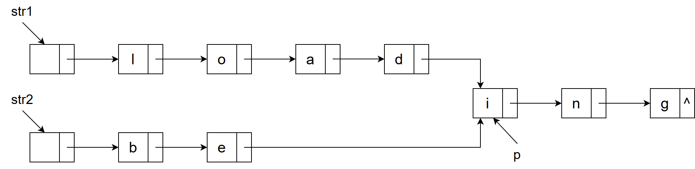
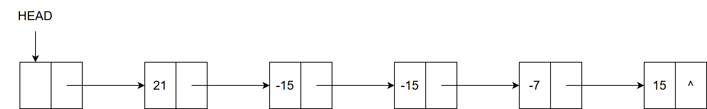
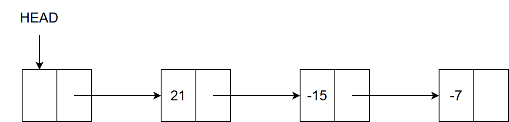
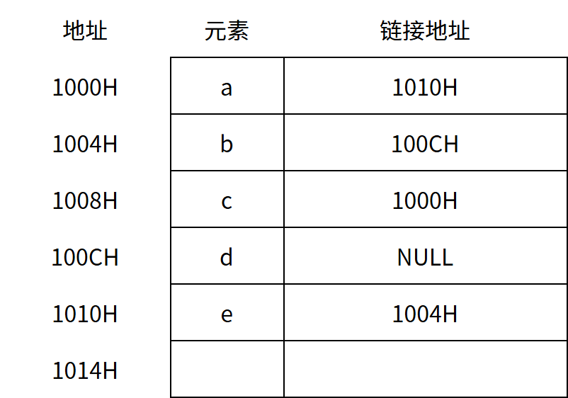

# 第2章 线性表

> 科目：一、数据结构
> 题目数量：16道
> 年份范围：2009-2024

---

## 2009年

### 第42题（综合题）

（15 分）己知一个带有表头结点的单链表，结点结构为 data link 假设该链表只给出了头指针list。在不改变链表的前提下，请设计一个尽可能高效的算法，查找 链表中倒数第k 个位置上的结点（k 为正整数）。若查找成功，算法输出该结点的data 域的值，并返 回1；否则，只返回0。要求：

（1）描述算法的基本设计思想。

（2）描述算法的详细实现步骤。

（3）根据设计思想和实现步骤，采用程序设计语言描述算法（使用C、C++或Java 语言实现）， 关键之处请给出简要注释。

---

## 2010年

### 第42题（综合题）

（13 分）设将n（n ＞ 1）个整数存放到一维数组R 中。试设计一个在时间和空间两方面都尽可 能高效的算法。将R 中保存的序列循环左移p（0 ＜ p ＜ n）个位置，即将R 中的数据由(X0, X1, …, Xn-1) 变换为(Xp, Xp+1, …, Xn-1, X0, X1, …, Xp-1)。要求：

（1）给出算法的基本设计思想。

（2）根据设计思想，采用C、C++或Java 语言描述算法，关键之处给出注释。

（3）说明你所设计算法的时间复杂度和空间复杂度。

---

## 2011年

### 第42题（综合题）

（15 分）一个长度为L（L≥1）的升序序列S, 处在第⌊L/2⌉个位置的数称为S 的中位数。例如， 若序列S1＝ (11, 13, 15, 17, 19)，则S1 的中位数是15, 两个序列的中位数是含它们所有元素的升 序序列的中位数。例如，若 S2＝ (2, 4, 6, 8, 20), 则 S1 和S2 的中位数是11。现在有两个等长升 序序列A 和B, 试设计一个在时间和空间两方面都尽可能高效的算法，找出两个序列A 和B 的 中位数。 要求：

（1）给出算法的基本设计思想。

（2）根据设计思想，采用C、C++或Java 语言描述算法，关键之处给出注释。

（3）说明你所设计算法的时间复杂度和空间复杂度。

---

## 2012年

### 第42题（综合题）

假定采用带头结点的单链表保存单词，当两个单词有相同的后缀时，则可共享相同的后缀存储空间，例如，“loading" 和 “being” 的存储映像如下图所示。



设 str1 和 str2 分别指向两个单词所在单链表的头结点，链表结点结构为 | data | next |，请设计一个时间上尽可能高效的算法，找出由 str1 和 str2 所指向两个链表共同后缀的起始位置（如图中字符 i 所在的结点位置 p）。要求：
1）给出算法的基本设计思想。
2）根据设计思想，采用 C 或 C++ 或 Java 语言描述算法，关键之处给出注释。
3）说明你所设计算法的时间复杂度。

---

## 2013年

### 第1题（选择题）

已知两个长度分别为m 和n 的升序链表，若将它们合并为一个长度为m + n 的降序链表，则最坏 情况下的时间复杂度是 。

A. `O(n)`
B. `O(mn)`
C. `O(min(m, n)`)
D. `O(max(m, n)`)

---

### 第41题（综合题）

（13 分）已知一个整数序列A ＝ (a0, a1, …, an－1)，其中0≤ai＜n（0≤i＜n）。若存在：ap1＝ap2＝… apm＝x 且m ＞ n / 2（0≤pk＜n，1≤k≤m），则称x 为A 的主元素。例如A＝(0, 5, 5, 3, 5, 7, 5, 5)， 则5 为主元素；又如A ＝(0, 5, 5, 3, 5, 1, 5, 7），则A 中没有主元素。假设A 中的n 个元素保存在一 个一维数组中，请设计一个尽可能高效的算法，找出A 的主元素。若存在主元素，则输出该元素； 否则输出－1。要求：

（1）给出算法的基本设计思想。

（2）根据设计思想，采用C、C++或Java 语言描述算法，关键之处给出注释。

（3）说明你所设计算法的时间复杂度和空间复杂度。

---

## 2015年

### 第41题（综合题）

用单链表保存 
m
 个整数，结点的结构为，且 
∣data∣≤n
 （ 
n
 为正整数）。现要求设计一个时间复杂度尽可能高效的算法，对于链表中 data 的绝对值相等的结点，仅保留第一次出现的结点而删除其余绝对值相等的结点。例如，若给定的单链表 head 如下：



则删除结点后的 head 为：



要求：

(1) 给出算法的基本设计思想。

(2) 使用 C 或 C++ 语言，给出单链表结点的数据类型定义。

(3) 根据设计思想，采用 C 或 C++ 语言描述算法，关键之处给出注释。

(4) 说明你所设计算法的时间复杂度和空间复杂度。

---

## 2016年

### 第1题（选择题）

已知表头元素为 c 的单链表在内存中的存储状态如下表所示。现将 f 存放于 1014H 处并插入单链表，若 f 在逻辑上位于 a 和 e 之间，则 a,e,f 的 “链接地址” 依次是（ ）。



A. 1010H，1014H，1004H
B. 1010H，1004H，1014H
C. 1014H，1010H，1004H
D. 1014H，1004H，1010H

---

### 第2题（选择题）

已知一个带有表头结点的双向循环链表L，结点结构为 prev data next ，其中，prev 和next 分别是指向其直接前驱和直接后继结点的指针。现要删除指针p 所指的结点，正确的语句序列 是 。

A. `p->next`-＞prev＝`p->prev`; `p->prev`-＞next＝`p->prev`; free(p);
B. `p->next`-＞prev＝`p->next`; `p->prev`-＞next＝`p->next`; free(p);
C. `p->next`-＞prev＝`p->next`; `p->prev`-＞next＝`p->prev`; free(p);
D. `p->next`-＞prev＝`p->prev`;`p->prev`-＞next＝`p->next`; free(p);

---

### 第43题（综合题）

（15 分）已知由n（n≥2）个正整数构成的集合A ＝ {ak | 0≤k＜n}，将其划分为两个不相交的子 集A1和A2，元素个数分别是n1和n2，A1和A2中元素之和分别为S1和S2。设计一个尽可能高效的 划分算法，满足|n1 – n2|最小且|S1 – S2|最大。要求：

（1）给出算法的基本设计思想。

（2）根据设计思想，采用C 或C++语言描述算法，关键之处给出注释。

（3）说明你所设计算法的平均时间复杂度和空间复杂度。

---

## 2018年

### 第41题（综合题）

（13 分）给定一个含n（n≥1）个整数的数组，请设计一个在时间上尽可能高效的算法，找出数 组中未出现的最小正整数。例如，数组{－5, 3, 2, 3}中未出现的最小正整数是1；数组{1, 2, 3}中 未出现的最小正整数是4。要求：

（1）给出算法的基本设计思想。

（2）根据设计思想，采用C 或C++语言描述算法，关键之处给出注释。

（3）说明你所设计算法的时间复杂度和空间复杂度。

---

## 2019年

### 第41题（综合题）

（13 分）设线性表L ＝ (a1, a2, a3, …, an – 2, an – 1, an)采用带头结点的单链表保存，链表中的结点定 义如下：

```c
typedef struct node {
    int data;
    Struct node* next;
} NODE
```

请设计一个空间复杂度为O

(1)且时间上尽可能高效的算法，重新排列L 中的各结点，得到线性 表L' ＝ (a1, an, a2, an – 1, a3, an – 2, …)

（1）给出算法的基本设计思想。

（2）根据设计思想，采用C 或C++语言描述算法，关键之处给出注释。

（3）说明你所设计算法的时间复杂度。

---

## 2020年

### 第41题（综合题）

（13 分）定义三元组(a, b, c)（其中a, b, c 均为正数）的距离。D ＝ |a – b| + |b – c|。给定3 个非空 整数集合S1、S2和S3，按升序分别存储在3 个数组中。设计一个尽可能高效的算法，计算并输出 所有可能的三元组(a, b, c)（a∈S1, b∈S2, c∈S3）中的最小距离。例如S1＝{－1, 0, 9}，S2＝{－25, －10, 10, 11}，S3 ＝{2, 9, 17, 30, 41}，则最小距离为2，相应的三元组为(9, 10, 9)。要求：

（1）给出算法的基本设计思想。

（2）根据设计思想，采用C 或C++语言描述算法，关键之处给出注释。

（3）说明你所设计算法的时间复杂度。

---

## 2021年

### 第1题（选择题）

已知头指针 h 指向一个带头结点的非空单循环链表，结点结构为


其中 next 是指向直接后继结点的指针，p 是尾指针，q 是临时指针。现要删除该链表的第一个元素，正确的语句序列是（ ）。

A. `h->next` ＝ `h->next`-＞next; q ＝ `h->next`; free(q);
B. q ＝ `h->next`; `h->next` ＝ `h->next`-＞next; free(q);
C. q ＝ `h->next`; `h->next` ＝ `q->next`; if (p !＝ q) p ＝ h; free(q);
D. q ＝ `h->next`; `h->next` ＝ `q->next`; if (p ＝＝ q) p ＝ h; free(q);

---

## 2023年

### 第2题（选择题）

现有非空双向链表 L，其结点结构为：


prev 是指向前直接前驱结点的指针，next 是指向直接后继结点的指针。若要在 L 中指针 p 所指向的结点（非尾结点）之后插入指针 s 指向的新结点，则在执行了语句序列： `s->next`＝`p->next`; `p->next`＝s，后，还要执行（ ）。

A. `s->next`-＞prev＝p; `s->prev`＝p;
B. `p->next`-＞prev＝s; `s->prev`＝p;
C. `s->prev`＝`s->next`-＞prev; `s->next`-＞prev＝s;
D. `p->next`-＞prev＝`s->prev`; `s->next`-＞prev＝p;

---

## 2024年

### 第1题（选择题）

已知带头结点的非空单链表L 的头指针为h，结点结构为 data next ，其中next 是指向直接后继 结点的指针。现有指针p 和q，若p 指向L 中非首且非尾的任意一个结点。则执行语句序列

```c
q=p->next;
p->next=q->next;
q->next=h->next;
h->next=q
```

的结果是 。

A. 在p 所指结点后插入q 所指结点
B. 在q 所指结点后插入p 所指结点
C. 将p 所指结点移动到L 的头结点之后
D. 将q 所指结点移动到L 的头结点之后

---
