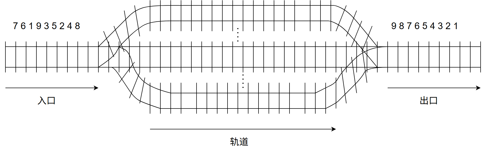

# 第3章 栈、队列和数组

> 科目：一、数据结构
> 题目数量：27道
> 年份范围：2009-2024

---

## 2009年

### 第1题（选择题）

为解决计算机主机与打印机之间速度不匹配问题，通常设置一个打印数据缓冲区，主机将要输出 的数据依次写入该缓冲区，而打印机则依次从该缓冲区中取出数据。该缓冲区的逻辑结构应该是 ＿＿＿＿＿＿。

A. 栈
B. 队列
C. 树
D. 图

---

### 第2题（选择题）

设栈S 和队列Q 的初始状态均为空，元素a, b, c, d, e, f, g 依次进入栈S。若每个元素出栈后立即 进入队列Q，且7 个元素出队的顺序是b, d, c, f, e, a, g，则栈S 的容量至少是＿＿＿＿＿＿。

A. 1
B. 2
C. 3
D. 4

---

## 2010年

### 第1题（选择题）

若元素a, b, c, d, e, f 依次进栈，允许进栈、退栈操作交替进行，但不允许连续三次进行退 栈操作，则不．可能得到的出栈序列是 。

A. d c e b f a
B. c b d a e f
C. b c a e f d
D. a f e d c b

---

### 第2题（选择题）

某队列允许在其两端进行入队操作，但仅允许在一端进行出队操作。若元素a, b, c, d, e 依次入此 队列后再进行出队操作，则不．可能得到的出队序列是 。

A. b a c d e
B. d b a c e
C. d b c a e
D. e c b a d

---

## 2011年

### 第2题（选择题）

元素a, b, c, d, e 依次进入初始为空的栈中，若元素进栈后可停留、可出栈，直到所有元素都出 栈，则在所有可能的出栈序列中，以元素d 开头的序列个数是 。

A. 3
B. 4
C. 5
D. 6

---

### 第3题（选择题）

已知循环队列存储在一维数组A[0..n-1]中，且队列非空时front和rear分别指向队头元素和队尾元素。若初始时队列空，且要求第一个进入队列的元素存储在A[0]处，则初始时front和rear的值分别是（）。

A. 0，0
B. 0，n-1
C. n-1，0
D. n-1，n-1

---

## 2012年

### 第2题（选择题）

已知操作符包括‘+’、‘-’、‘＊’、‘/’、‘(’和‘)’。将中缀表达式a+b-a＊((c+d)/e-f)+g 转换为等价 的后缀表达式ab+acd+e/f-＊-g+时，用栈来存放暂时还不能确定运算次序的操作符，若栈初始时为 空，则转换过程中同时保存在栈中的操作符的最大个数是 。

A. 5
B. 7
C. 8
D. 11

---

## 2013年

### 第2题（选择题）

一个栈的入栈序列为1, 2, 3, …, n，其出栈序列是p1, p2, p3, …, pn。若p2 ＝ 3，则p3可能取值的个 数是 。

A. n－3
B. n－2
C. n－1
D. 无法确定

---

## 2014年

### 第2题（选择题）

假设栈初始为空，将中缀表达式a/b＋(c＊d－e＊f)/g 转换为等价的后缀表达式的过程中，当扫描到 f 时，栈中的元素依次是 。

A. ＋ ( ＊ －
B. ＋ ( － ＊
C. / ＋ ( ＊ － ＊
D. / ＋ － ＊

---

### 第3题（选择题）

循环队列放在一维数组A[0…M－1]中，end1 指向队头元素，end2 指向队尾元素的后一个位置。 假设队列两端均可进行入队和出队操作，队列中最多能容纳M－1 个元素。初始时为空。下列判 断队空和队满的条件中，正确 ．．的是 。

A. 队空：end1 ＝＝ end2; 队满：end1 ＝＝ (end2 + 1) mod M
B. 队空：end1 ＝＝ end2; 队满：end2 ＝＝ (end1 + 1) mod (M－1)
C. 队空：end2 ＝＝ (end1 + 1) mod M; 队满：end1 ＝＝ (end2 + 1) mod M
D. 队空：end1 ＝＝ (end2 + 1) mod M; 队满：end2 ＝＝ (end1 + 1) mod (M－1)

---

## 2015年

### 第1题（选择题）

已知程序如下：

```c
int S(int n) {
    return(n<=0)?0:S(n-1)+n;
}
void main() {
    cout<<S(1);
}
```

程序运行时使用栈来保存调用过程的信息，自栈底到栈顶保存的信息依次对应的是 。

A. main()→S(1)→S(0)
B. S(0)→S(1)→main()
C. main()→S(0)→S(1)
D. S(1)→S(0)→main()

---

## 2016年

### 第3题（选择题）

设有下图所示的火车车轨，入口到出口之间有 n 条轨道，列车的行进方向均为从左至右，列车可驶入任意一条轨道。现有编号为 1-9 的 9 列列车，驶入的次序依次是 8, 4, 2, 5, 3, 9, 1, 6, 7。若期望驶出的次序依次为 1~9，则 n 至少是（ ）。



A. 2
B. 3
C. 4
D. 5

---

### 第4题（选择题）

有一个100 阶的三对角矩阵M，其元素mi,j （1≤i≤100，1≤j≤100）按行优先依次压缩存入下 标从0 开始的一维数组N 中。元素m30, 30在N 中的下标是 。

A. 86
B. 87
C. 88
D. 89

---

## 2017年

### 第2题（选择题）

下列关于栈的叙述中，错误的是 。 I. 采用非递归的方式重写递归程序时必须用栈 II. 函数调用时，系统要用栈保存必要的信息 III. 只要确定了入栈次序，就可确定出栈次序 IV. 栈是一种受限的线性表，允许在其两端进行操作

A. 仅I
B. 仅I、II、III
C. 仅I、III、IV
D. 仅II 、III 、IV

---

### 第3题（选择题）

适用于压缩存储稀疏矩阵的两种存储结构是 。

A. 三元组表和十字链表
B. 三元组表和邻接矩阵
C. 十字链表和二叉链表
D. 邻接矩阵和十字链表

---

## 2018年

### 第1题（选择题）

若栈S1中保存整数，栈S2中保存运算符，函数F()依次执行下述各步操作： （1）从S1中依次弹出两个操作数a 和b； （2）从S2中弹出一个运算符op： （3）执行相应的运算b op a; （4）将运算结果压入S1中。 假定S1中的操作数依次是5, 8, 3, 2（2 在栈顶），S2 中的运算符依次是＊, –, +（+在栈顶）。调用3 次F()后，S1栈顶保存的值是 。

A. －15
B. 15
C. －20
D. 20

---

### 第2题（选择题）

现有队列Q 与栈S，初始时Q 中的元素依次是1, 2, 3, 4, 5, 6（1 在队头），S 为空。若仅允许下列 3 种操作：①出队并输出出队元素：②出队并将出队元素入栈：③出栈并输出出栈元素，则不能得 到的输出序列是 。

A. 1, 2, 5, 6, 4, 3
B. 2, 3, 4, 5, 6, 1
C. 3, 4, 5, 6, 1, 2
D. 6, 5, 4, 3, 2, 1

---

### 第3题（选择题）

设有一个12×12 的对称矩阵M，将其上三角部分的元素mi, j （1≤i≤j≤12）按行优先存入C 语言 的一维数组N 中，元素m6, 6在N 中的下标是 。

A. 50
B. 51
C. 55
D. 66

---

## 2019年

### 第42题（综合题）

（10 分）请设计一个队列，要求满足：

①初始时队列为空；

②入队时，允许增加队列占用空 间；

③出队后，出队元素所占用的空间可重复使用，即整个队列所占用的空间只增不减；

④入队 操作和出队操作的时间复杂度始终保持为O

(1)。请回答下列问题：

（1）该队列是应选择链式存储结构，还是应选择顺序存储结构？

（2）画出队列的初始状态，并给出判断队空和队满的条件。

（3）画出第一个元素入队后的队列状态。

（4）给出入队操作和出队操作的基本过程。

---

## 2020年

### 第1题（选择题）

将一个10×10 对称矩阵M 的上三角部分的元素叫mi, j（1≤i≤j≤10）按列优先存入C 语言的一 维数组N 中，元素m7, 2在N 中的下标是 。

A. 15
B. 16
C. 22
D. 23

---

### 第2题（选择题）

对空栈S 进行Push 和Pop 操作，入栈序列为 a, b, c, d, e，经过Push, Push, Pop, Push, Pop, Push, Push, Pop 操作后得到的出栈序列是 。

A. b, a, c
B. b, a, e
C. b, c, a
D. b, c, e

---

## 2021年

### 第2题（选择题）

已知初始为空的队列Q 的一端仅能进行入队操作，另外一端既能进行入队操作又能进行出队操 作。若Q 的入队序列是1, 2, 3, 4, 5, 则不能得到的出队序列是 。

A. 5, 4, 3, 1, 2
B. 5, 3, 1, 2, 4
C. 4, 2, 1, 3, 5
D. 4, 1, 3, 2, 5

---

### 第3题（选择题）

已知二维数组A 按行优先方式存储，每个元素占用1 个存储单元。若元素A[0][0]的存储地址是 100，A[3][3]的存储地址是220，则元素A[5][5]的存储地址是 。

A. 295
B. 300
C. 301
D. 306

---

## 2022年

### 第2题（选择题）

给定有限符号集S，in 和out 均为S 中所有元素的任意排列。对于初始为空的栈ST，下列叙述 中，正确的是 。

A. 若in 是ST 的入栈序列，则不能判断out 是否为其可能的出栈序列
B. 若out 是ST 的出栈序列，则不能判断in 是否为其可能的入栈序列
C. 若in 是ST 的入栈序列，out 是对应in 的出栈序列，则in 与out 一定不同
D. 若in 是ST 的入栈序列，out 是对应的出栈序列，则in 与out 可能互为倒序

---

## 2023年

### 第1题（选择题）

下列对顺序存储的有序表（长度为n）实现给定操作的算法中，平均时间复杂度为O(1)的 是 。

A. 查找包含指定值元素的算法
B. 插入包含指定值元素的算法
C. 删除第i（1≤i≤n）个元素的算法
D. 获取第i（1≤i≤n）个元素的算法

---

### 第3题（选择题）

若采用三元组表存储结构存储稀疏矩阵 M。则除三元组表外，下列数据中还需要保存的 是 。 I. M 的行数 II. M 中包含非零元素的行数 III. M 的列数 IV. M 中包含非零元素的列数

A. 仅I、III
B. 仅I、IV
C. 仅II、IV
D. I、II、III、IV

---

## 2024年

### 第2题（选择题）

表达式 x + y ＊ (z – u)/v 的等价后缀表达式是 。

A. xyzu-＊v/+
B. xyzu-v/＊+
C. +x/＊y-zuv
D. +x＊y/-zuv

---
