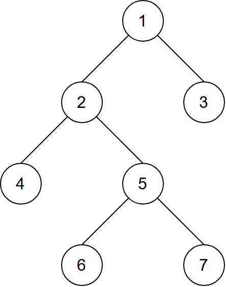
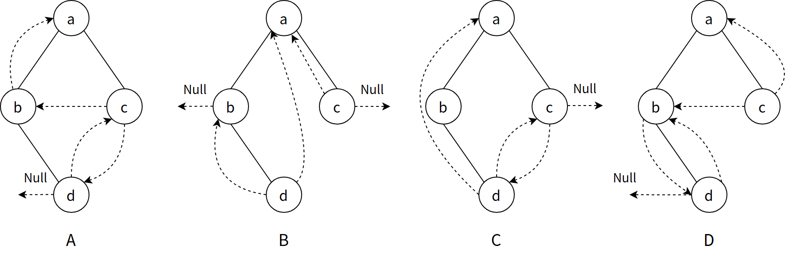
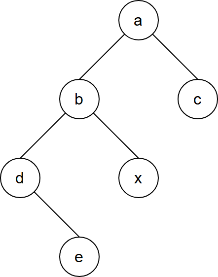
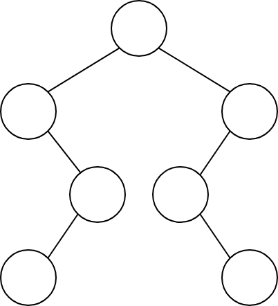
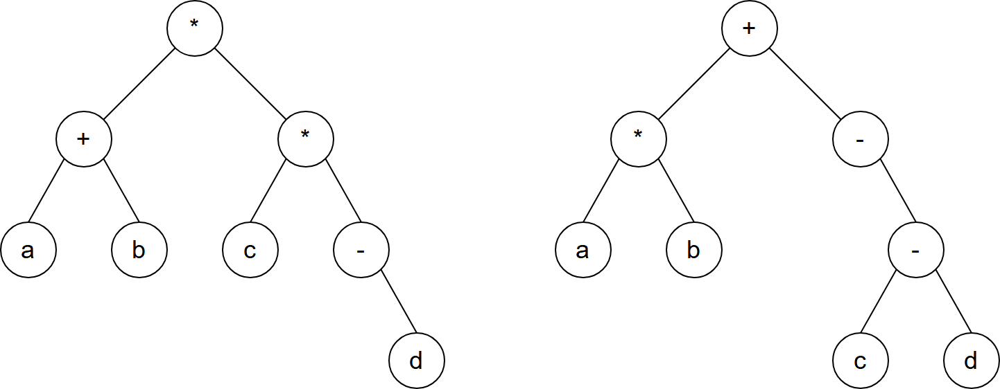
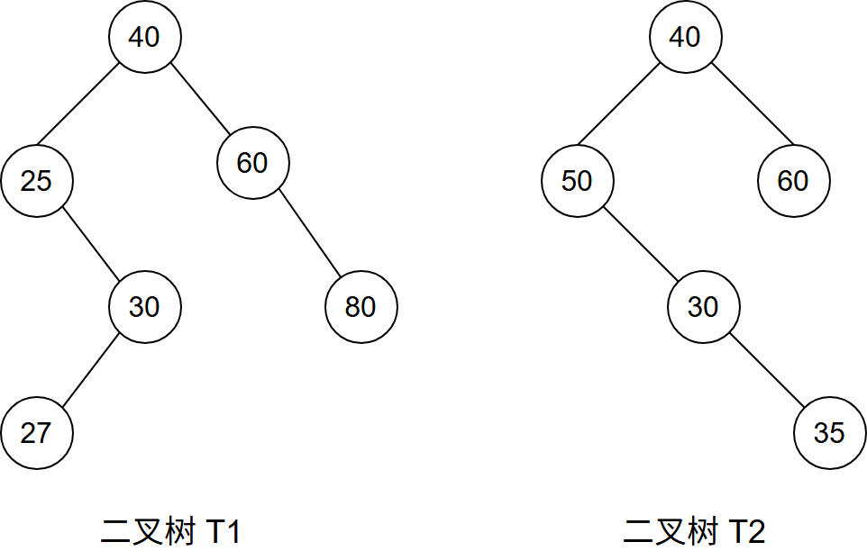
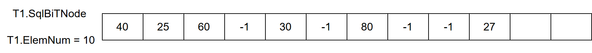
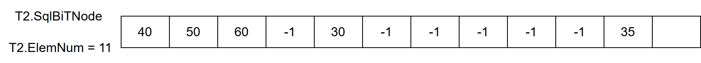
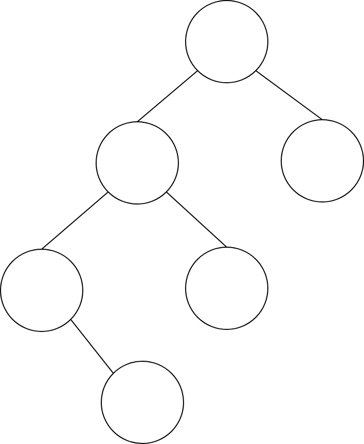

# 第5章 树与二叉树

> 科目：一、数据结构
> 题目数量：41道
> 年份范围：2009-2024

---

## 2009年

### 第3题（选择题）

给定二叉树如右图所示。设 N 代表二叉树的根，L 代表根结点的左子树，R 代表根结点的右子树。若遍历后的结点序列是 3，1，7，5，6，2，4，则其遍历方式是（）。



A. LRN
B. NRL
C. RLN
D. RNL

---

### 第5题（选择题）

己知一棵完全二叉树的第6 层（设根为第1 层）有8 个叶结点，则该完全二又树的结点个数最多 是 。

A. 39
B. 52
C. 111
D. 119

---

### 第6题（选择题）

将森林转换为对应的二叉树，若在二叉树中，结点u 是结点v 的父结点的父结点，则在原来的森 林中，u 和v 可能具有的关系是 。 I. 父子关系 II. 兄弟关系 III. u 的父结点与v 的父结点是兄弟关系

A. 只有II
B. I 和II
C. I 和III
D. I、II 和III

---

## 2010年

### 第3题（选择题）

下列线索二叉树中（用虚线表示线索），符合后序线索树定义的是（ ）。




---

### 第5题（选择题）

在一棵度为4 的树T 中，若有20 个度为4 的结点，10 个度为3 的 结点，1 个度为2 的结点，10 个度为1 的结点，则树T 的叶结点 个数是 。

A. 41
B. 82
C. 113
D. 122

---

### 第6题（选择题）

对n（n≥2）个权值均不相同的字符构造成哈夫曼树。下列关于该哈夫曼树的叙述中，错误的 是 。

A. 该树一定是一棵完全二叉树
B. 树中一定没有度为1 的结点
C. 树中两个权值最小的结点一定是兄弟结点
D. 树中任一非叶结点的权值一定不小于下一层任一结点的权值

---

## 2011年

### 第4题（选择题）

若一棵完全二叉树有768 个结点，则该二叉树中叶结点的个数是

A. 257
B. 258
C. 384
D. 385

---

### 第5题（选择题）

若一棵二叉树的前序遍历序列和后序遍历序列分别为1, 2, 3, 4 和4, 3, 2, 1, 则该二叉树的中序遍 历序列不会是 。

A. 1, 2, 3, 4
B. 2, 3, 4, 1
C. 3, 2, 4, 1
D. 4, 3, 2, 1

---

### 第6题（选择题）

已知一棵有2011 个结点的树，其叶结点个数为116, 该树对应的二叉树中无右孩子的结点个数 是 。

A. 115
B. 116
C. 1895
D. 1896

---

## 2012年

### 第3题（选择题）

若一棵二叉树的前序遍历序列为a, e, b, d, c，后序遍历序列为b, c, d, e, a，则根结点的孩子结 点 。

A. 只有e
B. 有e、b
C. 有e、c
D. 无法确定

---

### 第4题（选择题）

若平衡二叉树的高度为6，且所有非叶结点的平衡因子均为1，则该平衡二叉树的结点总数 为 。

A. 10
B. 20
C. 32
D. 33

---

## 2013年

### 第4题（选择题）

己知三又树T 中6 个叶结点的权分别是2, 3, 4, 5, 6, 7，T 的带权（外部）路径长度最小是 。

A. 27
B. 46
C. 54
D. 56

---

### 第5题（选择题）

若X 是后序线索二叉树中的叶结点，且X 存在左兄弟结点Y，则X 的右线索指向的是 。

A. X 的父结点
B. 以Y 为根的子树的最左下结点
C. X 的左兄弟结点Y
D. 以Y 为根的子树的最右下结点

---

## 2014年

### 第4题（选择题）

若对如下的二叉树进行中序线索化，则结点 x 的左、右线索指向的结点分别是（ ）。



A. e、c
B. e、a
C. d、c
D. b、a

---

### 第5题（选择题）

将森林F 转换为对应的二叉树T，F 中叶结点的个数等于 。

A. T 中叶结点的个数
B. T 中度为1 的结点个数
C. T 中左孩子指针为空的结点个数
D. T 中右孩子指针为空的结点个数

---

### 第6题（选择题）

5 个字符有如下4 种编码方案，不是 ．．前缀编码的是 。

A. 01, 0000, 0001, 001, 1
B. 011, 000, 001, 010, 1
C. 000, 001, 010, 011, 100
D. 0, 100, 110, 1110, 1100

---

### 第41题（综合题）

（13 分）二叉树的带权路径长度 （WPL）是二叉树中所有叶结点的带权路径长度之和。给定一棵 二叉树T ,采用二叉链表存储， 结点结构如下： left weight right 其中叶结点的weight 域保存该结点的非负权值。设root 为指向T 的根结点的指针，请设计求T 的WPL 的算法，要求：

（1）给出算法的基本设计思想。

（2）使用C 或C++语言，给出二叉树结点的数据类型定义。

（3）根据设计思想，采用C 或C++语言描述算法，关键之处给出注释。

---

## 2015年

### 第2题（选择题）

先序序列为a, b, c, d 的不同二叉树的个数是 。

A. 13
B. 14
C. 15
D. 16

---

### 第3题（选择题）

下列选项给出的是从根分别到达两个叶结点路径上的权值序列，能属于同一棵哈夫曼树的 是 。

A. 24, 10, 5 和24, 10, 7
B. 24, 10, 5 和24, 12, 7
C. 24, 10, 10 和24, 14, 11
D. 24, 10, 5 和24, 14, 6

---

## 2016年

### 第5题（选择题）

若森林F 有15 条边、25 个结点，则F 包含树的个数是 。

A. 8
B. 9
C. 10
D. 11

---

### 第42题（综合题）

（8 分）如果一棵非空k（k≥2）叉树T 中每个非叶结点都有k 个孩子，则称T 为正则k 叉树。 请回答下列问题并给出推导过程。

（1）若T 有m 个非叶结点，则T 中的叶结点有多少个？

（2）若T 的高度为h（单结点的树h ＝ 1），则T 的结点数最多为多少个？最少为多少个？

---

## 2017年

### 第4题（选择题）

要使一棵非空二叉树的先序序列与中序序列相同，其所有非叶结点须满足的条件 。

A. 只有左子树
B. 只有右子树
C. 结点的度均为1
D. 结点的度均为2

---

### 第5题（选择题）

已知一颗二叉树的树形如下图所示，其后序序列为 e，a，c，b，d，g，f，树中与结点 a 同层的结点是（）



A. c
B. d
C. f
D. g

---

### 第6题（选择题）

已知字符集{a, b, c, d, e, g, h}，若各字符的哈夫曼编码依次是0100, 10, 0000, 0101, 001, 011, 11, 0001，则编码序列0100011001001011110101 的译码结果是 。

A. a c g a b f h
B. a d b a g b b
C. a f b e a g d
D. a f e e f g d

---

### 第41题（综合题）

请设计一个算法，将给定的表达式树（二叉树）转换为等价的中缀表达式（通过括号反映操作符的计算次序）并输出。例如，当下列两棵表达式树作为算法输入时：



输出的中缀表达式分别为 (a+b)＊(c＊(−d)) 和 (a＊b)+(−(c−d)) 。
二叉树结点的定义如下：

```c
typedef struct node {
    char data[10]; // 存储操作数或操作符
    struct node *left, *right;
} BTree
```

要求：

(1) 给出算法的基本设计思想。

(2) 根据设计思想，采用 C 或 C++ 语言描述算法，关键之处给出注释。

---

## 2018年

### 第4题（选择题）

设一棵非空完全二叉树T 的所有叶结点均位于同一层，且每个非叶结点都有2 个子结点。若T 有 k 个叶结点，则T 的结点总数是 。

A. 2k – 1
B. 2k
C. k 2
D. 2k – 1

---

### 第5题（选择题）

已知字符集{a, b, c, d, e, f}，若各字符出现的次数分别为6, 3, 8, 2, 10, 4，则对应字符集中各字符的 哈夫曼编码可能是 。

A. 00, 1011, 01, 1010, 11, 100
B. 00, 100, 110, 000, 0010, 01
C. 10, 1011, 11, 0011, 00, 010
D. 0011, 10, 11, 0010, 01, 000

---

## 2019年

### 第2题（选择题）

若将一棵树T 转化为对应的二叉树BT，则下列对BT 的遍历中，其遍历序列与T 的后根遍历序 列相同的是 。

A. 先序遍历
B. 中序遍历
C. 后序遍历
D. 按层遍历

---

### 第3题（选择题）

对n 个互不相同的符号进行哈夫曼编码。若生成的哈夫曼树共有115 个结点，则n 的值 是 。

A. 56
B. 57
C. 58
D. 60

---

## 2020年

### 第3题（选择题）

对于任意一棵高度为5 且有10 个结点的二叉树，若采用顺序存储结构保存，每个结点占1 个存 储单元（仅存放结点的数据信息），则存放该二叉树需要的存储单元数量至少是 。

A. 31
B. 16
C. 15
D. 10

---

### 第4题（选择题）

已知森林F 及与之对应的二叉树T，若F 的先根遍历序列是a, b, c, d, e, f，中根遍历序列是b, a, d, f, e, c,则T 的后根遍历序列是 。

A. b, a, d, f, e, c
B. b, d, f, e, c, a
C. b, f, e, d, c, a
D. f, e, d, c, b, a

---

### 第42题（综合题）

（10 分）若任一个字符的编码都不是其他字符编码的前缀，则称这种编码具有前缀特性。现有 某字符集（字符个数≥2）的不等长编码，每个字符的编码均为二进制的0、1 序列，最长为L 位，且具有前缀特性。请回答下列问题：

（1）哪种数据结构适宜保存上述具有前缀特性的不等长编码？

（2）基于你所设计的数据结构，简述从0/1 串到字符串的译码过程。

（3）简述判定某字符集的不等长编码是否具有前缀特性的过程。

---

## 2021年

### 第4题（选择题）

某森林F 对应的二叉树为T，若T 的先序遍历序列是a, b, d, c, e, g, f，中序遍历序列是b, d, a, e, g, c, f，则F 中树的棵树是 。

A. 1
B. 2
C. 3
D. 4

---

### 第5题（选择题）

若某二叉树有5 个叶结点，其权值分别为10, 12, 16, 21, 30，则其最小的带权路径长度（WPL） 是 。

A. 89
B. 200
C. 208
D. 289

---

## 2022年

### 第3题（选择题）

若结点p 与q 在二叉树T 的中序遍历序列中相邻，且p 在q 之前，则下列p 与q 的关系中，不． 可能的是 。 I. q 是p 的双亲 II. q 是p 的右孩子 III. q 是p 的右兄弟 IV. q 是p 的双亲的双亲

A. 仅I
B. 仅III
C. 仅II、III
D. 仅II、IV

---

### 第4题（选择题）

若三叉树T 中有244 个结点（叶结点的高度为1），则T 的高度至少是 。

A. 8
B. 7
C. 6
D. 5

---

### 第5题（选择题）

对任意给定的含n（n ＞ 2）个字符的有限集S，用二叉树表示S 的哈夫曼编码集和定长编码集， 分别得到二叉树T1 和T2。下列叙述中，正确的是 。

A. T1 与T2 的结点数相同
B. T1 的高度大于T2 的高度
C. 出现频次不同的字符在T1 中处于不同的层
D. 出现频次不同的字符在T2 中处于相同的层

---

### 第41题（综合题）

已知非空二叉树 T 的结点值均为正整数，采用顺序存储方式保存，数据结构定义如下：

```c
typedef struct {
    // MAX_SIZE 为已定义常量
    Elemtype SqBiTNode[MAX_SIZE]; // 保存二叉树结点值的数组
    int ElemNum; // 实际占用的数组元素个数
}SqBiTree
```

T 中不存在的结点在数组 SqBiTNode 中用 -1 表示。例如，对于下图所示的两棵非空二叉树 T1 和 T2：



T1 的存储结果如下：



T2 的存储结果如下：



请设计一个尽可能高效的算法，判定一棵采用这种方式存储的二叉树是否为二叉搜索树，若是，则返回 true，否则，返回 false，要求：

(1) 给出算法的基本设计思想。

(2) 根据设计思想，采用 C 或 C++ 语言描述算法，关键之处给出注释。

---

## 2023年

### 第4题（选择题）

在有 6 个字符组成的字符集 S 中，各个字符出现的频次分别为 3, 4, 5, 6, 8, 10，为 S 构造的哈夫曼树的加权平均长度为（ ）

A. 2.4
B. 2.5
C. 2.67
D. 2.75

---

### 第5题（选择题）

已知一棵二叉树的树形如图，若其后序遍历为 f,d,b,e,c,a，则其先序序列为（ ）。



A. aedfbc
B. acebdf
C. cabefd
D. dfebac

---

## 2024年

### 第3题（选择题）

p、q 和v 都是二叉树T 中的结点，v 有两个孩子结点，T 的中序遍历序列形如：“…, p, v, q, …”， 则下列叙述中，正确的是 。

A. p 没有右孩子，q 没有左孩子
B. p 没有右孩子，q 有左孩子
C. p 有右孩子，q 没有左孩子
D. p 有右孩子，q 有左孩子

---
