# 第6章 图

> 科目：一、数据结构
> 题目数量：39道
> 年份范围：2009-2024

---

## 2009年

### 第7题（选择题）

下列关于无向连通图特性的叙述中，正确的是 。 I. 所有顶点的度之和为偶数 II. 边数大于顶点个数减1 III. 至少有一个顶点的度为1

A. 只有I
B. 只有II
C. I 和II
D. I 和III

---

### 第41题（综合题）

（10 分）带权图 （权值非负，表示边连接的两顶点间的距离）的最短路径问题是找出从初始顶点 到目标顶点之间的一条最短路径。假设从初始顶点到目标顶点之间存在路径，现有一种解决该问 题的方法：

①设最短路径初始时仅包含初始顶点，令当前顶点u 为初始顶点；

②选择离u 最近且尚未在最短路径中的一个顶点v，加入最短路径中，修改当前顶点u＝v

③重复步骤

②，直到u 是目标顶点时为止。 请问上述方法能否求得最短路径？若该方法可行，请证明之；否则，请举例说明。

---

## 2010年

### 第7题（选择题）

若无向图G＝(V, E)中含有7 个顶点，要保证图G 在任何情况下都是连通的，则需要的边数最少 是 。

A. 6
B. 15
C. 16
D. 21

---

### 第8题（选择题）

对下图进行拓扑排序，可以得到不同拓扑序列的个数是（）。

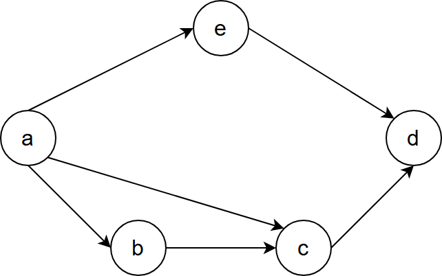

A. 4
B. 3
C. 2
D. 1

---

## 2011年

### 第7题（选择题）

对于下列关键字序列，不可能构成某二叉排序树中一条查找路径的序列是 。

A. 95, 22, 91, 24, 94, 71
B. 92, 20, 91, 34, 88, 35
C. 21, 89, 77, 29, 36, 38
D. 12, 25, 71, 68, 33, 34

---

### 第8题（选择题）

下列关于图的叙述中，正确的是 。 I. 回路是简单路径 II. 存储稀疏图，用邻接矩阵比邻接表更省空间 III. 若有向图中存在拓扑序列，则该图不存在回路

A. 仅II
B. 仅I 、II
C. 仅III
D. 仅1 、III

---

### 第41题（综合题）

已知有 6 个顶点（顶点编号为 0～5）的有向带权图 G ，其邻接矩阵 A 为上三角矩阵，按行为主序（行优先）保存在如下的一维数组中。

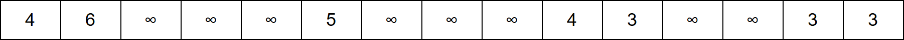

要求：

(1) 写出图 G 的邻接矩阵 A 。

(2) 画出有向带权图 G 。

(3) 求图 G 的关键路径，并计算该关键路径的长度。

---

## 2012年

### 第5题（选择题）

对有n 个结点、e 条边且使用邻接表存储的有向图进行广度优先遍历，其算法时间复杂度是 。

A. `O(n)`
B. `O(e)`
C. `O(n + e)`
D. `O(ne)`

---

### 第6题（选择题）

若用邻接矩阵存储有向图，矩阵中主对角线以下的元素均为零，则关于该图拓扑序列的结论 是 。

A. 存在，且唯一
B. 存在，且不唯一
C. 存在，可能不唯一
D. 无法确定是否存在

---

### 第7题（选择题）

对如下有向图带权图，若采用迪杰斯特拉（Dijkstra）算法求从源点 a 到其他各顶点的最短路径，则得到的第一条最短路径的目标顶点是 b，第二条最短路径的目标顶点是 c，后续得到的其余最短路径的目标顶点依次是（ ）。

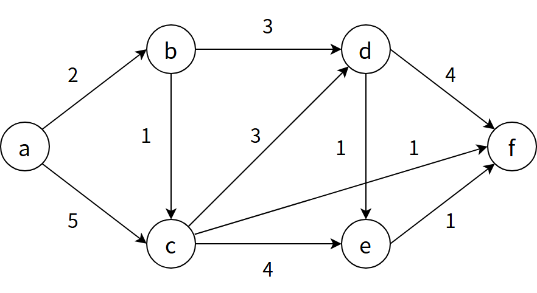

A. d, e, f
B. e, d, f
C. f, d, e
D. f, e, d

---

### 第8题（选择题）

下列关于最小生成树的叙述中，正确的是 I. 最小生成树的代价唯一 II. 所有权值最小的边一定会出现在所有的最小生成树中 III. 使用普里姆(Prim)算法从不同顶点开始得到的最小生成树一定相同 IV. 使用普里姆算法和克鲁斯卡尔(Kruskal)算法得到的最小生成树总不相同

A. 仅I
B. 仅II
C. 仅I、III
D. 仅II、IV

---

## 2013年

### 第7题（选择题）

设图的邻接矩阵 A 如下所示。各顶点的度依次是（）
A ＝
```text
⎡0 1 0 1⎤
⎢0 0 1 1⎥
⎢0 1 0 0⎥
⎣1 0 0 0⎦
```
​

A. 1，2，1，2
B. 2，2，1，1
C. 3，4，2，3
D. 4，4，2，2

---

### 第8题（选择题）

若对如下无向图进行遍历，则下列选项中，不是广度优先遍历序列的是（）

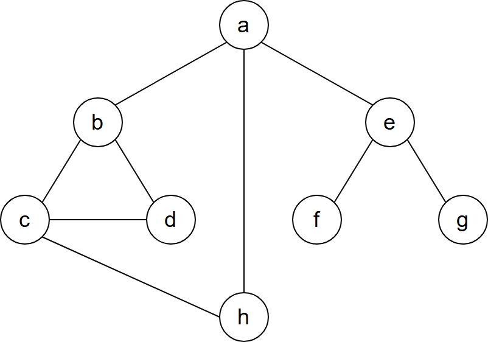

A. h，c，a，b，d，e，g，f
B. e，a，f，g，b，h，c，d
C. d，b，c，a，h，e，f，g
D. a，b，c，d，h，e，f，g

---

### 第9题（选择题）

下列 AOE 网表示一项包含 8 个活动的工程。通过同时加快若干活动的进度可以缩短整个工程的工期。下列选项中，加快其进度就可以缩短工程工期的是（）

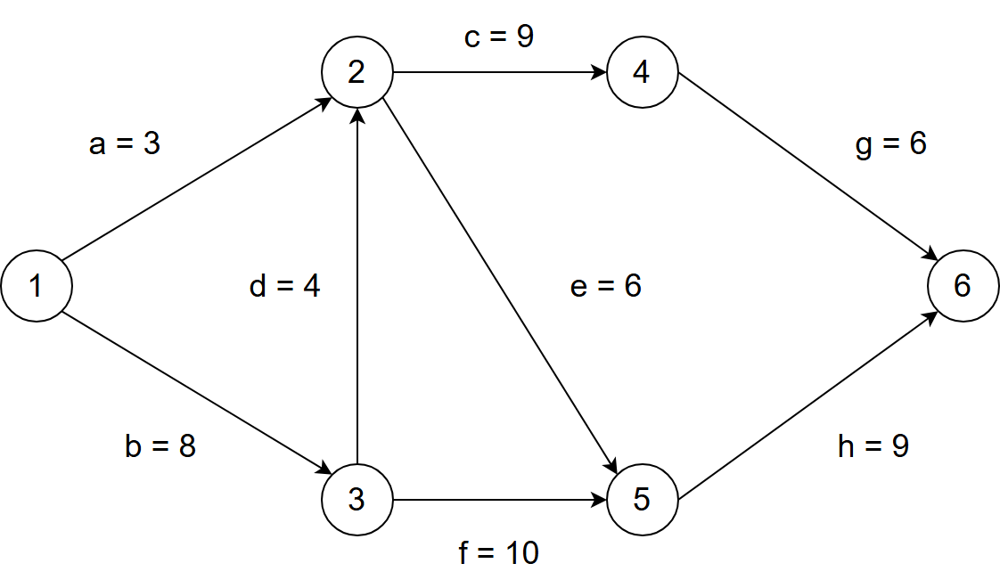

A. c 和 e
B. d 和 e
C. f 和 d
D. f 和 h

---

## 2014年

### 第7题（选择题）

对如下所示的有向图进行拓扑排序，得到的拓扑序列可能是（）

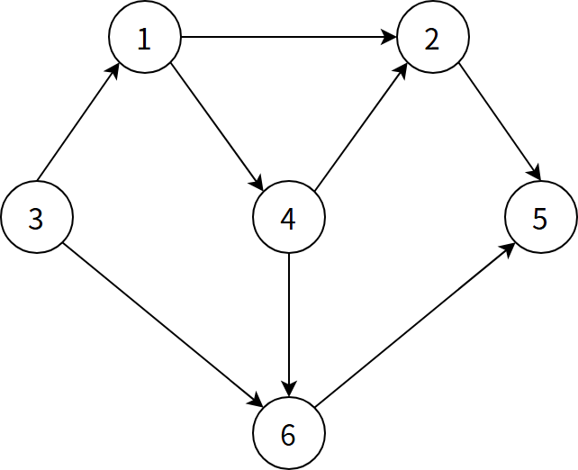

A. 3,1,2,4,5,6
B. 3,1,2,4,6,5
C. 3,1,4,2,5,6
D. 3,1,4,2,6,5

---

## 2015年

### 第5题（选择题）

设有向图G＝(V，E)，顶点集V＝{v0, v1, v2, v3}，边集E＝{＜v0, v1＞，＜v0, v2＞，＜v0, v3＞, ＜v1,v3＞}。若 从顶点v0开始对图进行深度优先遍历，则可能得到的不同遍历序列个数是 。

A. 2
B. 3
C. 4
D. 5

---

### 第6题（选择题）

求下面带权图的最小（代价）生成树时，可能是克鲁斯卡（Kruskal）算法第 2 次选中但不是普里姆（Prim）算法（从 V4 开始）第 2 次选中的边是（）。

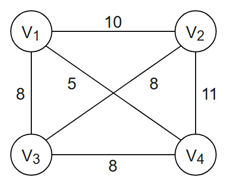

A. (
V1​
,
V3​
)
B. (
V1​
,
V4​
)
C. (
V2​
,
V3​
)
D. (
V3​
,
V4​
)

---

### 第42题（综合题）

已知含有
5
个顶点的图
G
如下图所示。

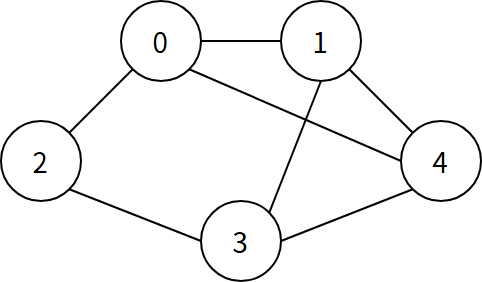

请回答下列问题：

(1) 写出图
G
的邻接矩阵 
A
 （行、列下标均从
0
开始）。

(2) 求 
A2
 ，矩阵 
A2
 中位于 0 行 3 列元素值的含义是什么？

(3) 若已知具有 
n
(n≥2)
 个顶点的图的邻接矩阵为 
B
，则 
Bm
(2≤m≤n)
 中非零元素的含义是什么？

---

## 2016年

### 第6题（选择题）

下列选项中，不是下图深度优先搜索序列的是（）

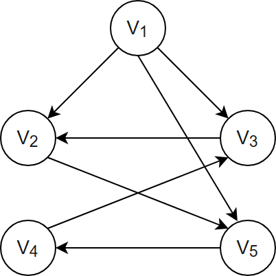

A. V1​,V5​,V4​,V3​,V2​
B. V1​,V3​,V2​,V5​,V4​
C. V1​,V2​,V5​,V4​,V3​
D. V1​,V2​,V3​,V4​,V5​

---

### 第7题（选择题）

若将n 个顶点e 条弧的有向图采用邻接表存储，则拓扑排序算法的时间复杂度是 。

A. `O(n)`
B. `O(n + e)`
C. `O(n 2)`
D. `O(ne)`

---

### 第8题（选择题）

使用迪杰斯特拉（Djkstra）算法求下图中从顶点 1 到其他各顶点的最短路径，依次得到的各最短路径的目标顶点是（ ）。

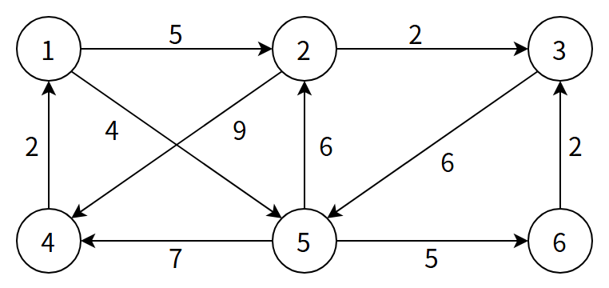

A. 5,2,3,4,6
B. 5,2,3,6,4
C. 5,2,4,3,6
D. 5,2,6,3,4

---

## 2017年

### 第7题（选择题）

已知无向图G 含有16 条边，其中度为4 的顶点个数为3，度为3 的顶点个数为4，其他顶点的度 均小于3。图G 所含的顶点个数至少是 。

A. 10
B. 11
C. 13
D. 15

---

### 第42题（综合题）

使用 Prim（普里姆）算法求带权连通图的最小（代价）生成树（MST）。请回答下列问题。

(1) 对下列图 G，从顶点 A 开始求 G 的 MST，依次给出按算法选出的边。

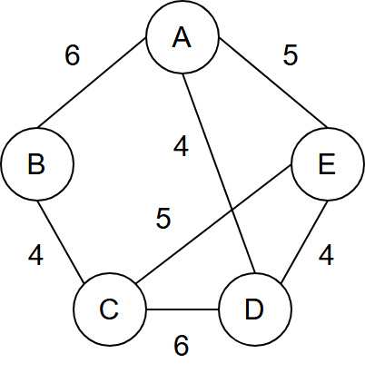

(2) 图 G 的 MST 是唯一的吗？

(3) 对任意的带权连通图，满足什么条件时，其 MST 是唯一的？

---

## 2018年

### 第7题（选择题）

下列选项中，不是如下有向图的拓扑序列的是（ ）

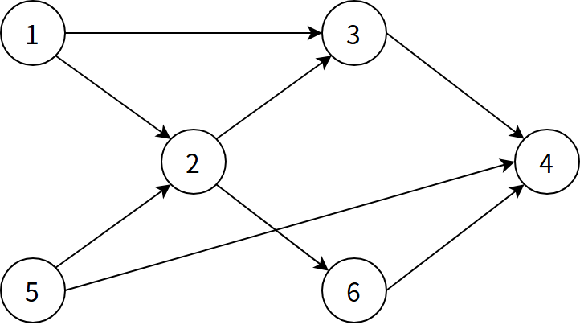

A. 1, 5, 2, 3, 6, 4
B. 5, 1, 2, 6, 3, 4
C. 5, 1, 2, 3, 6, 4
D. 5, 2, 1, 6, 3, 4

---

### 第42题（综合题）

拟建设一个光通信骨干网络连通 BJ、CS、XA、QD、JN、NJ、TL 和 WH 等 8 个城市，题 42 图中无向边上的权值表示两个城市间备选光缆的铺设费用。

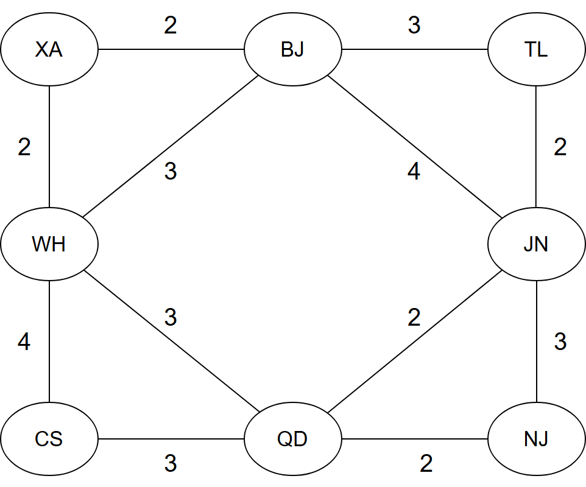

请回答下列问题。

(1) 仅从铺设费用角度出发，给出所有可能的最经济的光缆铺设方案（用带权图表示），并计算相应方案的总费用。

(2) 题 42 图可采用图的哪一种存储结构？给出求解问题

(1) 所使用的算法名称。

(3) 假设每个城市采用一个路由器按

(1) 中得到的最经济方案组网，主机 H1 直接连接在 TL 的路由器上，主机 H2 直接连接在 BJ 的路由器上。若 H1 向 H2 发送一个 TTL＝5 的 IP 分组，则 H2 是否可以收到该 IP 分组？

---

## 2019年

### 第5题（选择题）

下图所示的 AOE 网表示一项包含 8 个活动的工程。活动 d 的最早开始时间和最迟开始时间分别是（ ）。

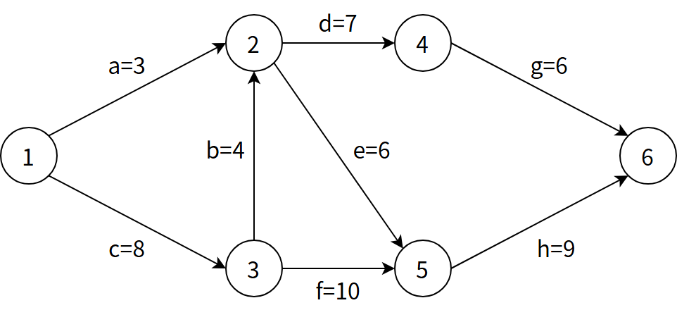

A. 3 和 7
B. 12 和 12
C. 12 和 14
D. 15 和 15

---

### 第6题（选择题）

用有向无环图描述表达式(x + y)((x + y) / x)，需要的顶点个数至少是 。

A. 5
B. 6
C. 8
D. 9

---

## 2020年

### 第6题（选择题）

修改递归方式实现的图的深度优先搜索（DFS）算法，将输出（访问）顶 点信息的语句移到退出递归前（即执行输出语句后立刻退出递归）。采用 修改后的算法遍历有向无环图G，若输出结果中包含G 中的全部顶点，则输出的顶点序列是G 的 。

A. 拓扑有序序列
B. 逆拓扑有序序列
C. 广度优先搜索序列
D. 深度优先搜索序列

---

### 第7题（选择题）

已知无向图 G 如下所示，使用克鲁斯卡尔（Kruskal）算法求图 G 的最小生成树，加入到最小生成树中的边依次是（ ）。

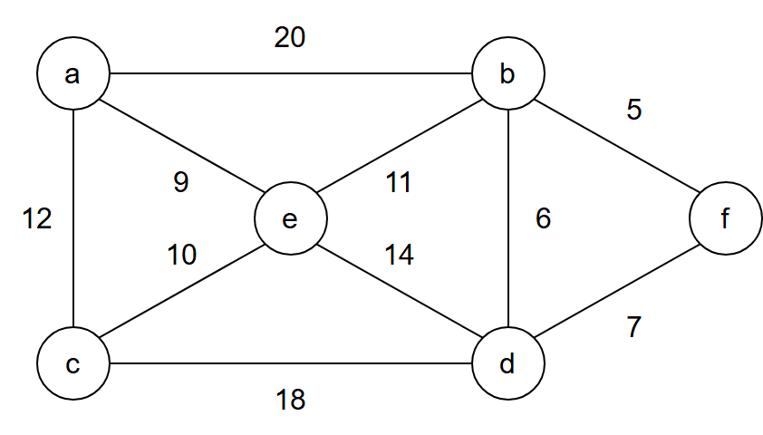

A. (b,f)(b,d)(a,e)(c,e)(b,e)
B. (b,f)(b,d)(b,e)(a,e)(e,c)
C. (a,e)(b,e)(c,e)(b,d)(b,f)
D. (a,e)(c,e)(b,e)(b,f)(b,d)

---

### 第8题（选择题）

若使用AOE 网估算工程进度，则下列叙述中正确的是 。

A. 关键路径是从原点到汇点边数最多的一条路径
B. 关键路径是从原点到汇点路径长度最长的路径
C. 增加任一关键活动的时间不会延长工程的工期
D. 缩短任一关键活动的时间将会缩短工程的工期

---

## 2021年

### 第7题（选择题）

给定如下有向图，该图的拓扑有序序列的个数是（ ）。

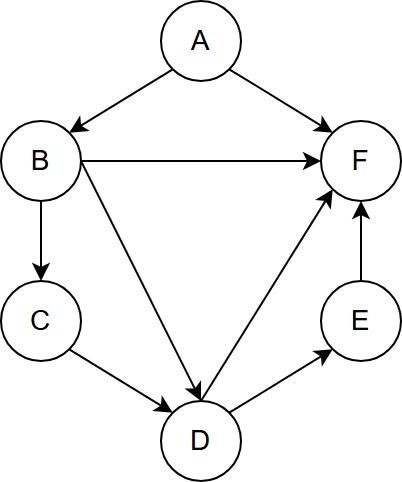

A. 1
B. 2
C. 3
D. 4

---

### 第8题（选择题）

使用 Dijkstra 算法求下图中从顶点 1 到其余各顶点的最短路径，将当前找到的从顶点 1 到顶点 2, 3, 4, 5 的最短路径长保存在数组 dist 中，求出第二条最短路径后，dist 中的内容更新为（ ）

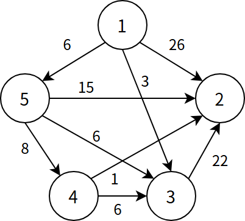

A. 26, 3, 14, 6
B. 25, 3, 14, 6
C. 21, 3, 14, 6
D. 15, 3, 14, 6

---

### 第41题（综合题）

（15 分）已知无向连通图G 由顶点集V 和边集E 组成，|E| ＞ 0 ,当G 中度为奇数的顶点个数为不 大于2 的偶数时，G 存在包含所有边且长度为|E|的路径（称为EL 路径）。设图G 采用邻接矩阵 存储，类型定义如下：

```c
typedef struct {
    //图的定义
    int numVertices, numEdges; //图中实际顶点数和边数
    char VerticesList[MAXV]; //顶点表。MAXV 为已定义常量
    int Edge[MAXV][MAXV]; //邻接矩阵
}MGraph
```

请设计算法int IsExistEL(MGraph G)，判断G 是否存在EL 路径，若存在，则返回1，否 则返回0。要求：

（1）给出算法的基本设计思想。

（2）根据设计思想，采用C 或C++语言描述算法，关键之处给出注释。

（3）说明你所设计算法的时间复杂度和空间复杂度。

---

## 2022年

### 第6题（选择题）

对于无向图G ＝ (V, E)，下列选项中，正确的 是 。

A. 当| V | ＞ | E |时，G 一定是连通的
B. 当| V | ＜ | E |时，G 一定是连通的
C. 当| V | ＝ | E | – 1 时，G 一定是不连通的
D. 当| V | ＞ | E | + 1 时，G 一定是不连通的

---

### 第7题（选择题）

下图是一个有 10 个活动的 AOE 网，时间余量最大的活动是 ( )。

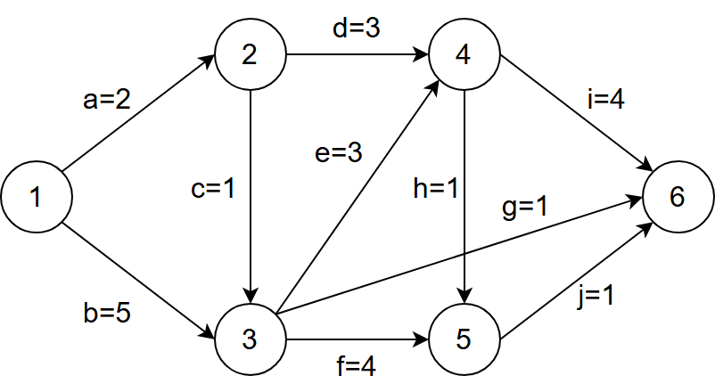

A. c
B. g
C. h
D. j

---

## 2023年

### 第6题（选择题）

已知无向连通图G 中各边的权值均为1，下列算法中，一定能够求出图G 中 从某顶点到其余各顶点最短路径的是 。 I. 普里姆（Prim）算法 II. 克鲁斯卡尔（Kruskal）算法 III. 图的广度优先搜索算法

A. 仅I
B. 仅III
C. 仅I、II
D. I、II、III

---

### 第41题（综合题）

已知有向图 G 采用邻接矩阵存储，类型定义如下：

```c
typedef struct {
    // 图的类型定义
    int numVertices, numEdges; // 图中顶点数和有向边数
    char VerticesList[MAXV]; // 顶点表，MAXV 为已定义常量
    int Edge[MAXV][MAXV]; // 邻接矩阵
} MGraph
```

将图中出度大于入度的顶点称为 K 顶点。例如在题 41 图中，顶点 a 和 b 都是 K 顶点。

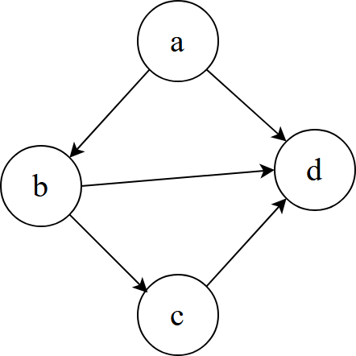

设计算法 int printVertices(MGraph G) 对给定任意非空有向图 G，输出 G 中所有 K 顶点的算法，并返回 K 顶点的个数。

(1) 给出算法的设计思想。

(2) 根据算法思想，写出 C/C++ 描述，并注释。

---

## 2024年

### 第4题（选择题）

给定无向图的邻接多重表，求顶点 b、d 的度（）

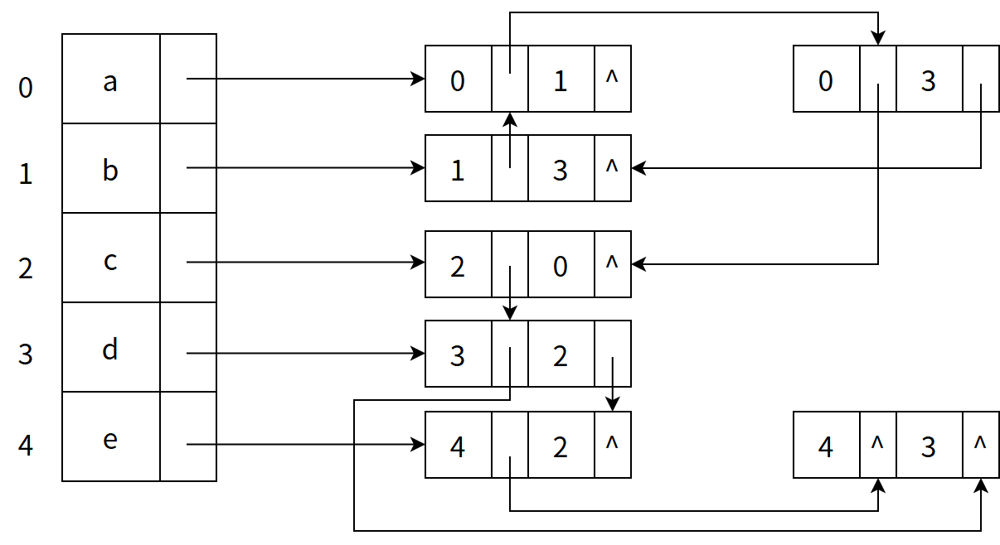

A. 0, 2
B. 2, 4
C. 3, 2
D. 2, 3

---

### 第41题（综合题）

（13 分）2023 年10 月26 日，神舟十七号载人飞船发射取得圆满成功，再次彰显了中国航天事 业的辉煌成就。载人航天工程是包含众多子工程的复杂系统工程，为了保证工程的有序开展，需 要明确各子工程的前导子工程，以协调各子工程的实施。该问题可以简化、抽象为有向图的拓扑 序列问题。已知有向图G 采用邻接矩阵存储，类型定义如下。

```c
typedef struct //图的类型定义 {
    int numVertices, numEdges; //图的顶点数和有向边数
    char VerticesList[MAXV]; //顶点表，MAXV 为已定义常量
    int Edge[MAXV][MAXV]; //邻接矩阵
}MGraph
```

请设计算法：int uniquely(MGraph G)，判定G 是否存在唯一的拓扑序列，若是，则返回 1，否则返回0。要求如下。

（1）给出算法的基本设计思想。（4 分）

（2）根据设计思想，采用C 或C++语言描述算法，关键之处给出注释。（9 分）

---
