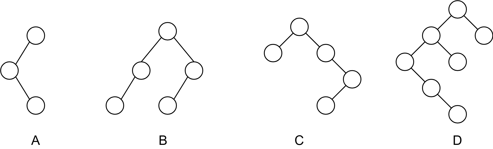
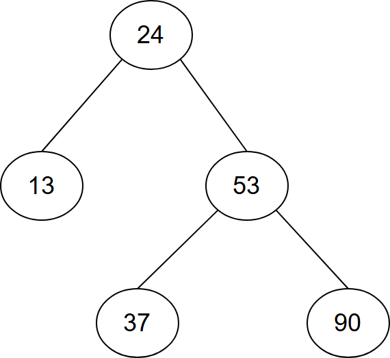
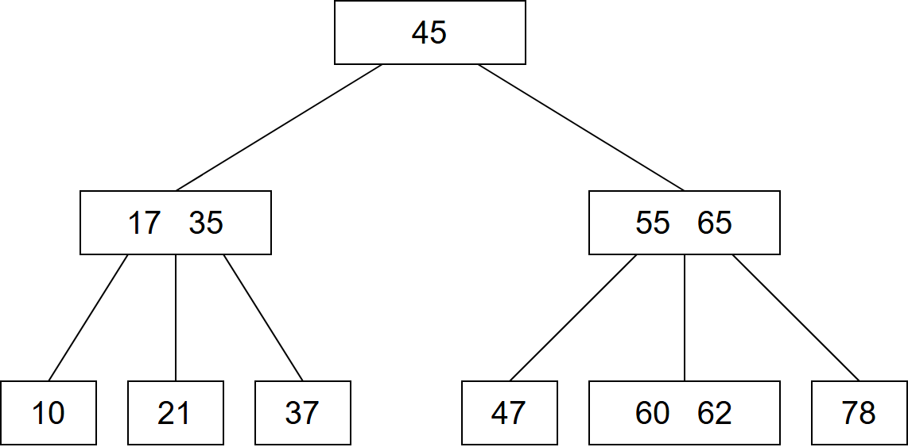
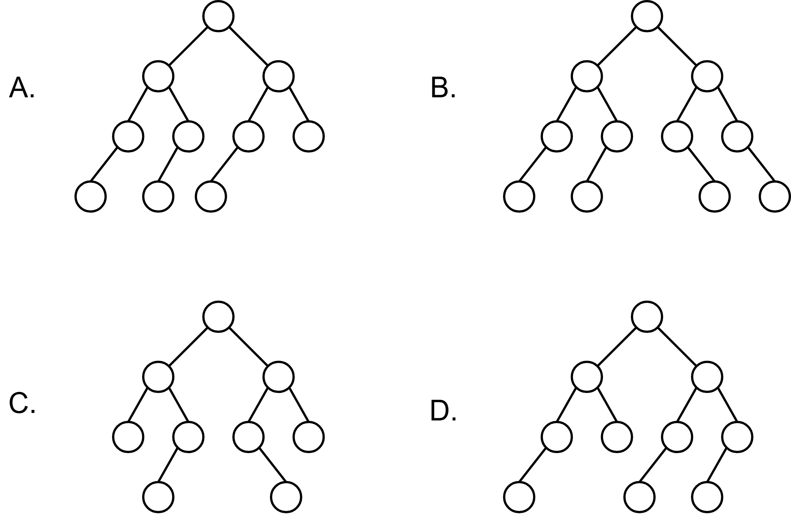
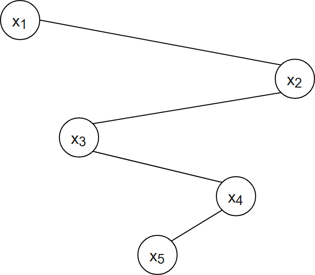
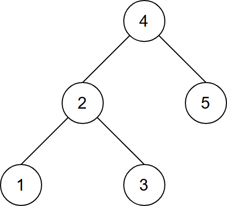
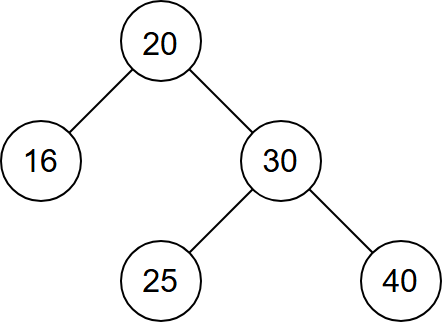
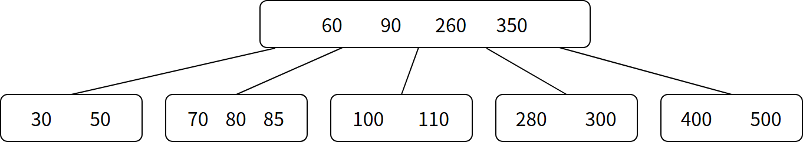
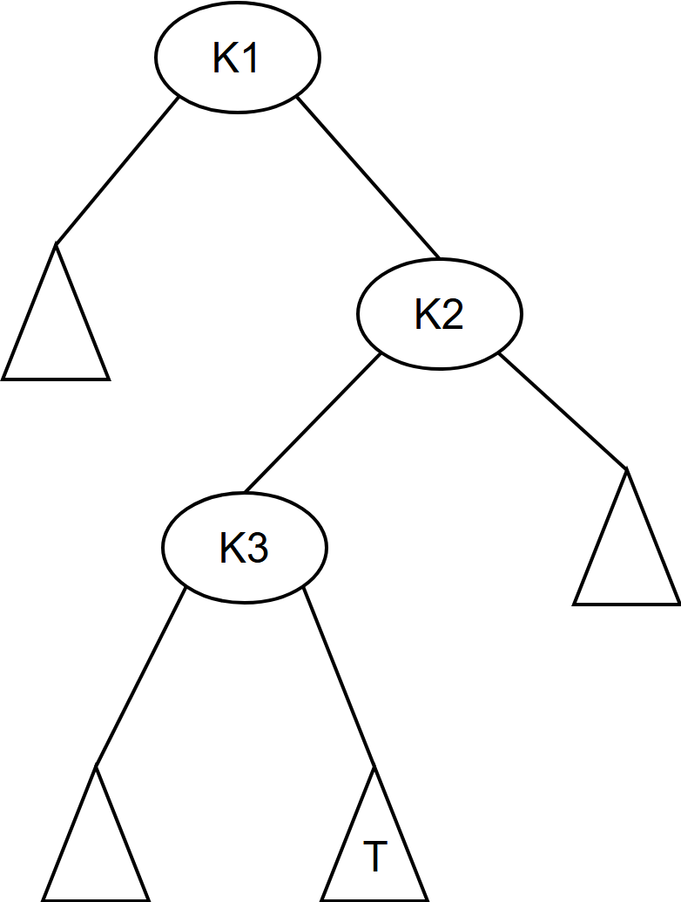

# 第7章 查找

> 科目：一、数据结构
> 题目数量：37道
> 年份范围：2009-2024

---

## 2009年

### 第4题（选择题）

下列二叉排序树中，满足平衡二叉树定义的是（ ）。




---

### 第8题（选择题）

下列叙述中，不．符合m 阶B 树定义要求的是 。

A. 根结点最多有m 棵子树
B. 所有叶结点都在同一层上
C. 各结点内关键字均升序或降序排列
D. 叶结点之间通过指针链接

---

## 2010年

### 第4题（选择题）

在下图所示的平衡二叉树中，插入关键字 48 后得到一棵新平衡二叉树。在新平衡二叉树中，关键字 37 所在结点的左、右子结点中保存的关键字分别是（ ）。



A. 13, 48
B. 24, 48
C. 24, 53
D. 24, 90

---

### 第9题（选择题）

已知一个长度为16 的顺序表L，其元素按关键字有序排列。若 采用折半查找法查找一个L 中不存在的元素，则关键字的比较次 数最多的是 。

A. 4
B. 5
C. 6
D. 7

---

### 第41题（综合题）

（10 分）将关键字序列（7, 8, 30, 11, 18, 9, 14）散列存储到散列表中。散列表的存储空间是一个 下标从0 开始的一维数组，散列函数为H(key)＝(key×3) mod 7，处理冲突采用线性探测再散列 法，要求装填（载）因子为0.7。

（1）请画出所构造的散列表。

（2）分别计算等概率情况下查找成功和查找不成功的平均查找长度。

---

## 2011年

### 第7题（选择题）

对于下列关键字序列，不可能构成某二叉排序树中一条查找路径的序列是 。

A. 95, 22, 91, 24, 94, 71
B. 92, 20, 91, 34, 88, 35
C. 21, 89, 77, 29, 36, 38
D. 12, 25, 71, 68, 33, 34

---

### 第9题（选择题）

为提高散列(Hash) 表的查找效率，可以采取的正确措施是 。 I. 增大装填（载）因子 II. 设计冲突（碰撞）少的散列函数 III. 处理冲突（碰撞）时避免产生聚集（堆积）现象

A. 仅I
B. 仅II
C. 仅I、II
D. 仅II、III

---

## 2012年

### 第9题（选择题）

已知一棵 3 阶 B 树，如下图所示。删除关键字 78 得到一棵新 B 树，其最右叶结点中的关键字是（）。



A. 60
B. 60, 62
C. 62, 65
D. 65

---

## 2013年

### 第3题（选择题）

若将关键字1, 2, 3, 4, 5, 6, 7 依次插入到初始为空的平衡二叉树T 中，则T 中平衡因子为0 的分支 结点的个数是 。

A. 0
B. 1
C. 2
D. 3

---

### 第6题（选择题）

在任意一棵非空二叉排序树T1 中，删除某结点v 之后形成二叉排序树T2，再将v 插入T2形成二 叉排序树T3。下列关于T1与T3的叙述中，正确的是 。 I. 若v 是T1的叶结点，则T1与T3不同 II. 若v 是T1的叶结点，则T1与T3相同 III. 若v 不是T1的叶结点，则T1与T3不同 IV. 若v 不是T1的叶结点，则T1与T3相同

A. 仅I、III
B. 仅I、IV
C. 仅II、III
D. 仅II、IV

---

### 第10题（选择题）

在一棵高度为2 的5 阶B 树中，所包含关键字的个数最少是 。

A. 5
B. 7
C. 8
D. 14

---

### 第42题（综合题）

（10 分）设包含4 个数据元素的集合S＝{ “do”，“for”， “repeat”, “while”}，各元素的查找概率 依次为p1 ＝ 0.35，p2 ＝ 0.15，p3＝0.15，p4＝0.35。将S 保存在一个长度为4 的顺序表中，采用折半查 找法，查找成功时的平均查找长度为22。请回答：

（1）若采用顺序存储结构保存S，且要求平均查找长度更短，则元素应如何排列？应使用何种查 找方法？查找成功时的平均查找长度是多少？

（2）若采用链式存储结构保存S，且要求平均查找长度更短，则元素应如何排列？应使用何种查 找方法？查找成功时的平均查找长度是多少？

---

## 2014年

### 第8题（选择题）

用哈希（散列）方法处理冲突（碰撞）时可能出现堆积（聚集）现象。下列选项中，会受堆积现 象直接影响的是 。

A. 存储效率
B. 散列函数
C. 装填（装载）因子
D. 平均查找长度

---

### 第9题（选择题）

在一棵具有15 个关键字的4 阶B 树中，含关键字的结点个数最多是 。

A. 5
B. 6
C. 10
D. 15

---

## 2015年

### 第4题（选择题）

现有一棵无重复关键字的平衡二叉树（AVL 树），对其进行中序遍历可得到一个降序序列。下列 关于该平衡二叉树的叙述中，正确的是 。

A. 根结点的度一定为2
B. 树中最小元素一定是叶结点
C. 最后插入的元素一定是叶结点
D. 树中最大元素一定是无左子树

---

### 第7题（选择题）

下列选项中，不能构成折半查找中关键字比较序列的是 。

A. 500, 200, 450, 180
B. 500, 450, 200, 180
C. 180, 500, 200, 450
D. 180, 200, 500, 450

---

## 2016年

### 第9题（选择题）

在有n（n＞1000）个元素的升序数组A 中查找关键字x。查找算法的伪代码如下所示。

```c
k=0;
while(k<n 且A[k]<x) k=k+3;
if(k<n 且A[k]==x)
```

查找成功; else if (k-1＜n 且A[k-1]＝＝x) 查找成功; else if(k-2＜n 且A[k-2]＝＝x) 查找成功; else 查找失败; 本算法与折半查找算法相比，有可能具有更少比较次数的情形是 。

A. 当x 不在数组中
B. 当x 接近数组开头处
C. 当x 接近数组结尾处
D. 当x 位于数组中间位置

---

### 第10题（选择题）

B+树不同于B 树的特点之一是 。

A. 能支持顺序查找
B. 结点中含有关键字
C. 根结点至少有两个分支
D. 所有叶结点都在同一层上

---

## 2017年

### 第8题（选择题）

下列二叉树中，可能成为折半查找判定树（不含外部结点）的是（）




---

### 第9题（选择题）

下列应用中，适合使用B+树的是 。

A. 编译器中的词法分析
B. 关系数据库系统中的索引
C. 网络中的路由表快速查找
D. 操作系统的磁盘空闲块管理

---

## 2018年

### 第6题（选择题）

已知二叉排序树如下图所示，元素之间应满足的大小关系是（ ）。



A. x1​＜x2​＜x3​
B. x1​＜x4​＜x5​
C. x3​＜x5​＜x4​
D. x4​＜x3​＜x5​

---

### 第8题（选择题）

高度为5 的3 阶B 树含有的关键字个数至少是 。

A. 15
B. 31
C. 62
D. 242

---

### 第9题（选择题）

现有长度为 7、初始为空的散列表 HT，散列函数 H(k) ＝ k % 7，用线性探测再散列法解决冲突。将关键字 22, 43, 15 依次插人到 HT 后，查找成功的平均查找长度是（ ）

A. 1.5
B. 1.6
C. 2
D. 3

---

## 2019年

### 第4题（选择题）

在任意一棵非空平衡二叉树（AVL 树）T1中，删除某结点v 之后形成平衡二叉树T2，再将v 插 入T2形成平衡二叉树T3。下列关于T1与T3的叙述中，正确的是 。 I. 若v 是T1的叶结点，则T1与T3可能不相同 II. 若v 不是T1的叶结点，则T1与T3一定不相同 III. 若v 不是T1的叶结点，则T1与T3一定相同

A. 仅I
B. 仅II
C. 仅I、II
D. 仅I、III

---

### 第8题（选择题）

现有长度为 11 且初始为空的散列表 HT，散列函数是 H(key)＝key%7，采用线性探查（线性探测再散列）法解决冲突将关键字序列 87，40，30，6，11，22，98，20 依次插入到 HT 后，HT 查找失败的平均查找长度是（ ）。

A. 4
B. 5.25
C. 6
D. 6.29

---

## 2020年

### 第5题（选择题）

下列给定的关键字输入序列中，不能生成如下二叉排序树的是（ ）。



A. 4，5，2，1，3
B. 4，5，1，2，3
C. 4，2，5，3，1
D. 4，2，1，3，5

---

### 第10题（选择题）

依次将关键字5, 6, 9, 13, 8, 2, 12, 15 插入初始为空的4 阶B 树后，根结点中包含的关键字 是 。

A. 8
B. 6,9
C. 8, 13
D. 9, 12

---

## 2021年

### 第6题（选择题）

给定平衡二叉树如下图所示，插入关键字 23 后，根中的关键字是（ ）。



A. 16
B. 20
C. 23
D. 25

---

### 第9题（选择题）

在一棵高度为3 的3 阶B 树中，根为第1 层，若第2 层中有4 个关键字，则该树的结点个数最 多是 。

A. 11
B. 10
C. 9
D. 8

---

## 2022年

### 第8题（选择题）

在下图所示的 5 阶 B 树 T 中，删除关键字 260 之后需要进行必要的调整，得到新的 B 树 T1。下列选项中，不可能是 T1 根结点中关键字序列的是（  ）。



A. 60，90，280
B. 60，90，350
C. 60，85，110，350
D. 60，90，110，350

---

### 第9题（选择题）

下列因素中，影响散列（哈希）方法平均查找长度的是 。 I. 装填因子 II. 散列函数 III. 冲突解决策略

A. 仅I、II
B. 仅I、III
C. 仅II、III
D. I、II、III

---

## 2023年

### 第7题（选择题）

下列关于非空B 树的叙述中，正确的是 。 I. 插入操作可能增加树的高度 II. 删除操作一定会导致叶结点的变化 III. 查找某关键字总是要查找到叶结点 IV. 插入的新关键字最终位于叶结点中

A.仅I
B. 仅I、II
C. 仅III、IV
D. 仅I、II、IV

---

### 第8题（选择题）

对含有600 个元素的有序顺序表进行折半查找，关键字间的比较次数最多是 。

A. 9
B. 10
C. 30
D. 300

---

### 第9题（选择题）

现有长度为 5，初始为空的散列表 HT，散列表函数 H(k) ＝ (k+4) % 5 用线性探查再散列法解决冲突。若将关键字序列 2022,12,25 依次插入 HT 中，然后删除关键字 25，则 HT 中查找失败的平均查找长度（ ）。

A. 1
B. 1.6
C. 1.8
D. 2.2

---

## 2024年

### 第5题（选择题）

下列数据结构中，不适合 ．．．直接使用折半查找的是 。 I. 有序链表 II. 无序数组 III. 有序静态链表 IV. 无序静态链表

A. 仅I、III
B. 仅II、IV
C. 仅II、III、IV
D. I、II、III、IV

---

### 第7题（选择题）

一棵二叉搜索树如下图所示，K1、K2、K3 分别是对应结点中保存的关键字、三角形表示子树。则子树 T 中任一结点中保存的关键字 X 满足的是（ ）。



A. X＜K1​
B. X＞K2​
C. K1​＜X＜K3​
D. K3​＜X＜K2​

---

### 第42题（综合题）

（10 分）将关键字序列20, 3, 11, 18, 9, 14, 7 依次存储到初始为空、长度为11 的散列表HT 中， 散列函数H(key) ＝ (key×3)%11。H(key)计算出的初始散列地址为H0，发生冲突时探查地址序列 是H1, H2, H3, …，其中，Hk＝(H0 + k 2)%11，k ＝ 1, 2, 3, …。 请回答下列问题。

（1）画出所构造的HT，并计算HT 的装填因子。（6 分）

（2）给出在HT 中查找关键字14 的关键字比较序列。（2 分）

（3）在HT 中查找关键字8，确认查找失败时的散列地址是多少？（2 分）

---
