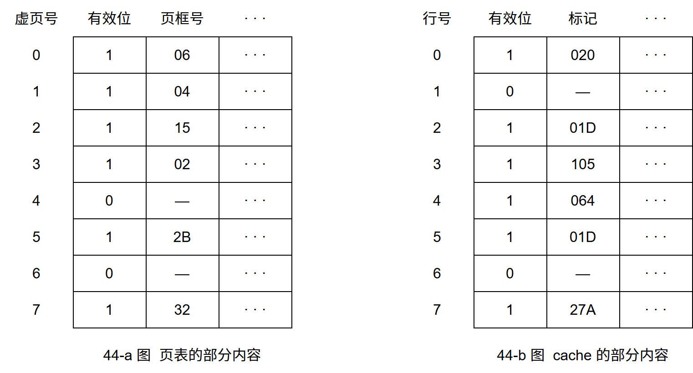
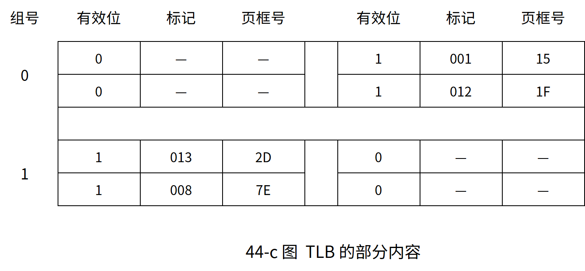
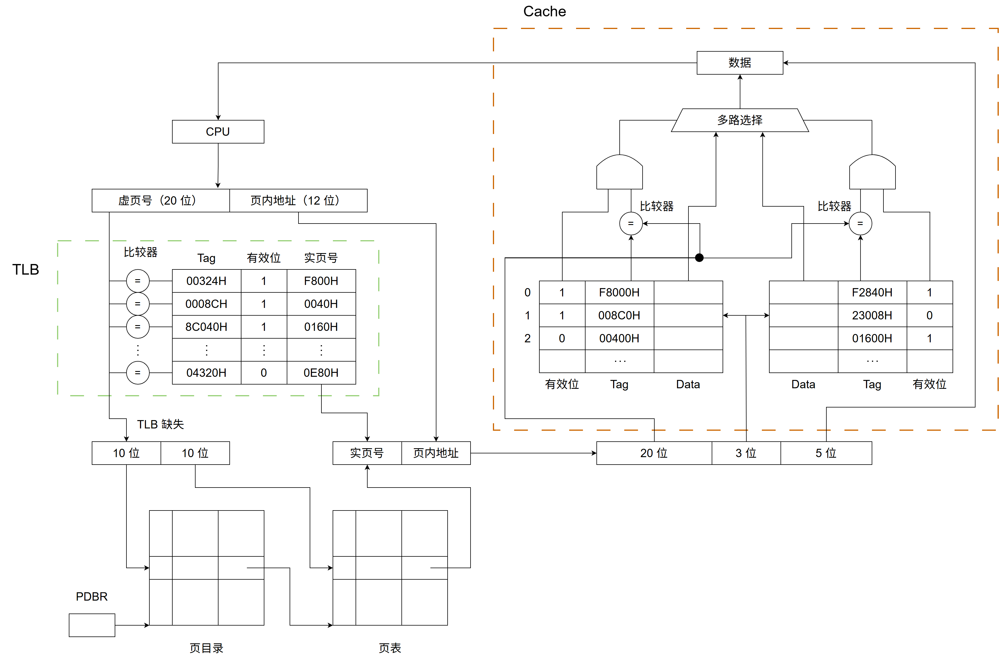
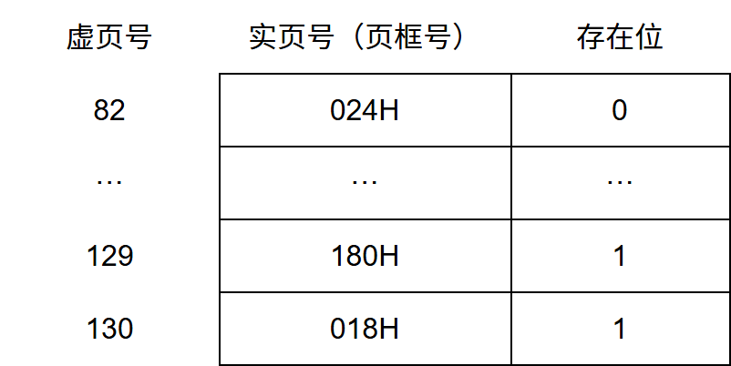

# 第3章 存储系统

> 科目：二、计算机组成原理
> 题目数量：41道
> 年份范围：2009-2024

---

## 2009年

### 第14题（选择题）

某计算机的Cache 共有16 块，采用2 路组相联映射方式（即每组2 块）。每个主存块大小为32B， 按字节编址。主存129 号单元所在主存块应装入到的Cache 组号是 。

A. 0
B. 1
C. 4
D. 6

---

### 第15题（选择题）

某计算机主存容量为64KB，其中ROM 区为4KB，其余为RAM 区，按字节编址。现要用2K× 8 位的ROM 芯片和4K×4 位的RAM 芯片来设计该存储器，则需要上述规格的ROM 芯片数和 RAM 芯片数分别是 。

A. 1、15
B. 2、15
C. 1、30
D. 2、30

---

### 第21题（选择题）

假设某计算机的存储系统由 Cache 和主存组成，某程序执行过程中访存 1000 次，其中访问 Cache 缺失（未命中）50 次，则 Cache 的命中率是（）。

A. 5%
B. 9.5%
C. 50%
D. 95%

---

## 2010年

### 第15题（选择题）

假定用若干2K×4 位的芯片组成一个8K×8 位的存储器，则地址0B1FH 所在芯片的最小地址 是 。

A. 0000H
B. 0600H
C. 0700H
D. 0800H

---

### 第16题（选择题）

下列有关RAM 和ROM 的叙述中，正确的是 。 I. RAM 是易失性存储器，ROM 是非易失性存储器 II. RAM 和ROM 都采用随机存取方式进行信息访问 III. RAM 和ROM 都可用作Cache IV. RAM 和ROM 都需要进行刷新

A. 仅I 和II
B. 仅II 和III
C. 仅I、II 和IV
D. 仅II、III 和IV

---

### 第17题（选择题）

下列命中组合情况中，一次访存过程中不．可能发生的是 。

A. TLB 未命中，Cache 未命中，Page 未命中
B. TLB 未命中，Cache 命中，Page 命中
C. TLB 命中，Cache 未命中，Page 命中
D. TLB 命中，Cache 命中，Page 未命中

---

### 第44题（综合题）

（12 分）某计算机的主存地址空间大小为256MB，按字节编址。指令Cache 和数据Cache 分 离，均有8 个Cache 行，每个Cache 行大小为64B，数据Cache 采用直接映射方式。现有两个功 能相同的程序A 和B，其伪代码如下： 程序A：

```c
int a[256][256] …… int sum_array1() {
    int i,j,sum=0;
    for(i=0;i<256;i++) for(j=0;j<256;j++) sum+=a[i][j];
    return sum;
}
```

程序B：

```c
int a[256][256] …… int sum_array2() {
    int i,j,sum=0;
    for(j=0;j<256;j++) for(i=0;i<256;i++) sum+=a[i][j];
    return sum;
}
```

假定int 型数据用32 位补码表示，程序编译时i、j、sum 均分配在寄存器中，数组a 按行优先 方式存放，其首地址为320（十进制数）。请回答下列问题，要求说明理由或给出计算过程。

（1）若不考虑用于Cache 一致性维护和替换算法的控制位，则数据Cache 的总容量为多少？

（2）数组元素a[0][31]和a[1][1]各自所在的主存块对应的Cache 行号分别是多少（Cache 行号 从0 开始）？

（3）程序A 和B 的数据访问命中率各是多少？哪个程序的执行时间更短？

---

## 2011年

### 第14题（选择题）

下列各类存储器中， 不采用随机存取方式的是 。

A. EPROM
B. CDROM
C. DRAM
D. SRAM

---

### 第15题（选择题）

某计算机存储器按字节编址，主存地址空间大小为64MB, 现用4MB×8 位的RAM 芯片组成 32MB 的主存储器， 则存储器地址寄存器MAR 的位数至少是 。

A. 22 位
B. 23 位
C. 25 位
D. 26 位

---

### 第44题（综合题）

某计算机存储器按字节编址，虚拟（逻辑）地址空间大小为 16MB，主存（物理）地址空间大小为 1MB，页面大小为 4KB：Cache 采用直接映射方式，共 8 行：主存与 Cache 之间交换的块大小为 32B。系统运行到某一时刻时，页表的部分内容和 Cache 的部分内容分别如题 44-a 图、题 44-b 图所示，图中页框号及标记字段的内容为十六进制形式。



请回答下列问题∶

(1) 虚拟地址共有几位，哪几位表示虚页号？物理地址共有几位，哪几位表示页框号（物理页号）？

(2) 使用物理地址访问 Cache 时，物理地址应划分成哪几个字段？要求说明每个字段的位数及在物理地址中的位置。

(3) 虚拟地址 001C60H 所在的页面是否在主存中？若在主存中，则该虚拟地址对应的物理地址是什么？访问该地址时是否 Cache 命中？要求说明理由。

(4) 假定为该机配置一个 4 路组相连的 TLB，该 TLB 共可存放 8 个页表项，若其当前内容（十六进制）如题 44-c 图所示，则此时虚拟地址 024BACH 所在的页面是否在主存中？要求说明理由。




---

## 2012年

### 第16题（选择题）

下列关于闪存（Flash Memory）的叙述中，错误的是。

A. 信息可读可写，并且读、写速度一样快
B. 存储元由MOS 管组成，是一种半导体存储器
C. 掉电后信息不丢失，是一种非易失性存储器
D. 采用随机访问方式，可替代计算机外部存储器

---

### 第17题（选择题）

假设某计算机按字编址，Cache 有4 个行，Cache 和主存之间交换的块大小为1 个字。若Cache 的 内容初始为空，采用2 路组相联映射方式和LRU 替换策略。访问的主存地址依次为0, 4, 8, 2, 0, 6, 8, 6, 4, 8 时， 命中Cache 的次数是 。

A. 1
B. 2
C. 3
D. 4

---

### 第43题（综合题）

（11 分）假定某计算机的CPU 主频为80MHz，CPI 为4，平均每条指令访存1.5 次，主存与Cache 之间交换的块大小为16B, Cache 的命中率为99%, 存储器总线宽度为32 位。请回答下列问题。

（1）该计算机的MIPS 数是多少？平均每秒Cache 缺失的次数是多少？在不考虑DMA 传送的 情况下，主存带宽至少达到多少才能满足CPU 的访存要求？

（2）假定在Cache 缺失的情况下访问主存时，存在0.0005%的缺页率，则CPU 平均每秒产生多 少次缺页异常？若页面大小为4KB, 每次缺页都需要访问磁盘，访问磁盘时DMA 传送采用周期 挪用方式，磁盘I/O 接口的数据缓冲寄存器为32 位，则磁盘I/O 接口平均每秒发出的DMA 请求 次数至少是多少？

（3）CPU 和DMA 控制器同时要求使用存储器总线时，哪个优先级更高？为什么？

（4）为了提高性能，主存采用四体低位交叉存储模式，工作时每1/4 个存储周期启动一个体。 若每个体的存储周期为50ns, 则该主存能提供的最大带宽是多少？

---

## 2013年

### 第16题（选择题）

某计算机主存地址空间大小为256MB，按字节编址，虚拟地址空间大小为4GB，采用页式存储 管理，页面大小为4KB，TLB（快表）采用全相联映射，有4 个页表项，内容如下表所示。 有效位 标记 页框号 … 0 FF180H 0002H … 1 3FFF1H 0035H … 0 02FF3H 0351H … 1 03FFFH 0153H … 则对虚拟地址 03FFF180H 进行虚拟地址变换的结果是 。

A. 015 3180H
B. 003 5180H
C. TLB 缺失
D. 缺页

---

### 第43题（综合题）

（9 分）某32 位计算机，CPU 主频为800MHz，Cache 命中时的CPI 为4，Cache 块大小为32 字 节；主存采用8 体交叉存储方式，每个体的存储字长为32 位、存储周期为40ns；存储器总线宽度 为32 位，总线时钟频率为200MHz，支持突发传送总线事务。每次读突发传送总线事务的过程包 括：送首地址和命令、存储器准备数据、传送数据。每次突发传送32 字节，传送地址或32 位数 据均需要一个总线时钟周期。请回答下列问题，要求给出理由或计算过程。

（1）CPU 和总线的时钟周期各为多少？总线的带宽（即最大数据传输率）为多少？

（2）Cache 缺失时，需要用几个读突发传送总线事务来完成一个主存块的读取？

（3）存储器总线完成一次读突发传送总线事务所需的时间是多少？

（4）若程序BP 执行过程中，共执行了100 条指令，平均每条指令需进行1.2 次访存，Cache 缺 失率为5％，不考虑替换等开销，则BP 的CPU 执行时间是多少？

---

## 2014年

### 第15题（选择题）

某容量为256MB 的存储器由若干4Mx8 位的DRAM 芯片构成，该DRAM 芯片的地址引脚和数 据引脚总数是 。

A. 19
B. 22
C. 30
D. 36

---

## 2015年

### 第15题（选择题）

假定主存地址为32 位，按字节编址，主存和Cache 之间采用直接映射方式，主存块大小为4 个 字，每字32 位，采用回写（Write Back）方式，则能存放4K 字数据的Cache 的总容量的位数至 少是

A. 146k
B. 147K
C. 148K
D. 158K

---

### 第16题（选择题）

假定编译器将赋值语句“x ＝ x + 3;”转换为指令"add xaddr, 3”，其中xaddr 是x 对应的存储单元 地址。若执行该指令的计算机采用页式虚拟存储管理方式，并配有相应的TLB，且Cache 使用 直写（Write Through)方式，则完成该指令功能需要访问主存的次数至少是 。

A. 0
B. 1
C. 2
D. 3

---

### 第17题（选择题）

下列存储器中，在工作期间需要周期性刷新的是 。

A. SRAM
B. SDRAM
C. ROM
D. FLASH

---

### 第18题（选择题）

某计算机使用4 体交叉编址存储器，假定在存储器总线上出现的主存地址（十进制）序列为 8005, 8006, 8007, 8008, 8001, 8002, 8003, 8004, 8000，则可能发生访存冲突的地址对是 。

A. 8004 和8008
B. 8002 和8007
C. 8001 和8008
D. 8000 和8004

---

## 2016年

### 第15题（选择题）

有如下 C 语言程序段：

```c
for (k = 0; k < 1000; k++) a[k] = a[k] + 32
```

若数组 a 以及变量 k 均为 int 型，int 型数据占 4B，数据 Cache 采用直接映射方式，数据区大小是 1KB，块大小是 16B，该程序段执行前 Cache 为空，则该程序段执行过程中，访问数组 a 的 Cache 的缺失率是（ ）。

A. 1.25%
B. 2.5%
C. 12.5%
D. 25%

---

### 第16题（选择题）

某存储器容量为64KB，按字节编址，地址4000H～5FFFH 为ROM 区，其余为RAM 区。若采 用8K×4 位的SRAM 芯片进行设计，则需要该芯片的数量是 。

A. 7
B. 8
C. 14
D. 16

---

## 2017年

### 第13题（选择题）

某计算机主存按字节编址，由4 个64M×8 位的DRAM 芯片采用交叉编址方式构成，并与宽度为 32 位的存储器总线相连，主存每次最多读写32 位数据。若double 型变量x 的主存地址为804 001AH, 则读取x 需要的存储周期数是 。

A. 1
B. 2
C. 3
D. 4

---

### 第14题（选择题）

某C 语言程序段如下：

```c
for(i=0;i<=9;i++) {
    temp = 1;
    for(j=0;j<=i;j++)temp *= a[j] sum+=temp;
}
```

下列关于数组a 的访问局部性的描述中，正确的是。

A. 时间局部性和空间局部性皆有
B. 无时间局部性，有空间局部性
C. 有时间局部性，无空间局部性
D. 时间局部性和空间局部性皆无

---

## 2018年

### 第17题（选择题）

假定DRAM 芯片中存储阵列的行数为r、列数为c，对于一个2K×1 位的DRAM 芯片，为保证 其地址引脚数最少，并尽量减少刷新开销，则r、c 的取值分别是 。

A. 2048、1
B. 64、32
C. 32、64
D. 1、2048

---

### 第44题（综合题）

某计算机采用页式虚拟存储管理方式，按字节编址。CPU 进行存储访问的过程如题 44 图所示。



根据题 44 图回答下列问题。

(1) 主存物理地址占多少位？

(2) TLB 采用什么映射方式？TLB 用 SRAM 还是 DRAM 实现？

(3) Cache 采用什么映射方式？若 Cache 采用 LRU 替换算法和回写（Write Back）策略，则 Cache 每行中除数据（Data）、Tag 和有效位外，还应有哪些附加位？Cache 总容量是多少？Cache 中有效位的作用是什么？

(4) 若 CPU 给出的虚拟地址为 0008C040H，则对应的物理地址是多少？是否在 Cache 中命中？说明理由。若 CPU 给出的虚拟地址为 0007C260H，则该地址所在主存块映射到的 Cache 组号是多少？

---

## 2019年

### 第14题（选择题）

下列关于缺页处理的叙述中，错误的是 。

A. 缺页是在地址转换时CPU 检测到的一种异常
B. 缺页处理由操作系统提供的缺页处理程序来完成
C. 缺页处理程序根据页故障地址从外存读入所缺失的页
D. 缺页处理完成后回到发生缺页的指令的下一条指令执行

---

## 2020年

### 第15题（选择题）

下列关于TLB 和Cache 的叙述中，错误的是 。

A. 命中率都与程序局部性有关
B. 缺失后都需要去访问主存
C. 缺失处理都可以由硬件实现
D. 都由DRAM 存储器组成

---

### 第44题（综合题）

（10 分）假定主存地址为32 位，按字节编址，指令Cache 和数据Cache 与主存之间均采用8 路 组相联映射方式，直写（Write Through）写策略和LRU 替换算法，主存块大小为64B，数据区 容量各为32KB。开始时Cache 均为空。请回答下列问题。

（1）Cache 每一行中标记（Tag）、LRU 位各占几位？是否有修改位？

（2）有如下C 语言程序段：

```c
for (k = 0; k < 1024 ; k++) s[k] = 2 * s[k]
```

若数组s 及其变量k 均为int 型，int 型数据占4B,变量k 分配在寄存器中，数组s 在主存中的起 始地址为0080 00C0H，则该程序段执行过程中，访问数组s 的数据Cache 缺失次数为多少？

（3）若CPU 最先开始的访问操作是读取主存单元0001 0003H 中的指令，简要说明从Cache 中 访问该指令的过程，包括Cache 缺失处理过程。

---

## 2021年

### 第15题（选择题）

某计算机的存储器总线中有24 位地址线和32 位数据线，按字编址，字长为32 位。如果00 0000H～3F FFFFH 为RAM 区，那么需要512K×8 位的RAM 芯片数为 。

A. 8
B. 16
C. 32
D. 64

---

### 第16题（选择题）

若计算机主存地址为32 位，按字节编址，Cache 数据区大小为32KB，主存块大小为32B，采用 直接映射方式和回写（Write Back）策略，则Cache 行的位数至少是 。

A. 275
B. 274
C. 258
D. 257

---

### 第44题（综合题）

（8 分）假设计算机M 的主存地址为24 位，按字节编址；采用分页存储管理方式，虚拟地址为 30 位，页大小为4KB；TLB 采用2 路组相联方式和LRU 替换策略，共8 组。请回答下列问题。

（1）虚拟地址中哪几位表示虚页号？哪几位表示页内地址？

（2）已知访问TLB 时虚页号高位部分用作TLB 标记，低位部分用作TLB 组号，M 的虚拟地址 中哪几位是TLB 标记？哪几位是TLB 组号？

（3）假设TLB 初始时为空，访问的虚页号依次为10, 12, 16, 7, 26, 4, 12 和20 ,在此过程中，哪 一个虚页号对应的TLB 表项被替换？说明理由。

（4）若将M 中的虚拟地址位数增加到32 位，则TLB 表项的位数增加几位？

---

## 2022年

### 第15题（选择题）

某计算机主存地址为 24 位，采用分页虚拟存储管理方式，虚拟地址空间大小为 4GB，页大小为 4KB，按字节编址。某进程的页表部分内容如下表所示。当 CPU 访问虚拟地址 00082840H，虚 - 实地址转换的结果是（ ）。



A. 得到主存地址 02 4840H
B. 得到主存地址 18 0840H
C. 得到主存地址 01 8840H
D. 检测到缺页异常

---

### 第16题（选择题）

若计算机主存地址为32 位，按字节编址，某Cache 的数据区容量为32KB，主存块大小为64B， 采用8 路组相联映射方式，该Cache 中比较器的个数和位数分别为 。

A. 8, 20
B. 8, 23
C. 64, 20
D. 64, 23

---

### 第17题（选择题）

某内存条包含8 个8192×8192×8 位的DRAM 芯片，按字节编址，支持突发（burst）传送方 式，对应存储器总线宽度为64 位，每个DRAM 芯片内有一个行缓冲区（row buffer）。下列关于 该内存条的叙述中，不．正确的是 。

A. 内存条的容量为512MB
B. 采用多模块交叉编址方式
C. 芯片的地址引脚为26 位
D. 芯片内行缓冲有8192×8 位

---

## 2023年

### 第15题（选择题）

某计算机的CPU 有30 根地址线，按字节编址，CPU 和主存芯片连接时，要求主存芯片占满所有 可能存储地址空间，并且RAM 区和ROM 区所分配的空间大小比为3:1。若RAM 在连续低地址 区，ROM 在连续高地址区，则ROM 的地址范围 。

A. 0000 0000H～0FFF FFFFH
B. 1000 0000H～2FFF FFFFH
C. 3000 0000H～3FFF FFFFH
D. 4000 0000H～4FFF FFFFH

---

### 第43题（综合题）

（14 分）已知计算机M 字长为32 位，按字节编址，采用请求调页策略的虚拟存储管理方式， 虚拟地址32 位，页面大小为4KB；数据Cache 采用4 路组相联映射方式，数据区大小为8KB， 主存块大小为32B。现有C 语言程序段如下：

```c
int a[24][64];
… for (i=0;i<24;i++) for (j=0;j<64;j++)a[i][j]=10
```

已知二维数组a 按行优先存放，在虚拟地址空间中分配的起始地址为0042 2000H，sizeof(int) ＝ 4。假定在M 上执行上述程序段之前数组a 不在主存，且在该程序执行过程中不会发生页面置 换。请回答下列问题：

（1）数组分布在几个页面中？对于数组a 的访问，会发生几次缺页异常？页故障地址各是什 么？

（2）不考虑变量i 和j，该程序段的数据访问是否具有时间局部性？为什么？

（3）计算机M 的虚拟地址(A31~A0)中哪几位用作块内地址？哪几位用作Cache 组号？a[1][0]的 虚拟地址是多少？其所在主存块对应的Cache 组号是多少？

（4）数组a 占用多少主存块？假设上述程序段执行过程中数组a 的访问不会和其他数据发生 Cache 访问冲突，则数组a 的Cache 命中率是多少？若将循环中i 和j 的次序按如下方式调换：

```c
for (j=0;j<64;j++) for (i=0;i<24;i++)a[i][j]=10
```

则数组a 的Cache 命中率又是多少？

---

### 第44题（综合题）

（9 分）43 题中C 程序段在计算机M 上的部分机器级代码如下，每个机器级代码行中依次包含 指令序号、虚拟地址、机器指令和汇编指令。

```c
for (i=0; i<24; i++) 1 00401072 C7 45 F8 00 00 00 00 mov [ebp–8]，0 2 00401079 EB 09 jmp 00401084h 3 0040107B 8B 55 F8 mov eax，[ebp-8] ... ... ... 7 00401088 7D 32 jge 004010BCh for (j=0; j<64; j++) 8 0040108A C7 45 FC 00 00 00 00 mov [ebp–4]，0 ... ... ... a[i][j]=10;
... ... ... 19 004010AE C7 84 82 00 20 42 00 0A mov [ecx + edx * 4+ 00 00 00 00422000h]，0Ah
```

请回答下列问题。

（1）第20 条指令的虚拟地址是多少？

（2）已知第2 条jmp 和第7 条jge 都是跳转指令，其操作码分别是EBH 和7DH，跳转目标地址 分别为0040 1084H、0040 10BCH,这两条指令分别采用什么寻址方式？请给出第2 条指令jmp 的 跳转目标地址计算过程。

（3）已知第19 条mov 指令的功能是“a[i][j]←10”，其中ecx 和edx 为寄存器名，0042 2000H 是数组a 的首地址，指令中源操作数采用什么寻址方式？已知edx 中存放的是变量j，ecx 中存放 的是什么？根据该指令的机器码判断计算机M 采用的是大端还是小端方式。

（4）第1 次执行第19 条指令时，取指令过程中是否会发生缺页异常？为什么？

---

## 2024年

### 第16题（选择题）

对于页式虚拟存储管理系统，下列关于存储器层次结构的叙述中，错误的是 。

A. Cache–主存层次的交换单位为主存块，主存–外存层次的交换单位为页
B. Cache–主存层次替换算法由硬件实现，主存–外存层次替换算法由软件实现
C. Cache–主存层次可采用回写法写策略，主存–外存层次通常采用回写法写策略
D. Cache–主存层次可采用直接映射方式，主存–外存层次通常采用直接映射方式

---

### 第17题（选择题）

某计算机按字节编址，采用页式虚拟存储管理方式，虚拟地址为32 位，主存地址为30 位，页大 小为1KB。若TLB 共有32 个表项，采用4 路组相联映射方式，则TLB 表项中标记字段的位数至 少是 。

A. 17
B. 18
C. 19
D. 20

---

### 第18题（选择题）

下列事件中，不是 ．．在MMU 地址转换过程检测的是 。

A. 访问越权
B. Cache 缺失
C. 页面缺失
D. TLB 缺失

---
