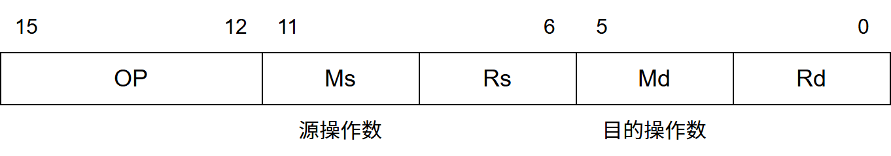
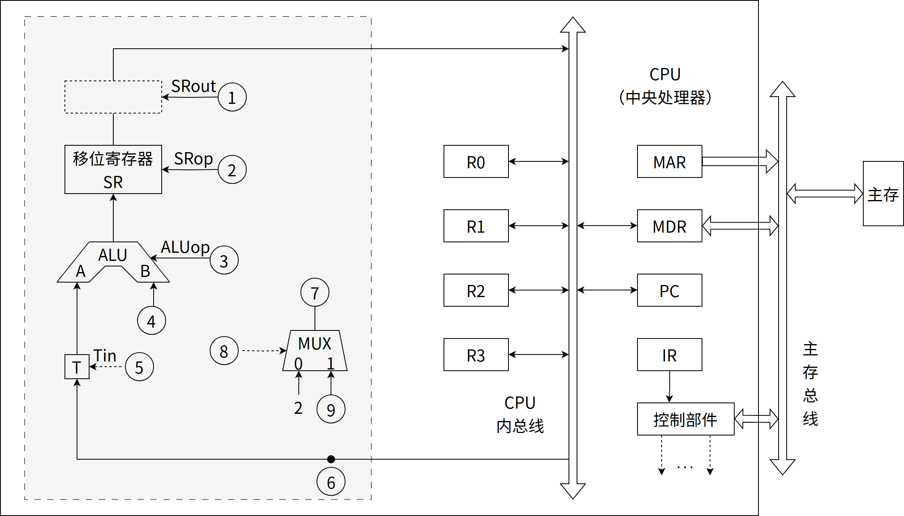
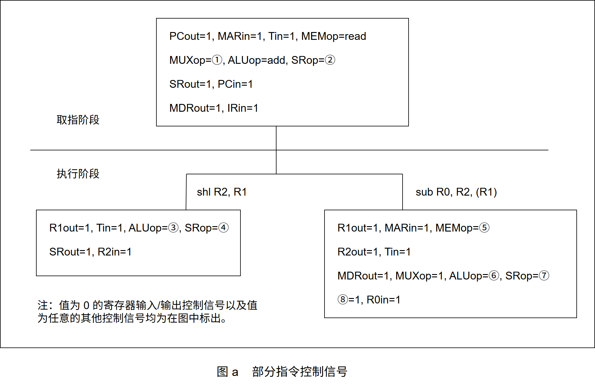
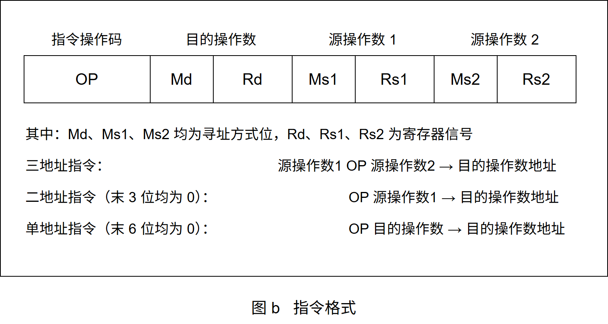
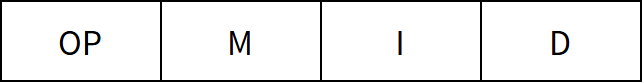
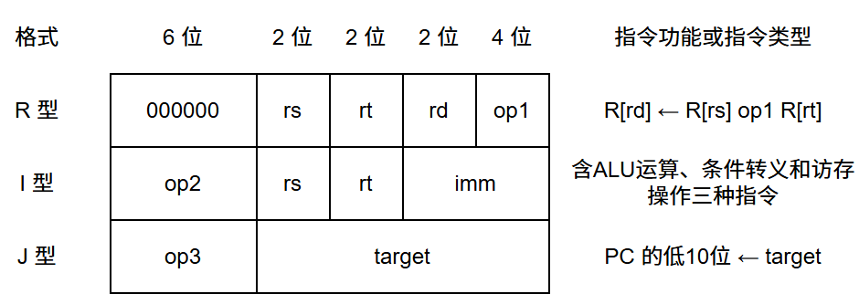
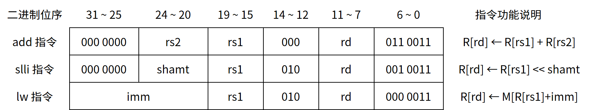
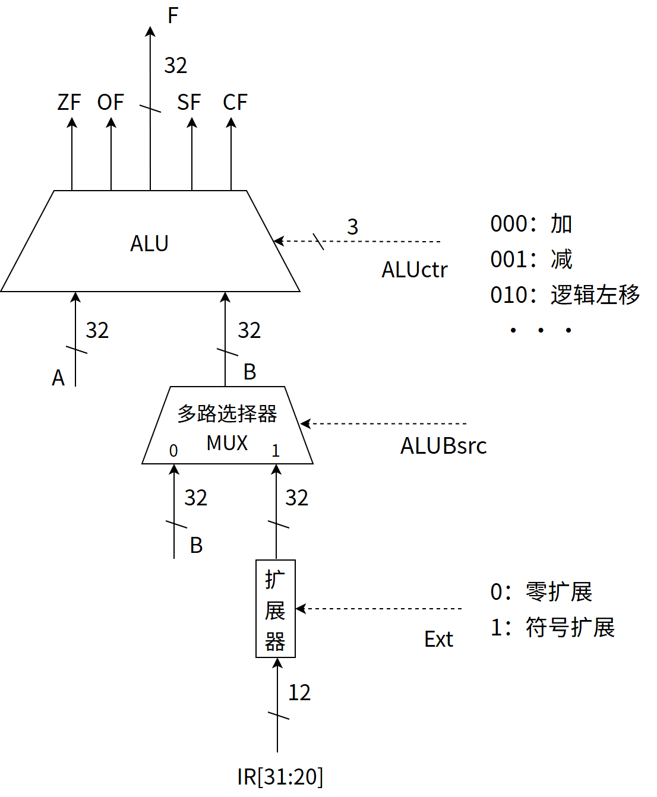

# 第4章 指令系统

> 科目：二、计算机组成原理
> 题目数量：26道
> 年份范围：2009-2024

---

## 2009年

### 第16题（选择题）

某机器字长为16 位，主存按字节编址，转移指令采用相对寻址，由两个字节组成，第一个字节为 操作码字段，第二个字节为相对位移量字段。假定取指令时，每取一个字节PC 自动加1。若某转 移指令所在主存地址为2000H，相对位移量字段的内容为06H，则该转移指令成功转移后的目标 地址是 。

A. 2006H
B. 2007H
C. 2008H
D. 2009H

---

### 第17题（选择题）

下列关于RISC 的叙述中，错误的是 。

A. RISC 普遍采用微程序控制器
B. RISC 大多数指令在一个时钟周期内完成
C. RISC 的内部通用寄存器数量相对CISC 多
D. RISC 的指令数、寻址方式和指令格式种类相对CISC 少

---

## 2010年

### 第18题（选择题）

下列寄存器中，汇编语言程序员可见的是 。

A. 存储器地址寄存器（MAR）
B. 程序计数器（PC）
C. 存储器数据寄存器（MDR）
D. 指令寄存器（IR）

---

### 第43题（综合题）

某计算机字长为 16 位，主存地址空间大小为 128KB，按字编址。采用单字长指令格式，指令各字段定义如下：

转移指令采用相对寻址方式，相对偏移量用补码表示，寻址方式定义如下：
Ms/Md 寻址方式 助记符 含义
000B 寄存器直接 Rn 操作数 ＝ (Rn)
001B 寄存器间接 (Rn) 操作数 ＝ ((Rn))
010B 寄存器间接、自增 (Rn)+ 操作数 ＝ ((Rn)), (Rn) + 1 → Rn
011B 相对 D(Rn) 转移目标地址 ＝ (PC) + (Rn)
请回答下列问题：

(1) 该指令系统最多可有多少条指令？该计算机最多有多少个通用寄存器？存储器地址寄存器（MAR）和存储器数据寄存器（MDR）至少各需要多少位？

(2) 转移指令的目标地址范围是多少？

(3) 若操作码 0010B 表示加法操作（助记符为 add），寄存器 R4 和 R5 的编号分别为 100B 和 101B，R4 的内容为 1234H，R5 的内容为 5678H，地址 1234H 中的内容为 5678H，地址 5678H 中的内容为 1234H，则汇编语言为“add (R4), (R5)+”（逗号前为源操作数，逗号后为目的操作数）对应的机器码是什么（用十六进制表示）？该指令执行后，哪些寄存器和存储单元中的内容会改变？改变后的内容是什么？

---

## 2011年

### 第16题（选择题）

偏移寻址通过将某个寄存器内容与一个形式地址相加而生成有效地址。下列寻址方式中，不．属于 偏移寻址方式的是 。

A. 间接寻址
B. 基址寻址
C. 相对寻址
D. 变址寻址

---

### 第17题（选择题）

某机器有一个标志寄存器， 其中有进位/借位标志CF、零标志ZF、符号标志SF 和溢出标志OF, 条件转移指令bgt (无符号整数比较大于时转移）的转移条件是 。

A. CF + OF ＝ 1
B. SF തതതത + ZF ＝ 1
C. CF + ZF തതതതതതതതതതത ＝ 1
D. CF + SF തതതതതതതതതത ＝ 1

---

## 2012年

### 第18题（选择题）

某计算机的控制器采用微程序控制方式， 微指令中的操作控制字段采用字段直接编码法，共有33 个微命令，构成5 个互斥类，分别包含7、3、12、5 和6 个微命令， 则操作控制字段至少有 。

A. 5 位
B. 6 位
C. 15 位
D. 33 位

---

## 2013年

### 第17题（选择题）

假设变址寄存器R 的内容为1000H，指令中的形式地址为2000H；地址1000H 中的内容为 2000H，地址2000H 中的内容为3000H，地址3000H 中的内容为4000H，则变址寻址方式下访 问到的操作数是 。

A. 1000H
B. 2000H
C. 3000H
D. 4000H

---

## 2014年

### 第17题（选择题）

某计算机有16 个通用寄存器，采用32 位定长指令字，操作码字段（含寻址方式位）为8 位， Store 指令的源操作数和目的操作数分别采用寄存器直接寻址和基址寻址方式。若基址寄存器可 使用任一通用寄存器，且偏移量用补码表示，则Store 指令中偏移量的取值范围是 。

A. －32768～＋32767
B. －32767～＋32768
C. －65536～＋65535
D. －65535～＋65536

---

## 2015年

### 第43题（综合题）

某 16 位计算机的主存按字节编址，存取单位为 16 位；采用 16 位定长指令字格式；CPU 采用单总线结构，主要部分如下图所示。

图中 R0～R3 为通用寄存器；T 为暂存器；SR 为移位寄存器，可实现直送（mov）、左移一位（left）和右移一位（right）3 种操作，控制信号为 SRop，SR 的输出由信号 SRout 控制；ALU 可实现直送 A（mova）、A 加 B（add）、A 减 B（sub）、A 与 B（and）、A 或 B（or）、非 A（not）、A 加 1（inc）这 7 种操作，控制信号为 ALUop。
注：已补充内总线到 MAR 的箭头和内总线到 IR 的箭头。
请回答下列问题。

(1) 图中哪些寄存器是程序员可见的？为何要设置暂存器 T？

(2) 控制信号 ALUop 和 SRop 的位数至少各是多少？

(3) 控制信号 SRout 所控制部件的名称或作用是什么？

(4) 端点

①～

⑨中，哪些端点须连接到控制部件的输出端？

(5) 为完善单总线数据通路，需要在端点

①～

⑨中相应的端点之间添加必要的连线。写出连线的起点和终点，以正确表示数据的流动方向。

(6) 为什么二路选择器 MUX 的一个输入端是 2？

---

### 第44题（综合题）

题 43 中描述的计算机，其部分指令执行过程的控制信号如题 44 图 a 所示。

该机指令格式如题 44 图 b 所示，支持寄存器直接和寄存器间接两种寻址方式，寻址方式位分别为 0 和 1，通用寄存器 R0～R3 的编号分别为 0、1、2 和 3。

请回答下列问题。

(1) 该机的指令系统最多可定义多少条指令？

(2) 假定 inc、shl 和 sub 指令的操作码分别为 01H、02H 和 03H，则以下指令对应的机器代码各是什么？
inc R1; // (R1)+1→R1
shl R2, R1; // (R1)＜＜1→R2
sub R3, (R1), R2; // ((R1))–(R2)→R3

(3) 假设寄存器 X 的输入和输出控制信号分别为 Xin 和 Xout，其值为 1 表示有效，为 0 表示无效（例如，PCout＝1 表示 PC 内容送总线）；存储器控制信号为 MEMop，用于控制存储器的读 (read) 和写 (write) 操作。写出题 44 图 a 中标号

①～

⑧处的控制信号或控制信号的取值。

(4) 指令 sub R1，R3，(R2) 和 inc R1 的执行阶段至少各需要多少个时钟周期？

---

## 2016年

### 第17题（选择题）

某指令格式如下所示。

其中 M 为寻址方式，I 为变址寄存器编号，D 为形式地址。若采用先变址后间址的寻址方式，则操作数的有效地址是（ ）。

A. I+D
B. (I)+D
C. ((I)+
D) D. ((I))+D

---

### 第18题（选择题）

某计算机主存空间为4GB，字长为32 位，按字节编址，采用32 位字长指令字格式。若指令按 字边界对齐存放，则程序计数器（PC）和指令寄存器（IR）的位数至少分别是 。

A. 30、30
B. 30、32
C. 32、30
D. 32、32

---

## 2017年

### 第15题（选择题）

下列寻址方式中，最适合按下标顺序访问一维数组元素的是。

A. 相对寻址
B. 寄存器寻址
C. 直接寻址
D. 变址寻址

---

### 第16题（选择题）

某计算机按字节编址，指令字长固定且只有两种指令格式，其中三地址指令29 条，二地址指令 107 条，每个地址字段为6 位，则指令字长至少应该是 。

A. 24 位
B. 26 位
C. 28 位
D. 32 位

---

## 2018年

### 第18题（选择题）

按字节编址的计算机中，某double 型数组A 的首地址为2000H，使用变址寻址和循环结构访问 数组A，保存数组下标的变址寄存器初值为0，每次循环取一个数组元素，其偏移地址为变址值 乘以sizeof(double)，取完后变址寄存器内容自动加1。若某次循环所取元素的地址为2100H，则 进入该次循环时变址寄存器的内容是 。

A. 25
B. 32
C. 64
D. 100

---

## 2019年

### 第15题（选择题）

某计算机采用大端方式，按字节编址。某指令中操作数的机器数为1234 FF00H，该操作数采用 基址寻址方式，形式地址（用补码表示）为FF12H，基址寄存器的内容为F000 0000H，则该操 作数的LSB（最低有效字节）所在的地址是 。

A. F000 FF12H
B. F000 FF15H
C. EFFF FF12H
D. EFFF FF15H

---

### 第17题（选择题）

某指令功能为R[r2]←R[r1] + M[R[r0]]，其两个源操作数分别采用寄存器、寄存器间接寻址方 式。对于下列给定部件，该指令在取数及执行过程中需要用到的是 。 I. 通用寄存器组（GPRs） II. 算术逻辑单元（ALU） III. 存储器（Memory） IV. 指令译码器（ID）

A. 仅I、II
B. 仅I、II、III
C. 仅II、III、IV
D. 仅I、III、IV

---

## 2020年

### 第16题（选择题）

某计算机采用16 位定长指令字格式，操作码位数和寻址方式位数固定，指令系统有48 条指令， 支持直接、间接、立即、相对4 种寻址方式。单地址指令中，直接寻址方式的可寻址范围 是 。

A. 0～255
B. 0～1023
C. －128～127
D. －512～511

---

## 2021年

### 第17题（选择题）

下列寄存器中，汇编语言程序员可见的 。 I. 指令寄存器 II. 微指令寄存器 III. 基址寄存器 IV. 标志/状态寄存器

A. 仅I、II
B. 仅I、IV
C. 仅II、IV
D. 仅III、IV

---

### 第43题（综合题）

假定计算机 M 字长为 16 位，按字节编址，连接 CPU 和主存的系统总线中地址线为 20 位、数据线为 8 位，采用 16 位定长指令字，指令格式及其说明如下：

其中，op1~op3 为操作码，rs、rt 和 rd 为通用寄存器编号，R[r] 表示寄存器 r 的内容，imm 为立即数，target 为转移目标的形式地址。请回答下列问题。

(1) ALU 的宽度是多少位？可寻址主存空间大小为多少字节？指令寄存器、主存地址寄存器（MAR）和主存数据寄存器（MDR）分别应有多少位？

(2) R 型格式最多可定义多少种操作？I 型和 J 型格式总共最多可定义多少种操作？通用寄存器最多有多少个？

(3) 假定 op1 为 0010 和 0011 时，分别表示带符号整数减法和带符号整数乘法指令，则指令 01B2H 的功能是什么（参考上述指令功能说明的格式进行描述）？若 1、2、3 号通用寄存器当前内容分别为 B052H、0008H、0020H，则分别执行指令 01B2H 和 01B3H 后，3 号通用寄存器内容各是什么？各自结果是否溢出？

(4) 若采用 I 型格式的访存指令中 imm（偏移量）为带符号整数，则地址计算时应对 imm 进行零扩展还是符号扩展？

(5) 无条件转移指令可以采用上述哪种指令格式？

---

## 2022年

### 第18题（选择题）

下列选项中，属于指令集体系结构（ISA）规定的内容是 。 I. 指令字格式和指令类型 II. CPU 的时钟周期 III. 通用寄存器个数和位数 IV. 加法器的进位方式

A. 仅I、II
B. 仅I、III
C. 仅II、IV
D. 仅I、III、IV

---

### 第19题（选择题）

设计某指令系统时，假设采用16 位定长指令字格式，操作码使用扩展编码方式，地址码为6 位，包含零地址、一地址和二地址3 种格式的指令。若二地址指令有12 条，一地址指令有254 条，则零地址指令的条数最多为 。

A. 0
B. 2
C. 64
D. 128

---

## 2023年

### 第17题（选择题）

某运算类型指令中有一个地址码为通用寄存器编号，对应通用寄存器中存放的是操作数或操作数 的地址，CPU 区分两者的依据是 。

A. 操作数的寻址方式
B. 操作数的编码方式
C. 通用寄存器的编号
D. 通用寄存器的内容

---

## 2024年

### 第13题（选择题）

通常情况下，将汇编语言程序中实现特定功能的指令序列定义成一条伪指令 （pseudoinstruction）。 下列选项中，CPU 能理解并直接执行的是 。 I. 伪指令 II. 微指令 III. 机器指令 IV. 汇编指令

A. 仅I 和IV
B. 仅II 和III
C. 仅III 和IV
D. 仅I、II 和IV

---

### 第43题（综合题）

假定计算机 M 字长为 32 位。按字节编址，采用 32 位定长指令字，指令 add slli 和 lw 的格式、编码和功能说明如题 43(a) 图所示。

其中 R[x] 表示通用寄存器 x 的内容，M[x] 表示地址为 x 的存储单元内容，shamt 为移位位数，imm 为补码表示的偏移量。题 43(b) 图给出了计算机 M 的部分数据通路及其控制信号（用箭头虚线表示），其中，A 和 B 分别表示从通用寄存器 rs1 和 rs2 中读出的内容，IR[31:20] 表示指令寄存器中的高 12 位。控制信号 Ext 为 0、1 时扩展器分别实现零扩展，符写扩展 ALUctr 为 000、001、010 时 ALU 分别实现加、减、逻辑左移运算。

请回答下列问题

(1) 计算机 M 最多有多少个通用寄存器？为什么 shamt 字段占 5 位？（2 分）

(2) 执行 add 指令时，控制信号 ALUBsrc 的取值应该是什么？若 rs1 和 rs2 寄存器内容分别是 8765 4321H 和 9876 5432H，则 add 指令执行后，ALU 输出端 F、OF 和 CF 的结果分别是什么？若设 add 指令处理的是无符号整数，则应根据哪个标志判断是否溢出（3 分）

(3) 执行 slli 指令时，控制信号 Ext 的取值可以是 0 也可以是 1，为什么？（2 分）

(4) 执行 lw 指令时，控制信号 Ext、ALUctr 的取值分别是什么？（2 分）

(5) 若一条指令的机器码是 A040 A103H，则该指令一定是 lw 指令，为什么？(2 分）

(6) 若执行该指令时，R[01H]＝FFFF A2D0H，则所读取数据的存储地址是多少？(2 分）

---
