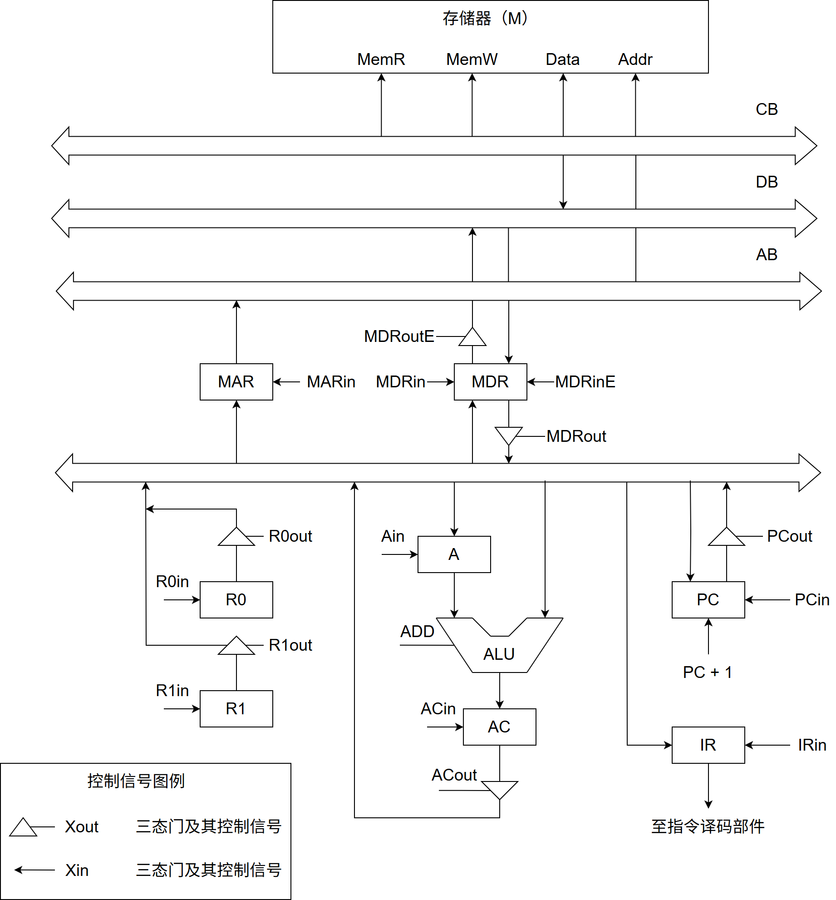
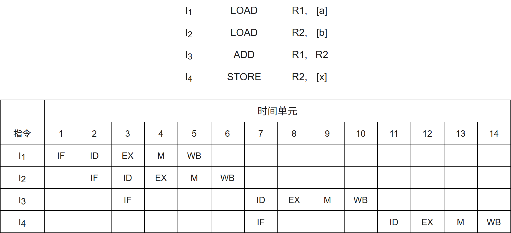
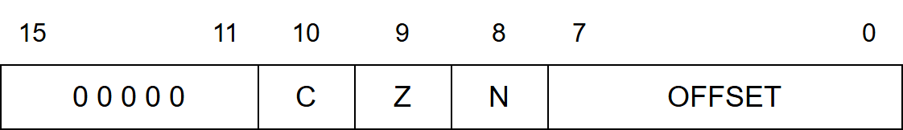
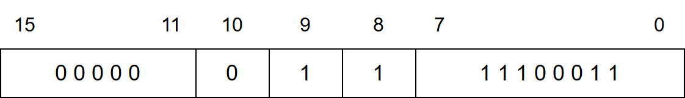
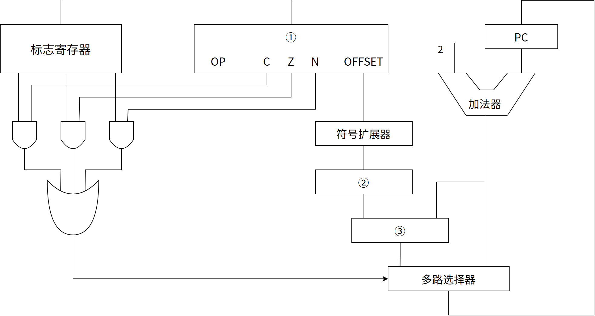
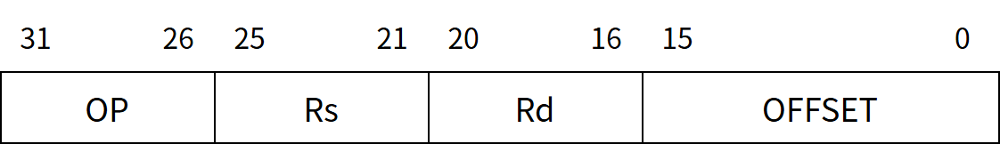
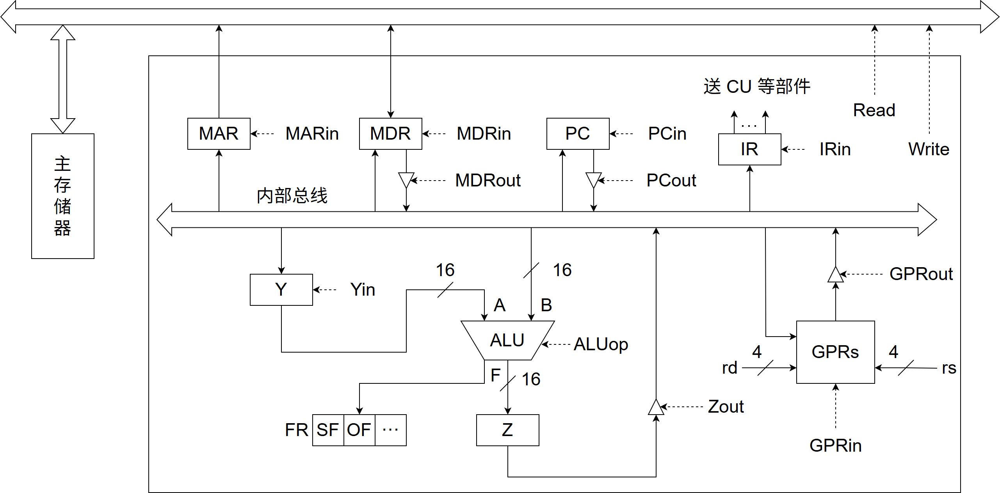
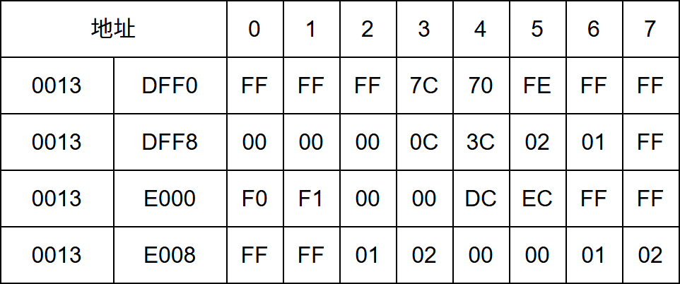

# 第5章 中央处理器

> 科目：二、计算机组成原理
> 题目数量：30道
> 年份范围：2009-2024

---

## 2009年

### 第18题（选择题）

某计算机的指令流水线由四个功能段组成，指令流经各功能段的时间（忽略各功能段之间的缓存 时间）分别为90ns、80ns、70ns、和60ns，则该计算机的CPU 时钟周期至少是 。

A. 90ns
B. 80ns
C. 70ns
D. 60ns

---

### 第19题（选择题）

相对于微程序控制器，硬布线控制器的特点是 。

A. 指令执行速度慢，指令功能的修改和扩展容易
B. 指令执行速度慢，指令功能的修改和扩展难
C. 指令执行速度快，指令功能的修改和扩展容易
D. 指令执行速度快，指令功能的修改和扩展难

---

### 第44题（综合题）

某计算机字长 16 位，采用 16 位定长指令字结构，部分数据通路结构如下图所示，图中所有控制信号为 1 时表示有效、为 0 时表示无效。例如控制信号 MDRinE 为 1 表示允许数据从 DB 打入 MDR，MDRin 为 1 表示允许数据从内总线打入 MDR。假设 MAR 的输出一直处于使能状态。加法指令“ADD (R1)，R0”的功能为 (R0)+((R1)) → (R1)，即将 R0 中的数据与 R1 的内容所指主存单元的数据相加，并将结果送入 R1 的内容所指主存单元中保存。



下表给出了上述指令取指和译码阶段每个节拍（时钟周期）的功能和有效控制信号，请按表中描述方式用表格列出指令执行阶段每个节拍的功能和有效控制信号。
时钟 功能 有效控制信号
C1 MAR ← (PC) PCout, MARin
C2 MDR ← M(MAR)
PC ← (PC) + 1 MemR, MDRinE, PC+1
C3 IR ← (MDR) MDRout, IRin
C4 指令译码 无

---

## 2010年

### 第19题（选择题）

下列选项中，不．会引起指令流水线阻塞的是 。

A. 数据旁路（转发）
B. 数据相关
C. 条件转移
D. 资源冲突

---

## 2011年

### 第18题（选择题）

下列给出的指令系统特点中， 有利于实现指令流水线的是＿＿＿。 I. 指令格式规整且长度一致 II. 指令和数据按边界对齐存放 III. 只有Load/Store 指令才能对操作数进行存储访问

A. 仅I、II
B. 仅II、III
C. 仅I、III
D. I、II、III

---

### 第19题（选择题）

假定不采用Cache 和指令预取技术， 且机器处于“开中断” 状态。在下列有关指令执行的叙述 中，错误的是 。

A. 每个指令周期中CPU 都至少访问内存一次
B. 每个指令周期一定大于等于一个CPU 时钟周期
C. 空操作指令的指令周期中任何寄存器的内容都不会被改变
D. 当前程序在每条指令执行结束时都可能被外部中断打断

---

## 2012年

### 第44题（综合题）

某 16 位计算机中，带符号整数用补码表示，数据 Cache 和指令 Cache 分离。下表给出了指令系统中部分指令格式，其中 Rs 和 Rd 表示寄存器，mem 表示存储单元地址，(x) 表示寄存器 x 或存储单元 x 的内容。
该计算机采用 5 段流水方式执行指令，各流水段分别是取指（IF）、译码/读寄存器（ID）、执行/计算有效地址（EX）、访问存储器（M）和结果写回寄存器（WB），流水线采用 “按序发射，按序完成” 方式，没有采用转发技术处理数据相关，并且同一个寄存器的读和写操作不能在同一个时钟周期内进行。请回答下列问题：



(1) 若 int 型变量 x 的值为 -513，存放在寄存器 R1 中，则执行指令 “SHR R1” 后，R1 的内容是多少（用十六进制表示）？

(2) 若某个时间段中，有连续的 4 条指令进入流水线，在其执行过程中没有发生任何阻塞，则执行这 4 条指令所需的时钟周期数为多少？

(3) 若高级语言程序中某赋值语句为 x＝a+b，x、a 和 b 均为 int 型变量，它们的存储单元地址分别表示为[x]、[a]和[b]。该语句对应的指令序列及其在指令流水线中的执行过程如下图所示。
则这 4 条指令执行过程中，
I3​
的 ID 段和
I4​
的 IF 段被阻塞的原因各是什么？

(4) 若高级语言程序中某赋值语句为 x＝x＊2+a，x 和 a 均为 unsigned int 类型变量，它们的存储单元地址分别表示为[x]、[a]，则执行这条语句至少需要多少个时钟周期？要求模仿题 44 图画出这条语句对应的指令序列及其在流水线中的执行过程示意图。

---

## 2013年

### 第18题（选择题）

某CPU主频为1.03GHz，采用4级指令流水线，每个段的执行需要1个时钟周期。假定CPU执行了100条指令，在其执行过程中没有发生任何流水线阻塞，此时流水线的吞吐率为（）。

A. 0.25×10^9条指令/秒
B. 0.97×10^9条指令/秒
C. 1.0×10^9条指令/秒
D. 1.03×10^9条指令/秒

---

### 第44题（综合题）

某计算机采用 16 位定长指令字格式，其 CPU 中有一个标志寄存器，其中包含进位/借位标志 CF、零标志 ZF 和符号标志 NF。假定为该机设计了条件转移指令，其格式如下：



其中，00000 为操作码 OP；C、Z 和 N 分别为 CF、ZF 和 NF 的对应检测位，某检测位为 1 时表示需检测对应标志，需检测的标志位中只要有一个为 1 就转移，否则就不转移，例如，若 C＝1，Z＝0，N＝1，则需检测 CF 和 NF 的值，当 CF＝1 或 NF＝1 时发生转移；OFFSET 是相对偏移量，用补码表示。转移执行时，转移目标地址为 (PC)+2+2×OFFSET；顺序执行时，下条指令地址为 (PC)+2。请回答下列问题。

(1) 该计算机存储器按字节编址，还是按字编址？该条件转移指令向后（反向）最多可跳转最多少条指令？

(2) 某条件转移指令的地址为 200CH，指令内容如下图所示，若该执行时 CF＝0，ZF＝0，NF＝1，则该指令执行后 PC 的值是多少？若该指令执行时 CF＝1，ZF＝0，NF＝0，则该指令执行后 PC 的值又是多少？请给出计算过程。



(3) 实现“无符号数比较小于等于时转移”功能的指令中，C、Z 和 N 应各是什么？

(4) 以下是该指令对应的数据通路示意图，要求给出中部件

①~

③的名称或功能说明。




---

## 2014年

### 第16题（选择题）

采用指令Cache与数据Cache分离的主要目的是（）。

A. 降低Cache的缺失损失
B. 提高Cache的命中率
C. 降低CPU平均访存时间
D. 减少指令流水线资源冲突

---

### 第18题（选择题）

某计算机采用微程序控制器，共有32 条指令，公共的取指令微程序包含2 条微指令，各指令对 应的微程序平均由4 条微指令组成，采用断定法（下地址字段法）确定下条微指令地址，则微指 令中下地址字段的位数至少是 。

A. 5
B. 6
C. 8
D. 9

---

### 第44题（综合题）

某程序中有如下循环代码段 P：

```c
for (int i=0; i<N; i++) sum += A[i]
```

假设编译时变量 sum 和 i 分别分配在寄存器 R1 和 R2 中。常量 N 在寄存器 R6 中，数组 A 的首地址在寄存器 R3 中。程序段 P 起始地址为 08048100H，对应的汇编代码和机器代码如下表所示。
编号 地址 机器代码 汇编代码 注释
I 08048100H 00022080H loop: sll R4, R2, 2 (R2)«2 → R4
2 08048104H 00083020H add R4, R4, R3 (R4) + (R3) → R4
3 08048108H 8C850000H load R5, 0(R4) ((R4) + 0) → R5
4 0804810CH 00250820H add R1, R1, R5 (R1) + (R5) → R1
5 08048110H 20420001H add R2, R2, 1 (R2) + 1 → R2
6 08048114H 1446FFFAH bne R2, R6, loop if (R2)≠(R6) goto loop
执行上述代码的计算机 M 采用 32 位定长指令字，其中分支指令 bne 采用如下格式：



Op 为操作码，Rs 和 Rd 为寄存器编号，OFFSET 为偏移量，用补码表示。请回答下列问题，并说明理由。

(1) M 的存储器编址单位是什么？

(2) 已知 sll 指令实现左移功能，数组 A 中每个元素占多少位？

(3) 题 44 表中 bne 指令的 OFFSET 字段的值是多少？已知 bne 指令采用相对寻址方式，当前 PC 内容为 bne 指令地址，通过分析题 44 表中指令地址和 bne 指令内容，推断出 bne 指令的转移目标地址计算公式。

(4) 若 M 采用如下“按序发射、按序完成”的 5 级指令流水线：IF（取指）、ID（译码及取数）、EXE（执行）、MEM（访存）、WB（写回寄存器），且硬件不采取任何转发措施，分支指令的执行均引起 3 个时钟周期阻塞，则 P 中那些指令的执行会由于数据相关而发生流水线阻塞？哪条指令的执行会发生控制冒险？为什么指令 1 的执行不会因为与指令 5 的数据相关而发生阻塞？

---

## 2016年

### 第19题（选择题）

在无转发机制的五段基本流水线（取指、译码/读寄存器、运算、访写回寄存器）中，下列指令 序列存在数据冒险的指令对是 I1：add R1, R2, R3; (R2) + (R3)→R1 I2：add R5, R2, R4; (R2) + (R4)→R5 I3：add R4, R5, R3; (R5) + (R3)→R4 I4：add R5, R2, R6; (R2) + (R6)→R5

A. I1 和12
B. I2 和I3
C. I2 和I4
D. I3 和I4

---

### 第20题（选择题）

单周期处理器中所有指令的指令周期为一个时钟周期。下列关于单周期处理器的叙述中，错误的 是 。

A. 可以采用单总线结构数据通路
B. 处理器时钟频率较低
C. 在指令执行过程中控制信号不变
D. 每条指令的CPI 为1

---

## 2017年

### 第17题（选择题）

下列关千超标量流水线特性的叙述中， 正确的是 I. 能缩短流水线功能段的处理时间 II. 能在一个时钟周期内同时发射多条指令 III. 能结合动态调度技术提高指令执行并行性

A. 仅II
B. 仅I、III
C. 仅II、III
D. I、II 和III

---

### 第18题（选择题）

下列关于主存储器（MM）和控制存储器（CS）的叙述中，错误的是 。

A. MM 在CPU 外，CS 在CPU 内
B. MM 按地址访问，CS 按内容访问
C. MM 存储指令和数据，CS 存储微指令
D. MM 用RAM 和ROM 实现，CS 用ROM 实现

---

### 第19题（选择题）

下列关于指令流水线数据通路的叙述中，错误的是 。

A. 包含生成控制信号的控制部件
B. 包含算术逻辑运算部件（ALU）
C. 包含通用寄存器组和取指部件
D. 由组合逻辑电路和时序逻辑电路组合而成

---

### 第44题（综合题）

（10 分）在按字节编址的计算机M 上， 题43 中f1 的部分源程序（阴影部分）与对应的机器 级代码（包括指令的虚拟地址）如下图所示。

```c
int f1(unsigned n) 1 00401020 55 push ebp … … … for(unsigned i =0; i<=n-1;i++) … … … 20 0040105E 39 4D F4 cmp dword ptr[ebp-0Ch], ecx … … … {
    power *= 2;
    23 00401066 D1 E2 shl edx,1 … … … return sum;
    35 0040107F C3 ret
```

其中，机器级代码行包括行号、虚拟地址、机器指令和汇编指令。请回答下列问题。

（1）计算机M 是RISC 还是CISC? 为什么？

（2）f1 的机器指令代码共占多少字节？要求给出计算过程。

（3）第20 条指令cmp 通过i 减n-1 实现对i 和n-1 的比较。执行f1

(0)过程中，当i＝0 时，cmp 指令执行后， 进/借位标志CF 的内容是什么？要求给出计算过程。

（4）第23 条指令shl 通过左移操作实现了power＊2 运算，在f2 中能否也用shl 指令实现power ＊2? 为什么？

---

## 2018年

### 第20题（选择题）

若某计算机最复杂指令的执行需要完成 5 个子功能，分别由功能部件 A~E 实现，各功能部件所需时间分别为 80ps、50ps、50ps、70ps 和 50ps，采用流水线方式执行指令，流水段寄存器延时为 20ps，则 CPU 时钟周期至少为（ ）。

A. 60ps
B. 70ps
C. 80ps
D. 100ps

---

## 2019年

### 第16题（选择题）

下列有关处理器时钟脉冲信号的叙述中，错误的是 。

A. 时钟脉冲信号由机器脉冲源发出的脉冲信号经整形和分频后形成
B. 时钟脉冲信号的宽度称为时钟周期，时钟周期的倒数为机器主频
C. 时钟周期以相邻状态单元间组合逻辑电路的最大延迟为基准确定
D. 处理器总是在每来一个时钟脉冲信号时就开始执行一条新的指令

---

### 第18题（选择题）

在采用“取指、译码/取数、执行、访存、写回”5 段流水线的处理器中，执行如下指令序列，其 中s0、s1、s2、s3 和t2 表示寄存器编号。 I1：add s2, s1, s0 //R[s2]←R[s1]+R[s0] I2：load s3, 0(t2) //R[s3]←M[R[t2]+0] I3：add s2, s2, s3 //R[s2]←R[s2]+R[s3] I4：store s2, 0(t2) //M[R[t2]+0]←R[s3] 下列指令中，不存在数据冒险的是 。

A. I1 和I3
B. I2 和I3
C. I2 和I4
D. I3 和I4

---

### 第45题（综合题）

（16 分）已知f(n) ＝ n! ＝ n×(n – 1)×(n – 2)×…×2×1，计算f(n)的C 语言函数f1 的源程序（带 框部分）及其在32 位计算机M 上的部分机器级代码如下：

```c
int f1(int n) {
    1 00401000 55 push ebp ... if(n>1) 1100401018 83 7D 08 01 cmp dword ptr [ebp+8],1 120040101C 7E 17 jle f1+35h
    (00401035) return n*f1(n-1);
    130040101E 8B 45 08 mov eax, dword ptr[ebp+8] 1400401021 83 E8 01 sub eax, 1 1500401024 50 push eax 1600401025 E8 D6 FF FF FF call f1
    (00401000) ... 1900401030 0F AF C1 imul eax, ecx 2000401033 EB 05 jmp f1+3Ah (0040103a) else return 1;
    2100401035 B8 01 00 00 00 mov eax, 1
}
```

... 2600401040 3B EC cmp ebp, esp ... 300040104A C3 ret 其中，机器级代码行包括行号、虚拟地址、机器指令和汇编指令，计算机M 按字节编址，int 型 数据占32 位。请回答下列问题：

（1）计算f

(10)需要调用函数f1 多少次？执行哪条指令会递归调用f1？

（2）上述代码中，哪条指令是条件转移指令？哪几条指令一定会使程序跳转执行？

（3）根据第16 行的call 指令，第17 行指令的虚拟地址应是多少？已知第16 行的call 指令采用 相对寻址方式，该指令中的偏移量应是多少（给出计算过程）？已知第16 行的call 指令的后4 字节为偏移量，M 是采用大端方式还是采用小端方式？

（4）f

(13) ＝ 6227020800，但f1

(13)的返回值为1932053504，为什么两者不相等？要使f1

(13)能 返回正确的结果，应如何修改f1 的源程序？

（5）第19 行的imul 指令（带符号整数乘）的功能是R[eax]←R[eax]×R[ecx]，当乘法器输出的 高、低32 位乘积之间满足什么条件时，溢出标志OF ＝ 1？要使CPU 在发生溢出时转异常处理， 编译器应在imul 指令后应加一条什么指令？

---

## 2020年

### 第17题（选择题）

下列给出的处理器类型中，理想情况下，CPI 为1 的是 。 I. 单周期CPU II. 多周期CPU III. 基本流水线CPU IV. 超标量流水线CPU

A. 仅I、II
B. 仅I、III
C. 仅II、IV
D. 仅III、IV

---

## 2021年

### 第18题（选择题）

下列关于数据通路的叙述中，错误的是 。

A. 数据通路包含ALU 等组合逻辑（操作）元件
B. 数据通路包含寄存器等时序逻辑（状态）元件
C. 数据通路不包含用于异常事件检测及响应的电路
D. 数据通路中的数据流动路径由控制信号进行控制

---

## 2022年

### 第22题（选择题）

下列关于并行处理技术的叙述中，不．正确的是 。

A. 多核处理器属于MIMD 结构
B. 向量处理器属于SIMD 结构
C. 硬件多线程技术只可用于多核处理器
D. SMP 中所有处理器共享单一物理地址空间

---

### 第43题（综合题）

某 CPU 中部分数据通路如图所示，其中，GPRs 为通用寄存器组；FR 为标志寄存器，用于存放 ALU 产生的标志信息；带箭头虚线表示控制信号，如控制信号 ReaD. Write 分别表示主存读、主存写，MDRin 表示内部总线上数据写入 MDR，MDRout 表示 MDR 的内容送内部总线。



(1) ALU 的输入端 A. B 及输出端 F 的最高位分别为 A15 、 B15 及 F15 ，FR 中的符号标志和溢出标志分别为 SF 和 OF，则 SF 的逻辑表达式是什么？A 加 B. A 减 B 时 OF 的逻辑表达式分别是什么？要求逻辑表达式的输入变量为 A15、B15 及 F15 。

(2) 为什么要设置暂存器 Y 和 Z？

(3) 若 GPRs 的输入端 rs、rd 分别为所读、写的通用寄存器的编号，则 GPRs 中最多有多少个通用寄存器？rs 和 rd 来自图中的哪个寄存器？已知 GPRs 内部有一个地址译码器和一个多路选择器，rd 应该连接地址译码器还是多路选择器？

(4) 取指令阶段（不考虑 PC 增量操作）的控制信号序列是什么？若从发出主存读命令到主存读出数据并传送到 MDR 共需 5 个时钟周期，则取指令阶段至少需要几个时钟周期？

(5) 图中控制信号由什么部件产生？图中哪些寄存器的输出信号会连到该部件的输入端？

---

## 2023年

### 第18题（选择题）

数据通路由组合逻辑元件（操作元件）和时序逻辑元件组成（状态元件）组成，以下给出的元件 中，属于操作元件的是 。 I. 算术逻辑部件（ALU） II. 程序计数器（PC） III. 通用寄存器组（GPRs） IV. 多路选择器（MUX）

A.仅I、II
B.仅I、IV
C. 仅II、III
D. 仅I、II、IV

---

### 第19题（选择题）

某系统采用“取指、译码/取数、执行、访存、写回”5 段流水线，RISC 处理器中执行如下指令序 列（第一列为指令序号），其中s0、s1、s2、s3、t2 表示寄存器编号。 I1 add s2, s1, s0 //R[s2]←R[s1]+R[s0] I2 load s3, 0(s2) //R[s3]←M[R[s2]+0] I3 beq t2, s3, L1 //if R[t2]＝R[s3] jump to L1 I4 addi t2, t2, 20 //R[t2]←R[t2] + 20 I5 L1:... 若采用转发（旁路）技术处理数据冒险，采用硬件阻塞方式处理控制冒险，则在I1~I4 执行过程 中，发生流水线阻塞的指令有 。

A. 仅I3
B. 仅I2、I4
C. 仅I3、I4
D. I2、I3、I4

---

## 2024年

### 第19题（选择题）

对于采用“取指、译码/取数、执行、访存、写回”5 段流水线的RISC 数据通路，下列关于指令流 水线数据冒险处理的叙述中，错误 ．．的是 。

A. 相邻两条指令中的操作数相关可能引起数据冒险
B. 在数据相关的指令间插入“气泡”能避免数据冒险
C. 所有数据冒险都可以通过加入转发（旁路）电路解决
D. 所有数据冒险都能通过调整指令顺序和插入 nop 指令解决

---

### 第44题（综合题）

对于题 43 中的计算机 M，C 语言程序 P 包含的语句 sum+＝a[i];，在 M 中对应的指令序列 S 如下：
slli r4, r2, 2 // R[r4] ＜- R[r2]＜＜2
add r4, r3, r4 // R[r4] ＜- R[r3]+R[r4]
lw r5, 0(r4) // R[r5] ＜- M[R[r4]+0]
add r1, r1, r5 // R[r1] ＜- R[r1]+R[r5]
已知变量 i，sum 和数组 a 都为 int 型，通用寄存器 r1 - r5 的编号为 01H-05H。请回答下列问题。

（1）根据指令序列 s 中每条指令的功能，写出存放数组 a 的首地址、变参 i 和 sum 的通用寄存器编号（3 分）

（2）已知 M 为小端方式，计算机采用页式存储管理方式。页大小为 4KB。若执行到指令序列 s 中第 1 条指令时，i＝5 且 r1 和 r3 的内容分别为 0000 1332H 和 0013 DFF0H。从地址 0013 DFF0H 开始存储单元内容如题 44 图所示。则执行 sum+＝a[i]; 语句后。a[i] 的地址、a[i] 和 sum 的机器数分别是什么（用十六进制表示）？a[i] 所在页的页号是多少？在此次执行中，数据组 a 至少存放在几页中？（5 分）



（3）指令 slli r4, r2, 2 的机器码是什么（用十六进制表示）？若数组 a 改为 short 类型，则指令序列存到 S 中 slli 指令的汇编形式应是什么？

---
