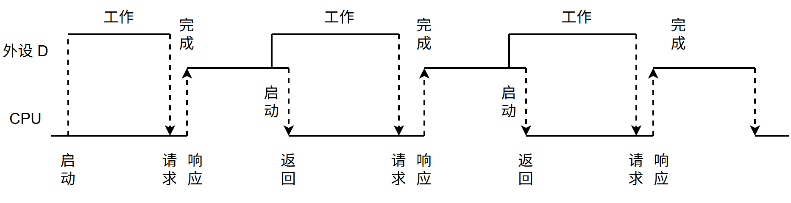

# 第7章 输入输出系统

> 科目：二、计算机组成原理
> 题目数量：38道
> 年份范围：2009-2024

---

## 2009年

### 第22题（选择题）

下列选项中，能引起外部中断的事件是

A. 键盘输入
B. 除数为0
C. 浮点数运算下溢
D. 访存缺页

---

### 第43题（综合题）

（8 分）某计算机的CPU 主频为500MHz，CPI 为5 （即执行每条指令平均需5 个时钟周期）。假 定某外设的数据传输率为0.5MB/s，采用中断方式与主机进行数据传送，以32 位为传输单位，对 应的中断服务程序包含18 条指令，中断服务的其他开销相当于2 条指令的执行时间。请回答下 列问题，要求给出计算过程。

（1）在中断方式下，CPU 用于该外设I/O 的时间占整个CPU 时间的百分比是多少？

（2）当该外设的数据传输率达到5MB/s 时，改用DMA 方式传送数据。假定每次DMA 传送块 大小为5000B，且DMA 预处理和后处理的总开销为500 个时钟周期，则CPU 用于该外设I/O 的时间 占整个CPU 时间的百分比是多少（假设DMA 与CPU 之间没有访存冲突）？

---

## 2010年

### 第21题（选择题）

单级中断系统中，中断服务程序内的执行顺序是 。 I. 保护现场 II. 开中断 III. 关中断 IV. 保存断点 V. 中断事件处理 VI. 恢复现场 VII. 中断返回

A. I→V→VI→II→VII
B. III→I→V→VII
C. III→IV→V→VI→VII
D. IV→I→V→VI→VII

---

### 第22题（选择题）

假定一台计算机的显示存储器用DRAM 芯片实现，若要求显示分辨率为1600×1200，颜色深度 为24 位，帧频为85Hz，显存总带宽的50％用来刷新屏幕，则需要的显存总带宽至少约为 。

A. 245Mbps
B. 979Mbps
C. 1 958Mbps
D. 7 834Mbps

---

## 2011年

### 第21题（选择题）

某计算机有五级中断L4-L0， 中断屏蔽字为M4M3M2M1M0，Mi ＝ 1 （0≤i≤4）表示对Li 级中断 进行屏蔽。若中断响应优先级从高到低的顺序是L4→L0→L2→L1→L3，则L1的中断处理程序中设 置的中断屏蔽字是 。

A. 11110
B. 01101
C. 00011
D. 01010

---

### 第22题（选择题）

某计算机处理器主频为 50MHz，采用定时查询方式控制设备 A 的 I/O，查询程序运行一次所用的时钟周期数至少为 500。在设备 A 工作期间，为数据不丢失，每秒需对其查询至少 200 次，则 CPU 用于设备 A 的 I/O 的时间占整个 CPU 时间的百分比至少是（ ）。

A. 0.02%
B. 0.05%
C. 0.20%
D. 0.50%

---

## 2012年

### 第22题（选择题）

响应外部中断的过程中，中断隐指令完成的操作，除保护断点外，还包括 。 I. 关中断 II. 保存通用寄存器的内容 III. 形成中断服务程序入口地址并送PC

A. 仅I、II
B. 仅I、III
C. 仅II、III
D. I、II、III

---

## 2013年

### 第20题（选择题）

下列选项中，用于提高RAID 可靠性的措施有 . I. 磁盘镜像 II. 条带化 III. 奇偶校验 IV. 增加Cache 机制

A. 仅I、II
B. 仅I、III
C. 仅I、III 和IV
D. 仅II、III 和IV

---

### 第21题（选择题）

某磁盘的转速为10000转/分，平均寻道时间是6ms，磁盘传输速率是20MB/s，磁盘控制器延迟为0.2ms，读取一个4KB的扇区所需的平均时间约为（）。

A. 9ms
B. 9.4ms
C. 12ms
D. 12.4ms

---

### 第22题（选择题）

下列关于中断I/O 方式和DMA 方式比较的叙述中，错误的是 。

A. 中断I/O 方式请求的是CPU 处理时间，DMA 方式请求的是总线使用权
B. 中断响应发生在一条指令执行结束后，DMA 响应发生在一个总线事务完成后
C. 中断I/O 方式下数据传送通过软件完成，DMA 方式下数据传送由硬件完成
D. 中断I/O 方式适用于所有外部设备，DMA 方式仅适用于快速外部设备

---

## 2014年

### 第21题（选择题）

下列有关I/O 接口的叙述中，错误的是 。

A. 状态端口和控制端口可以合用同一个寄存器
B. I/O 接口中CPU 可访问的寄存器称为I/O 端口
C. 采用独立编址方式时，I/O 端口地址和主存地址可能相同
D. 采用统一编址方式时，CPU 不能用访存指令访问I/O 端口

---

### 第22题（选择题）

若某设备中断请求的响应和处理时间为 100ns，每 400ns 发出一次中断请求，中断响应所允许的最长延迟时间为 50ns，则在该设备持续工作过程中，CPU 用于该设备的 I/O 时间占整个 CPU 时间的百分比至少是（ ）。

A. 12.5%
B. 25%
C. 37.5%
D. 50%

---

## 2015年

### 第20题（选择题）

若磁盘转速为 7200rpm，平均寻道时间为 8ms，每个磁道包含 1000 个扇区，则访问一个扇区的平均存取时间大约是（ ）。

A. 8.1ms
B. 12.2ms
C. 16.3ms
D. 20.5ms

---

### 第21题（选择题）

在采用中断I/O 方式控制打印输出的情况下，CPU 和打印控制接囗中的I/O 端口之间交换的信息 不可能是

A. 打印字符
B. 主存地址
C. 设备状态
D. 控制命令

---

### 第22题（选择题）

内部异常（内中断）可分为故障（fault）、陷阱（trap）和终止（abort）三类。下列有关内部异常 的叙述中，错误的是 。

A. 内部异常的产生与当前执行指令相关
B. 内部异常的检测由CPU 内部逻辑实现
C. 内部异常的响应发生在指令执行过程中
D. 内部异常处理后返回到发生异常的指令继续执行

---

## 2016年

### 第22题（选择题）

异常是指令执行过程中在处理器内部发生的特殊事件，中断是来自处理器外部的请求事件。下列 关于中断或异常情况的叙述中，错误的是 。

A. “访存时缺页”属于中断
B. “整数除以0”属于异常
C. “DMA 传送结束”属于中断
D. “存储保护错”属于异常

---

### 第44题（综合题）

假定 CPU 主频为 50MHz，CPI 为 4。设备 D 采用异步串行通信方式向主机传送 7 位 ASCII 字符，通信规程中有 1 位奇校验位和 1 位停止位，从 D 接收启动命令到字符送入 I/O 端口需要 0.5ms。请回答下列问题，要求说明理由。

(1) 每传送一个字符，在异步串行通信线上共需传输多少位？在设备 D 持续工作过程中，每秒钟最多可向 I/O 端口送入多少个字符？

(2) 设备 D 采用中断方式进行输入/输出，示意图如下∶

I/O 端口每收到一个字符申请一次中断，中断响应需 10 个时钟周期，中断服务程序共有 20 条指令，其中第 15 条指令启动 D 工作。若 CPU 需从 D 读取 1000 个字符，则完成这一任务所需时间大约是多少个时钟周期？CPU 用于完成这一任务的时间大约是多少个时钟周期？在中断响应阶段 CPU 进行了哪些操作？

---

## 2017年

### 第21题（选择题）

I/O 指令实现的数据传送通常发生在 。

A. I/O 设备和I/O 端口之间
B. 通用寄存器和I/O 设备之间
C. I/O 端口和I/O 端口之间
D. 通用寄存器和I/O 端口之间

---

### 第22题（选择题）

下列关于多重中断系统的叙述中，错误的是（ ）。

A. 在一条指令执行结束时响应中断
B. 中断处理期间 CPU 处于关中断状态
C. 中断请求的产生与当前指令的执行无关
D. CPU 通过采样中断请求信号检测中断请求

---

## 2018年

### 第22题（选择题）

下列关于外部I/O 中断的叙述中，正确的是 。

A. 中断控制器按所接收中断请求的先后次序进行中断优先级排队
B. CPU 响应中断时，通过执行中断隐指令完成通用寄存器的保护
C. CPU 只有在处于中断允许状态时，才能响应外部设备的中断请求
D. 有中断请求时，CPU 立即暂停当前指令执行，转去执行中断服务程序

---

### 第43题（综合题）

（8 分）假定计算机的主频为500MHz，CPI 为4。现有设备A 和B，其数据传输率分别为 2MB/s 和40MB/s，对应I/O 接口中各有一个32 位数据缓冲寄存器。请回答下列问题，要求给出 计算过程。

（1）若设备A 采用定时查询I/O 方式，每次输入/输出都至少执行10 条指令。设备A 最多间隔 多长时间查询一次才能不丢失数据？CPU 用于设备A 输入/输出的时间占CPU 总时间的百分比 至少是多少？

（2）在中断I/O 方式下，若每次中断响应和中断处理的总时钟周期数至少为400，则设备B 能 否采用中断I/O 方式？为什么？

（3）若设备B 采用DMA 方式，每次DMA 传送的数据块大小为1000B，CPU 用于DMA 预处 理和后处理的总时钟周期数为500，则CPU 用于设备B 输入/输出的时间占CPU 总时间的百分比 最多是多少？

---

## 2019年

### 第20题（选择题）

下列关于磁盘存储器的叙述中，错误的是（ ）。

A. 磁盘的格式化容量比非格式化容量小
B. 扇区中包含数据、地址和校验等信息
C. 磁盘存储器的最小读写单位为一字节
D. 磁盘存储器由磁盘控制器、磁盘驱动器和盘片组成

---

### 第21题（选择题）

某设备以中断方式与 CPU 进行数据交换，CPU 主频为 1GHz，设备接口中的数据缓冲寄存器为 32 位，设备的数据传输率为 50KBps。若每次中断开销（包括中断响应和中断处理）为 1000 个时钟周期，则 CPU 用于该设备输入/输出的时间占整个 CPU 时间的百分比最多是（ ）。

A. 1.25%
B. 2.5%
C. 5%
D. 12.5%

---

### 第22题（选择题）

下列关于DMA 方式的叙述中，正确的是 。 I. DMA 传送前由设备驱动程序设置传送参数 II. 数据传送前由DMA 控制器请求总线使用权 III. 数据传送由DMA 控制器直接控制总线完成 IV. DMA 传送结束后的处理由中断服务程序完成

A. 仅I、II
B. 仅I、III、IV
C. 仅II、III、IV
D. I、II、III、IV

---

### 第44题（综合题）

（7 分）某计算机系统中的磁盘有300 个柱面，每个柱面有10 个磁道，每个磁道有200 个扇 区，扇区大小为512B。文件系统的每个簇包含2 个扇区。请回答下列问题：

（1）磁盘的容量是多少？

（2）假设磁头在85 号柱面上，此时有4 个磁盘访问请求，簇号分别为100 260、60 005、101 660 和110 560。若采用最短寻道时间优先（SSTF）调度算法，则系统访问簇的先后次序是什 么？

（3）第100 530 簇在磁盘上的物理地址是什么？将簇号转换成磁盘物理地址的过程是由I/O 系统 的什么程序完成的？

---

## 2020年

### 第18题（选择题）

下列关于“自陷”（Trap，也称陷阱）的叙述中，错误的是 。

A. 自陷是通过陷阱指令预先设定的一类外部中断事件
B. 自陷可用于实现程序调试时的断点设置和单步跟踪
C. 自陷发生后CPU 将转去执行操作系统内核相应程序
D. 自陷处理完成后返回到陷阱指令的下一条指令执行

---

### 第20题（选择题）

下列事件中，属于外部中断事件的是 。 I. 访存时缺页 II. 定时器到时 III. 网络数据包到达

A. 仅 I、II
B. 仅 I、III
C. 仅II、III
D. I、II 和III

---

### 第21题（选择题）

外部中断包括不可屏蔽中断（NMI）和可屏蔽中断，下列关于外部中断的叙述中错误的是（ ）。

A. CPU 处于关中断状态时也能响应 NMI 请求；
B. 一旦可屏蔽中断请求信号有效，CPU 将立即响应；
C. 不可屏蔽中断的优先级比可屏蔽中断的优先级高；
D. 可通过中断屏蔽字改变可屏蔽中断的处理优先级。

---

### 第22题（选择题）

若设备采用周期挪用DMA 方式进行输入和输出，每次DMA 传送的数据块大小为512 字节，相 应的I/O 接口中有一个32 位数数据缓冲寄存器。对于数据输入过程，下列叙述中，错误的 是 。

A. 每准备好32 位数据，DMA 控制器就发出一次总线请求
B. 相对于CPU，DMA 控制器的总线使用权的优先级更高
C. 在整个数据块的传送过程中，CPU 不可以访问主存储器
D. 数据块传送结束时，会产生“DMA 传送结束”中断请求

---

## 2021年

### 第20题（选择题）

下列选项中，不属于I/O 接口的是 。

A. 磁盘驱动器
B. 打印机适配器
C. 网络控制器
D. 可编程中断控制器

---

### 第21题（选择题）

异常事件在当前指令执行过程中进行检测，中断请求则在当前指令执行后进行检测。下列事件 中，相应处理程序执行后，必须回到当前指令重新执行的是 。

A. 系统调用
B. 页缺失
C. DMA 传送结束
D. 打印机缺纸

---

### 第22题（选择题）

下列是关于多重中断系统中CPU 响应中断的叙述，其中错误的是 。

A. 仅在用户态（执行用户程序）下，CPU 才能检测和响应中断
B. CPU 只有在检测到中断请求信号后，才会进入中断响应周期
C. 进入中断响应周期时，CPU 一定处于中断允许（开中断）状态
D. 若CPU 检测到中断请求信号，则一定存在未被屏蔽的中断源请求信号

---

## 2022年

### 第21题（选择题）

下列关于中断I/O 方式的叙述中，不．正确的是 。

A. 适用于键盘、针式打印机等字符型设备
B. 外设和主机之间的数据传送通过软件完成
C. 外设准备数据的时间应小于中断处理时间
D. 外设为某进程准备数据时CPU 可运行其他进程

---

### 第44题（综合题）

（8 分）假设某磁盘驱动器中有4 个双面盘片，每个盘面有20000 个磁道，每个磁道有500 个扇 区，每个扇区可记录512 字节的数据，盘片转速为7200RPM（转/分），平均寻道时间为5ms。请 回答下列问题。

（1）每个扇区包含数据及其地址信息，地址信息分为3 个字段。这3 个字段的名称各是什么？ 对于该磁盘，各字段至少占多少位？

（2）一个扇区的平均访问时间约为多少？

（3）若采用周期挪用DMA 方式进行磁盘与主机之间的数据传送，磁盘控制器中的数据缓冲区 大小为64 位，则在一个扇区读写过程中，DMA 控制器向CPU 发送了多少次总线请求？若CPU 检测到DMA 控制器的总线请求信号时也需要访问主存，则DMA 控制器是否可以获得总线使用 权？为什么？

---

## 2023年

### 第21题（选择题）

下列关于硬件和异常/中断关系的叙述中，错误的是（ ）。

A. CPU 在执行一条指令过程中检测异常事件
B. CPU 在执行完一条指令时检测中断请求信号
C. 开中断时CPU 检测到中断请求后就进行中断响应
D. 外部设备通过中断控制器向CPU 发中断结束信号

---

### 第22题（选择题）

下列关于 I/O 控制方式的叙述中，错误的是（ ）。

A. 查询方式下，通过 CPU 执行查询程序进行 I/O 操作
B. 中断方式下，通过 CPU 执行中断服务程序进行 I/O 操作
C. DMA 方式下，通过 CPU 执行 DMA 传送程序进行 I/O 操作
D. 对于 SSD 网络适配器等高速设备，采用 DMA 方式输入/输出

---

## 2024年

### 第21题（选择题）

下列关于中断I/O 方式的叙述中，错误 ．．的是 。

A. 中断屏蔽字用于确定中断响应的优先级
B. 保存断点和程序状态字在中断响应阶段完成
C. 保存通用寄存器和设置新中断屏蔽字由软件实现
D. 单重中断方式下中断处理时CPU 处于关中断状态

---

### 第22题（选择题）

DMA 控制I/O 方式下，设备的输入/输出由DMA 控制器控制完成，此时，DMA 控制器控制的数 据传输通路位于 。

A. CPU 和主存之间
B. CPU 和DMA 控制器之间
C. 设备接口和主存之间
D. 设备接口和 DMA 控制器之间

---
