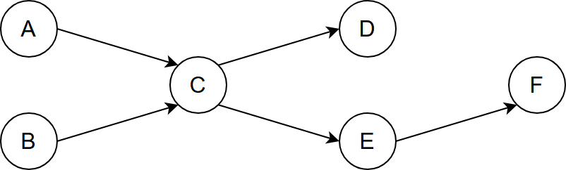
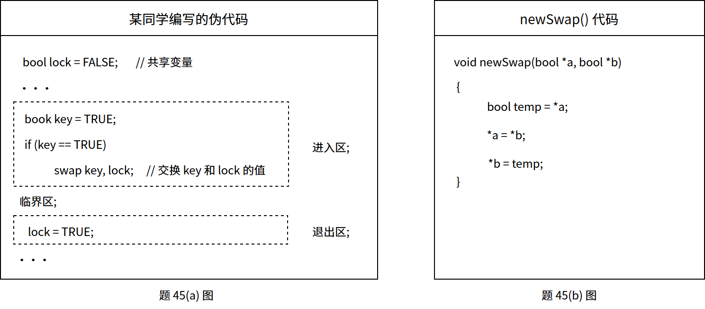

# 第2章 进程与线程

> 科目：三、操作系统
> 题目数量：36道
> 年份范围：2009-2024

---

## 2009年

### 第23题（选择题）

单处理机系统中，可并行的是 I. 进程与进程 II. 处理机与设备 III. 处理机与通道 IV. 设备与设备

A. I、II 和III
B. I、II 和IV
C. I、III 和IV
D. II、III 和IV

---

## 2010年

### 第24题（选择题）

下列选项中，导致创建新进程的操作是 。 I. 用户登录成功 II. 设备分配 III. 启动程序执行

A. 仅I 和II
B. 仅II 和III
C. 仅I 和III
D. I、II 和III

---

### 第25题（选择题）

设与某资源关联的信号量初值为3，当前值为1。若M 表示该资源的可用个数，N 表示等待该资 源的进程数，则M、N 分别是 。

A. 0、1
B. 1、0
C. 1、2
D. 2、0

---

### 第27题（选择题）

进程P0和P1的共享变量定义及其初值为：

```c
boolean flag[2];
int turn=0;
flag[0]=FALSE;
flag[1]=FALSE
```

若进程P0和P1访问临界资源的类C 伪代码实现如下：

```c
void P0()//进程P0 {
    while(TRUE) {
        flag[0]=TRUE;
        turn=1;
        while(flag[1]&&(turn==1));
        临界区;
        flag[0]=FALSE;
    }
}
void P1()//进程P1 {
    while(TRUE) {
        flag[1]=TRUE;
        turn=0;
        while(flag[0]&&(turn==0));
        临界区;
        flag[1]=FALSE;
    }
}
```

则并发执行进程P0和P1时产生的情形是 。

A. 不能保证进程互斥进入临界区，会出现“饥饿”现象
B. 不能保证进程互斥进入临界区，不会出现“饥饿”现象
C. 能保证进程互斥进入临界区，会出现“饥饿”现象
D. 能保证进程互斥进入临界区，不会出现“饥饿”现象

---

## 2011年

### 第25题（选择题）

在支持多线程的系统中， 进程P 创建的若干线程不能共享的是 。

A. 进程P 的代码段
B. 进程P 中打开的文件
C. 进程P 的全局变量
D. 进程P 中某线程的栈指针

---

### 第32题（选择题）

有两个并发执行的进程P1和P2, 共享初值为1 的变量x。P1对x 加1, P2 对x 减l。加1 和减1 操 作的指令序列分别如下所示。 //加1 操作 load R1, x //取x 到寄存器R1 中 inc R1 store x, R1 //将R1 的内容存入x //减1 操作 load R2, x dec R2 store x, R2 两个操作完成后，x 的值 。

A. 可能为－1 或3
B. 只能为1
C. 可能为0、1 或2
D. 可能为－1、0、1 或2

---

### 第45题（综合题）

（8 分）某银行提供1 个服务窗口和10 个供顾客等待的座位。顾客到达银行时，若有空座位，则 到取号机上领取一个号，等待叫号。取号机每次仅允许一位顾客使用。当营业员空闲时，通过叫 号选取一位顾客， 并为其服务。顾客和营业员的活动过程描述如下：

```c
cobegin {
    process 顾客i {
        从取号机获取一个号码； 等待叫号； 获取服务；
    }
    process 营业员 {
        while (TRUE) {
            叫号;
            为客户服务
        }
    }
}coend
```

请添加必要的信号量和P、V （或wait()、signal()）操作，实现上述过程中的互斥与同步。要求 写出完整的过程，说明信号量的含义并赋初值。

---

## 2012年

### 第31题（选择题）

下列关于进程和线程的叙述中，正确的是 。

A. 不管系统是否支待线程，进程都是资源分配的基本单位
B. 线程是资源分配的基本单位，进程是调度的基本单位
C. 系统级线程和用户级线程的切换都需要内核的支持
D. 同一进程中的各个线程拥有各自不同的地址空间

---

## 2013年

### 第45题（综合题）

（7 分）某博物馆最多可容纳500 人同时参观，有一个出入口，该出入口一次仅允许一个人通过。 参观者的活动描述如下： cobegin 参观者进程i: { … 进门； … 参观； … 出门； … } coend 请添加必要的信号量和P、V （或wait()、signal()）操作，以实现上述过程中的互斥与同步。要求 写出完整的过程，说明信号量的含义并赋初值。

---

## 2014年

### 第26题（选择题）

一个进程的读磁盘操作完成后，操作系统针对该进程必做的是 。

A. 修改进程状态为就绪态
B. 降低进程优先级
C. 给进程分配用户内存空间
D. 增加进程时间片大小

---

### 第31题（选择题）

下列关于管道（Pipe）通信的叙述中，正确的是 。

A. 一个管道可实现双向数据传输
B. 管道的容量仅受磁盘容量大小限制
C. 进程对管道进行读操作和写操作都可能被阻塞
D. 一个管道只能有一个读进程或一个写进程对其操作

---

### 第47题（综合题）

（8 分）系统中有多个生产者进程和多个消费者进程，共享一个能存放1000 件产品的环形缓冲区 （初始为空）。当缓冲区未满时，生产者进程可以放入其生产的一件产品，否则等待；当缓冲区未 空时，消费者进程可以从缓冲区取走一件产品，否则等待。要求一个消费者进程从缓冲区连续取 出10 件产品后，其他消费者进程才可以取产品。请使用信号量P，V （或wait(), signal())操作实现 进程间的互斥与同步，要求写出完整的过程，并说明所用信号量的含义和初值。

---

## 2015年

### 第25题（选择题）

下列选项中，会导致进程从执行态变为就绪态的事件是 。

A. 执行P(wait)操作
B. 申请内存失败
C. 启动I/O 设备
D. 被高优先级进程抢占

---

### 第45题（综合题）

（9 分）有A、B 两人通过信箱进行辩论，每个人都从自己的信箱中取得对方的问题。将答案和 向对方提出的新问题组成一个邮件放入对方的邮箱中。假设A 的信箱最多放M 个邮件，B 的信 箱最多放N 个邮件。初始时A 的信箱中有x 个邮件（0 ＜ x ＜ M），B 的信箱中有y 个（0 ＜ y ＜ N）。辩论者每取出一个邮件，邮件数减1。A 和B 两人的操作过程描述如下：

```c
CoBegin A {
    while (TRUE) {
        从A 的信箱中取出一个邮件;
        回答问题并提出一个新问题;
        将新邮件放入B 的邮箱;
    }
}
```

B{

```c
while (TRUE) {
    从B 的信箱中取出一个邮件;
    回答问题并提出一个新问题;
    将新邮件放入A 的邮箱;
}
```

} 当信箱不为空时，辩论者才能从信箱中取邮件，否则需要等待。当信箱不满时，辩论者才能 将新邮件放入信箱，否则需要等待。请添加必要的信号量和P、V（或wait、signal）操作，以实 现上述过程的同步。要求写出完整过程，并说明信号量的含义和初值。

---

## 2016年

### 第27题（选择题）

使用 TSL (Test and Set Lock) 指令实现进程互斥的伪代码如下所示。

```c
do {
    ... while (TSL(&lock));
    critical section;
    lock = FALSE;
    ...
} while (TRUE)
```

; 下列与该实现机制相关的叙述中，正确的是（ ）。

A. 退出临界区的进程负责唤醒阻塞态进程
B. 等待进入临界区的进程不会主动放弃 CPU
C. 上述伪代码满足“让权等待”的同步准则
D. while (TSL(&lock)) 应在关中断状态下执行

---

### 第30题（选择题）

进程P1和P2均包含并发执行的线程，部分伪代码描述如下所示。

```c
int x = 0;
Thread1() {
    int a;
    a=1;
    x += 1;
}
Thread2() {
    int a;
    a=2;
    x += 2;
}
//进程P2
int x = 0;
Thread3() {
    int a;
    a = x;
    x += 3;
}
Thread4() {
    int b b=x;
    x += 4;
}
```

下列选项中，需要互斥执行的操作是 。

A. a ＝ 1 与a ＝ 2
B. a ＝ x 与 b ＝ x
C. x +＝ 1 与 x +＝ 2
D. x +＝1 与x+＝3

---

### 第32题（选择题）

下列关于管程的叙述中，错误的是

A. 管程只能用于实现进程的互斥
B. 管程是由编程语言支持的进程同步机制
C. 任何时候只能有一个进程在管程中执行
D. 管程中定义的变量只能被管程内的过程访问 题33～41 均依据题33～41 图回答。

---

## 2017年

### 第46题（综合题）

（8 分）某进程中有3 个并发执行的线程thread1、thread2 和thread3, 其伪代码如下所示。 请添加必要的信号量和P、V(或wait()、signal())操作，要求确保线程互斥访问临界资源，并且最 大限度地并发执行。

---

## 2018年

### 第25题（选择题）

属于同一进程的两个线程thread1 和thread2 并发执行，共享初值为0 的全局变量x。thread1 和 thread2 实现对全局变量x 加1 的机器级代码描述如下。 thread1 thread2 mov R1, x //(x) → R1 inc R1 //(R1) + 1 → R1 mov x, R1 //(R1) → x mov R2, x //(x) → R2 inc R2 //(R2) + 1 → R2 mov x, R2 //(R2) → x 在所有可能的指令执行序列中，使x 的值为2 的序列个数是 。

A. 1
B. 2
C. 3
D. 4

---

### 第28题（选择题）

若 x 是管程内的条件变量，则当进程执行 `x.wait`() 时所做的工作是（）。

A. 实现对变量 x 的互斥访问
B. 唤醒一个在 x 上阻塞的进程
C. 根据 x 的值判断该进程是否进入阻塞态
D. 阻塞该进程，并将之插入 x 的阻塞队列中

---

### 第32题（选择题）

下列同步机制中，可以实现让权等待的是 。

A. Peterson 方法
B. swap 指令
C. 信号量方法
D. TestAndSet 指令

---

## 2019年

### 第23题（选择题）

下列关于线程的描述中，错误的是 。

A. 内核级线程的调度由操作系统完成
B. 操作系统为每个用户级线程建立一个线程控制块
C. 用户级线程间的切换比内核级线程间的切换效率高
D. 用户级线程可以在不支持内核级线程的操作系统上实现

---

### 第24题（选择题）

下列选项中，可能将进程唤醒的事件是（ ）。 Ⅰ.I/O 结束 Ⅱ.某进程退出临界区 Ⅲ.当前进程的时间片用完

A. 仅Ⅰ
B. 仅Ⅲ
C. 仅Ⅰ、Ⅱ
D. Ⅰ、Ⅱ、Ⅲ

---

## 2020年

### 第29题（选择题）

下列关于父进程与子进程的叙述中，错误的是 。

A. 父进程与子进程可以并发执行
B. 父进程与子进程共享虚拟地址空间
C. 父进程与子进程有不同的进程控制块
D. 父进程与子进程不能同时使用同一临界资源

---

### 第32题（选择题）

下列准则中，实现临界区互斥机制必须遵循的是 。 I. 两个进程不能同时进入临界区 II. 允许进程访问空闲的临界资源 III. 进程等待进入临界区的时间是有限的 IV. 不能进入临界区的执行态进程立即放弃CPU

A. 仅 I、IV
B. 仅 II、III
C. 仅 I、II、III
D. 仅 I、III、IV

---

### 第45题（综合题）

（7 分）现有5 个操作A、B、C、D 和E，操作C 必须在A 和B 完成后执行，操作E 必须在C 和D 完成后执行，请使用信号量的wait()、signal()操作（P、V 操作）描述上述操作之间的同步 关系，并说明所用信号量及其初值。

---

## 2021年

### 第24题（选择题）

下列操作中，操作系统在创建新进程时，必须完成的是 。 I. 申请空白的进程控制块 II. 初始化进程控制块 III. 设置进程状态为执行态

A. 仅I
B. 仅I、II
C. 仅I、III
D. 仅II、III

---

### 第45题（综合题）

（7 分）下表给出了整型信号量S 的wait()和signal()操作的功能描述，以及采用开/关中断指令实 现信号量操作互斥的两种方法。 功能描述 方法1 方法2

```c
Semaphore S;
wait(S) {
    while(S<=0);
    S=S-1;
}
signal(S) {
    S=S+1;
}
Semaphore S;
wait(S) {
    关中断;
    While(S<=0);
    S=S-1;
    开中断;
}
signal(S) {
    关中断;
    S=S+1;
    开中断;
}
Semaphore S;
wait(S) {
    关中断;
    while(S<=0) {
        开中断;
        关中断;
    }
    S=S-1;
    开中断;
}
signal(S) {
    关中断;
    S=S+1;
    开中断;
}
```

请回答下列问题。

（1）为什么在wait()和signal()操作中对信号量S 的访问必须互斥执行？

（2）分别说明方法1 和方法2 是否正确。若不正确，请说明理由。

（3）用户程序能否使用开/关中断指令实现临界区互斥？为什么？

---

## 2022年

### 第28题（选择题）

下列事件或操作中，可能导致进程P 由执行态变为阻塞态的是 。 I. 进程P 读文件 II. 进程P 的时间片用完 III. 进程P 申请外设 IV. 进程P 执行信号量的wait()操作

A. 仅I、IV
B. 仅II、III
C. 仅III、IV
D. 仅I、III、IV

---

### 第46题（综合题）

某进程的两个线程 T1 和 T2 并发执行 A. B. C. D. E 和 F 共 6 个操作，其中 T1 执行 A. E 和 F，T2 执行 B. C 和 D。题 46 图表示上述 6 个操作的执行顺序所必须满足的约束：C 在 A 和 B 完成后执行，D 和 E 在 C 完成后执行，F 在 E 完成后执行。请使用信号量的 wait()、signal() 操作描述 T1 和 T2 之间的同步关系，并说明所用信号量的作用及其初值。




---

## 2023年

### 第27题（选择题）

下列由当前线程引起的事件或执行的操作中，可能导致该线程由执行形态变为就绪态的 是 。

A. 键盘输入
B. 缺页异常
C. 主动出让CPU
D. 执行信号量的wait()操作

---

### 第30题（选择题）

进程R 和S 共享数据data，若data 在R 和S 中所在页的页号分别为p1 和p2，两个页所对应的页 框号分别为f1 和f2，则下列叙述中，正确的是 。

A. p1 和p2 一定相等，f1 和f2 一定相等
B. p1 和p2 一定相等，f1 和f2 不一定相等
C. p1 和p2 不一定相等，f1 和f2 一定相等
D. p1 和p2 不一定相等，f1 和f2 不一定相等

---

### 第45题（综合题）

现要求学生使用 swap 指令和布尔型变量 lock 实现临界区互斥。lock 为线程间共享的变量。lock 的值为 TRUE 时线程不能进入临界区，为 FALSE 时线程能够进入临界区。某同学编写的实现临界区互斥的伪代码如题 45(a) 图所示。



(1) 题 45(a) 图中伪代码中哪些语句存在错误？将其改为正确的语句（不增加语句条数）。

(2) 题 45(b) 图中给出了两个变量值的函数 newSwap() 的代码是否可以用函数调用语句“newSwap(&key, &lock)”代替指令“swap key, lock”以实现临界区的互斥？为什么？

---

## 2024年

### 第24题（选择题）

下列选项中，操作系统在终止进程时不一定 ．．．执行的是 。

A. 终止子进程
B. 回收进程占用的设备
C. 撤销进程控制块
D. 回收为进程分配的内存

---

### 第28题（选择题）

若进程P 中的线程T 先打开文件，得到文件描述符fd，再创建两个线程Ta 和Tb，则下列资源中， Ta 与Tb 可共享的是 I. 进程P 的地址空间 II. 线程T 的栈 III. 文件描述符fd

A. 仅I
B. 仅I、III
C. 仅II、III
D. I、II、III

---

### 第46题（综合题）

（8 分）计算机系统中的进程之间往往需要相互协作以完成一个任务。在某网络系统中，缓冲区 B 用于存放一个数据分组，对B 的操作有C1、C2 和C3。C1 将一个数据分组写入B 中，C2 从 B 中读出一个数据分组，C3 对B 中的数据分组进行修改。要求B 为空时才能执行C1，B 非空时 才能执行C2 和C3。

（1）假设进程P1 和P2 均需要执行C1，实现C1 的代码是否为临界区？为什么？（2 分）

（2）假设B 初始为空，进程P1 执行C1 一次，进程P2 执行C2 一次。请定义尽可能少的信号 量，并用wait()、signal()操作描述进程P1 和P2 之间的同步或互斥关系，说明所用信号量的作用 及其初值。（3 分）

（3）假设B 初始不为空，进程P1 和P2 各执行C3 一次。请定义尽可能少的信号量，并用 wait()、signal()操作描述进程P1 和P2 之间的同步或互斥关系，说明所用信号量的作用及其初 值。（3 分）

---
