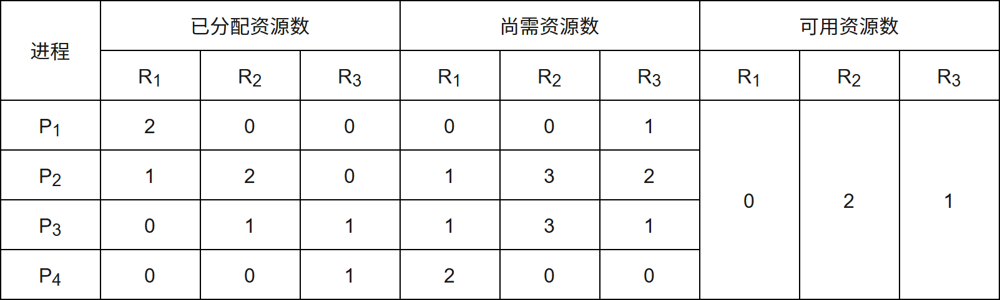
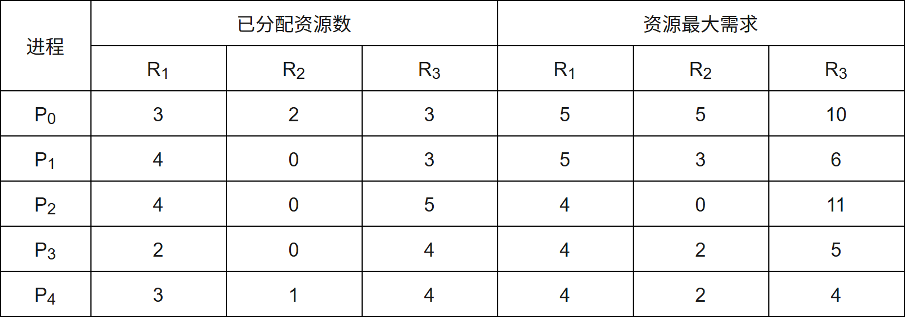
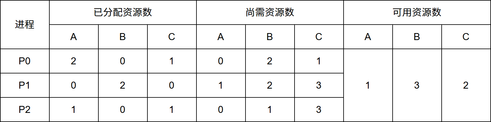

# 第3章 处理机调度与死锁

> 科目：三、操作系统
> 题目数量：33道
> 年份范围：2009-2024

---

## 2009年

### 第24题（选择题）

下列进程调度算法中，综合考虑进程等待时间和执行时间的是

A. 时间片轮转调度算法
B. 短进程优先调度算法
C. 先来先服务调度算法
D. 高响应比优先调度算法

---

### 第25题（选择题）

某计算机系统中有8 台打印机，由K 个进程竞争使用，每个进程最多需要3 台打印机。该系统可 能会发生死锁的K 的最小值是 。

A. 2
B. 3
C. 4
D. 5

---

## 2010年

### 第26题（选择题）

下列选项中，降低进程优先级的合理时机是 。

A. 进程的时间片用完
B. 进程刚完成I/O，进入就绪列队
C. 进程长期处于就绪列队中
D. 进程从就绪状态转为运行状态

---

## 2011年

### 第23题（选择题）

下列选项中，满足短任务优先且不会发生饥饿现象的调度算法是 。

A. 先来先服务
B. 高响应比优先
C. 时间片轮转
D. 非抢占式短任务优先

---

### 第27题（选择题）

某时刻进程的资源使用情况如下表所示。

此时的安全序列是（ ）。

A. P1​,P2​,P3​,P4​
B. P1​,P4​,P3​,P2​
C. P1​,P3​,P2​,P4​
D. 不存在

---

## 2012年

### 第27题（选择题）

假设 5 个进程
P0​
、
P1​
、
P2​
、
P3​
、
P4​
共享三类资源
R1​
、
R2​
、
R3​
，这些资源总数分别为 18、6、22。T0 时刻的资源分配情况如下表所示，此时存在的一个安全序列是（ ）。

A. P0​,P2​,P4​,P1​,P3​
B. P1​,P0​,P3​,P4​,P2​
C. P2​,P1​,P0​,P3​,P4​
D. P3​,P4​,P2​,P1​,P0​

---

### 第29题（选择题）

一个多道批处理系统中仅有P1和P2 两个作业，P2比P1晚5ms 到达，它们的计算和I/O 操作顺序 如下： P1：计算60ms，I/O 80ms，计算20ms P2：计算120ms，I/O 40ms，计算40ms 若不考虑调度和切换时间， 则完成两个作业需要的时间最少是 。

A. 240ms
B. 260ms
C. 340ms
D. 360ms

---

### 第30题（选择题）

若某单处理器多进程系统中有多个就绪态进程，则下列关于处理机调度的叙述中，错误的是（ ）。

A. 在进程结束时能进行处理机调度
B. 创建新进程后能进行处理机调度
C. 在进程处于临界区时不能进行处理机调度
D. 在系统调用完成并返回用户态时能进行处理机调度

---

## 2013年

### 第31题（选择题）

某系统正在执行三个进程P1、P2和P3，各进程的计算（CPU）时间和I/O 时间比例如下表所示。 进程 计算时间 I/O 时间 P1 90% 10% P2 50% 50% P3 15% 85% 为提高系统资源利用率，合理的进程优先级设置应为 。

A. P1 ＞ P2 ＞ P3
B. P3 ＞ P2 ＞ P1
C. P2 ＞ P1 ＝ P3
D. P1 ＞ P2 ＝ P3

---

### 第32题（选择题）

下列关于银行家算法的叙述中，正确的是（ ）。

A. 银行家算法可以预防死锁
B. 当系统处于安全状态时，系统中一定无死锁进程
C. 当系统处于不安全状态时，系统中一定会出现死锁进程
D. 银行家算法破坏了死锁必要条件中的“请求和保持”条件

---

## 2014年

### 第23题（选择题）

下列调度算法中，不可能导致饥饿现象的是（ ）。

A. 时间片轮转
B. 静态优先数调度
C. 非抢占式短作业优先
D. 抢占式短作业优先

---

### 第24题（选择题）

某系统有n 台互斥使用的同类设备，三个并发进程分别需要3、4、5 台设备，可确保系统不发生 死锁的设备数n 最小为 。

A. 9
B. 10
C. 11
D. 12

---

## 2015年

### 第26题（选择题）

若系统S1 采用死锁避免方法，S2 采用死锁检测方法。下列叙述中，正确的是 。 I. S1 会限制用户申请资源的顺序，而S2 不会 II. S1 需要进程运行所需资源总量信息，而S2 不需要 III. S1 不会给可能导致死锁的进程分配资源，而S2 会

A. 仅I、II
B. 仅II、III
C. 仅I、III
D. I、II、III

---

## 2016年

### 第24题（选择题）

某单CPU 系统中有输入和输出设备各1 台，现有3 个并发执行的作业，每个作业的输入、计算 和输出时间均分别为2ms、3ms 和4ms，且都按输入、计算和输出的顺序执行，则执行完3 个作 业需要的时间最少是 。

A. 15ms
B. 17ms
C. 22ms
D. 27ms

---

### 第25题（选择题）

系统中有3 个不同的临界资源R1, R2和R3，被4 个进程p1, p2, p3及p4共享。各进程对资源的需求 为：p1申请R1和R2，p2申请R2和R3，p3申请R1和R3，p4申请R2。若系统出现死锁，则处于死锁 状态的进程数至少是 。

A. 1
B. 2
C. 3
D. 4

---

### 第46题（综合题）

（6 分）某进程调度程序采用基于优先数（priority）的调度策略，即选择优先数最小的进程运 行，进程创建时由用户指定一个nice 作为静态优先数。为了动态调整优先数，引入运行时间 cpuTime 和等待时间waitTime，初值均为0。进程处于执行态时，cpuTime 定时加1，且 waitTime 置0；进程处于就绪态时，cpuTime 置0，waitTime 定时加1。请回答下列问题。

（1）若调度程序只将nice 的值作为进程的优先数，即priority ＝ nice，则可能会出现饥饿现象， 为什么？

（2）使用nice、cpuTime 和waitTime 设计一种动态优先数计算方法，以避免产生饥饿现象，并 说明waitTime 的作用。

---

## 2017年

### 第23题（选择题）

假设4 个作业到达系统的时刻和运行时间如下表所示。 作业 到达时刻t 运行时间 J1 0 3 J2 1 3 J3 1 2 J4 3 4 系统在t ＝ 2 时开始作业调度。若分别采用先来先服务和短作业优先调度算法，则选中的作业分别 是 。

A. J2、J3
B. J1、J4
C. J2、J4
D. J1、J3

---

### 第27题（选择题）

下列有关基于时间片的进程调度的叙述中，错误的是 。

A. 时间片越短，进程切换的次数越多，系统开销也越大
B. 当前进程的时间片用完后，该进程状态由执行态变为阻塞态
C. 时钟中断发生后，系统会修改当前进程在时间片内的剩余时间
D. 影响时间片大小的主要因素包括响应时间、系统开销和进程数量等

---

## 2018年

### 第24题（选择题）

某系统采用基于优先权的非抢占式进程调度策略，完成一次进程调度和进程切换的系统时间开销 为1μs。在T 时刻就绪队列中有3 个进程P1、P2和P3，其在就绪队列中的等待时间、需要的CPU 时间和优先权如下表所示。 进程 等待时间 需要的CPU 时间 优先权 P1 30μs 12μs 10 P2 15μs 24μs 30 P3 18μs 36μs 20 若优先权值大的进程优先获得CPU，从T 时刻起系统开始进程调度，系统的平均周转时间 为 。

A. 54μs
B. 73μs
C. 74μs
D. 75μs

---

### 第26题（选择题）

假设系统中有4 个同类资源，进程P1, P2和P3需要的资源数分别为4, 3 和1，P1, P2和P3已申请到 的资源数分别为2, 1 和0，则执行安全性检测算法的结果是 。

A. 不存在安全序列，系统处于不安全状态
B. 存在多个安全序列，系统处于安全状态
C. 存在唯一安全序列P3, P1, P2，系统处于安全状态
D. 存在唯一安全序列P3, P2, P1，系统处于安全状态

---

### 第27题（选择题）

下列选项中，可能导致当前进程P 阻塞的事件是 。 I. 进程P 申请临界资源 II. 进程P 从磁盘读数据 III. 系统将CPU 分配给高优先权的进程

A. 仅I
B. 仅II
C. 仅I、II
D. I、II、III

---

### 第29题（选择题）

当定时器产生时钟中断后，由时钟中断服务程序更新的部分内容是 。 I. 内核中时钟变量的值 II. 当前进程占用CPU 的时间 III. 当前进程在时间片内的剩余执行时间

A. 仅I、II
B. 仅II、III
C. 仅I、III
D. I、II、III

---

## 2019年

### 第27题（选择题）

系统采用二级反馈队列调度算法进行进程调度。就绪队列Q1采用时间片轮转调度算法，时间片 为10ms；就绪队列Q2采用短进程优先调度算法；系统优先调度Q1队列中的进程，当Q1为空时 系统才会调度Q2中的进程；新创建的进程首先进入Q1；Q1中的进程执行一个时间片后，若未结 束，则转入Q2。若当前Q1、Q2为空，系统依次创建进程P1、P2后即开始进程调度，P1、P2需要 的CPU 时间分别为30ms 和20ms，则进程P1、P2在系统中的平均等待时间为 。

A. 25ms
B. 20ms
C. 15ms
D. 10ms

---

### 第30题（选择题）

下列关于死锁的叙述中，正确的是（ ）。 Ⅰ、可以通过剥夺进程资源解除死锁 Ⅱ、死锁的预防方法能确保系统不发生死锁 Ⅲ、银行家算法可以判断系统是否处于死锁状态 Ⅳ、当系统出现死锁时，必然有两个或两个以上的进程处于阻塞态

A. 仅Ⅱ、Ⅲ
B. 仅Ⅰ、Ⅱ、Ⅳ
C. 仅Ⅰ、Ⅱ、Ⅲ
D. 仅Ⅰ、Ⅲ、Ⅳ

---

### 第43题（综合题）

（8 分）有n（n≥3）位哲学家围坐在一张圆桌边，每位哲学家交替地就餐和思考。在圆桌中心 有m（m≥1）个碗，每两位哲学家之间有一根筷子。每位哲学家必须取到一个碗和两侧的筷子 后，才能就餐，进餐完毕，将碗和筷子放回原位，并继续思考。为使尽可能多的哲学家同时就 餐，且防止出现死锁现象，请使用信号量的P、V 操作［wait()、signal()操作］描述上述过程中 的互斥与同步，并说明所用信号量及初值的含义。

---

## 2020年

### 第26题（选择题）

下列与进程调度有关的因素中，在设计多级反馈队列调度算法时需要考虑的是 。 I. 就绪队列的数量 II. 就绪队列的优先级 III. 各就绪队列的调度算法 IV. 进程在就绪队列间的迁移条件

A. 仅I、II
B. 仅III、IV
C. 仅II 、III、IV
D. I、II、III 和IV

---

### 第27题（选择题）

某系统中有 A、B 两类资源各 6 个，t 时刻资源分配及需求情况如下表所示。 进程 A 已分配数量 B 已分配数量 A 需求总量 B 需求总量 P1 2 3 4 4 P2 2 1 3 1 P3 1 2 3 4 t 时刻安全性检测结果是（ ）。

A. 存在安全序列 P1、P2、P3
B. 存在安全序列 P2、P1、P3
C. 存在安全序列 P2、P3、P1
D. 不存在安全序列

---

## 2021年

### 第25题（选择题）

下列内核的数据结构或程序中，分时系统实现时间片轮转调度需要使用的是 。 I. 进程控制块 II. 时钟中断处理程序 III. 进程就绪队列 IV. 进程阻塞队列

A. 仅II、III
B. 仅I、IV
C. 仅I、II、III
D. 仅I、II、IV

---

### 第27题（选择题）

下列事件中，可能引起进程调度程序执行的是 。 I. 中断处理结束 II. 进程阻塞 III. 进程执行结束 IV. 进程的时间片用完

A. 仅I、III
B. 仅II、IV
C. 仅III、IV
D. I、II、III 和IV

---

### 第31题（选择题）

若系统中有n（n≥2）个进程，每个进程均需要使用某类临界资源2 个，则系统不会发生死锁所 需的该类资源总数至少是 。

A. 2
B. n
C. n + 1
D. 2n

---

## 2022年

### 第25题（选择题）

进程P0、P1、P2 和P3 进入就绪队列的时刻、优先级（值越小优先权越高）及CPU 执行时间如 下表所示。 进程 进入就绪队列的时刻 优先级 CPU 执行时间 P0 0ms 15 100ms P1 10ms 20 60ms P2 10ms 10 20ms P3 15ms 6 10ms 若系统采用基于优先权的抢占式进程调度算法，则从0ms 时刻开始调度，到4 个进程都运 行结束为止，发生进程调度的总次数为 。

A. 4
B. 5
C. 6
D. 7

---

### 第26题（选择题）

系统中有三个进程 P0、P1、P2 及三类资源 A. B. C。若某时刻系统分配资源的情况如下表所示，则此时系统中存在的安全序列的个数为（ ）。

A. 1
B. 2
C. 3
D. 4

---

## 2023年

### 第29题（选择题）

进程P1、P2 和P3 进入就绪队列的时刻，优先级（值越大优先权越高）以及CPU 的执行时间如下 表所示： 进程名 进入就绪队列的时刻 优先数 CPU 执行时间 P1 0ms 1 60ms P2 20ms 10 42ms P3 30ms 100 13ms 若系统采用基于优先权的抢占式CPU 调度算法，从0ms 时刻开始进行调度，则P1、P2 和P3 的平均周转时间为 。

A. 60ms
B. 61ms
C. 70ms
D. 71ms

---
