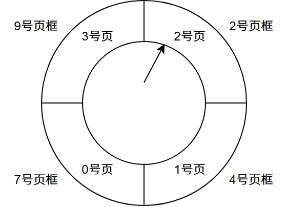
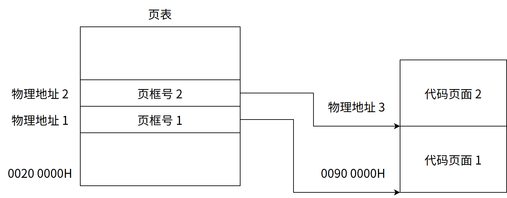
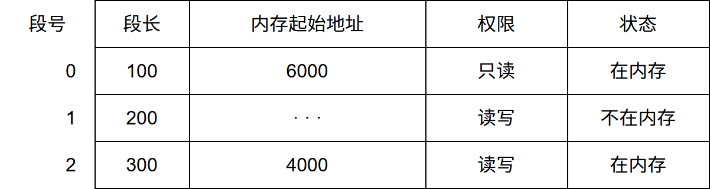
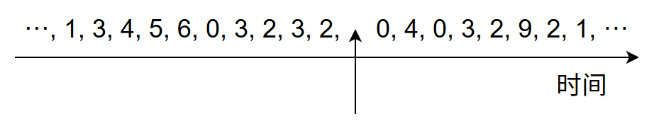
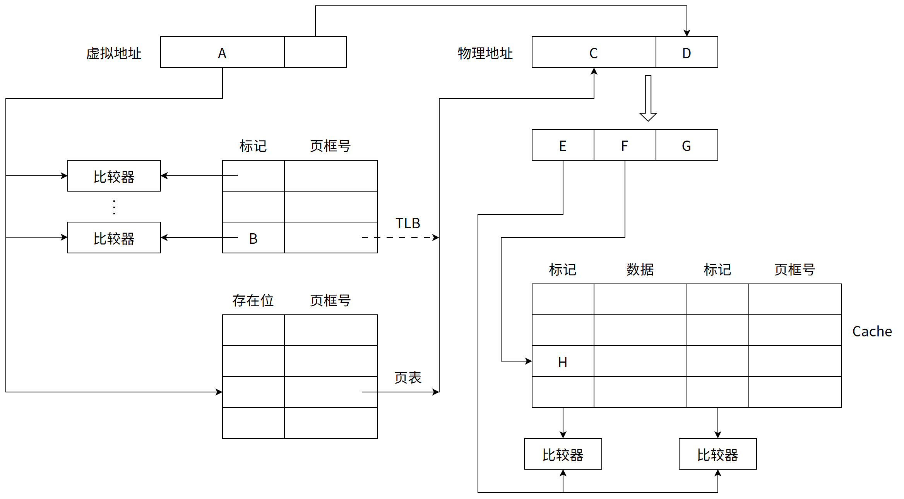
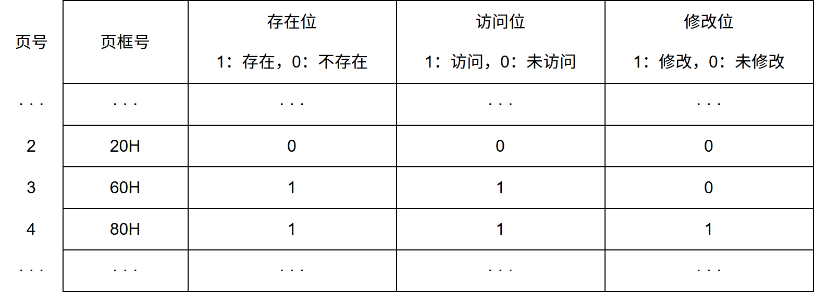

# 第4章 内存管理

> 科目：三、操作系统
> 题目数量：44道
> 年份范围：2009-2024

---

## 2009年

### 第26题（选择题）

分区分配内存管理方式的主要保护措施是（）。

A. 界地址保护
B. 程序代码保护
C. 数据保护
D. 栈保护

---

### 第27题（选择题）

一个分段存储管理系统中，地址长度为32 位，其中段号占8 位，则最大段长是

A. 2 8B
B. 2 16B
C. 2 24B
D. 2 32B

---

### 第46题（综合题）

（8 分）请求分页管理系统中，假设某进程的页表内容见下表。 页面大小为4KB，一次内存的访问时间为100ns，一次快表 （TLB）的访问时间为10ns，处理一 次缺页的平均时间为10 8ns （已含更新TLB 和页表的时间），进程的驻留集大小固定为2，采用最近最 少使用置换算法 （LRU）和局部淘汰策略。假设

①TLB 初始为空：

②地址转换时先访问TLB，若TLB 未命中，再访问页表（忽略访问页表之后的TLB 更新时间）；

③有效位为0 表示页面不在内存中，产 生缺页中断，缺页中断处理后，返回到产生缺页中断的指令处重新执行。设有虚地址访问序列2362H、 1565H、25A5H，请问： 1）依次访问上述三个虚地址，各需多少时间？给出计算过程。 2）基于上述访问序列，虚地址1565H 的物理地址是多少？请说明理由。

---

## 2010年

### 第28题（选择题）

某基于动态分区存储管理的计算机，其主存容量为55MB （初始为空闲），采用最佳适配（Best Fit） 算法，分配和释放的顺序为：分配15MB，分配30MB，释放15MB，分配8MB，分配6MB，此 时主存中最大空闲分区的大小是 。

A. 7MB
B. 9MB
C. 10MB
D. 15MB

---

### 第29题（选择题）

某计算机采用二级页表的分页存储管理方式，按字节编址，页大小为2 10B，页表项大小为2B， 逻辑地址结构为 页目录号 页号 页内偏移量 逻辑地址空间大小为2 16 页，则表示整个逻辑地址空间的页目录表中包含表项的个数至少 是 。

A. 64
B. 128
C. 256
D. 512

---

### 第46题（综合题）

设某计算机的逻辑地址空间和物理地址空间均为 64KB，按字节编址。若某进程最多需要 6 页（Page）数据存储空间，页的大小为 1KB，操作系统采用固定分配局部置换策略为此进程分配 4 个页框（Page Frame）。在时刻 260 前该进程访问情况见下表（访问位即使用位）。
页号 页框号 装入时刻 访问位
0 7 130 1
1 4 230 1
2 2 200 1
3 9 260 1
当该进程执行到时刻 260 时，要访问逻辑地址为 17CAH 的数据。请回答下列问题：

(1) 该逻辑地址对应的页号是多少？

(2) 若采用先进先出 (FIFO) 置换算法，该逻辑地址对应的物理地址？要求给出计算过程。

(3) 采用时钟 (CLOCK) 置换算法，该逻辑地址对应的物理地址是多少？要求给出计算过程（设搜索下一页的指针按顺时针方向移动，且指向当前 2 号页框，示意图如下图）。

---

## 2011年

### 第28题（选择题）

在缺页处理过程中， 操作系统执行的操作可能是 。 I. 修改页表 II. 磁盘I/O III. 分配页框

A. 仅I、II
B. 仅II
C. 仅III
D. I、II 和III

---

### 第29题（选择题）

当系统发生抖动(thrashing)时， 可以采取的有效措施是 。 I. 撤销部分进程 II. 增加磁盘交换区的容量 III. 提高用户进程的优先级

A. 仅I
B. 仅II
C. 仅III
D. 仅I、II

---

### 第30题（选择题）

在虚拟内存管理中，地址变换机构将逻辑地址变换为物理地址， 形成该逻辑地址的阶段 是 。

A. 编辑
B. 编译
C. 链接
D. 装载

---

## 2012年

### 第25题（选择题）

下列关于虚拟存储器的叙述中，正确的是 。

A. 虚拟存储只能基于连续分配技术
B. 虚拟存储只能基于非连续分配技术
C. 虚拟存储容量只受外存容量的限制
D. 虚拟存储容量只受内存容量的限制

---

### 第45题（综合题）

（7 分）某请求分页系统的局部页面置换策略如下：系统从0 时刻开始扫描， 每隔5 个时间单位 扫描一轮驻留集（扫描时间忽略不计），本轮没有被访问过的页框将被系统回收， 并放入到空闲 页框链尾，其中内容在下一次分配之前不被清空。当发生缺页时， 如果该页曾被使用过且还在空 闲页链表中， 那么重新放回进程的驻留集中；否则，从空闲页框链表头部取出一个页框。 假设不考虑其他进程的影响和系统开销。初始时进程驻留集为空。目前系统空闲页框链表中 页框号依次为32、15、21、41。进程P 依次访问的＜虚拟页号，访问时刻＞是＜1,1＞, ＜3, 2＞, ＜0,4＞, ＜0, 6＞, ＜1, 11＞, ＜0, 13＞, ＜2, 14＞。请回答下列问题。

（1）访问＜0, 4＞时，对应的页框号是什么？说明理由。

（2）访问＜1, 11＞时，对应的页框号是什么？说明理由。

（3）访问＜2, 14＞时，对应的页框号是什么？说明理由。

（4）该策略是否适合于时间局部性好的程序？说明理由。

---

## 2013年

### 第30题（选择题）

若用户进程访问内存时产生缺页，则下列选项中，操作系统可能执行的操作是 。 I. 处理越界错 II. 置换页 III. 分配内存

A. 仅I、II
B. 仅II、III
C. 仅II、III
D. I、II 和III

---

### 第46题（综合题）

某计算机主存按字节编址，逻辑地址和物理地址都是 32 位，页表项大小为 4 字节。请回答下列问题。

(1) 若使用一级页表的分页存储管理方式，逻辑地址结构为：

则页的大小是多少字节？页表最大占用多少字节？

(2) 若使用二级页表的分页存储管理方式，逻辑地址结构为：

设逻辑地址为 LA，请分别给出其对应的页目录号和页表索引的表达式。

(3) 采用

(1) 中的分页存储管理方式，一个代码段起始逻辑地址为 0000 8000H，其长度为 8KB，被装载到从物理地址 0090 0000H 开始的连续主存空间中。页表从主存 0020 0000H 开始的物理地址处连续存放，如下图所示（地址大小自下向上递增）。请计算出该代码段对应的两个页表项的物理地址、这两个页表项中的页框号以及代码页面 2 的起始物理地址。

---

## 2014年

### 第28题（选择题）

下列措施中，能加快虚实地址转换的是 。 I. 增大块表（TLB）容量 II. 让页表常驻内存 III. 增大交换区（swap）

A. 仅I
B. 仅II
C. 仅I、II
D. 仅II、III

---

### 第30题（选择题）

在页式虚拟存储管理系统中，采用某些页面置换算法，会出现Belady 异常现象，即进程的缺页 次数会随着分配给该进程的页框个数的增加而增加。下列算法中，可能出现Belady 异常现象的 是 。 I. LRU 算法 II. FIFO 算法 III. OPT 算法

A. 仅II
B. 仅I、II
C. 仅I、III
D. 仅II、III

---

### 第32题（选择题）

下列选项中，属于多级页表优点的是 。

A. 加快地址变换速度
B. 减少缺页中断次数
C. 减少页表项所占字节数
D. 减少页表所占的连续内存空间

---

### 第45题（综合题）

（11 分）假设对于44 题中的计算机M 和程序P 的机器代码， M 采用页式虚拟存储管理； P 开 始执行时，(R1)＝(R2)＝0，(R6)＝1000，其机器代码已调入主存但不在Cache 中；数组A 未调入主 存，且所有数组元素在同一页，并存储在磁盘同一个扇区。请回答下列问题并说明理由。

（1）P 执行结束时，R2 的内容是多少？

（2）M 的指令Cache 和数据Cache 分离。若指令Cache 共有16 行，Cache 和主存交换的块大小 为32 字节，则其数据区的容量是多少？若仅考虑程序段P 的执行，则指令Cache 的命中率为多 少？

（3）P 在执行过程中，哪条指令的执行可能发生溢出异常？哪条指令的执行可能产生缺页异常？ 对于数组A 的访问，需要读磁盘和TLB 至少各多少次？

---

## 2015年

### 第27题（选择题）

系统为某进程分配了4 个页框，该进程己访问的页号序列为2, 0, 2, 9, 3, 4, 2, 8, 2, 4, 8, 4, 5。若进 程要访问的下一页的页号为7，依据LRU 算法，应淘汰页的页号是 。

A. 2
B. 3
C. 4
D. 8

---

### 第30题（选择题）

在请求分页系统中，页面分配策略与页面置换策略不能组合使用的是 。

A. 可变分配，全局置换
B. 可变分配，局部置换
C. 固定分配，全局置换
D. 固定分配，局部置换

---

### 第46题（综合题）

某计算机系统按字节编址，采用二级页表的分页存储管理方式，虚拟地址格式如下所示： 10 位 10 位 12 位 页目录号 页表索引 页内偏移量 请回答下列问题。

（1）页和页框的大小各为多少字节？进程的虚拟地址空间大小为多少页？

（2）假定页目录项和页表项均占4 字节，则进程的页目录和页表共占多少页？要求写出计算过 程。

（3）若某指令周期内访问的虚拟地址为0100 0000H 和0111 2048H，则进行地址转换时共访问 多少个二级页表？要求说明理由。

---

## 2016年

### 第26题（选择题）

某系统采用改进型CLOCK 置换算法，页表项中字段A 为访问位，M 为修改位。A ＝ 0 表示页最 近没有被访问，A ＝ 1 表示页最近被访问过。M＝0 表示页没有被修改过，M＝1 表示页被修改过。 按(A, M)所有可能的取值，将页分为四类：(0, 0), (1, 0), (0, 1)和(1, 1)，则该算法淘汰页的次序 为 。

A. (0, 0), (0, 1), (1, 0), (1, 1)
B. (0, 0), (1, 0), (0, 1), (1, 1)
C. (0, 0), (0, 1), (1, 1), (1, 0)
D. (0, 0), (1, 1), (1, 0), (0, 1)

---

### 第28题（选择题）

某进程的段表内容如下所示。

当访问段号为 2、段内地址为 400 的逻辑地址时，进行地址转换的结果是（ ）。

A. 段缺失异常
B. 得到内存地址 4400
C. 越权异常
D. 越界异常

---

### 第29题（选择题）

某进程访问页面的序列如下所示。

若工作集的窗口大小为 6，则在 t 时刻的工作集为（ ）。

A. {6, 0, 3, 2}
B. {2, 3, 0, 4}
C. {0, 4, 3, 2, 9}
D. {4, 5, 6, 0, 3, 2}

---

### 第45题（综合题）

某计算机采用页式虚拟存储管理方式，按字节编址，虚拟地址为 32 位，物理地址为 24 位，页大小为 8KB；TLB 采用全相联映射；Cache 数据区大小为 64KB，按 2 路组相联方式组织，主存块大小为 64B。存储访问过程的示意图如下。

请回答下列问题。

(1) 图中字段 A～G 的位数各是多少？TLB 标记字段 B 中存放的是什么信息？

(2) 将块号为 4099 的主存块装入到 Cache 中时，所映射的 Cache 组号是多少？对应的 H 字段内容是什么？

(3) Cache 缺失处理的时间开销大还是缺页处理的时间开销大？为什么？

(4) 为什么 Cache 可以采用直写 (Write Through) 策略，而修改页面内容时总是采用回写 (Write Back) 策略？

---

## 2017年

### 第25题（选择题）

某计算机按字节编址，其动态分区内存管理采用最佳适应算法，每次分配和回收内存后都对空闲 分区链重新排序。当前空闲分区信息如下表所示。 分区起始地址 20K 500K 1000K 200K 分区大小 40KB 80KB 100KB 200KB 回收起始地址为60K、大小为140KB 的分区后，系统中空闲分区的数量、空闲分区链第一个分区 的起始地址和大小分别是 。

A. 3、20K、380KB
B. 3、500K、80KB
C. 4、20K、180KB
D. 4、500K、80KB

---

### 第45题（综合题）

（7 分）假定题44 给出的计算机M 采用二级分页虚拟存储管理方式，虚拟地址格式如下： 页目录号（10 位） 页表索引（10 位） 页内偏移量（12 位） 请针对题43 的函数f1 和题44 中的机器指令代码， 回答下列问题。

（1）函数f1 的机器指令代码占多少页？

（2）取第1 条指令（push ebp）时， 若在进行地址变换的过程中需要访问内存中的页目录和页 表， 则会分别访问它们各自的第几个表项（编号从0 开始）？

（3）M 的I/O 采用中断控制方式。若进程P 在调用f1 之前通过scanf()获取n 的值，则在执行 scanf()的过程中，进程P 的状态会如何变化? CPU 是否会进入内核态？

---

## 2018年

### 第45题（综合题）

（8 分）请根据题44 图给出的虚拟存储管理方式，回答下列问题。

（1）某虚拟地址对应的页目录号为6，在相应的页表中对应的页号为6，页内偏移量为8，该虚 拟地址的十六进制表示是什么？

（2）寄存器PDBR 用于保存当前进程的页目录起始地址，该地址是物理地址还是虚拟地址？进 程切换时，PDBR 的内容是否会变化？说明理由。同一进程的线程切换时，PDBR 的内容是否会 变化？说明理由。

（3）为了支持改进型CLOCK 置换算法，需要在页表项中设置哪些字段？

---

## 2019年

### 第28题（选择题）

在分段存储管理系统中，用共享段表描述所有被共享的段。若进程P1和P2共享段S，下列叙述 中，错误的是 。

A. 在物理内存中仅保存一份段S 的内容
B. 段S 在P1和P2中应该具有相同的段号
C. P1和P2共享段S 在共享段表中的段表项
D. P1和P2都不再使用段S 时才回收段S 所占的内存空间

---

### 第29题（选择题）

某系统釆用LRU 页置换算法和局部置换策略，若系统为进程P 预分配了4 个页框，进程P 访问 页号的序列为0, 1, 2, 7, 0, 5, 3, 5, 0, 2, 7, 6，则进程访问上述页的过程中，产生页置换的总次数 是 。

A. 3
B. 4
C. 5
D. 6

---

### 第31题（选择题）

某计算机主存按字节编址，采用二级分页存储管理，地址结构如下所示：

虚拟地址 20501225H 对应的页目录号、页号分别是（ ）。

A. 081H、101H
B. 081H、401H
C. 201H、101H
D. 201H、401H

---

### 第32题（选择题）

在下列动态分区分配算法中，最容易产生内存碎片的是 。

A. 首次适应算法
B. 最坏适应算法
C. 最佳适应算法
D. 循环首次适应算法

---

### 第46题（综合题）

（7 分）对于题45，若计算机M 的主存地址为32 位，釆用分页存储管理方式，页大小为4KB， 则第1 行的push 指令和第30 行的ret 指令是否在同一页中（说明理由）？若指令Cache 有64 行，采用4 路组相联映射方式，主存块大小为64B，则32 位主存地址中，哪几位表示块内地 址？哪几位表示Cache 组号？哪几位表示标记（tag）信息？读取第16 行的call 指令时，只可能 在指令Cache 的哪一组中命中（说明理由）？

---

## 2020年

### 第28题（选择题）

下列因素中，影响请求分页系统有效（平均）访存时间的是 。 I. 缺页率 II. 磁盘读写时间 III. 内存访问时间 IV. 执行缺页处理程序的CPU 时间

A. 仅II、III
B. 仅I、IV
C. 仅I、III、IV
D. I、II、III 和IV

---

### 第46题（综合题）

（8 分）某32 位系统采用基于二级页表的请求分页存储管理方式，按字节编址，页目录项和页 表项长度均为4 字节，虚拟地址结构如下所示。 页目录号（10 位） 页号（10 位） 页内偏移量（12 位） 某C 程序中数组a[1024][1024]的起始虚拟地址为1080 0000H，数组元素占4 字节，该程序运行 时，其进程的页目录起始物理地址为0020 1000H，请回答下列问题。

（1）数组元素a[1][2]的虚拟地址是什么？对应的页目录号和页号分别是什么？对应的页目录项 的物理地址是什么？若该目录项中存放的页框号为00301H，则a[1][2]所在页对应的页表项的物 理地址是什么？

（2）数组a 在虚拟地址空间中所占的区域是否必须连续？在物理地址空间中所占区域是否必须 连续？

（3）已知数组a 按行优先方式存放，若对数组a 分别按行遍历和按列遍历，则哪种遍历方式的 局部性更好？

---

## 2021年

### 第28题（选择题）

某请求分页存储系统的页大小为 4KB，按字节编址。系统给进程 P 分配 2 个固定的页框并采用改进型 Clock 置换算法，进程 P 页表的部分内容如下表所示：

若 P 访问虚拟地址为 02A01H 的存储单元，则经地址变换后得到的物理地址是（）。

A. 00A01H
B. 20A01H
C. 60A01H
D. 80A01H

---

### 第29题（选择题）

在采用二级页表的分页系统中，CPU 页表基址寄存器中的内容是 。

A. 当前进程的一级页表的起始虚拟地址
B. 当前进程的一级页表的起始物理地址
C. 当前进程的二级页表的起始虚拟地址
D. 当前进程的二级页表的起始物理地址

---

## 2022年

### 第29题（选择题）

某进程访问的页b 不在内存中，导致产生缺页异常，该缺页异常处理过程中不一定包含的操作 是 。

A. 淘汰内存中的页
B. 建立页号与页框号的对应关系
C. 将页b 从外存读入内存
D. 修改页表中页b 对应的存在位

---

### 第30题（选择题）

下列选项中，不．会影响系统缺页率的是 。

A. 页置换算法
B. 工作集的大小
C. 进程的数量
D. 页缓冲队列的长度

---

## 2023年

### 第25题（选择题）

某系统采用页式存储管理，用位图管理空闲页框。若页大小为4KB，物理内存大小为16GB，则位 图所占空间的大小是 。

A. 128B
B. 128KB
C. 512KB
D. 4MB

---

### 第28题（选择题）

对于采用虚拟内存管理方式的系统，下列关于进程虚拟地址空间的叙述中，错误的是 。

A. 每个进程都有自已独立的虚拟地址空间
B. C 语言中malloc()函数返回的是虚拟地址
C. 进程对数据段和代码段可以有不同的访问权限
D. 虚拟地址空间的大小由内存和硬盘的大小决定

---

## 2024年

### 第25题（选择题）

在支持页式存储管理的系统中，进程切换时操作系统需要执行的操作是 。 I. 更新程序计数器的值 II. 更新栈基址寄存器值 III. 更新页表基地址寄存器值

A. 仅III
B. 仅I、II
C. 仅I、III
D. I、II、III

---

### 第27题（选择题）

下列算法中，每次回收分区时仅合并大小相等的空闲分区的是 。

A. 伙伴算法
B. 最佳适应算法
C. 最坏适应算法
D. 首次适应算法

---

### 第30题（选择题）

假设某系统使用时间片轮转调度算法进行CPU调度，时间片大小为5ms，系统共有10个进程，初始时均处于就绪队列，执行结束前仅处于执行态或就绪态。若队尾的进程P所需CPU时间最短，时间为25ms，在不考虑系统开销的情况下，则进程P的周转时间为（）。

A. 200ms
B. 205ms
C. 250ms
D. 295ms

---

### 第45题（综合题）

某计算机按字节编址，采用页式虚拟存储管理方式，虚拟地址和物理地址的长度均为 32 位，页表项的大小为 4 字节，页大小为 4MB，虚拟地址结构如下：

进程 Р 的页表起始虚拟地址为 B8C0 0000H，被装载到从物理地址 6540 0000H 开始的连续主存空间中。请回答下列问题：

（1）若 CPU 在执行进程 P 的过程中，访问虚拟地址 1234 5678H 时发生了缺页异常，经过缺页异常处理和 MMU 地址转换后得到的物理地址是 BAB4 5678H。在此次缺页异常的处理中，需要为新缺页分配页框并更新相应的页表项，则该页表项的虚拟地址和物理地址分别是什么？该页表项中的页框号更新后的值是什么？（3 分）

（2）进程 P 的页表所在页的页号是什么？该页对应的页表项的虚拟地址是什么？该页表项中的页框号是多少？（4 分）

---
