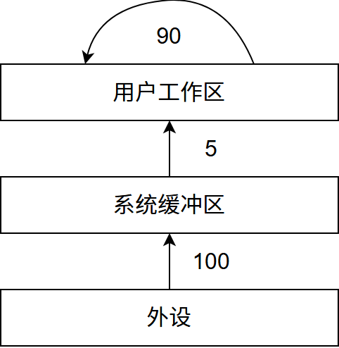
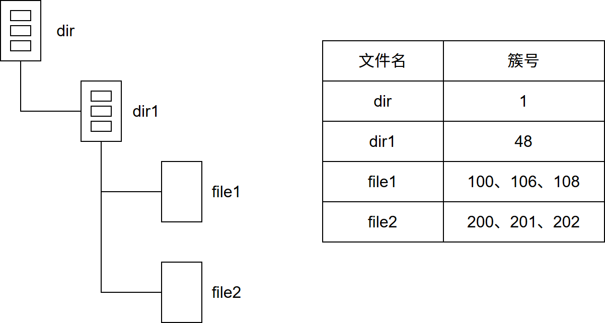
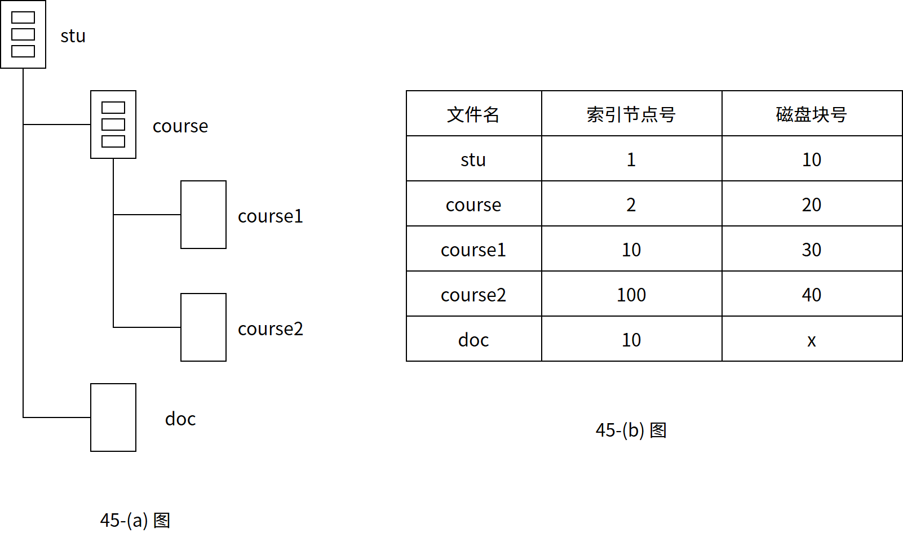

# 第5章 文件管理

> 科目：三、操作系统
> 题目数量：35道
> 年份范围：2009-2024

---

## 2009年

### 第28题（选择题）

下列文件物理结构中，适合随机访问且易于文件扩展的是 。

A. 连续结构
B. 索引结构
C. 链式结构且磁盘块定长
D. 链式结构且磁盘块变长

---

### 第30题（选择题）

文件系统中，文件访问控制信息存储的合理位置是 。

A. 文件控制块
B. 文件分配表
C. 用户口令表
D. 系统注册表

---

### 第31题（选择题）

设文件F1 的当前引用计数值为1，先建立F1 的符号链接（软链接）文件F2，再建立F1 的硬链 接文件F3，然后删除F1。此时，F2 和F3 的引用计数值分别是 。

A. 0、1
B. 1、1
C. 1、2
D. 2、1

---

## 2010年

### 第30题（选择题）

设文件索引结点中有7 个地址项，其中4 个地址项是直接地址索引，2 个地址项是一级间接地址 索引，1 个地址项是二级间接地址索引，每个地址项大小为4B。若磁盘索引块和磁盘数据块大小 均为256B，则可表示的单个文件最大长度是 。

A. 33KB
B. 519KB
C. 1 057KB
D. 16 513KB

---

### 第31题（选择题）

设置当前工作目录的主要目的是 。

A. 节省外存空间
B. 节省内存空间
C. 加快文件的检索速度
D. 加快文件的读/写速度

---

## 2011年

### 第31题（选择题）

某文件占10 个磁盘块，现要把该文件磁盘块逐个读入主存缓冲区，并送用户区进行分析，假设 一个缓冲区与一个磁盘块大小相同，把一个磁盘块读入缓冲区的时间为100μs, 将缓冲区的数据 传送到用户区的时间是50μs, CPU 对一块数据进行分析的时间为50μs。在单缓冲区和双缓冲区结 构下， 读入并分析完该文件的时间分别是 。

A. 1500μs、1000μs
B. 1550μs、1100μs
C. 1550μs、1550μs
D. 2000μs、2000μs

---

### 第46题（综合题）

（7 分）某文件系统为一级目录结构，文件的数据一次性写入磁盘，已写入的文件不可修改，但 可多次创建新文件。请回答如下问题。

（1）在连续、链式、索引三种文件的数据块组织方式中，哪种更合适？要求说明理由。为定位 文件数据块，需要FCB 中设计哪些相关描述字段？

（2）为快速找到文件，对于FCB, 是集中存储好，还是与对应的文件数据块连续存储好？要求 说明理由。

---

## 2012年

### 第32题（选择题）

下列选项中，不能改善磁盘设备I/O 性能的是

A. 重排I/O 请求次序
B. 在一个磁盘上设置多个分区
C. 预读和滞后写
D. 优化文件物理块的分布

---

### 第46题（综合题）

（8 分）某文件系统空间的最大容量为4TB （1TB ＝ 2 40B）, 以磁盘块为基本分配单位。磁盘块大 小为1KB。文件控制块(FCB)包含一个512B 的索引表区。请回答下列问题。

（1）假设索引表区仅采用直接索引结构， 索引表区存放文件占用的磁盘块号，索引表项中块号 最少占多少字节？可支持的单个文件最大长度是多少字节？

（2）假设索引表区采用如下结构：第0～7 字节采用＜起始块号，块数＞格式表示文件创建时预 分配的连续存储空间， 其中起始块号占6B，块数占2B；剩余504 字节采用直接索引结构，一个 索引项占6B，那么可支持的单个文件最大长度是多少字节？为了使单个文件的长度达到最大， 请 指出起始块号和块数分别所占字节数的合理值并说明理由。

---

## 2013年

### 第23题（选择题）

用户在删除某文件的过程中，操作系统不可能执行的操作是

A. 删除此文件所在的目录
B. 删除与此文件关联的目录项
C. 删除与此文件对应的文件控制块
D. 释放与此文件关联的内存缓冲区

---

### 第24题（选择题）

为支持CD-ROM 中视频文件的快速随机播放，播放性能最好的文件数据块组织方式是 。

A. 连续结构
B. 链式结构
C. 直接索引结构
D. 多级索引结构

---

### 第26题（选择题）

若某文件系统索引结点(inode)中有直接地址项和间接地址项，则下列选项中，与单个文件长度无 关的因素是 。

A. 索引结点的总数
B. 间接地址索引的级数
C. 地址项的个数
D. 文件块大小

---

### 第27题（选择题）

设系统缓冲区和用户工作区均采用单缓冲，从外设读入 1 个数据块到系统缓冲区的时间为 100，从系统缓冲区读入 1 个数据块到用户工作区的时间为 5，对用户工作区中的 1 个数据块进行分析的时间为 90（如下图所示）。

进程从外设读入并分析 2 个数据块的最短时间是（ ）。

A. 200
B. 295
C. 300
D. 390

---

## 2014年

### 第27题（选择题）

现有一个容量为10GB 的磁盘分区， 磁盘空间以簇（Cluster）为单位进行分配，簇的大小为 4KB，若采用位图法管理该分区的空闲空间，即用一位（bit）标识一个簇是否被分配，则存放该 位图所需簇的个数为 。

A. 80
B. 320
C. 80K
D. 320K

---

### 第29题（选择题）

在一个文件被用户进程首次打开的过程中，操作系统需要做的是 。

A. 将文件内容读到内存中
B. 将文件控制块读到内存中
C. 修改文件控制块中的读写权限
D. 将文件的数据缓冲区首指针返回给用户进程

---

### 第46题（综合题）

（7 分）文件F 由200 条记录组成，记录从1 开始编号。用户打开文件后，欲将内存中的一条记 录插入到文件F 中，作为其第30 条记录。请回答下列问题，并说明理由。

（1）若文件系统采用连续分配方式，每个磁盘块存放一条记录，文件F 存储区域前后均有足够的 空闲磁盘空间，则完成上述插入操作最少需要访问多少次磁盘块? F 的文件控制块内容会发生哪些 改变？

（2）若文件系统采用链接分配方式，每个磁盘块存放一条记录和一个链接指针，则完成上述插入 操作需要访问多少次磁盘块？若每个存储块大小为1KB，其中4 字节存放链接指针，则该文件系 统支持的文件最大长度是多少？

---

## 2015年

### 第28题（选择题）

在系统内存中设置磁盘缓冲区的主要目的是 。

A. 减少磁盘I/O 次数
B. 减少平均寻道时间
C. 提高磁盘数据可靠性
D. 实现设备无关性

---

### 第29题（选择题）

在文件的索引结点中存放直接索引指针10 个，一级和二级索引指针各1 个。磁盘块大小为 1KB，每个索引指针占4 字节。若某文件的索引结点己在内存中，则把该文件偏移量（按字节编 址）为1234 和307400 处所在的磁盘块读入内存，需访问的磁盘块个数分别是 。

A. 1, 2
B. 1, 3
C. 2, 3
D. 2, 4

---

### 第31题（选择题）

文件系统用位图法表示磁盘空间的分配情况，位图存于磁盘的32、127 号块中，每个盘块占 1024 字节，盘块和块内字节均从0 开始编号。假设要释放的盘块号为409612，则位图中要修改 的位所在的盘块号和块内字节序号分别是 。

A. 81、1
B. 81、2
C. 82、1
D. 82、2

---

## 2016年

### 第47题（综合题）

某磁盘文件系统使用链接分配方式组织文件，簇大小为 4KB。目录文件的每个目录项包括文件名和文件的第一个簇号，其他簇号存放在文件分配表 FAT 中。

(1) 假定目录树如下图所示，各文件占用的簇号及顺序如下表所示，其中 dir、dir1 是目录，file1、file2 是用户文件。请给出所有目录文件的内容。

(2) 若 FAT 的每个表项仅存放簇号，占 2 个字节，则 FAT 的最大长度为多少字节？该文件系统支持的文件长度最大是多少？

(3) 系统通过目录文件和 FAT 实现对文件的按名存取，说明 file1 的 106、108 两个簇号分别存放在 FAT 的哪个表项中。

(4) 假设仅 FAT 和 dir 目录文件已读入内存，若需将文件 dir/dir1/file1 的第 5000 个字节读入内存，则要访问哪几个簇？

---

## 2017年

### 第26题（选择题）

某文件系统的簇和磁盘扇区大小分别为1KB 和512B。若一个文件的大小为1026B，则系统分配 给该文件的磁盘空间大小是 。

A. 1026B
B. 1536B
C. 1538B
D. 2048B

---

### 第29题（选择题）

下列选项中， 磁盘逻辑格式化程序所做的工作是 。 I. 对磁盘进行分区 II. 建立文件系统的根目录 III. 确定磁盘扇区校验码所占位数 IV. 对保存空闲磁盘块信息的数据结构进行初始化

A. 仅II
B. 仅II、IV
C. 仅III、IV
D. 仅I、II、IV

---

### 第30题（选择题）

某文件系统中，针对每个文件，用户类别分为 4 类：安全管理员、文件主、文件主的伙伴、其他用户；访问权限分为 5 种：完全控制、执行、修改、读取、写入。若文件控制块中用二进制位串表示文件权限，为表示不同类别用户对一个文件的访问权限，则描述文件权限的位数至少应为（ ）。

A. 5
B. 9
C. 12
D. 20

---

### 第31题（选择题）

若文件f1 的硬链接为f2，两个进程分别打开f1 和f2， 获得对应的文件描述符为fd1 和fd2, 则下 列叙述中，正确的是 。 I. f1 和f2 的读写指针位置保持相同 II. f1 和f2 共享同一个内存索引结点 III. fd1 和fd2 分别指向各自的用户打开文件表中的一项

A. 仅III
B. 仅II、III
C. 仅I、II
D. I、II 和III

---

## 2018年

### 第31题（选择题）

下列优化方法中，可以提高文件访问速度的是 。 I. 提前读 II. 为文件分配连续的簇 III. 延迟写 IV. 采用磁盘高速缓存

A. 仅I、II
B. 仅II、III
C. 仅I、III、IV
D. I、II、III、IV

---

### 第46题（综合题）

（7 分）某文件系统采用索引节点存放文件的属性和地址信息，簇大小为4KB。每个文件索引节 点占64B，有11 个地址项，其中直接地址项8 个，一级、二级和三级间接地址项各1 个，每个 地址项长度为4B。请回答下列问题。

（1）该文件系统能支持的最大文件长度是多少？（给出计算表达式即可。）

（2）文件系统用1M（1M ＝ 2 20）个簇存放文件索引节点，用512M 个簇存放文件数据。若一个 图像文件的大小为5600B，则该文件系统最多能存放多少个图像文件？

（3）若文件F1 的大小为6KB，文件F2 的大小为40KB，则该文系统获取F1 和F2 最后一个簇 的簇号需要的时间是否相同？为什么？

---

## 2019年

### 第26题（选择题）

下列选项中，可用于文件系统管理空闲磁盘块的数据结构是 。 I. 位图 II. 索引结点 III. 空闲磁盘块链 IV. 文件分配表（FAT）

A. 仅I、II
B. 仅I、III、IV
C. 仅I、III
D. 仅II、III、IV

---

## 2020年

### 第23题（选择题）

若多个进程共享同一个文件F，则下列叙述中，正确的是 。

A. 各进程只能用“读”方式打开文件F
B. 在系统打开文件表中仅有一个表项包含F 的属性
C. 各进程的用户打开文件表中关于F 的表项内容相同
D. 进程关闭F 时，系统删除F 在系统打开文件表中的表项

---

### 第24题（选择题）

下列选项中，支持文件长度可变、随机访问的磁盘存储空间分配方式是 。

A. 索引分配
B. 链接分配
C. 连续分配
D. 动态分区分配

---

### 第31题（选择题）

某文件系统的目录项由文件名和索引结点号构成。若每个目录项长度为64 字节，其中4 字节存 放索引结点号，60 字节存放文件名。文件名由小写英文字母构成，则该文件系统能创建的文件 数量的上限为 。

A. 2 26
B. 2 32
C. 2 60
D. 2 64

---

## 2021年

### 第30题（选择题）

若目录dir 下有文件file1，则为删除该文件内核不必完成的工作是 。

A. 删除file1 的快捷方式
B. 释放file1 的文件控制块
C. 释放file1 占用的磁盘空间
D. 删除目录dir 中与file1 对应的目录项

---

## 2022年

### 第45题（综合题）

某文件系统的磁盘块大小为 4KB，目录项由文件名和索引节点号构成，每个索引节点占 256 字节，其中包含直接地址项 10 个，一级、二级和三级间接地址项各 1 个，每个地址项占 4 字节。该文件系统中子目录 stu 的结构如题 45(a) 图所示，stu 包含子目录 course 和文件 doc，course 子目录包含文件 course1 和 course2。各文件的文件名、索引节点号、占用磁盘块的块号如题 45(b) 图所示。

请回答下列问题。

(1) 目录文件 stu 中每个目录项的内容是什么？

(2) 文件 doc 占用的磁盘块的块号 x 的值是多少？

(3) 若目录文件 course 的内容已在内存，则打开文件 course1 并将其读入内存，需要读几个磁盘块？说明理由。

(4) 若文件 course2 的大小增长到 6MB，为了存取 course2 需要使用该文件索引节点的哪几级间接地址项？说明理由。

---

## 2023年

### 第31题（选择题）

若文件F 仅被进程P 打开并访问，则当进程P 关闭F 时，下列操作中，文件系统需要完成的 是 。

A. 删除目录文件中F 的目录项
B. 释放F 的索引节点所占的内存空间
C. 释放F 的索引节点所占的外存空间
D. 将文件磁盘索引结点中的链接计数减1

---

## 2024年

### 第26题（选择题）

文件系统需占用部分外存空间记录空闲块位置。下列方法中，占用外存空间的大小与当前空闲块 数量无关的是 。

A. 位图法
B. 空闲表法
C. 成组链接法
D. 空闲链表法

---

### 第29题（选择题）

下列系统调用的实现中，包含文件按名查找功能的是 。

A. open()
B. read()
C. write()
D. close()

---
