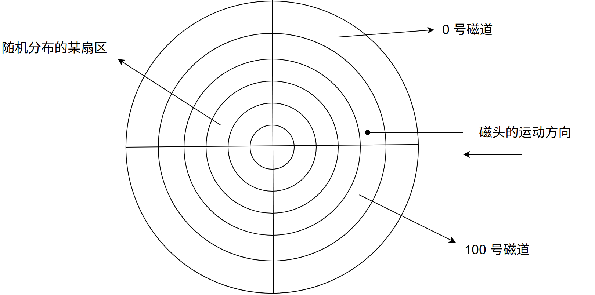

# 第6章 输入输出管理

> 科目：三、操作系统
> 题目数量：22道
> 年份范围：2009-2024

---

## 2009年

### 第29题（选择题）

假设磁头当前位于第105 道，正在向磁道序号增加的方向移动。现有一个磁道访问请求序列为35, 45, 12, 68, 110, 180, 170, 195，采用SCAN 调度（电梯调度）算法得到的磁道访问序列是 。

A. 110, 170, 180, 195, 68, 45, 35, 12
B. 110, 68, 45, 35, 12, 170, 180, 195
C. 110, 170, 180, 195, 12, 35, 45, 68
D. 12, 35, 45, 68, 110, 170, 180, 195

---

### 第32题（选择题）

程序员利用系统调用打开I/O 设备时，通常使用的设备标识是 。

A. 逻辑设备名
B. 物理设备名
C. 主设备号
D. 从设备号

---

### 第45题（综合题）

（7 分）三个进程P1、P2、P3 互斥使用一个包含N （N ＞ 0）个单元的缓冲区。P1每次用produce() 生成一个正整数并用put()送入缓冲区某一空单元中；P2 每次用getodd()从该缓冲区中取出一个奇 数并用countodd()统计奇数个数；P3 每次用geteven()从该缓冲区中取出一个偶数并用counteven() 统计偶数个数。请用信号量机制实现这三个进程的同步与互斥活动，并说明所定义信号量的含义 （要求用伪代码描述）。

---

## 2010年

### 第32题（选择题）

本地用户通过键盘登录系统时，首先获得键盘输入信息的程序是 。

A. 命令解释程序
B. 中断处理程序
C. 系统调用服务程序
D. 用户登录程序

---

### 第45题（综合题）

假设计算机系统采用 CSCAN（循环扫描）磁盘调度策略，使用 2KB 的内存空间记录 16384 个磁盘块的空闲状态。

(1) 请说明在上述条件如何进行磁盘块空闲状态的管理。

(2) 设某单面磁盘的旋转速度为 6000rpm，每个磁道有 100 个扇区，相邻磁道间的平均移动的时间为 1ms。若在某时刻，磁头位于 100 号磁道处，并沿着磁道号增大的方向移动（见下图），磁道号的请求队列为 50, 90, 30, 120，对请求队列中的每个磁道需读取 1 个随机分布的扇区，则读完这个扇区点共需要多少时间？需要给出计算过程。

(3) 如果将磁盘替换为随机访问的 Flash 半导体存储器（如 U 盘、SSD 等），是否有比 CSCAN 更高效的磁盘调度策略？若有，给出磁盘调度策略的名称并说明理由；若无，说明理由。

---

## 2011年

### 第26题（选择题）

用户程序发出磁盘I/O 请求后， 系统的正确处理流程是

A. 用户程序→系统调用处理程序→中断处理程序→设备驱动程序
B. 用户程序→系统调用处理程序→设备驱动程序→中断处理程序
C. 用户程序→设备驱动程序→系统调用处理程序→中断处理程序
D. 用户程序→设备驱动程序→中断处理程序→系统调用处理程序

---

## 2012年

### 第26题（选择题）

操作系统的I/O 子系统通常由四个层次组成，每一层明确定义了与邻近层次的接口。其合理的层 次组织排列顺序是

A. 用户级I/O 软件、设备无关软件、设备驱动程序、中断处理程序
B. 用户级I/O 软件、设备无关软件、中断处理程序、设备驱动程序
C. 用户级I/O 软件、设备驱动程序、设备无关软件、中断处理程序
D. 用户级I/O 软件、中断处理程序、设备无关软件、设备驱动程序

---

### 第28题（选择题）

若一个用户进程通过read 系统调用读取一个磁盘文件中的数据，则下列关于此过程的叙述中，正 确的是 。 I. 若该文件的数据不在内存中，则该进程进入睡眠等待状态。 II. 请求read 系统调用会导致CPU 从用户态切换到核心态 III. read 系统调用的参数应包含文件的名称

A. 仅I、II
B. 仅I、III
C. 仅II、III
D. I、II 和III

---

## 2013年

### 第25题（选择题）

用户程序发出磁盘I/O 请求后，系统的处理流程是：用户程序→系统调用处理程序→设备驱动程 序→中断处理程序。其中，计算数据所在磁盘的柱面号、磁头号、扇区号的程序是 。

A. 用户程序
B. 系统调用处理程序
C. 设备驱动程序
D. 中断处理程序

---

## 2015年

### 第32题（选择题）

某硬盘有200 个磁道（最外侧磁道号为0），磁道访问请求序列为130, 42, 180, 15, 199, 当前磁头 位于第58 号磁道并从外侧向内侧移动。按照SCAN 调度方法处理完上述请求后，磁头移过的磁 道数是 。

A. 208
B. 287
C. 325
D. 382

---

## 2016年

### 第31题（选择题）

下列关于SPOOLing 技术的叙述中，错误的是 。

A. 需要外存的支持
B. 需要多道程序设计技术的支持
C. 可以让多个作业共享一台独占设备
D. 由用户作业控制设备与输入/输出井之间的数据传送

---

## 2017年

### 第32题（选择题）

系统将数据从磁盘读到内存的过程包括以下操作： ①DMA 控制器发出中断请求 ②初始化DMA 控制器并启动磁盘 ③从磁盘传输一块数据到内存缓冲区 ④执行“DMA 结束”中断服务程序 正确的执行顺序是 。

A. ③→①→②→④
B. ②→③→①→④
C. ②→①→③→④
D. ①→②→④→③

---

## 2018年

### 第30题（选择题）

系统总是访问磁盘的某个磁道而不响应对其他磁道的访问请求，这种现象称为磁臂黏着。下列磁 盘调度算法中，不会导致磁臂黏着的是 。

A. 先来先服务（FCFS）
B. 最短寻道时间优先（SSTF）
C. 扫描算法（SCAN）
D. 循环扫描算法（CSCAN）

---

## 2020年

### 第30题（选择题）

对于具备设备独立性的系统，下列叙述中，错误的是 。

A. 可以使用文件名访问物理设备
B. 用户程序使用逻辑设备名访问物理设备
C. 需要建立逻辑设备与物理设备之间的映射关系
D. 更换物理设备后必须修改访问该设备的应用程序

---

## 2021年

### 第26题（选择题）

某系统中磁盘的磁道数为200（0～199），磁头当前在184 号磁道上。用户进程提出的磁盘访问 请求对应的磁道号依次为184, 187, 176, 182, 199。若采用最短寻道时间优先调度算法（SSTF）完 成磁盘访问，则磁头移动的距离（磁道数）是 。

A. 37
B. 38
C. 41
D. 42

---

### 第32题（选择题）

下列选项中，通过系统调用完成的操作是（ ）。

A. 页置换
B. 进程调度
C. 创建新进程
D. 生成随机整数

---

### 第46题（综合题）

（8 分）某计算机用硬盘作为启动盘，硬盘第一个扇区存放主引导记录，其中包含磁盘引导程序 和分区表。磁盘引导程序用于选择引导哪个分区的操作系统，分区表记录硬盘上各分区的位置等 描述信息。硬盘被划分成若干个分区，每个分区的第一个扇区存放分区引导程序，用于引导该分 区中的操作系统。系统采用多阶段引导方式，除了执行磁盘引导程序和分区引导程序外，还需要 执行ROM 中的引导程序。请回答下列问题。

（1）系统启动过程中操作系统的初始化程序、分区引导程序、ROM 中的引导程序、磁盘引导程 序的执行顺序是什么？

（2）把硬盘制作为启动盘时，需要完成操作系统的安装、磁盘的物理格式化、逻辑格式化、对 磁盘进行分区，执行这4 个操作的正确顺序是什么？

（3）磁盘扇区的划分和文件系统根目录的建立分别是在第

（2）问的哪个操作中完成的？

---

## 2022年

### 第32题（选择题）

下列关于驱动程序的叙述中，不．正确的是 。

A. 驱动程序与I/O 控制方式无关
B. 初始化设备是由驱动程序控制完成的
C. 进程在执行驱动程序时可能进入阻塞态
D. 读/写设备的操作是由驱动程序控制完成的

---

## 2023年

### 第32题（选择题）

下列因素中，设备分配需要考虑的是 。 I.设备的类型 II. 设备的访问权限 III.设备的占用状态 IV. 逻辑设备与物理设备的映射关系

A. 仅I、II
B. 仅II、III
C. 仅III、IV
D. I、II、III、IV

---

### 第46题（综合题）

（8 分）进程P 通过执行系统调用从键盘接收一个字符的输入，已知此过程中与进程P 相关的操 作包括：

①将进程P 插入就绪队列；

②将进程P 插入阻塞队列；

③将字符从键盘控制器读入系统缓冲 区；

④启动键盘中断处理程序；

⑤进程P 系统调用返回；

⑥用户在键盘上输入字符。以上编号

①～

⑥仅用于标记操作，与操作的先后顺序无关，请回答下列问题。

（1）按照正确的操作顺序，操作

①的前一个和后一个操作分别是上述操作中的哪一个？操作

⑥ 的后一个操作是上述操作中的哪一个？

（2）在上述哪个操作之后CPU 一定从进程P 切换到其他进程？在上述哪个操作之后CPU 调度 程序才能选中进程P 执行？

（3）完成上述哪个操作的代码属于键盘驱动程序？

（4）键盘中断处理程序执行时，进程P 处于什么状态？CPU 处于内核态还是用户态？

---

## 2024年

### 第31题（选择题）

键盘中断服务例程执行结束时，所输入的数据存放位置是（） 。

A. 用户缓冲区
B. CPU 的通用寄存器
C. 内核缓冲区
D. 键盘控制器的数据缓冲区

---

### 第32题（选择题）

某磁盘的磁道数为400（磁道号为0～399），采用循环扫描算法（CSCAN）进行磁盘调度，完成 对200 号磁道的请求后，磁头向磁道号减小的方向移动。若还有7 个磁盘请求，对应的磁道号分 别为300, 120, 110, 0, 160, 210, 399，则完成上述磁盘访问请求后磁头移动的距离是 。

A. 599
B. 619
C. 788
D. 799

---
