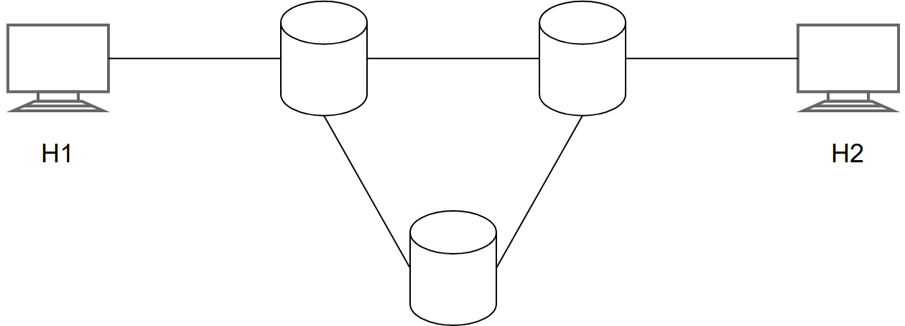
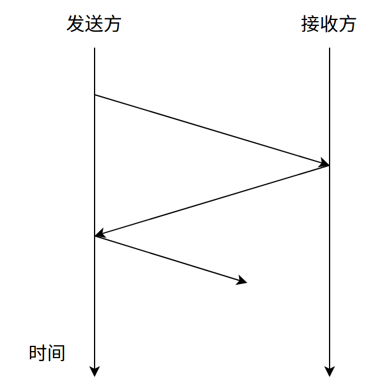

# 第1章 计算机网络体系结构

> 科目：四、计算机网络
> 题目数量：14道
> 年份范围：2009-2024

---

## 2009年

### 第33题（选择题）

在OSI 参考模型中，自下而上第一个提供端到端服务的层次是 。

A. 数据链路层
B. 传输层
C. 会话层
D. 应用层

---

## 2010年

### 第33题（选择题）

下列选项中，不属于网络体系结构所描述的内容是 。

A. 网络的层次
B. 每层使用的协议
C. 协议的内部实现细节
D. 每层必须完成的功能

---

### 第34题（选择题）

在下图所示的采用 “存储-转发” 方式的分组交换网络中，所有链路的数据传输速率为 100 Mbps，分组大小为 1000 B，其中分组头大小为 20 B。若主机 H1 向主机 H2 发送一个大小为 980 000 B 的文件，则在不考虑分组拆装时间和传播延迟的情况下，从 H1 发送开始到 H2 接收完为止，需要的时间至少是（ ）。

A. 80 ms
B. 80.08 ms
C. 80.16 ms
D. 80.24 ms

---

## 2011年

### 第33题（选择题）

TCP/IP 参考模型的网络层提供的是 。

A. 无连接不可靠的数据报服务
B. 无连接可靠的数据报服务
C. 有连接不可靠的虚电路服务
D. 有连接可靠的虚电路服务

---

## 2013年

### 第33题（选择题）

在OSI 参考模型中，下列功能需由应用层的相邻层实现的是

A. 对话管理
B. 数据格式转换
C. 路由选择
D. 可靠数据传输

---

### 第35题（选择题）

主机甲通过1 个路由器（存储转发方式）与主机乙互联，两段链路的数据传输速率均为10Mbps, 主机甲分别采用报文交换和分组大小为10kb 的分组交换向主机乙发送1 个大小为8Mb（1M ＝ 10 6kb）的报文。若忽略链路传播延迟、分组头开销和分组拆装时间，则两种交换方式完成该报 文传输所需的总时间分别为 。

A. 800ms、1600ms
B. 801ms、1600ms
C. 1600ms、800ms
D. 1600ms、801ms

---

## 2014年

### 第33题（选择题）

在OSI 参考模型中，直接为会话层提供服务的是 。

A. 应用层
B. 表示层
C. 传输层
D. 网络层

---

## 2016年

### 第33题（选择题）

在OSI 参考模型中，RI、Switch、Hub 实现的最高功能层分别是 。

A. 2、2、1
B. 2、2、2
C. 3、2、1
D. 3、2、2

---

## 2017年

### 第33题（选择题）

假设OSI 参考模型的应用层欲发送400B 的数据（无拆分）， 除物理层和应用层之外，其他各层 在封装PDU 时均引入20B 的额外开销，则应用层数据传输效率约为 。

A. 80%
B. 83%
C. 87%
D. 91%

---

## 2019年

### 第33题（选择题）

OSI 参考模型的第5 层（自下而上）完成的主要功能是 。

A. 差错控制
B. 路由选择
C. 会话管理
D. 数据表示转换

---

## 2020年

### 第33题（选择题）

下图描述的协议要素是 (  )。

Ⅰ、语法；Ⅱ、语义；Ⅲ、时序

A. 仅 Ⅰ；
B. 仅 Ⅱ；
C. 仅 Ⅲ；
D. Ⅰ、Ⅱ、Ⅲ

---

### 第34题（选择题）

下列关于虚电路网络的叙述中，错误的是 。

A. 可以确保数据分组传输顺序
B. 需要为每条虚电路预分配带宽
C. 建立虚电路时需要进行路由选择
D. 依据虚电路号（VCID）进行数据分组转发

---

## 2021年

### 第33题（选择题）

在TCP/IP 参考模型中，由传输层相邻的下一层实现的主要功能 。

A. 对话管理
B. 路由选择
C. 端到端报文段传输
D. 结点到结点流量控制

---

## 2022年

### 第33题（选择题）

在ISO/OSI 参考模型中，实现两个相邻结点间流量控制功能的是 。

A. 物理层
B. 数据链路层
C. 网络层
D. 传输层

---
