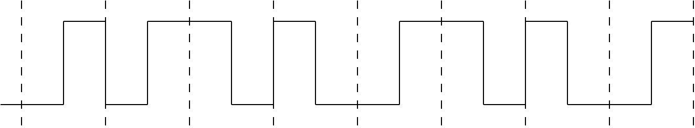
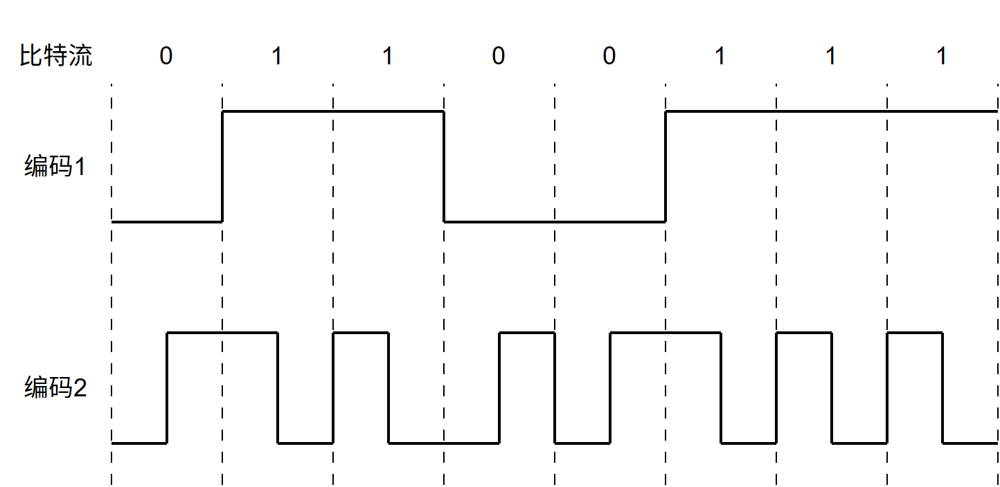
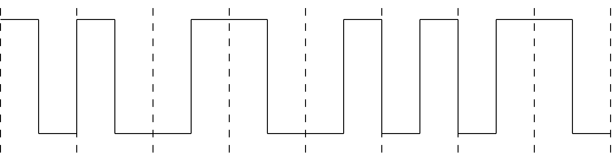

# 第2章 物理层

> 科目：四、计算机网络
> 题目数量：15道
> 年份范围：2009-2024

---

## 2009年

### 第34题（选择题）

在无噪声情况下，若某通信链路的带宽为3kHz，采用4 个相位，每个相位具有4 种振幅的QAM 调制技术，则该通信链路的最大数据传输速率是 。

A. 12kbps
B. 24kbps
C. 48kbps
D. 96kbps

---

## 2011年

### 第34题（选择题）

若某通信链路的数据传输速率为2400bps, 采用四相位调制，则该链路的波特率是 。

A. 600 波特
B. 1200 波特
C. 4800 波特
D. 9600 波特

---

## 2012年

### 第34题（选择题）

在物理层接口特性中， 用于描述完成每种功能的事件发生顺序的是。

A. 机械特性
B. 功能特性
C. 过程特性
D. 电气特性

---

## 2013年

### 第34题（选择题）

若下图为 10 BaseT 网卡接收到的信号波形，则该网卡收到的比特串是（ ）。

A. 0011 0110
B. 1010 1101
C. 0101 0010
D. 1100 0101

---

## 2014年

### 第35题（选择题）

下列因素中，不会影响信道数据传输速率的是 。

A. 信噪比
B. 频率宽带
C. 调制速率
D. 信号传播速度

---

## 2015年

### 第34题（选择题）

使用两种编码方案对比特流 01100111 进行编码的结果如下图所示，编码 1 和编码 2 分别是（ ）。

A. NRZ 和曼彻斯特编码
B. NRZ 和差分曼彻斯特编码
C. NRZI 和曼彻斯特编码
D. NRZI 和差分曼彻斯特编码

---

## 2016年

### 第34题（选择题）

若连接和R3 链路的频率带宽为8kHz，信噪比为30dB，该链路实际数据传输速率约为理论最大 数据传输速率的50%。则该链路的实际数据传输速率约是 。

A. 8kbps
B. 20Kbps
C. 40kbps
D. 80kbps 题33～41 图

---

### 第36题（选择题）

若Hub再生比特流过程中，会产生1.535μs延时，信号传播速度为200m/μs，不考虑以太网帧的前导码，则H3与H4之间理论上可以相距的最远距离是（）。

A. 200m
B. 205m
C. 359m
D. 512m

---

## 2017年

### 第34题（选择题）

若信道在无噪声情况下的极限数据传输速率不小于信噪比为30dB 条件下的极限数据传输速率， 则信号状态数至少是 。

A. 4
B. 8
C. 16
D. 32

---

## 2018年

### 第34题（选择题）

下列选项中，不属于物理层接口规范定义范畴的是 。

A. 接口形状
B. 引脚功能
C. 物理地址
D. 信号电平

---

## 2019年

### 第34题（选择题）

100BaseT 快速以太网使用的导向传输介质是 。

A. 双绞线
B. 单模光纤
C. 多模光纤
D. 同轴电缆

---

## 2021年

### 第34题（选择题）

若下图为一段差分曼彻斯特编码信号波形，则其编码的二进制位串是（ ）

A. 1011 1001
B. 1101 0001
C. 0010 1110
D. 1011 0110

---

## 2022年

### 第34题（选择题）

在一条带宽为200 kHz 的无噪声信道上，若采用4 个幅值的ASK 调制，则该信道的最大数据传 输速率是 。

A. 200kbps
B. 400kbps
C. 800kbps
D. 1600kbps

---

## 2023年

### 第34题（选择题）

某无噪声理想信道带宽为4MHz，采用QAM 调制，若该信道的最大数据传输速率是48Mb/s，则 该信道采用的QAM 调制方案是 。

A. QAM–16
B. QAM–32
C. QAM–64
D. QAM–128

---

## 2024年

### 第34题（选择题）

在下列二进制数字调制方法中，需要2 个不同频率载波的是 。

A. ASK
B. PSK
C. FSK
D. DPSK

---
