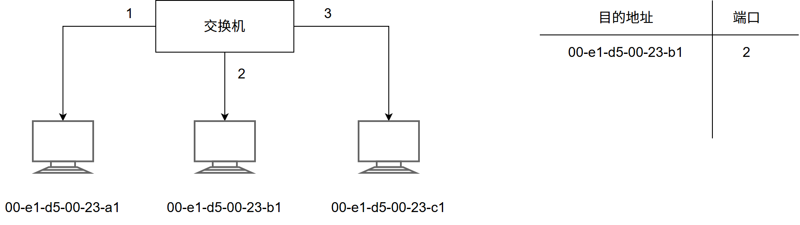
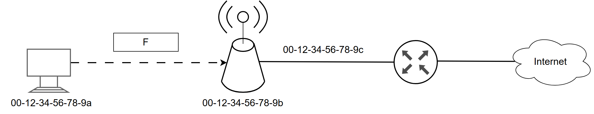
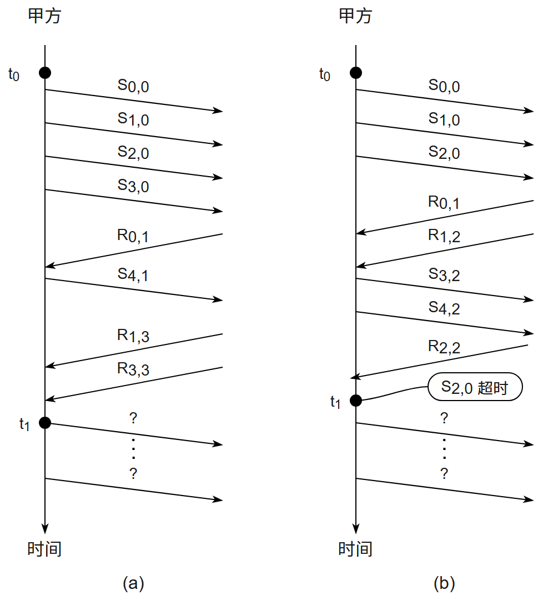
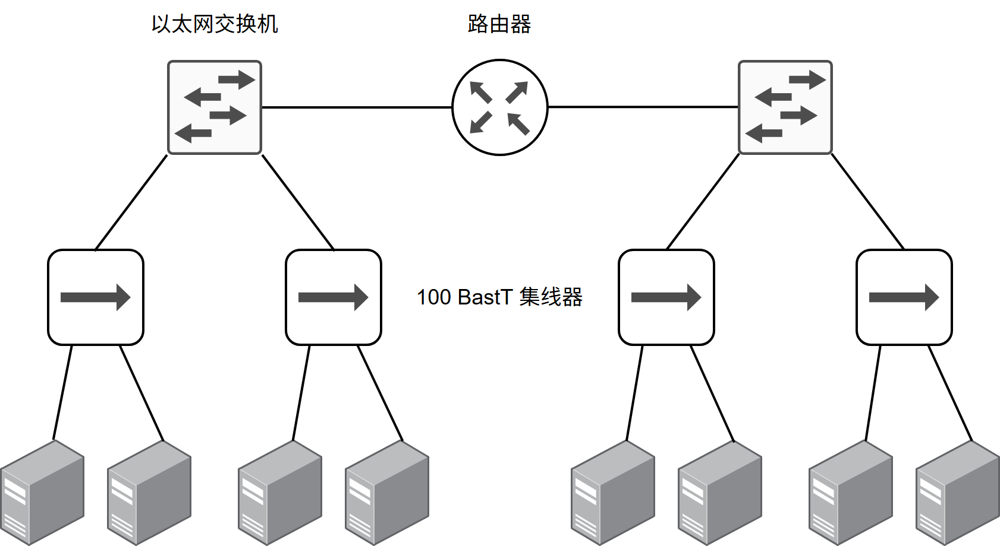
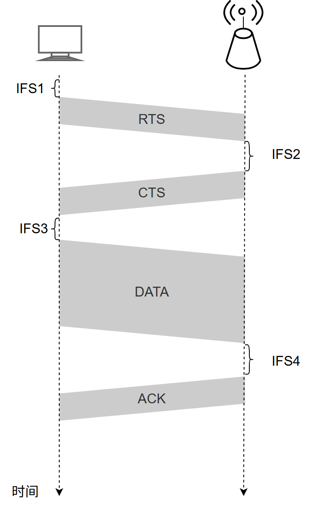
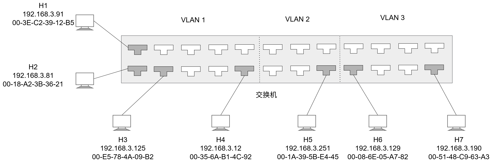
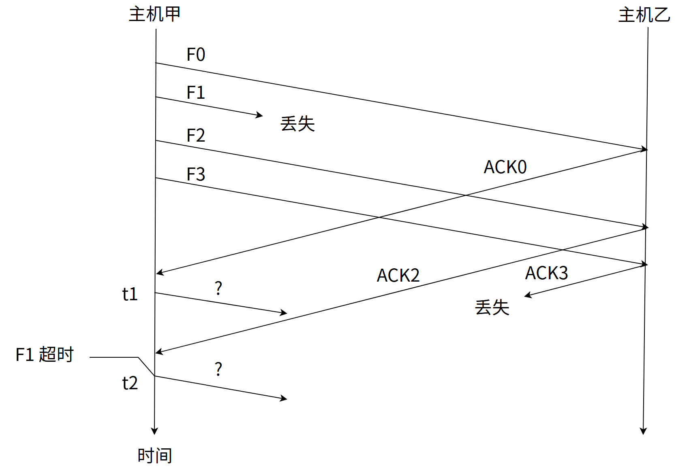

# 第3章 数据链路层

> 科目：四、计算机网络
> 题目数量：32道
> 年份范围：2009-2024

---

## 2009年

### 第35题（选择题）

数据链路层采用后退帧(GBN)协议，发送方己经发送了编号为0～7 的帧。当计时器超时时，若发 送方只收到0、2、3 号帧的确认，则发送方需要重发的帧数是 。

A. 2
B. 3
C. 4
D. 5

---

### 第36题（选择题）

以太网交换机进行转发决策时使用的PDU 地址是 。

A. 目的物理地址
B. 目的IP 地址
C. 源物理地址
D. 源IP 地址

---

### 第37题（选择题）

在一个采用 CSMA/CD 协议的网络中，传输介质是一根完整的电缆，传输速率为 1Gbps，电缆中的信号传播速度是 200 000km/s。若最小数据帧长度减少 800 比特，则最远的两个站点之间的距离至少需要（）。

A. 增加 160m
B. 增加 80m
C. 减少 160m
D. 减少 80m

---

## 2010年

### 第47题（综合题）

（9 分）某局域网采用CSMA/CD 协议实现介质访问控制，数据传输速率为10Mbps，主机甲和主 机乙之间的距离为2km，信号传播速度为200000km/s。请回答下列问题，要求说明理由或写出计 算过程。

（1）若主机甲和主机乙发送数据时发生冲突，则从开始发送数据时刻起，到两台主机均检测到 冲突时刻止，最短需经过多长时间？最长需经过多长时间（假设主机甲和主机乙发送数据过程中，其 他主机不发送数据）？

（2）若网络不存在任何冲突与差错，主机甲总是以标准的最长以太网数据帧（1518B）向主机乙 发送数据，主机乙每成功收到一个数据帧后立即向主机甲发送一个64B 的确认帧，主机甲收到确认 帧后方可发送下一个数据帧。此时主机甲的有效数据传输速率是多少（不考虑以太网的前导码）？

---

## 2011年

### 第35题（选择题）

数据链路层采用选择重传协议(SR)传输数据，发送方已发送了0~3 号数据帧，现已收到1 号帧的 确认，而0、2 号帧依次超时， 则此时需要重传的帧数是 。

A. 1
B. 2
C. 3
D. 4

---

### 第36题（选择题）

下列选项中，对正确接收到的数据帧进行确认的MAC 协议是 。

A. CSMA
B. CDMA
C. CSMA/CD
D. CSMA/CA

---

## 2012年

### 第35题（选择题）

以太网的MAC 协议提供的是 。

A. 无连接不可靠服务
B. 无连接可靠服务
C. 有连接不可靠服务
D. 有连接可靠服务

---

### 第36题（选择题）

两台主机之间的数据链路层采用后退N 帧协议(GBN)传输数据，数据传输速率为16kbps, 单向传 播时延为270ms, 数据帧长度范围是128～512 字节，接收方总是以与数据帧等长的帧进行确认。 为使信道利用率达到最高，帧序号的比特数至少为 。

A. 5
B. 4
C. 3
D. 2

---

## 2013年

### 第36题（选择题）

下列介质访问控方法中，可能发生冲突的是 。

A. CDMA
B. CSMA
C. TDMA
D. FDMA

---

### 第37题（选择题）

HDLC 协议对01111100 01111110 组帧后对应的比特串为 。

A. 01111100 00111110 10
B. 01111100 01111101 01111110
C. 01111100 01111101 0
D. 01111100 01111110 01111101

---

### 第38题（选择题）

对于 100 Mbps 的以太网交换机，当输出端口无排队，以直通交换 (cut-through switching) 方式转发一个以太网帧（不包括前导码）时，引入的转发延迟至少是（ ）。

A. 0 μs
B. 0.48 μs
C. 5.12 μs
D. 121.44 μs

---

## 2014年

### 第34题（选择题）

某以太网拓扑及交换机当前转发表如下图所示，主机 00-e1-d5-00-23-a1 向主机 00-e1-d5-00-23-c1 发送 1 个数据帧，主机 00-e1-d5-00-23-c1 收到该帧后，向主机 00-e1-d5-00-23-a1 发送 1 个确认帧，交换机对这两个帧的转发端口分别是（ ）。

A. {3} 和 {1}
B. {2,3} 和 {1}
C. {2,3} 和 {1,2}
D. {1,2,3} 和 {1}

---

### 第36题（选择题）

主机甲与主机乙之间使用后退N 帧协议（GBN）传输数据，甲的发送窗口尺寸为1000，数据帧 长为1000 字节，信道带宽为100Mbps，乙每收到一个数据帧立即利用一个短帧（忽略其传输延 迟）进行确认，若甲、乙之间的单向传播延迟是50ms，则甲可以达到的最大平均数据传输速率 约为

A. 10Mbps
B. 20Mbps
C. 80Mbps
D. 100Mbps

---

## 2015年

### 第35题（选择题）

主机甲通过128kbps 卫星链路，采用滑动窗口协议向主机乙发送数据，链路单向传播延迟为 250ms，帧长为1000 字节。不考虑确认帧的开销，为使链路利用率不小于80%，帧序号的比特 数至少是 。

A. 3
B. 4
C. 7
D. 8

---

### 第36题（选择题）

下列关于CSMA/CD 协议的叙述中，错误的是 。

A. 边发送数据帧，边检测是否发生冲突
B. 适用于无线网络，以实现无线链路共享
C. 需要根据网络跨距和数据传输速率限定最小帧长
D. 当信号传播延迟趋近0 时，信道利用率趋近100％

---

### 第37题（选择题）

下列关于交换机的叙述中，正确的是 。

A. 以太网交换机本质上是一种多端口网桥
B. 通过交换机互连的一组工作站构成一个冲突域
C. 交换机每个端口所连网络构成一个独立的广播域
D. 以太网交换机可实现采用不同网络层协议的网络互联

---

## 2016年

### 第35题（选择题）

若主机H2 向主机H4 发送1 个数据帧，主机H4 向主机H2 立即发送一个确认帧，则除H4 外， 从物理层上能够收到该确认帧的主机还有 。

A. 仅H2
B. 仅H3
C. 仅H1、H2
D. 仅H2、H3

---

## 2017年

### 第35题（选择题）

在下图所示的网络中，若主机 H 发送一个封装访问 Internet 的 IP 分组的 IEEE 802.11 数据帧 F，则帧 F 的地址 1、地址 2 和地址 3 分别是（ ）。

A. 00-12-34-56-78-9a, 00-12-34-56-78-9b, 00-12-34-56-78-9c
B. 00-12-34-56-78-9b, 00-12-34-56-78-9a, 00-12-34-56-78-9c
C. 00-12-34-56-78-9b, 00-12-34-56-78-9c, 00-12-34-56-78-9a
D. 00-12-34-56-78-9a, 00-12-34-56-78-9c, 00-12-34-56-78-9b

---

### 第47题（综合题）

甲乙双方均采用后退 N 帧协议 (GBN) 进行持续的双向数据传输，且双方始终采用捎带确认，帧长均为 1000 B。 
Sx,y​
 和 
Rx,y​
 分别表示甲方和乙方发送的数据帧，其中：
x
是发送序号；
y
是确认序号（表示希望接收对方的下一帧序号）；数据帧的发送序号和确认序号字段均为 3 比特。信道传输速率为 100 Mbps，RTT ＝ 0.96 ms。下图给出了甲方发送数据帧和接收数据帧的两种场景，其中 
t0​
 为初始时刻，此时甲方的发送和确认序号均为 0， 
t1​
 时刻甲方有足够多的数据待发送。

请回答下列问题。

(1) 对于图 (a)， 
t0​
 时刻到 
t1​
 时刻期间，甲方可以断定乙方已正确接收的数据帧数是多少？正确接收的是哪几个帧（请用 
Sx,y​
 形式给出）？

(2) 对于图 (a)，从 
t1​
 时刻起，甲方在不出现超时且未收到乙方新的数据帧之前，最多还可以发送多少个数据帧？其中第一个帧和最后一个帧分别是哪个（请用 
Sx,y​
 形式给出）？

(3) 对于图 (b)，从 
t1​
 时刻起，甲方在不出现新的超时且未收到乙方新的数据帧之前，需要重发多少个数据帧？重发的第一个帧是哪个（请用 
Sx,y​
 形式给出）？

(4) 甲方可以达到的最大信道利用率是多少？

---

## 2018年

### 第35题（选择题）

IEEE 802.11无线局域网的MAC协议CSMA/CA进行信道预约的方法是（）。

A. 发送确认帧
B. 采用二进制指数退避
C. 使用多个MAC地址
D. 交换RTS与CTS帧

---

### 第36题（选择题）

主机甲采用停–等协议向主机乙发送数据，数据传输速率是3kbps,单向传播延时是200ms，忽略 确认帧的传输延时。当信道利用率等于40%时，数据帧的长度为 。

A. 240 比特
B. 400 比特
C. 480 比特
D. 800 比特

---

## 2019年

### 第35题（选择题）

对于滑动窗口协议，若分组序号采用3 比特编号，发送窗口大小为5，则接收窗口最大 是 。

A. 2
B. 3
C. 4
D. 5

---

### 第36题（选择题）

假设一个采用 CSMA/CD 协议的 100Mbps 局域网，最小帧长是 128 B，则在一个冲突域内两个站点之间的单向传播延时最多是（ ）。

A. 2.56 us
B. 5.12 us
C. 10.24 us
D. 20.48 us

---

## 2020年

### 第35题（选择题）

下图所示的网络冲突域和广播域的个数分别是（ ）。

A. 2，2；
B. 2，4；
C. 4，2；
D. 4，4；

---

### 第36题（选择题）

假设主机采用停等协议向主机乙发送数据帧，数据帧长与确认帧长均为 1000B。数据传输速率是 10kbps，单项传播延时是 200ms。则甲的最大信道利用率（ ）。

A. 80%；
B. 66.7%；
C. 44.4%；
D. 40%

---

### 第37题（选择题）

某 IEEE 802.11 无线局域网中主机 H 与 AP 之间发送或接收 CSMA/CA 帧的过程如下图所示，在 H 或 AP 发送帧前所等待的帧间间隔时间（IFS）中最长的是（ ）。

A. IFS1;
B. IFS2;
C. IFS3;
D. IFS4；

---

## 2023年

### 第35题（选择题）

假设通过同一信道，数据链路层分别采用停止–等待协议、GBN 协议和SR 协议（发送窗口和接 收窗口相等）传输数据，3 个协议数据帧长相同，忽略确认帧长度，帧序号位数为3 比特。若对应 3 个协议的发送方最大信道利用率分别是U1、U2 和U3，则U1、U2 和U3 满足的关系是 。

A. U1≤U2≤U3
B. U1≤U3≤U2
C. U2≤U3≤U1
D. U3≤U2≤U1

---

### 第36题（选择题）

已知10BaseT以太网的争用时间片为51.2us。若网卡在发送某帧时发生了连续4次冲突，则基于二进制指数退避算法确定的再次尝试重发该帧前等待的最长时间是（）。

A. 51.2us
B. 204.8us
C. 768us
D. 819.2us

---

### 第37题（选择题）

若甲向乙发送数据时采用CRC 校验，生成多项式为G(X)＝X 4+X+1(即G＝10011)，则乙接收到下列 比特串时，可以断定其在传输过程中未发生错误的是 。

A. 1 0111 0000
B. 1 0111 0100
C. 1 0111 1000
D. 1 0111 1100

---

## 2024年

### 第35题（选择题）

如题 35 图所示的支持 VLAN 划分的交换机，已按端口划分了 3 个 VLAN，部分端口连接主机的 IP 地址和 MAC 地址如图中所示，ARP 表结构为＜IP 地址，MAC 地址，TTL＞ ，下列选项中，不会出现在 H4 的 ARP 表中的是（）

A. 192.168.3.81, 00-18-A2-3B-36-21, 14:32:00
B. 192.168.3.91, 00-3E-C2-39-12-B5, 14:37:00
C. 192.168.3.125, 00-E5-78-4A-09-B2, 14:35:00
D. 192.168.3.129, 00-08-6E-05-A7-82, 14:52:00

---

### 第36题（选择题）

在采用CSMA/CA的802.11无线局域网中，DIFS＝120μs，SIFS＝28μs，RTS、CTS和ACK帧的传输时延分别是3μs、2μs和2μs，忽略信号传播时延。若主机A欲向AP发送一个总长度为1998B的数据帧，无线链路带宽为54Mb/s，则隐藏站B收到AP发送的CTS帧时，设置的网络分配向量NAV的值是（）。

A. 326us
B. 354us
C. 385us
D. 513us

---

### 第37题（选择题）

主机甲通过选择重传（SR）滑动窗口协议向主机乙发送帧的部分过程如下图所示。F 为数据帧，ACKx
为确认帧，x 是位数为比特的序号。乙只对正确接收的数据帧进行独立确认。发送窗口与接收窗口大小相
同且均为最大值。甲在
t1​
时刻和
t2​
时刻发送的数据帧分别是 ( )

A. F1、F3
B. F1、F4
C. F3、F1
D. F4、F1

---
