# 第4章 网络层

> 科目：四、计算机网络
> 题目数量：44道
> 年份范围：2009-2024

---

## 2009年

### 第47题（综合题）

某网络拓扑如下图所示，路由器 R1 通过接口 E1、E2 分别连接局域网 1、局域网 2，通过接口 L0 连接路由器 R2，并通过路由器 R2 连接域名服务器与互联网。R1 的 L0 接口的 IP 地址是 202.118.2.1；R2 的 L0 接口的 IP 地址是 202.118.2.2，L1 接口的 IP 地址是 130.11.120.1，E0 接口的 IP 地址是 202.118.3.1；域名服务器的 IP 地址是 202.118.3.2。

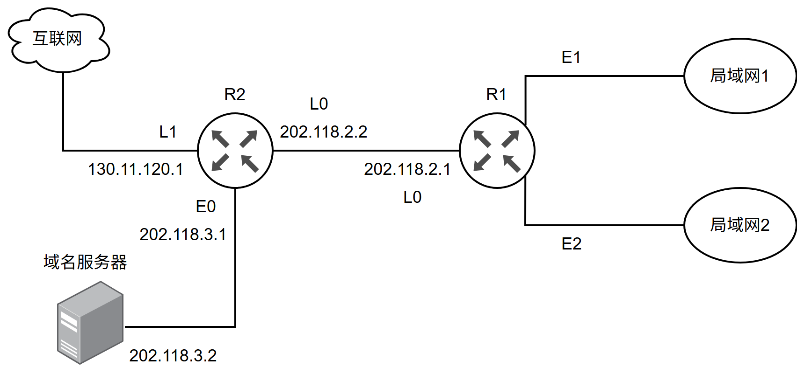

R1 和 R2 的路由表结构为：

(1) 将 IP 地址空间 202.118.1.0/24 划分为 2 个子网，分别分配给局域网 1、局域网 2，每个局域网需分配的 IP 地址数不少于 120 个。请给出子网划分结果，说明理由或给出必要的计算过程。

(2) 请给出 R1 的路由表，使其明确包括到局域网 1 的路由、局域网 2 的路由、域名服务器的主机路由和互联网的路由。

(3) 请采用路由聚合技术，给出 R2 到局域网 1 和局域网 2 的路由。

---

## 2010年

### 第35题（选择题）

某自治系统内采用RIP 协议，若该自治系统内的路由器R1 收到其邻居路由器R2 的距离矢量， 距离矢量中包含信息＜net1, 16＞，则能得出的结论是 。

A. R2 可以经过R1 到达net1，跳数为17
B. R2 可以到达net1，跳数为16
C. R1 可以经过R2 到达net1，跳数为17
D. R1 不能经过R2 到达net1

---

### 第36题（选择题）

若路由器R 因为拥塞丢弃IP 分组，则此时R 可向发出该IP 分组的源主机发送的ICMP 报文类 型是 。

A. 路由重定向
B. 目的不可达
C. 源点抑制
D. 超时

---

### 第37题（选择题）

某网络的IP地址空间为192.168.5.0/24，采用定长子网划分，子网掩码为255.255.255.248，则该网络中的最大子网个数、每个子网内的最大可分配地址个数分别是（）。

A. 32，8
B. 32，6
C. 8，32
D. 8，30

---

### 第38题（选择题）

下列网络设备中，能够抑制广播风暴的是 。 I. 中继器 II. 集线器 III. 网桥 IV. 路由器

A. 仅I 和II
B. 仅III
C. 仅III 和IV
D. 仅IV

---

## 2011年

### 第37题（选择题）

某网络拓扑如下图所示，路由器 R1 只有到达子网 192.168.1.0/24 的路由。为使 R1 可以将 IP 分组正确地路由到图中所有子网，则在 R1 中需要增加的一条路由（目的网络，子网掩码，下一跳）是（ ）。

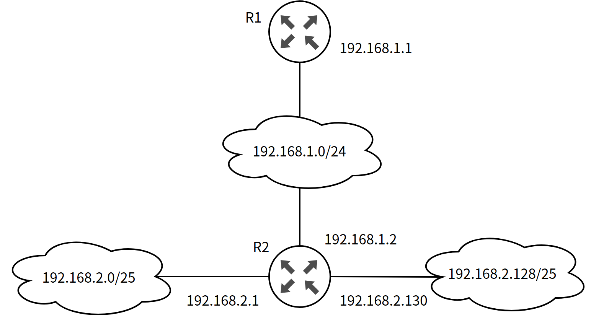

A. 192.168.2.0，255.255.255.128，192.168.1.1
B. 192.168.2.0，255.255.255.0，192.168.1.1
C. 192.168.2.0，255.255.255.128，192.168.1.2
D. 192.168.2.0，255.255.255.0，192.168.1.2

---

### 第38题（选择题）

在子网192.168.4.0/30中，能接收目的地址为192.168.4.3的IP分组的最大主机数是（）。

A. 0
B. 1
C. 2
D. 4

---

## 2012年

### 第33题（选择题）

在TCP/IP 体系结构中，直接为ICMP 提供服务的协议是 。

A. PPP
B. IP
C. UDP
D. TCP

---

### 第37题（选择题）

下列关于IP 路由器功能的描述中，正确的是 。 I. 运行路由协议，设置路由表 II. 监测到拥塞时，合理丢弃IP 分组 III. 对收到的IP 分组头进行差错校验，确保传输的IP 分组不丢失 IV. 根据收到的IP 分组的目的IP 地址，将其转发到合适的输出线路上

A. 仅III、IV
B. 仅I、II、III
C. 仅I、II、IV
D. I、II、III、IV

---

### 第38题（选择题）

ARP 协议的功能是（ ）。

A. 根据 IP 地址查询 MAC 地址
B. 根据 MAC 地址查询 IP 地址
C. 根据域名查询 IP 地址
D. 根据 IP 地址查询域名

---

### 第39题（选择题）

某主机的IP地址为180.80.77.55，子网掩码为255.255.252.0。若该主机向其所在子网发送广播分组，则目的地址可以是（）。

A. 180.80.76.0
B. 180.80.76.255
C. 180.80.77.255
D. 180.80.79.255

---

### 第47题（综合题）

主机 H 通过快速以太网连接 Internet，IP 地址为 192.168.0.8，服务器 S 的 IP 地址为 211.68.71.80。H 与 S 使用 TCP 通信时，在 H 上捕获的其中 5 个 IP 分组如题 47-a 表所示。

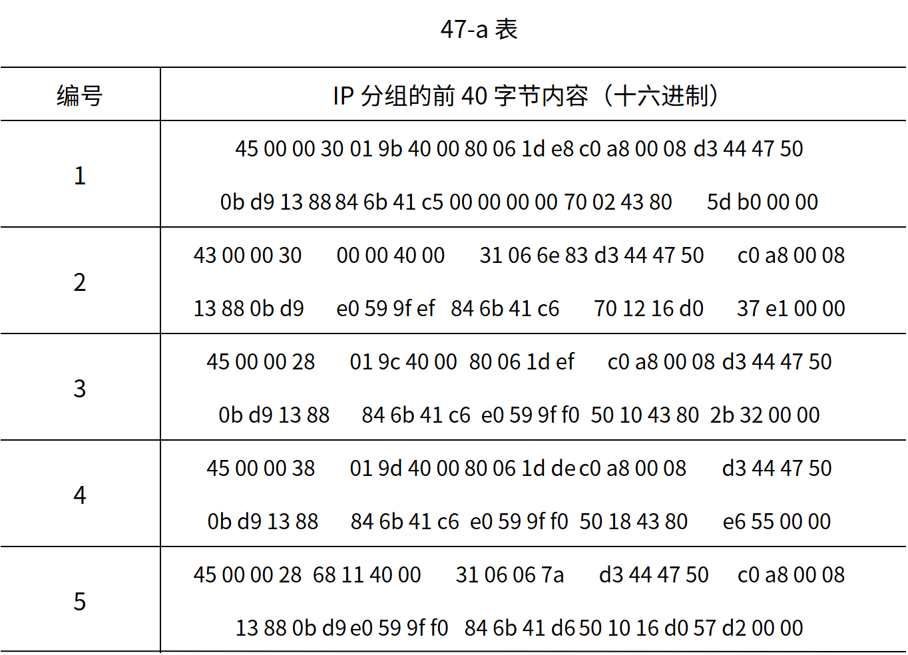

请回答下列问题。

(1) 题 47-a 表中的 IP 分组中，哪几个是由 H 发送的？哪几个完成了 TCP 连接建立过程？哪几个在通过快速以太网传输时进行了填充？

(2) 根据题 47-a 表中的 IP 分组，分析 S 已经收到的应用层数据字节数是多少？

(3) 若题 47-a 表中的某个 IP 分组在 S 发出时的前 40 字节如题 47-b 表所示，则该 IP 分组到达 H 时经过了多少个路由器？

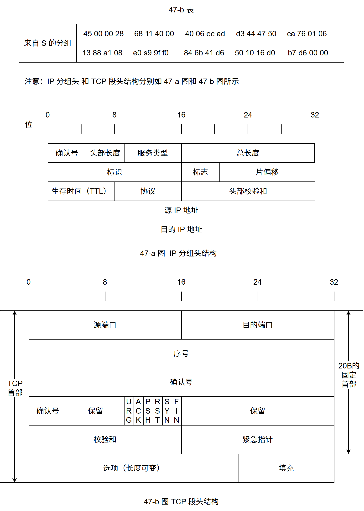

---

## 2013年

### 第47题（综合题）

假设 Internet 的两个自治系统构成的网络如题 47 图所示，自治系统 AS1 由路由器 R1 连接两个子网构成；自治系统 AS2 由路由器 R2、R3 互联并连接 3 个子网构成。各子网地址、R2 的接口名、R1 与 R3 的部分接口 IP 地址如题 47 图所示。

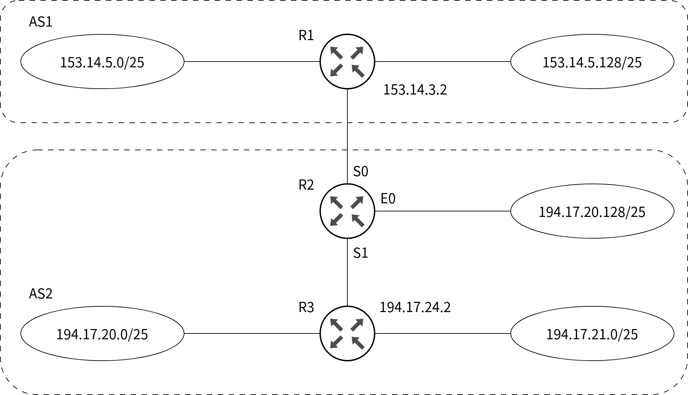

请回答下列问题。

(1) 假设路由表结构如下表所示。

请利用路由聚合技术，给出 R2 的路由表，要求包括到达题 47 图中所有子网的路由，且路由表中的路由项尽可能少。

(2) 若 R2 收到一个目的 IP 地址为 194.17.20.200 的 IP 分组，R2 会通过哪个接口转发该 IP 分组？

(3) R1 与 R2 之间利用哪个路由协议交换路由信息？该路由协议的报文被封装到哪个协议的分组中进行传输？

---

## 2014年

### 第37题（选择题）

站点 A、B、C 通过 CDMA 共享链路，A、B、C 的码片序列 (chipping sequence) 分别是 (1,1,1,1)、(1,-1,1,-1) 和 (1,1,-1,-1) 。若 C 从链路上收到的序列是 (2,0,2,0,0,-2,0,-2,0,2,0,2)，则 C 收到 A 发送的数据是（ ）。

A. 000
B. 101
C. 110
D. 111

---

### 第42题（综合题）

某网络中的路由器运行 OSPF 路由协议，题 42 表是路由器 R1 维护的主要链路状态信息（LSI），题 42 图是根据题 42 表的接口名构造出来的网络拓扑。

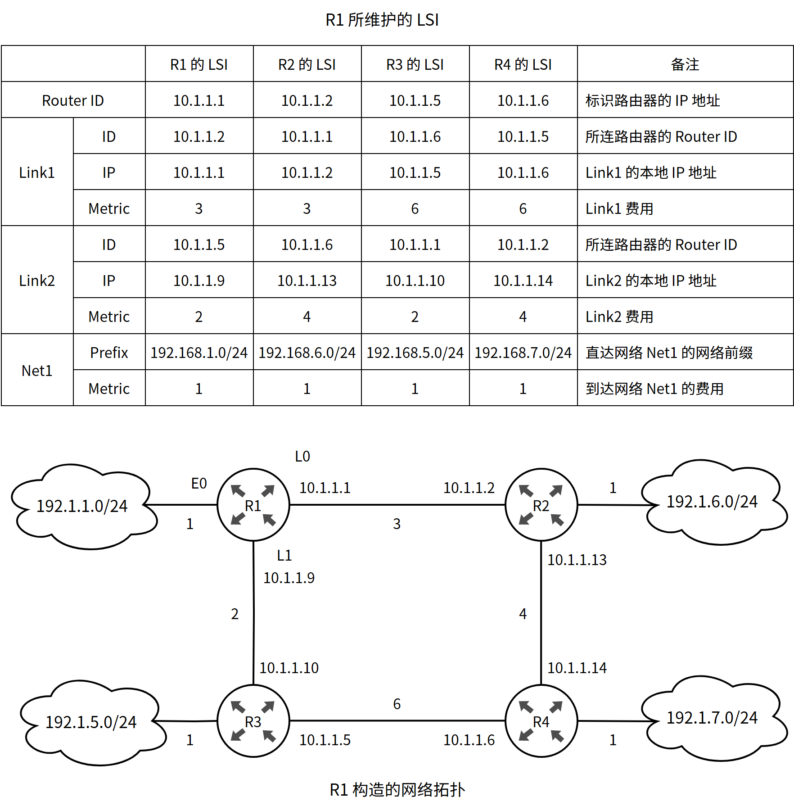

请回答下列问题。

⑴ 本题中的网络可抽象为数据结构中的哪种结构？

⑵ 针对题 42 表中的内容，设计合理的链式存储结构，以保存题 42 表中的链路状态信息（LSI）。要求给出链式存储结构的数据定义，并画出对应题 42 表的链式存储结构示意图（示意图中仅以 ID 标识结点）。

⑶ 按照迪杰斯特拉（Dijkstra）算法的策略，依次给出 R1 到达题 42 图中子网 192.1.`x.x` 的最短路径及费用。

---

### 第43题（综合题）

请根据题 42 描述的网络，继续回答下列问题。

(1) 假设路由表结构如下表所示，请给出题 42 图中 R1 的路由表，要求包括到达题 42 图中子网 192.1.`x.x` 的路由，且路由表中的路由项尽可能少。

(2) 当主机 192.1.1.130 向主机 192.1.7.211 发送一个 TTL＝64 的 IP 分组时，R1 通过哪个接口转发该 IP 分组？主机 192.1.7.211 收到的 IP 分组 TTL 是多少？

(3) 若 R1 增加一条 Metric 为 10 的链路连接 Internet，则题 42 表中 R1 的 LSI 需要增加哪些信息？

---

## 2015年

### 第38题（选择题）

某路由器的路由表如下表所示：
目的网络 下一跳 接口
169.96.40.0/23 176.1.1.1 S1
169.96.40.0/25 176.2.2.2 S2
169.96.40.0/27 176.3.3.3 S3
0.0.0.0/0 176.4.4.4 S4
若路由器收到一个目的地址为169.96.40.5的IP分组，则转发该IP分组的接口是（）。

A. S1
B. S2
C. S3
D. S4

---

### 第40题（选择题）

某浏览器发出的HTTP请求报文如下：
GET /`index.html` HTTP/1.1
Host: `www.test`.`edu.cn`
Connection: close
Cookie: 123456
下列叙述中，错误的是（）。

A. 该浏览器请求浏览index.html
B. index.html存放在www.`test.edu`.cn上
C. 该浏览器请求使用持续连接
D. 该浏览器曾经浏览过www.`test.edu`.cn

---

### 第47题（综合题）

某网络拓扑如题 47 图所示，其中路由器内网接口、DHCP 服务器、WWW 服务器与主机 1 均采用静态 IP 地址配置，相关地址信息见图中标注；主机 2～主机 N 通过 DHCP 服务器动态获取 IP 地址等配置信息。

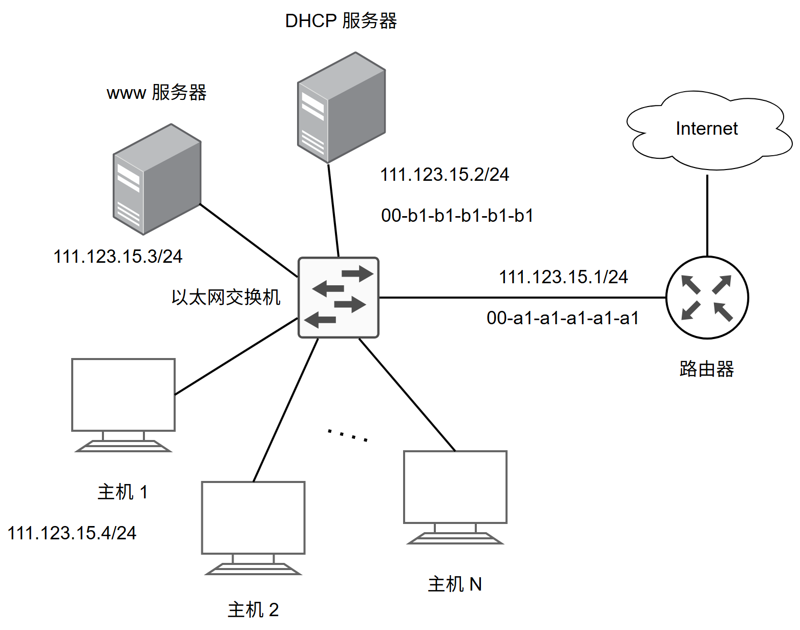

(1) DHCP 服务器可为主机 2～主机 N 动态分配 IP 地址的最大范围是什么？主机 2 使用 DHCP 协议获取 IP 地址的过程中，发送的封装 DHCP Discover 报文的 IP 分组的源 IP 地址和目的 IP 地址分别是什么？

(2) 若主机 2 的 ARP 表为空，则该主机访问 Internet 时，发出的第一个以太网帧的目的 MAC 地址是什么？封装主机 2 发往 Internet 的 IP 分组的以太网帧的目的 MAC 地址是什么？

(3) 若主机 1 的子网掩码和默认网关分别配置为 255.255.255.0 和 111.123.15.2，则该主机是否能访问 WWW 服务器？是否能访问 Internet？请说明理由。

---

## 2016年

### 第37题（选择题）

假设R1、R2、R3采用RIP协议交换路由信息，且均已收敛。若R3检测到网络201.1.2.0/25不可达，并向R2通告一次新的距离向量，则R2更新后，其到达该网络的距离是（）。

A. 2
B. 3
C. 16
D. 17

---

### 第38题（选择题）

假设连接R1、R2和R3之间的点对点链路使用201.1.3.x/30地址，当H3访问Web服务器S时，R2转发出去的封装HTTP请求报文的IP分组的源IP地址和目的IP地址分别是（）。

A. 192.168.3.251，130.18.10.1
B. 192.168.3.251，201.1.3.9
C. 201.1.3.8，130.18.10.1
D. 201.1.3.10，130.18.10.1

---

### 第39题（选择题）

假设H1与H2的默认网关和子网掩码均分别配置为192.168.3.1和255.255.255.128，H3与H4的默认网关和子网掩码均分别配置为192.168.3.254和255.255.255.128，则下列现象中可能发生的是（）。

A. H1不能与H2进行正常IP通信
B. H2与H4均不能访问Internet
C. H1不能与H3进行正常IP通信
D. H3不能与H4进行正常IP通信

---

## 2017年

### 第36题（选择题）

下列 IP 地址中，只能作为 IP 分组的源 IP 地址但不能作为目的 IP 地址的是（ ）。

A. 0.0.0.0
B. 127.0.0.1
C. 200.10.10.3
D. 255.255.255.255

---

### 第37题（选择题）

直接封装RIP、OSPF、BGP 报文的协议分别是 。

A. TCP、UDP、IP
B. TCP、IP、UDP
C. UDP、TCP、IP
D. UDP、IP、TCP

---

### 第38题（选择题）

若将网络21.3.0.0/16划分为128个规模相同的子网，则每个子网可分配的最大IP地址个数是（）。

A. 254
B. 256
C. 510
D. 512

---

## 2018年

### 第37题（选择题）

路由器 R 通过以太网交换机 S1 和 S2 连接两个网络，R 的接口、主机 H1 和 H2 的 IP 地址与 MAC 地址如下图所示。若 H1 向 H2 发送一个 IP 分组 P，则 H1 发出的封装 P 的以太网帧的目的 MAC 地址、H2 收到的封装 P 的以太网帧的源 MAC 地址分别是（ ）。

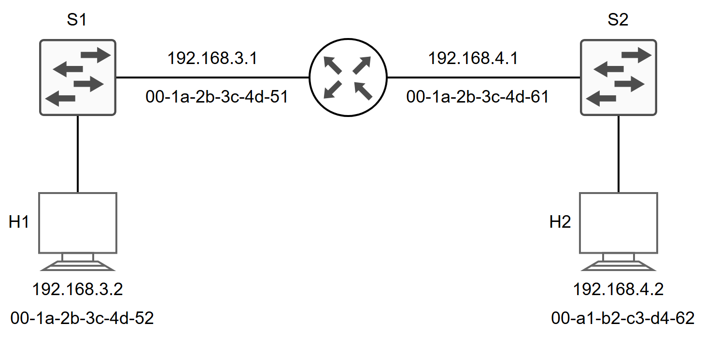

A. 00-a1-b2-c3-d4-62、00-1a-2b-3c-4d-52
B. 00-a1-b2-c3-d4-62、00-1a-2b-3c-4d-61
C. 00-1a-2b-3c-4d-51、00-1a-2b-3c-4d-52
D. 00-1a-2b-3c-4d-51、00-a1-b2-c3-d4-61

---

### 第38题（选择题）

某路由表中有转发接口相同的4条路由表项，其目的网络地址分别为35.230.32.0/21、35.230.40.0/21、35.230.48.0/21和35.230.56.0/21，将该4条路由聚合后的目的网络地址为（）。

A. 35.230.32.0/19
B. 35.230.32.0/20
C. 35.230.32.0/21
D. 35.230.32.0/22

---

### 第47题（综合题）

某公司网络如题 47 图所示。IP 地址空间 192.168.1.0/24 被均分给销售部和技术部两个子网，并已分别为部分主机和路由器接口分配了 IP 地址，销售部子网的 MTU＝1500 B，技术部子网的 MTU＝800 B。

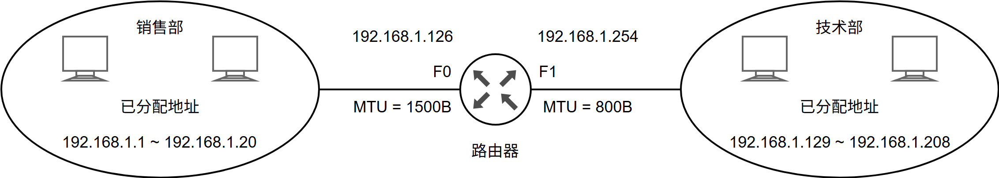

请回答下列问题。

(1) 销售部子网的广播地址是什么？技术部子网的子网地址是什么？若每个主机仅分配一个 IP 地址，则技术部子网还可以连接多少台主机？

(2) 假设主机 192.168.1.1 向主机 192.168.1.208 发送一个总长度为 1500 B 的 IP 分组，IP 分组的头部长度为 20 B，路由器在通过接口 F1 转发该 IP 分组时进行了分配。若分片时尽可能分为最大片，则一个最大 IP 分片封装数据的字节数是多少？至少需要分为几个分片？每个分片的片偏移量是多少？

---

## 2019年

### 第37题（选择题）

若将101.200.16.0/20划分为5个子网，则可能的最小子网的可分配IP地址数是（）。

A. 126
B. 254
C. 510
D. 1022

---

### 第47题（综合题）

某网络拓扑如题 47 图所示，其中 R 为路由器，主机 HI~H4 的 IP 地址配置以及 R 的各接口 IP 地址配置如图中所示。现有若干台以太网交换机（无 VLAN 功能）和路由器两类网络互连设备可供选择。

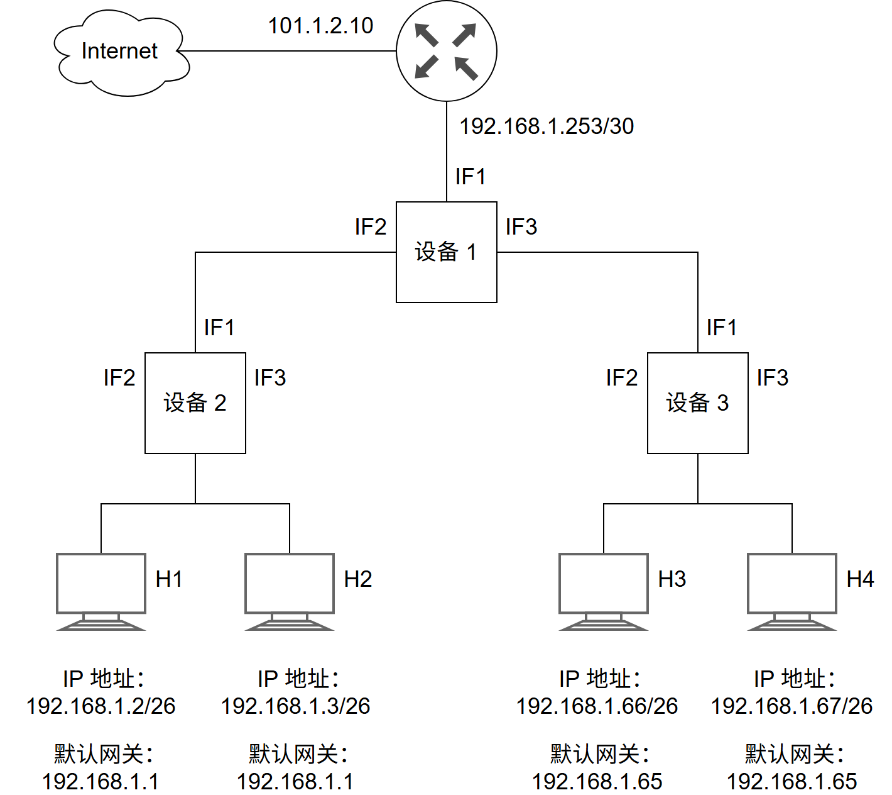

请回答下列问题：

(1) 设备 1、设备 2 和设备 3 分别应选择什么类型网络设备？

(2) 设备 1、设备 2 和设备 3 中，哪几个设备的接口需要配置 IP 地址？并为对应的接口配置正确的 IP 地
址。

(3) 为确保主机 H1~H4 能够访问 Internet，R 需要提供什么服务？

(4) 若主机 H3 发送一个目的地址为 192.168.1.127 的 IP 数据报，网络中哪几个主机会接收该数据报？

---

## 2020年

### 第47题（综合题）

某校园网有两个局域网，通过路由器 R1、R2 和 R3 互联后接入 Internet，S1 和 S2 为 以太网交换机，局域网采用静态 IP 地址配置，路由器部分接口以及各主机的 IP 地址如图所示：

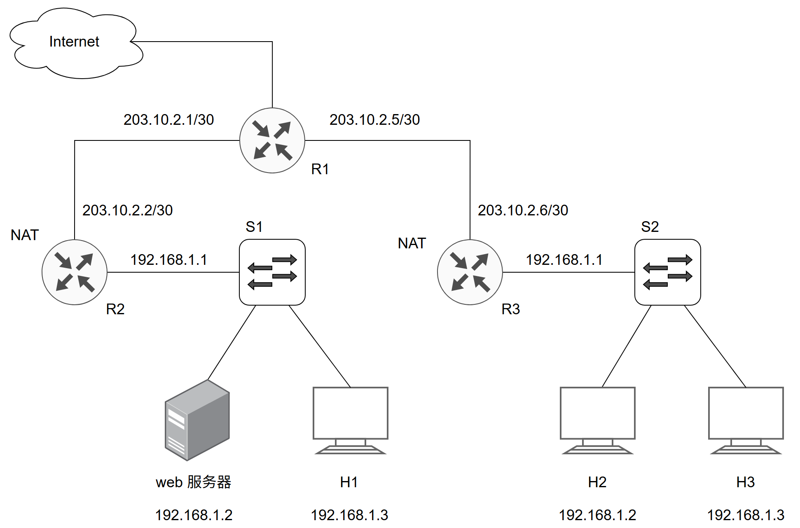

假设 NAT 转换表结构为：

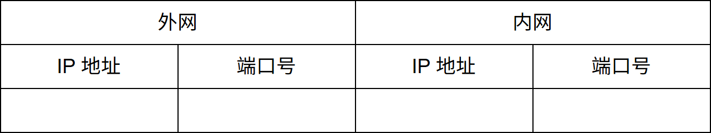

请回答下列问题：
1）为使 H2 和 H3 能够访问 Web 服务器（使用默认端口号），需要进行什么配置？
2）若 H2 主动访问 Web 服务器时，将 HTTP 请求报文封装到 IP 数据报 P 中发送，则 H2 发送 P 的源 IP 地址和目的 IP 地址分别是？经过 R3 转发后，P 的源 IP 地 址和目的 IP 地址分别是？经过 R2 转发后，P 的源 IP 地址和目的 IP 地址分别是？

---

## 2021年

### 第35题（选择题）

现将一个IP网络划分为3个子网，若其中一个子网是192.168.9.128/26，则下列网络中，不可能是另外两个子网之一的是（）。

A. 192.168.9.0/25
B. 192.168.9.0/26
C. 192.168.9.192/26
D. 192.168.9.192/27

---

### 第36题（选择题）

若路由器向MTU ＝ 800B 的链路转发一个总长度为1580B 的IP 数据报（首部长度为20B）时， 进行了分片，且每个分片尽可能大，则第2 个分片的总长度字段和MF 标志位的值分别 是 。

A. 796, 0
B. 796, 1
C. 800, 0
D. 800, 1

---

### 第37题（选择题）

某网络中的所有路由器均采用距离向量路由算法计算路由。若路由器 E 与邻居路由器 A,B,C 和 D 之间的直接链路距离分别是 8, 10, 12 和 6 , 且 E 收到邻居路由器的距离向量如下表所示，则路由器 E 更新后的到达目的网络 Netl~Net4 的距离分别是（ ）。

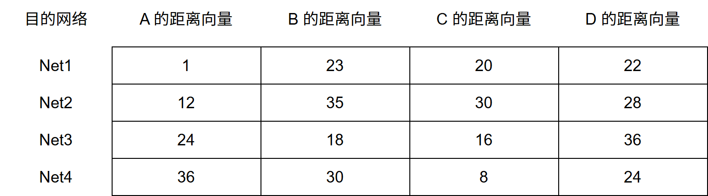

A. 9, 10, 12, 6
B. 9, 10, 28, 20
C. 9, 20, 12, 20
D. 9, 20, 28, 20

---

## 2022年

### 第35题（选择题）

若某主机的IP地址是183.80.72.48，子网掩码是255.255.192.0，则该主机所在网络的网络地址是（）。

A. 183.80.0.0
B. 183.80.64.0
C. 183.80.72.0
D. 183.80.192.0

---

### 第36题（选择题）

下图所示网络中的主机 H 的子网掩码与默认网关分别是（ ）。

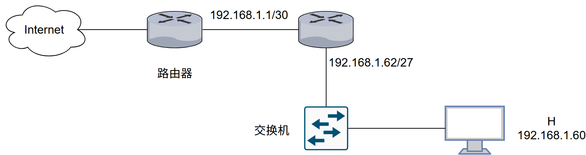

A. 255.255.255.192, 192.168.1.1
B. 255.255.255.192, 192.168.1.62
C. 255.255.255.224, 192.168.1.1
D. 255.255.255.224, 192.168.1.62

---

### 第37题（选择题）

在SDN 网络体系结构中，SDN 控制器向数据平面的SDN 交换机下发流表时所使用的接口 是 .

A. 东向接口
B. 南向接口
C. 西向接口
D. 北向接口

---

### 第47题（综合题）

某网络拓扑如题 47 图所示，R 为路由器，S 为以太网交换机，AP 是

802.11 接入点，路由器的 E0 接口和 DHCP 服务器的 IP 地址配置如图中所示；H1 与 H2 属于同一个广播域，但不属于同一个冲突域；H2 和 H3 属于同一个冲突域；H4 和 H5 已经接入网络，并通过 DHCP 动态获取了 IP 地址。现有路由器、100BaseT 以太网交换机和 100BaseT 集线器 (Hub) 三类设备各若干台。

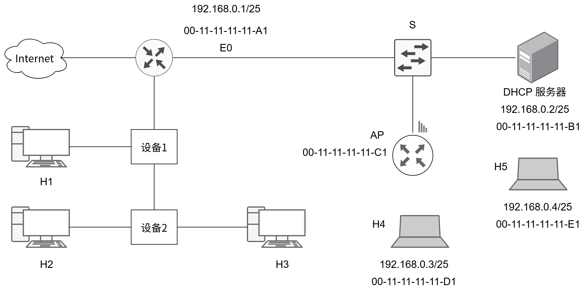

请回答下列问题。
· 设备 1 和设备 2 应该分别选择哪类设备？
· 若信号传播速度为 2x10⁸ m/s, 以太网最小帧长为 64 B, 信号通过设备 2 时会产生额外的

1.51 µs 的时间延迟，则 H2 与 H3 之间可以相距的最远距离是多少？
· 在 H4 通过 DHCP 动态获取 IP 地址过程中，H4 首先发送了 DHCP 报文 M, M 是哪种 DHCP 报文？路由器 E0 接口能否收到封装 M 的以太网帧？S 向 DHCP 服务器转发的封装 M 的以太网帧的目的 MAC 地址是什么？
· 若 H4 向 H5 发送一个 1P 分组 P, 则 H5 收到的封装 P 的

802.11 帧的地址 1、地址 2 和地址 3 分别是什么？

---

## 2023年

### 第33题（选择题）

如图，2 段链路的数据传输速率为 100Mbps，时延带宽积（即单向传播时延＊带宽）均为 1000bit。若 H1 向 H2 发送 1 个大小为 1MB 的文件，分组长度为 1000B，则从 H1 开始发送时刻起到 H2 收到文件全部数据时刻止，所需的时间至少是（注：
M＝106
）?

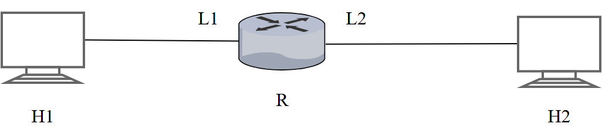

A. 80.02ms
B. 80.08ms
C. 80.09ms
D. 80.10ms

---

### 第38题（选择题）

某网络拓扑如下图所示，其中路由器 R2 实现 NAT 功能。若主机 H 向 Inernet 发送一个 IP 分组，则经过 R2 转发后，该 IP 分组的源 IP 地址是（ ）

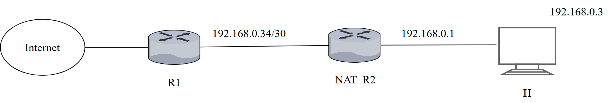

A. 192.168.0.33
B. 192.168.0.35
C. 192.168.0.1
D. 192.168.0.3

---

### 第39题（选择题）

主机168.16.84.24/20所在子网的最小可分配地址和最大可分配地址分别是（）。

A. 168.16.80.1，168.16.84.254
B. 168.16.80.1，168.16.95.254
C. 168.16.84.1，168.16.84.254
D. 168.16.84.1，168.16.95.254

---

### 第40题（选择题）

下列关于IPv4 和IPv6 的叙述中，正确的是（ ）。 I. IPv6 地址空间是IPv4 地址空间的96 倍 II. IPv4 首部和IPv6 的基本首部的长度均可变 III. IPv4 向IPv6 过渡可以采用双协议栈和隧道技术 IV. IPv6 首部的Hop Limit 等价于IPv4 首部的TTL 字段

A. 仅I、II
B. 仅I、IV
C. 仅II、III
D. 仅III、IV

---

## 2024年

### 第33题（选择题）

若分组交换网络及每段链路的带宽如下图，则 H1 到 H2 的最大吞吐量约为（）。

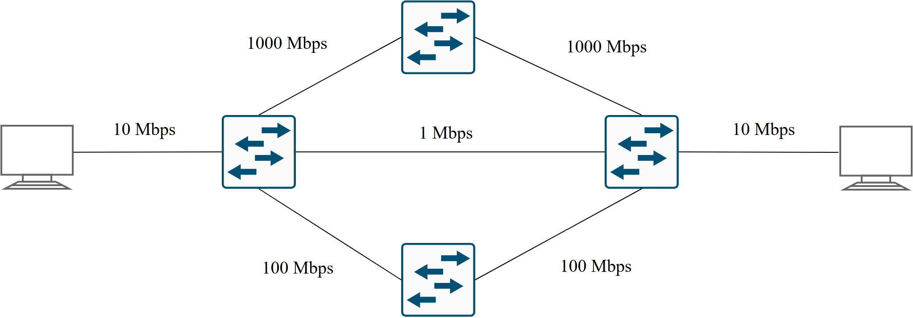

A. 1Mbps
B. 10Mbps
C. 100Mbps
D. 1000Mbps

---

### 第47题（综合题）

网络空间是继陆海空地之后的"第五疆域"，网络技术是网络疆域建设与治理的基础。路由算法与协议是网络核心技术之一。对其准确认知，合理选择与应用，对网络建设十分重要。假设现有互联网中的 4 个自治系统互连拓扑示意图如题 47 图所示。其中，AS1 运行内部网关协议 RIP；AS3 规模较小，自治系统内任意两个主机间通信，经过路由器数不超过 15 个；AS4 规模较大，自治系统内任意两个主机间通信，经过路由器数量可能超过 20 个。

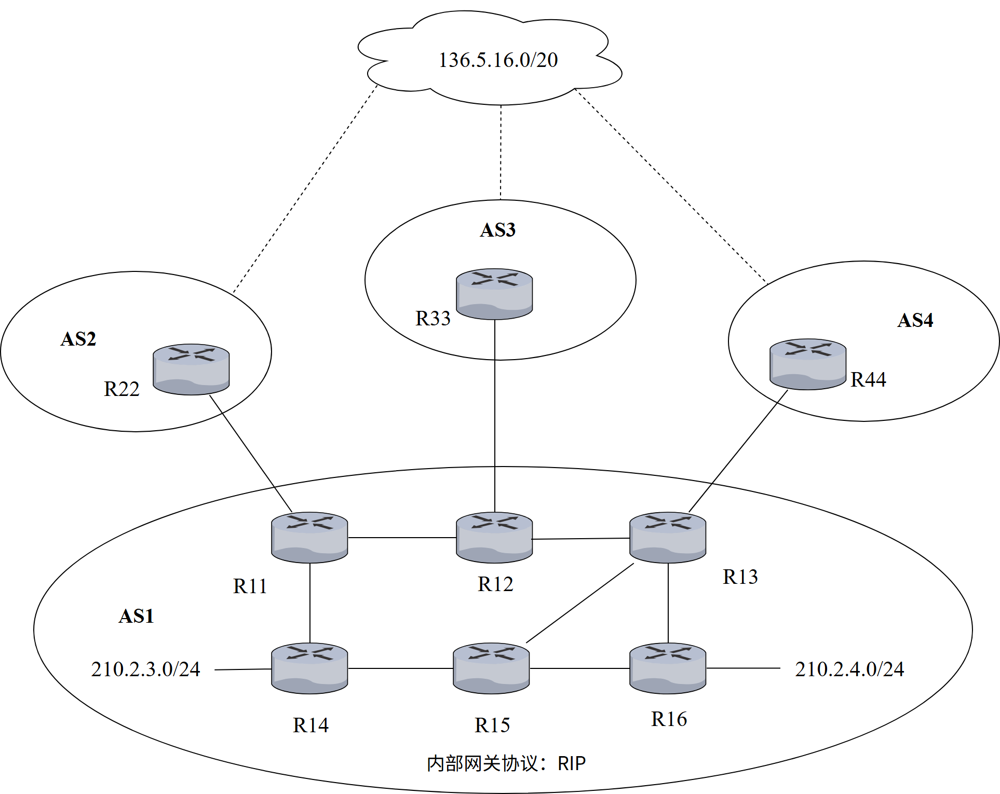

请回答下列问题：

（1）若仅有 RIP 和 OSPF 内部网关协议供选择，则 AS4 应选择哪个协议？（1 分）

（2）若 AS3 中的某主机向本自治系统另一主机发送 1 个 IP 分组，为确保该 IP 分组能正常接收，则该 IP 分组的初始 TTL 值应至少设置为多少？（1 分）

（3）设 AS1 中的路由器同一时刻启动，启动后立即构建并交换初始距离向量，之后，每隔 30s 交换一次最新的距离向量。则从交换初始距离向量时刻算起，R11~R16 路由器均获到达网络 210.2.4.0/24 的正确路由，至少需多长时间？（2 分）

（4）R44 向 R13 通告到达网络 136.5.16.0/20 路由时，由 BGP 协议哪类会话完成？通过哪个 BGP 报文通告？R13 通过 BGP 协议的哪类会话将该网络可达性信息通告给 R14 和 R15?（3 分）

（5）若 R14 和 R15 均收到分别由 R11、R12、R13 通告的到达网络 136.5.16.0/20 的可达性信息为：
目的网络：136.5.16.0/20，AS 路径：AS2 AS8 AS19，下一跳：R11
目的网络：136.5.16.0/20，AS 路轻：AS3 AS7 AS11 AS19，下一跳：R12
目的网络：136,5.16.0/20，AS 路径：AS4 AS10 AS19，下一跳：R13
则在无策略约束情况下，R14 和 R15 更新路由表后，各自路由表中到达网络 136.5.16.0/20 路由的下一跳分别是什么（用路由器名称表示）?（2 分）

---
