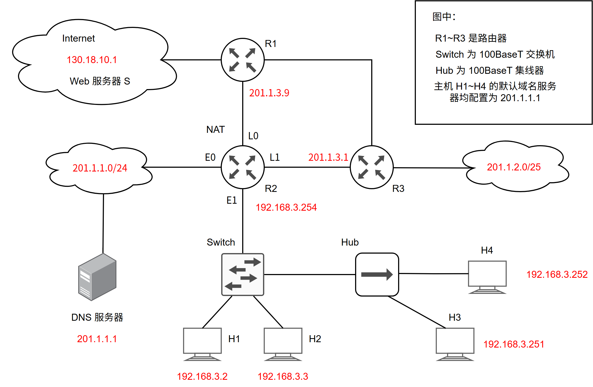
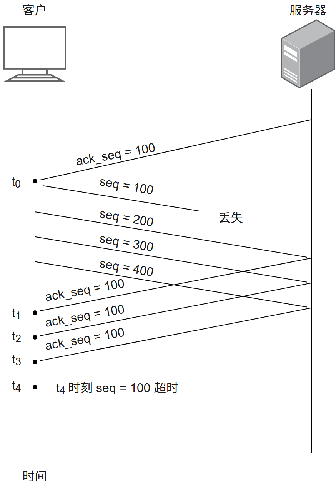
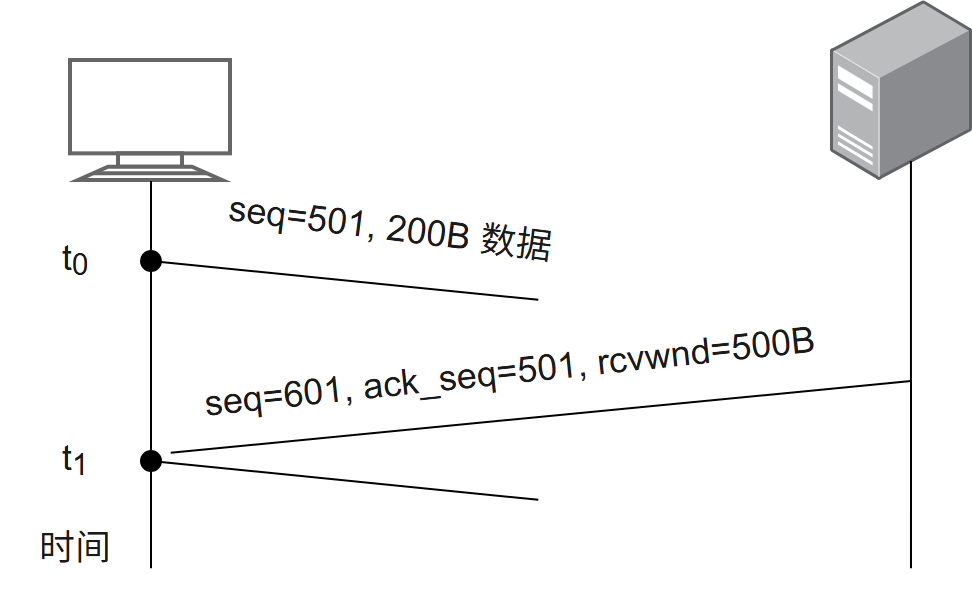
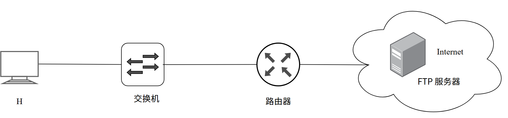

# 第5章 传输层

> 科目：四、计算机网络
> 题目数量：24道
> 年份范围：2009-2024

---

## 2009年

### 第38题（选择题）

主机甲与主机乙之间己建立一个TCP 连接，主机甲向主机乙发送了两个连续的TCP 段，分别包 含300B 和500B 的有效载荷，第一个段的序列号为200，主机乙正确接收到两个段后，发送给主 机甲的确认序列号是 。

A. 500
B. 700
C. 800
D. 1000

---

### 第39题（选择题）

一个TCP 连接总是以1KB 的最大段长发送TCP 段，发送方有足够多的数据要发送。当拥塞窗口 为16KB 时发生了超时，如果接下来的4 个RTT（往返时间）时间内的TCP 段的传输都是成功 的，那么当第4 个RTT 时间内发送的所有TCP 段都得到肯定应答时，拥塞窗口大小是 。

A. 7KB
B. 8KB
C. 9KB
D. 16KB 4

---

## 2010年

### 第39题（选择题）

主机甲和主机乙之间己建立了一个TCP 连接，TCP 最大段长度为1000B。若主机甲的当前拥塞 窗口为4000B，在主机甲向主机乙连续发送两个最大段后，成功收到主机乙发送的第一个段的确 认段，确认段中通告的接收窗口大小为2000B，则此时主机甲还可以向主机乙发送的最大字节数 是 。

A. 1000
B. 2000
C. 3000
D. 4000 4

---

## 2011年

### 第39题（选择题）

主机甲向主机乙发送一个 （SYN＝ 1, seq＝11220）的TCP 段，期望与主机乙建立TCP 连接，若主 机乙接受该连接请求，则主机乙向主机甲发送的正确的TCP 段可能是 。

A. （SYN＝0, ACK＝0, seq＝11221, ack＝11221）
B. （SYN＝1, ACK＝1, seq＝11220, ack＝11220）
C. （SYN＝1, ACK＝1, seq＝11221, ack＝11221）
D. （SYN＝0, ACK＝0, seq＝11220, ack＝11220） 4

---

### 第40题（选择题）

主机甲与主机乙之间已建立一个TCP 连接，主机甲向主机乙发送了3 个连续的TCP 段，分别包 含300B、400B 和500B 的有效载荷，第3 个段的序号为900。若主机乙仅正确接收到第1 段和 第3 段，则主机乙发送给主机甲的确认序号是 。

A. 300
B. 500
C. 1200
D. 1400

---

## 2013年

### 第39题（选择题）

主机甲与主机乙之间己建立一个TCP 连接，双方持续有数据传输，且数据无差错与丢失。若甲 收到1 个来自乙的TCP 段，该段的序号为1913、确认序号为2046、有效载荷为100 字节，则甲 立即发送给乙的TCP 段的序号和确认序号分别是 。

A. 2046、2012
B. 2046、2013
C. 2047、2012
D. 2047、2013 4

---

## 2014年

### 第38题（选择题）

主机甲和主机乙已建立了TCP 连接，甲始终以MSS ＝ 1KB 大小的段发送数据，并一直有数据发 送；乙每收到一个数据段都会发出一个接收窗口为10KB 的确认段。若甲在t 时刻发生超时时拥 塞窗口为8KB，则从t 时刻起，不再发生超时的情况下，经过10 个RTT 后，甲的发送窗口 是 。

A. 10KB
B. 12KB
C. 14KB
D. 15KB

---

### 第39题（选择题）

下列关于UDP 协议的叙述中，正确的是 。 I. 提供无连接服务 II. 提供复用/分用服务 III. 通过差错校验，保障可靠数据传输

A. 仅I
B. 仅I、II
C. 仅II、III
D. I、II、III 4

---

## 2015年

### 第39题（选择题）

主机甲和主机乙新建一个TCP 连接，甲的拥塞控制初始阈值为32KB，甲向乙始终以MSS＝1KB 大小的段发送数据，并一直有数据发送；乙为该连接分配16KB 接收缓存，并对每个数据段进行 确认，忽略段传输延迟。若乙收到的数据全部存入缓存，不被取走，则甲从连接建立成功时刻 起，未发送超时的情况下，经过4 个RTT 后，甲的发送窗口是 。

A. 1KB
B. 8KB
C. 16KB
D. 32KB 4

---

## 2016年

### 第41题（综合题）

图中：
R1~R3 是路由器
Switch 为 100BaseT 交换机
Hub 为 100BaseT 集线器
主机 H1~H4 的默认域名服务器均配置为 201.1.1.1
192.168.3.254
假设题 33～41 图中的 H3 访问 Web 服务器 S 时，S 为新建的 TCP 连接分配了 20 KB (K＝1 024) 的接收缓存，最大段长 MSS＝1 KB，平均往返时间 RTT＝200 ms。H3 建立连接时的初始序号为 100，且持续以 MSS 大小的段向 S 发送数据，拥塞窗口初始阈值为 32 KB；S 对收到的每个段进行确认，并通告新的接收窗口。假定 TCP 连接建立完成后，S 端的 TCP 接收缓存仅有数据存入而无数据取出。请回答下列问题。

(1) 在 TCP 连接建立过程中，H3 收到的 S 发送过来的第二次握手 TCP 段的 SYN 和 ACK 标志位的值分别是多少？确认序号是多少？

(2) H3 收到的第 8 个确认段所通告的接收窗口是多少？此时 H3 的拥塞窗口变为多少？H3 的发送窗口变为多少？

(3) 当 H3 的发送窗口等于 0 时，下一个待发送的数据段序号是多少？H3 从发送第 1 个数据段到发送窗口等于 0 时刻为止，平均数据传输速率是多少（忽略段的传输延时）？

(4) 若 H3 与 S 之间通信已经结束，在 t 时刻 H3 请求断开该连接，则从 t 时刻起，S 释放该连接的最短时间是多少？

---

## 2017年

### 第39题（选择题）

若甲向乙发起一个TCP 连接，最大段长MSS ＝ 1KB，RTT ＝ 5ms，乙开辟的接收缓存为64KB, 则 甲从连接建立成功至发送窗口达到32KB, 需经过的时间至少是 。

A. 25ms
B. 30ms
C. 160ms
D. 165ms 4

---

## 2018年

### 第39题（选择题）

UDP 协议实现分用（demultiplexing）时所依据的头部字段是 。

A. 源端口号
B. 目的端口号
C. 长度
D. 校验和 4

---

## 2019年

### 第38题（选择题）

某客户通过一个 TCP 连接向服务器发送数据的部分过程如题 38 图所示。客户在
t0​
时刻第一次收到确认序列号 ack_seq＝100 的段，并发送序列号 seq＝100 的段，但发生丢失。若 TCP 支持快速重传，则客户重新发送 seq＝100 段的时刻是（ ）。

A. t1​
B. t2​
C. t3​
D. t4​

---

### 第39题（选择题）

若主机甲主动发起一个与主机乙的TCP 连接，甲、乙选择的初始序列号分别为2018 和2046，则 第三次握手TCP 段的确认序列号是 。

A. 2018
B. 2019
C. 2046
D. 2047 4

---

## 2020年

### 第38题（选择题）

若主机甲与主机乙已建立一条TCP连接，最大段长（MSS）为1KB，往返时间（RTT）为2ms，则在不出现拥塞的前提下，拥塞窗口从8KB增长到32KB所需的最长时间是（）。

A. 4ms
B. 8ms
C. 24ms
D. 48ms

---

### 第39题（选择题）

若主机甲与主机乙建立TCP 连接时，发送的SYN 段中的序号为1000，在断开连接时，甲发送给 乙的FIN 段中的序号为5001，则在无任何重传的情况下，甲向乙已经发送的应用层数据的字节 数为 。

A. 4002
B. 4001
C. 4000
D. 3999 4

---

## 2021年

### 第38题（选择题）

若客户首先向服务器发送FIN 段请求断开TCP 连接，则当客户收到服务器发送的FIN 段并向服 务器发送了ACK 段后，客户的TCP 状态转换为 。

A. CLOSE_WAIT
B. TIME_WAIT
C. FIN_WAIT_1
D. FIN_WAIT_2

---

### 第39题（选择题）

若大小为 12B 的应用层数据分别通过 1 个 UDP 数据报和 1 个 TCP 段传输，则该 UDP 数据报 和 TCP 段实现的有效载荷（应用层数据）最大传输效率分别是（ ）。

A. 37.5%, 16.7%
B. 37.5%, 37.5%
C. 60.0%, 16.7%
D. 60.0%, 37.5%

---

### 第40题（选择题）

设主机甲通过 TCP 向主机乙发送数据，部分过程如下图所示。甲在
t0​
时刻发送一个序号 seq＝501、封装 200B 数据的段，在
t1​
时刻收到乙发送的序号 seq ＝ 601、确认序号 ack_seq ＝ 501、接收窗口 rcvwnd ＝ 500B 的段，则甲在未收到新的确认段之前，可以继续向乙发送的数据序号范围是（ ）。

A. 501 ~ 1000
B. 601 ~ 1100
C. 701 ~ 1000
D. 801 ~ 1100

---

## 2022年

### 第38题（选择题）

假设主机甲和主机乙已建立一个TCP 连接，最大段长MSS ＝ 1KB,甲一直有数据向乙发送，当甲 的拥塞窗口为16KB 时，计时器发生了超时，则甲的拥塞窗口再次增长到16KB 所需要的时间至 少是 。

A. 4RTT
B. 5RTT
C. 11RTT
D. 16RTT

---

### 第39题（选择题）

假设客户C 和服务器S 已建立一个TCP 连接，通信往返时间RTT＝50ms，最长报文段寿命MSL ＝ 800ms，数据传输结束后，C 主动请求断开连接。若从C 主动向S 发出FIN 段时刻算起，则C 和S 进入CLOSED 状态所需的时间至少分别是 。

A. 850ms，50ms
B. 1650ms, 50ms
C. 850ms, 75ms
D. 1650ms, 75ms 4

---

## 2023年

### 第47题（综合题）

如图，主机 H 登录到 FTP 服务器后，向服务器上传一个大小为 18000B 的文件 F，假设 H 传输 F 建立数据链接时，选择的初始序号为 100，MSS＝1000B，拥塞控制的初始阈值是 4MSS，RTT＝10ms，忽略 TCP 的传输时延，在 F 的传送过程中，H 以 MSS 段向服务器发送数据，且始终没有错误，丢包和乱序。

(1) FTP 的控制连接是持久的还是非持久的？FTP 的数据连接是持久的还是非持久的？H 登录服务器时，建立的 FTP 连接是数据连接还是控制连接。

(2) H 通过数据连接发送 F 时，F 的第一个字节序号是多少？在断开数据连接的过程中，FTP 发送的第二次挥手的 ACK 序号是？

(3) F 发送过程中，当 H 收到确认序号为 2101 的确认时，H 的拥塞调整为多少？收到确认序号为 7101 的确认段时，H 的拥窗口调整为多少

(4) H 从请求建立数据连接开始，到确认 F 已被服务全部接收为止，至少要多长时间？期间应用层数平均发送速率是多少？

---

## 2024年

### 第38题（选择题）

假设主机 H 通过 TCP 向服务器发送长度为 3000B 的报文，往返时间 RTT＝10ms，最长报文段寿命 MSL＝30s，最大报文段长度 MSS＝1000B，忽略 TCP 段的传输时廷，报文传输结束后 H 首先请求断开连接， 则从 H 请求建立 TCP 连接时刻起，到 H 进入 CLOSED 状态为止，所需时间至少是（ ）

A. 30.03s
B. 30.04s
C. 60.03s
D. 60.04s

---

### 第39题（选择题）

若UDP 协议在计算校验和过程中，计算得到中间结果为1011 1001 1011 0110 时，还需要加上最 后一个16 位数0110 0101 1100 0101，则最终计算得到的校验和是 。

A. 0001 1111 0111 1011
B. 0001 1111 0111 1100
C. 1110 0000 1000 0011
D. 1110 0000 1000 0100 4

---
