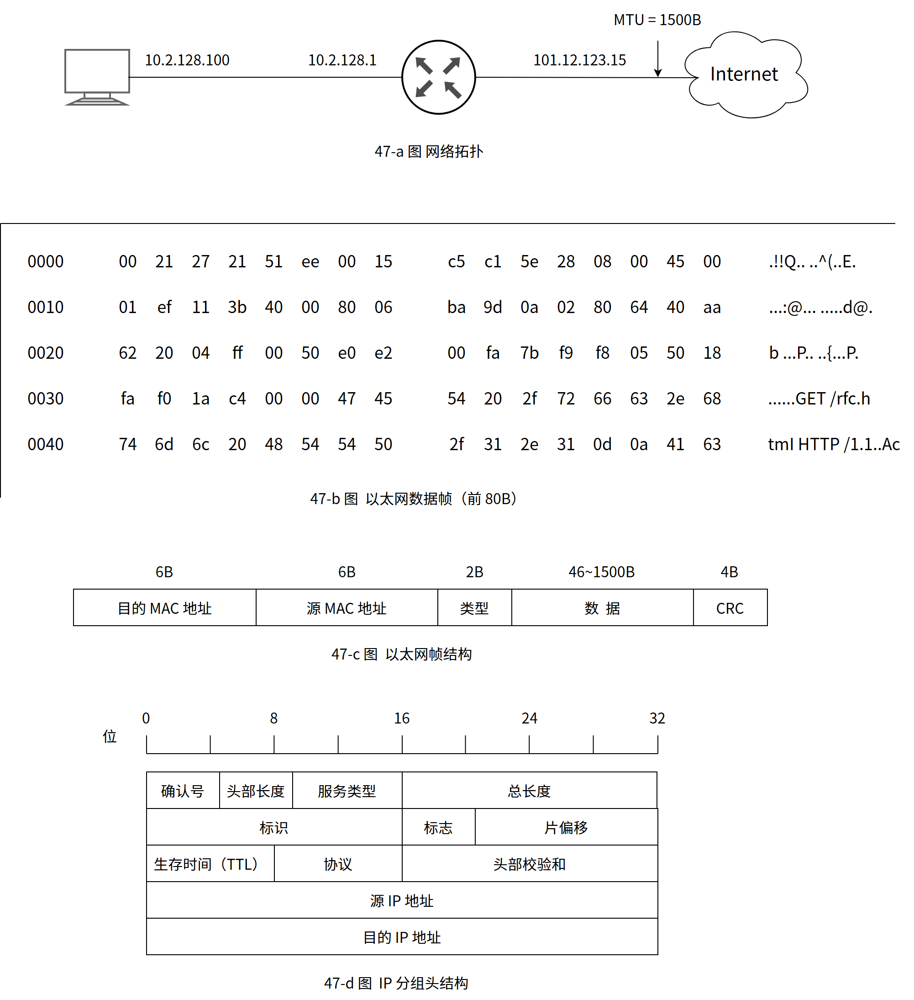
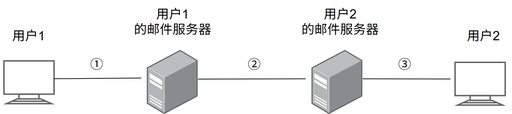
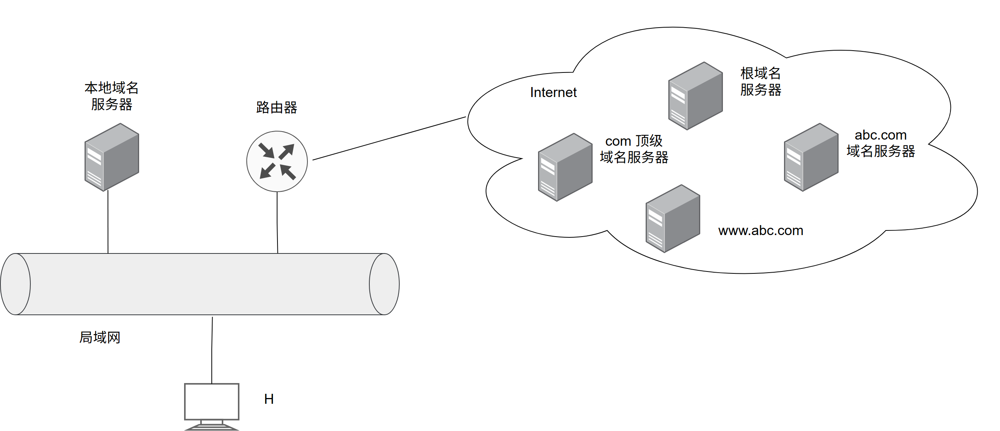
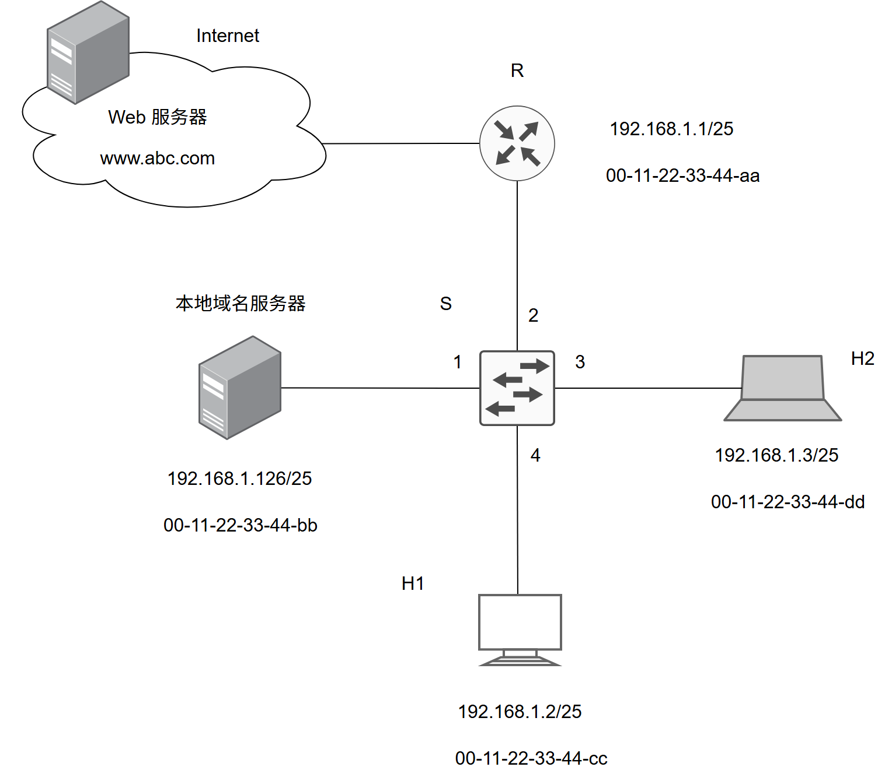

# 第6章 应用层

> 科目：四、计算机网络
> 题目数量：16道
> 年份范围：2009-2024

---

## 2009年

### 第40题（选择题）

FTP 客户和服务器间传递FTP 命令时，使用的连接是 。

A. 建立在TCP 之上的控制连接
B. 建立在TCP 之上的数据连接
C. 建立在UDP 之上的控制连接
D. 建立在UDP 之上的数据连接

---

## 2010年

### 第40题（选择题）

如果本地域名服务器无缓存，当采用递归方法解析另一网络某主机域名时，用户主机、本地域 名服务器发送的域名请求消息数分别为 。

A. 一条、一条
B. 一条、多条
C. 多条、一条
D. 多条、多条

---

## 2011年

### 第47题（综合题）

某主机的 MAC 地址为 00-15-C5-C1-5E-28，IP 地址为 10.2.128.100（私有地址）。题 47-a 图是网络拓扑，题 47-b 图是该主机进行 Web 请求的 1 个以太网数据帧前 80 个字节的十六进制及 ASCII 码内容。

请参考图中的数据回答以下问题。

(1) Web 服务器的 IP 地址是什么？该主机的默认网关的 MAC 地址是什么？

(2) 该主机在构造题 47-b 图的数据帧时，使用什么协议确定目的 MAC 地址？封装该协议请求报文的以太网帧的目的 MAC 地址是什么？

(3) 假设 HTTP/1.1 协议以持续的非流水线方式工作，一次请求 - 响应时间为 RTT，`rfc.html` 页面引用了 5 个 JPEG 小图像，则从发出题 47-b 图中的 Web 请求开始到浏览器收到全部内容为止，需要多少个 RTT？

(4) 该帧所封装的 IP 分组经过路由器 R 转发时，需修改 IP 分组头中的哪些字段？
注意：以太网数据帧结构和 IP 分组头结构分别如题 47-c 图、题 47-d 图所示。

---

## 2012年

### 第40题（选择题）

若用户 1 与用户 2 之间发送和接收电子邮件的过程如下图所示，则图中 ①、②、③ 阶段分别使用的应用层协议可以是

A. SMTP、SMTP、SMTP
B. POP3、SMTP、POP3
C. POP3、SMTP、SMTP
D. SMTP、SMTP、POP3

---

## 2013年

### 第40题（选择题）

下列关于SMTP 协议的叙述中，正确的是 。 I. 只支持传输7 比特ASCII 码内容 II. 支持在邮件服务器之间发送邮件 III. 支持从用户代理向邮件服务器发送邮件 IV. 支持从邮件服务器向用户代理发送邮件

A. 仅I、II 和III
B. 仅I、II、IV
C. 仅I、III、IV
D. 仅II、III 和IV

---

## 2014年

### 第40题（选择题）

使用浏览器访问某大学Web 网站主页时， 不可能使用到的协议是 。

A. PPP
B. ARP
C. UDP
D. SMTP

---

## 2015年

### 第33题（选择题）

通过POP3 协议接收邮件时，使用的传输层服务类型是 。

A. 无连接不可靠的数据传输服务
B. 无连接可靠的数据传输服务
C. 有连接不可靠的数据传输服务
D. 有连接可靠的数据传输服务

---

## 2016年

### 第40题（选择题）

假设所有域名服务器均采用迭代查询方式进行域名解析。当H4访问规范域名为www.`abc.xyz`.com的网站时，域名服务器201.1.1.1在完成该域名解析过程中，可能发出DNS查询的最少和最多次数分别是（）。

A. 0，3
B. 1，3
C. 0，4
D. 1，4

---

## 2017年

### 第40题（选择题）

下列关于FTP 协议的叙述中，错误的是 。

A. 数据连接在每次数据传输完毕后就关闭
B. 控制连接在整个会话期间保持打开状态
C. 服务器与客户端的TCP 20 端口建立数据连接
D. 客户端与服务器的TCP 21 端口建立控制连接

---

## 2018年

### 第33题（选择题）

下列TCP/IP 应用层协议中，可以使用传输层无连接服务的是 。

A. FTP
B. DNS
C. SMTP
D. HTTP

---

### 第40题（选择题）

无需转换即可由SMTP协议直接传输的内容是（）。

A. JPEG图像
B. MPEG视频
C. EXE文件
D. ASCII文本

---

## 2019年

### 第40题（选择题）

下列关于网络应用模型的叙述中，错误的是 。

A. 在P2P 模型中，结点之间具有对等关系
B. 在客户/服务器（C/S）模型中，客户与客户之间可以直接通信
C. 在C/S 模型中，主动发起通信的是客户，被动通信的是服务器
D. 在向多用户分发一个文件时，P2P 模型通常比C/S 模型所需的时间短

---

## 2020年

### 第40题（选择题）

假设下图所示网络中的本地域名服务器只提供递归查询服务，其他域名的服务器均只提供迭代查询服务；局域网内主机访问 Internet 上各服务器的往返时间（RTT）均为 10ms，忽略其他各种时延，若主机 H 通过超链接 http://`www.abc`.com/`index.html`，请求浏览纯文本 Web 页 `index.html`，则从点击 超链接开始到浏览器接收到 `index.html` 页面为止，所需最短、最长时间分别是：

A. 10ms，40ms；
B. 10ms，50ms；
C. 20ms，40ms；
D. 20ms，50ms;

---

## 2021年

### 第47题（综合题）

某网络拓扑如题 47 图所示，以太网交换机 S 通过路由器 R 与 Internet 互联。路由器部分接口、本地域名服务器、H1、H2 的 IP 地址和 MAC 地址如图中所示。在 t0 时刻 H1 的 ARP 表和 S 的交换表均为空，H1 在此刻利用浏览器通过域名 `www.abc`.com 请求访问 Web 服务器，在 t1 时刻（t1→t0）S 第一次收到了封装 HTTP 请求报文的以太网帧，假设从 t0 到 t1 期间网络未发生任何与此次 Web 访问无关的网络通信。

请回答下列问题。

(1) 从 t0 到 t1 期间，H1 除了 HTTP 之外还运行了哪个应用层协议？从应用层到数据链路层，该应用层协议报文是通过哪些协议进行逐层封装的？

(2) 若 S 的交换表结构为 ＜MAC 地址，端口＞，则 t1 时刻 S 交换表的内容是什么？

(3) 从 t0 到 t1 期间，H2 至少会接收到几个与此次 Web 访问相关的帧？接收到的是什么帧？帧的目的 MAC 地址是什么？

---

## 2022年

### 第40题（选择题）

假设主机H通过HTTP/1.1请求浏览某Web服务器S上的Web页news408.html，news408.html引用了同目录下的1幅图像，news408.html文件大小为1MSS（最大段长），图像文件大小为3MSS，H访问S的往返时间RTT＝10ms，忽略HTTP响应报文的首部开销和TCP段传输时延。若H已完成域名解析，则从H请求与S建立TCP连接时刻起，到接收到全部内容止，所需的时间至少是（）。

A. 30ms
B. 40ms
C. 50ms
D. 60ms

---

## 2024年

### 第40题（选择题）

若浏览器不支持并行TCP连接，使用非持久的HTTP/1.0协议请求浏览1个web页，该页中引用同一个网站上7个小图像文件，则从浏览器传输web页请求建立TCP连接开始，到接收完所有内容为止，所需要的往返时间RTT数至少是（）。

A. 4
B. 9
C. 14
D. 16

---
