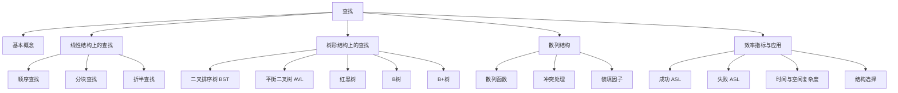
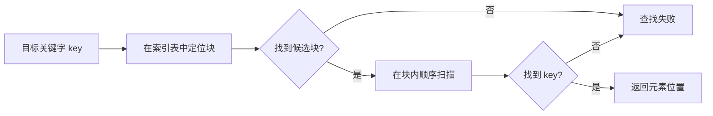
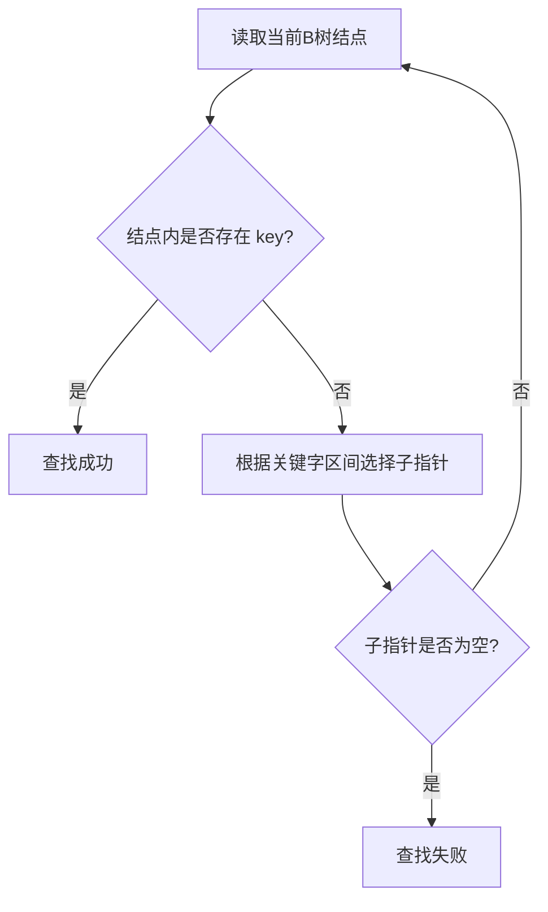
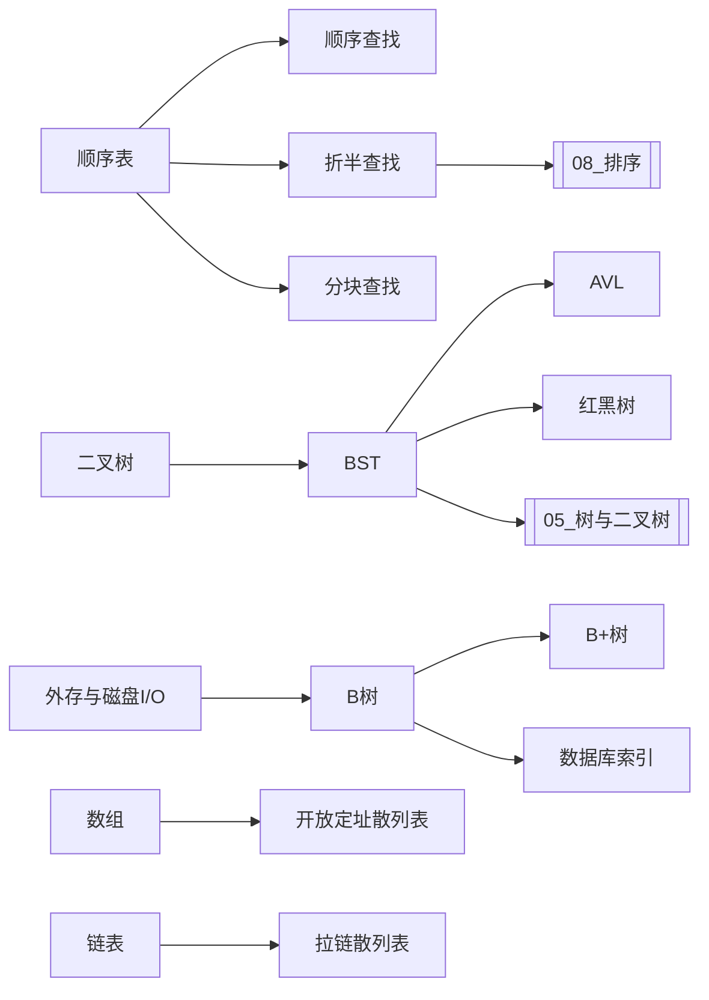

# 第7章　查找

> [!abstract] 本章定位
> 查找是 408 数据结构中的核心章节之一。本章不仅考概念和选择题，还经常与算法设计、树的构造、平均查找长度计算、时间复杂度分析结合起来考查。
>
> 本笔记按照你提供的知识架构顺序组织：
>
> **基本概念 → 顺序查找 → 分块查找 → 折半查找 → 树形查找 → B树与B+树 → 散列表 → 算法分析与应用**。

上一篇：[[06_图]]　｜　下一篇：[[08_排序]]　｜　总览：[[00_408数据结构总览]]

---

## 0. 本章知识架构

![[attachments/第7章_查找_知识架构.png]]



### 0.1 复习优先级

| 优先级 | 内容 | 需要达到的程度 |
|---|---|---|
| ★★★★★ | 折半查找、BST、AVL、散列表 | 会画过程、会算 ASL、会分析复杂度、会写核心算法 |
| ★★★★☆ | B树、B+树、分块查找 | 会判断结构性质，会完成插入删除过程，会比较异同 |
| ★★★☆☆ | 红黑树 | 熟记性质，理解插入调整，能判断树是否合法 |
| ★★★☆☆ | 查找基本概念 | 概念不能混淆，尤其是静态表、动态表和 ASL |

> [!important] 408能力要求
> 复习不能只停留在“记住复杂度”。你需要同时掌握：
>
> 1. 数据结构的逻辑关系与存储方式；
> 2. 查找、插入、删除的具体过程；
> 3. 成功和失败平均查找长度的计算；
> 4. 时间复杂度与空间复杂度；
> 5. 用 C 或 C++ 实现核心算法。

---

# 一、查找的基本概念

## 1.1 什么是查找

**查找**是指在数据集合中寻找满足某种条件的数据元素的过程。

查找结果有两种：

- **查找成功**：找到满足条件的数据元素；
- **查找失败**：数据集合中不存在满足条件的元素。

查找问题通常关注三个问题：

1. 数据采用什么结构保存；
2. 使用什么规则缩小查找范围；
3. 查找过程中进行了多少次关键字比较。

---

## 1.2 查找表

由同一类型的数据元素或记录组成、用于查找的数据集合称为**查找表**。

查找表上的常见操作包括：

- 查找满足条件的数据元素；
- 插入数据元素；
- 删除数据元素；
- 修改数据元素；
- 按关键字进行遍历或范围查询。

### 1.2.1 静态查找表

若查找表只进行查找，或插入、删除极少，则称为**静态查找表**。

适合静态查找表的方法：

- 顺序查找；
- 折半查找；
- 分块查找；
- 静态散列表。

### 1.2.2 动态查找表

若查找过程中还要频繁执行插入和删除，则称为**动态查找表**。

适合动态查找表的方法：

- 二叉排序树；
- 平衡二叉树；
- 红黑树；
- 散列表；
- B树和B+树。

> [!warning] 易错点
> “静态”与“动态”描述的是**查找表上的操作特点**，不是说数据一定存放在静态数组或动态内存中。

---

## 1.3 关键字

### 1.3.1 关键字

数据元素中能够参与查找的数据项称为**关键字**。

例如，学生记录中可能有：

```text
学号、姓名、班级、成绩
```

可以按学号查找，也可以按姓名查找，所以学号和姓名都可以作为关键字。

### 1.3.2 主关键字

能够**唯一标识一个数据元素**的关键字称为主关键字。

例如：

- 学号；
- 身份证号；
- 数据库表中的主键。

### 1.3.3 次关键字

不能唯一标识数据元素的关键字称为次关键字。

例如按“班级”查找时，可能找到多个学生。

> [!tip] 题目判断
> 若题目说“查找结果必须唯一”，通常隐含关键字是主关键字；若允许返回一组记录，则可能是次关键字。

---

## 1.4 查找长度与平均查找长度

### 1.4.1 查找长度

一次查找过程中，进行的**关键字比较次数**称为该次查找的查找长度。

### 1.4.2 平均查找长度 ASL

平均查找长度的英文是 `Average Search Length`，简称 **ASL**。

$$
ASL=\sum_{i=1}^{n}P_iC_i
$$

其中：

- $n$：可能出现的查找结果数量；
- $P_i$：第 $i$ 种查找结果出现的概率；
- $C_i$：第 $i$ 种情况下的关键字比较次数。

若各元素被查找的概率相同，则：

$$
P_i=\frac{1}{n}
$$

于是：

$$
ASL=\frac{1}{n}\sum_{i=1}^{n}C_i
$$

### 1.4.3 成功 ASL 与失败 ASL

必须区分：

$$
ASL_{成功}=\sum P_iC_i
$$

$$
ASL_{失败}=\sum Q_jD_j
$$

其中：

- $P_i$ 是查找到第 $i$ 个已有元素的概率；
- $Q_j$ 是关键字落入第 $j$ 个失败区间的概率；
- $C_i$ 是成功查找时的比较次数；
- $D_j$ 是失败查找时的比较次数。

> [!danger] ASL计算的第一原则
> 先问清楚题目统计的是什么：
>
> - 只统计与表中真实元素的比较；
> - 还是把“哨兵”比较也计算在内；
> - 成功与失败是否等概率；
> - 各关键字的查找概率是否相等。
>
> 口径不同，数值可能不同。

---

# 二、顺序查找

## 2.1 基本思想

顺序查找又称**线性查找**。

基本过程：

1. 从查找表的一端开始；
2. 依次比较当前元素的关键字与目标关键字；
3. 相等则查找成功；
4. 扫描结束仍未找到则查找失败。

顺序查找可以用于：

- 顺序表；
- 单链表；
- 双链表；
- 无序表；
- 有序表。

它是对存储结构要求最低的查找方法。

---

## 2.2 一般无序线性表的顺序查找

### 2.2.1 普通写法

```cpp
int SequentialSearch(const int data[], int length, int target) {
    // 从第 0 个元素开始，逐个与目标关键字比较
    for (int index = 0; index < length; ++index) {
        if (data[index] == target) {
            return index;               // 查找成功，返回下标
        }
    }

    return -1;                          // 扫描结束仍未找到
}
```

时间复杂度：

- 最好：$O(1)$；
- 最坏：$O(n)$；
- 平均：$O(n)$。

空间复杂度：

$$
O(1)
$$

---

## 2.3 带哨兵的顺序查找

教材采用 1 号到 $n$ 号位置存储有效元素，并将 0 号位置作为“哨兵”。

```cpp
struct SearchTable {
    int* element;       // element[1] 到 element[length] 存放有效元素
    int length;         // 查找表长度
};

int SequentialSearchWithSentinel(SearchTable table, int target) {
    table.element[0] = target;                 // 将目标关键字放入哨兵位置

    int index = table.length;                  // 从表尾向表头查找
    while (table.element[index] != target) {
        --index;                               // 不需要额外判断 index 是否越界
    }

    return index;                              // index=0 表示查找失败
}
```

### 2.3.1 哨兵的作用

哨兵不会降低算法的数量级，仍为 $O(n)$。

它的作用是：

- 将“是否找到”和“是否越界”两个循环条件合并；
- 减少循环内部的判断次数；
- 简化代码。

> [!warning] 哨兵不是一个额外的真实记录
> `element[0]` 只是辅助位置。返回 0 表示查找失败。

---

## 2.4 顺序查找成功 ASL

若从表尾向前查找，查找到第 $i$ 个元素需要比较：

$$
C_i=n-i+1
$$

若每个元素被查找的概率相同：

$$
ASL_{成功}
=\frac{1}{n}\sum_{i=1}^{n}(n-i+1)
$$

$$
=\frac{1+2+\cdots+n}{n}
$$

$$
=\frac{n+1}{2}
$$

因此：

$$
\boxed{ASL_{成功}=\frac{n+1}{2}}
$$

### 2.4.1 查找概率不相等

若第 $i$ 个元素被查找的概率为 $P_i$，则：

$$
ASL_{成功}=\sum_{i=1}^{n}P_iC_i
$$

要降低 ASL，应让**查找概率大的元素靠近查找起点**。

例如从表头向后查找时，应将记录按查找概率从大到小排列。

---

## 2.5 顺序查找失败 ASL

若使用教材中的哨兵算法，从表尾开始查找：

- $n$ 个真实元素均不匹配；
- 最后还会与 0 号位置的哨兵比较。

因此教材口径下：

$$
\boxed{ASL_{失败}=n+1}
$$

若题目明确只统计与真实记录的比较，则失败比较次数为 $n$。

> [!danger] 高频口径陷阱
> “顺序查找失败比较 $n$ 次”与“带哨兵顺序查找失败比较 $n+1$ 次”都可能正确，关键看题目是否把哨兵比较计入。

---

## 2.6 有序线性表上的顺序查找

若表中关键字按从小到大排列，则查找可以提前结束。

例如查找目标值 `target`：

- 当前元素小于 `target`：继续向后；
- 当前元素等于 `target`：成功；
- 当前元素大于 `target`：立即失败，因为后面的元素只会更大。

```cpp
int OrderedSequentialSearch(const int data[], int length, int target) {
    for (int index = 0; index < length; ++index) {
        if (data[index] == target) {
            return index;
        }

        if (data[index] > target) {
            return -1;                  // 后续元素更大，不可能再找到 target
        }
    }

    return -1;
}
```

### 2.6.1 失败判定树

对于 $n$ 个有序元素，存在 $n+1$ 个失败区间：

```text
(-∞,K1), (K1,K2), …, (Kn-1,Kn), (Kn,+∞)
```

若各失败区间等概率，教材中的平均失败查找长度为：

$$
ASL_{失败}
=\frac{1+2+\cdots+n+n}{n+1}
$$

$$
=\frac{n}{2}+\frac{n}{n+1}
$$

有序顺序查找在失败时可能提前停止，因此通常优于无序表的失败查找。

---

## 2.7 顺序查找总结

| 项目 | 结论 |
|---|---|
| 是否要求有序 | 不要求 |
| 是否支持链表 | 支持 |
| 成功 ASL（等概率） | $(n+1)/2$ |
| 失败 ASL | 普通扫描为 $n$；教材哨兵口径为 $n+1$ |
| 平均时间复杂度 | $O(n)$ |
| 空间复杂度 | $O(1)$ |
| 优点 | 简单，对存储结构和有序性没有要求 |
| 缺点 | 数据规模大时效率低 |

---

# 三、分块查找

## 3.1 基本思想

分块查找又称**索引顺序查找**。

它是顺序查找与折半查找之间的折中方案。

将长度为 $n$ 的查找表划分为若干块，并建立索引表。

必须满足：

1. **块内可以无序**；
2. **块间必须有序**；
3. 前一块中的所有关键字都小于后一块中的所有关键字。

一种常见索引项结构为：

```cpp
struct IndexEntry {
    int maxKey;         // 该块中的最大关键字
    int startIndex;     // 该块第一个元素的位置
    int blockLength;    // 该块包含的元素个数
};
```

---

## 3.2 查找过程

查找分成两个阶段。

### 阶段一：在索引表中确定目标块

可以使用：

- 顺序查找索引表；
- 折半查找索引表。

### 阶段二：在目标块内顺序查找

由于块内不一定有序，通常只能逐个扫描。



---

## 3.3 分块查找算法示例

```cpp
struct IndexEntry {
    int maxKey;         // 当前块的最大关键字
    int startIndex;     // 当前块的起始位置
    int blockLength;    // 当前块的长度
};

int BlockSearch(
    const int data[],
    const IndexEntry indexTable[],
    int blockCount,
    int target
) {
    int blockIndex = 0;

    // 第一步：在索引表中寻找第一个 maxKey >= target 的块
    while (
        blockIndex < blockCount &&
        indexTable[blockIndex].maxKey < target
    ) {
        ++blockIndex;
    }

    if (blockIndex == blockCount) {
        return -1;                              // 不存在候选块
    }

    // 第二步：在候选块内部顺序查找
    int begin = indexTable[blockIndex].startIndex;
    int end = begin + indexTable[blockIndex].blockLength;

    for (int position = begin; position < end; ++position) {
        if (data[position] == target) {
            return position;
        }
    }

    return -1;
}
```

---

## 3.4 分块查找的 ASL

设：

- 数据总数为 $n$；
- 分为 $b$ 块；
- 每块含 $s$ 个元素；
- 假设 $n=bs$；
- 各块和各元素等概率。

总平均查找长度为：

$$
ASL=L_{索引}+L_{块内}
$$

### 3.4.1 索引表采用顺序查找

索引表成功平均查找长度：

$$
L_{索引}=\frac{b+1}{2}
$$

块内顺序查找平均长度：

$$
L_{块内}=\frac{s+1}{2}
$$

所以：

$$
ASL=\frac{b+1}{2}+\frac{s+1}{2}
$$

代入 $b=n/s$：

$$
ASL=\frac{1}{2}\left(\frac{n}{s}+s\right)+1
$$

由均值不等式：

$$
\frac{n}{s}+s\ge 2\sqrt n
$$

当：

$$
s=\sqrt n
$$

时 ASL 最小，此时：

$$
ASL_{min}\approx \sqrt n+1
$$

因此顺序索引下，最优块大小通常取 $\sqrt n$ 附近。

### 3.4.2 索引表采用折半查找

若索引表有序且顺序存储，可折半定位块：

$$
ASL\approx O(\log b)+\frac{s+1}{2}
$$

整体通常介于顺序查找和折半查找之间。

---

## 3.5 分块查找的特点

| 维度 | 结论 |
|---|---|
| 块内 | 可无序 |
| 块间 | 必须有序 |
| 索引表 | 有序 |
| 查找方式 | 先索引、后块内扫描 |
| 插入删除 | 比完全有序表方便 |
| 查找效率 | 优于普通顺序查找，通常弱于折半查找 |
| 适用场景 | 数据分组明显，且需要兼顾查找与动态更新 |

> [!warning] 典型错误
> “块间有序”不是说只比较各块最大值即可，而是要求前一块所有元素都小于后一块所有元素。

---

# 四、折半查找

## 4.1 使用条件

折半查找又称**二分查找**。

必须同时满足：

1. 查找表按关键字有序；
2. 查找表支持随机访问；
3. 通常采用顺序存储结构。

因此：

- 有序数组：适用；
- 普通单链表：不适用；
- 即使链表有序，也不能高效定位中间结点。

> [!danger] 必背结论
> 折半查找不是只要求“有序”，还要求能在 $O(1)$ 时间访问中间位置。

---

## 4.2 基本思想

设当前查找区间为：

$$
[low,high]
$$

取中间位置：

$$
mid=\left\lfloor\frac{low+high}{2}\right\rfloor
$$

比较 `data[mid]` 与目标关键字 `target`：

- 相等：成功；
- `target < data[mid]`：到左半区间；
- `target > data[mid]`：到右半区间。

每次比较后，查找范围约缩小一半。

---

## 4.3 迭代实现

```cpp
int BinarySearch(const int data[], int length, int target) {
    int low = 0;                    // 当前查找区间左端点
    int high = length - 1;          // 当前查找区间右端点

    while (low <= high) {           // 区间仍非空
        // 比 (low + high) / 2 更安全，可避免整数加法溢出
        int middle = low + (high - low) / 2;

        if (data[middle] == target) {
            return middle;          // 查找成功
        }

        if (target < data[middle]) {
            high = middle - 1;      // 舍弃 middle 及其右侧区间
        } else {
            low = middle + 1;       // 舍弃 middle 及其左侧区间
        }
    }

    return -1;                      // low > high，区间为空
}
```

### 4.3.1 循环不变量

循环开始时，若目标存在，则它一定在：

$$
[low,high]
$$

中。

每次比较后：

- 中间元素已经被排除；
- 因此边界必须更新为 `middle - 1` 或 `middle + 1`；
- 若写成 `high = middle` 或 `low = middle`，可能出现死循环。

---

## 4.4 递归实现

```cpp
int BinarySearchRecursive(
    const int data[],
    int low,
    int high,
    int target
) {
    if (low > high) {
        return -1;                                  // 空区间，查找失败
    }

    int middle = low + (high - low) / 2;

    if (data[middle] == target) {
        return middle;
    }

    if (target < data[middle]) {
        return BinarySearchRecursive(
            data,
            low,
            middle - 1,
            target
        );
    }

    return BinarySearchRecursive(
        data,
        middle + 1,
        high,
        target
    );
}
```

复杂度：

- 时间：$O(\log n)$；
- 递归栈空间：$O(\log n)$；
- 迭代空间：$O(1)$。

---

## 4.5 折半查找判定树

折半查找过程可以画成一棵**判定树**。

- 圆形结点：表中真实元素，即成功结点；
- 方形或外部结点：不存在于表中的失败区间；
- 左子树关键字更小；
- 右子树关键字更大。

对于 $n$ 个元素：

- 成功结点数量为 $n$；
- 失败结点数量为 $n+1$；
- 判定树是一棵平衡二叉树；
- 它不一定是满二叉树或完全二叉树，但其层数差受到控制。

### 4.5.1 查找长度与层次

若根结点处于第 1 层，则：

- 查找成功时，比较次数等于成功结点层数；
- 查找失败时，比较次数由失败结点父结点所处路径决定。

---

## 4.6 折半查找的最大比较次数

判定树高度为：

$$
h=\left\lceil\log_2(n+1)\right\rceil
$$

它也等于：

$$
h=\left\lfloor\log_2n\right\rfloor+1
$$

因此最坏时间复杂度：

$$
O(\log n)
$$

### 4.6.1 满判定树时的成功 ASL

若：

$$
n=2^h-1
$$

则各层结点数依次为：

$$
1,2,4,\ldots,2^{h-1}
$$

成功 ASL：

$$
ASL_{成功}
=\frac{1}{n}\sum_{i=1}^{h}i\cdot 2^{i-1}
$$

化简可得：

$$
ASL_{成功}
=\frac{n+1}{n}\log_2(n+1)-1
$$

当 $n$ 较大时：

$$
ASL_{成功}\approx\log_2(n+1)-1
$$

> [!warning] 使用条件
> 这个闭式公式对应满判定树情形。一般 $n$ 下，应根据实际判定树各层结点数计算。

---

## 4.7 查找路径判断

给定有序序列和折半查找路径，常考判断路径是否合法。

判断原则：

1. 先根据第一个比较值确定目标落在左区间还是右区间；
2. 后续比较值必须始终位于当前合法区间；
3. 一旦某个值落在被排除的区间，路径就不可能出现。

例如查找目标 `25`：

```text
第一次比较 40，25 < 40，后续比较值必须小于 40。
第二次比较 10，25 > 10，后续比较值必须位于 (10,40)。
若第三次出现 8，则路径非法，因为 8 已经被排除。
```

---

## 4.8 折半查找的边界变式

408综合题可能不只要求“是否存在”，还可能要求查找边界。

### 4.8.1 查找第一个大于等于 target 的位置

```cpp
int LowerBound(const int data[], int length, int target) {
    int low = 0;
    int high = length;                 // 使用左闭右开区间 [low, high)

    while (low < high) {
        int middle = low + (high - low) / 2;

        if (data[middle] < target) {
            low = middle + 1;
        } else {
            high = middle;
        }
    }

    return low;                        // 可能等于 length
}
```

返回第一个满足：

$$
data[index]\ge target
$$

的位置。

### 4.8.2 查找第一个大于 target 的位置

```cpp
int UpperBound(const int data[], int length, int target) {
    int low = 0;
    int high = length;

    while (low < high) {
        int middle = low + (high - low) / 2;

        if (data[middle] <= target) {
            low = middle + 1;
        } else {
            high = middle;
        }
    }

    return low;
}
```

返回第一个满足：

$$
data[index]>target
$$

的位置。

### 4.8.3 统计 target 出现次数

$$
count=upper\_bound(target)-lower\_bound(target)
$$

---

## 4.9 折半查找易错点

> [!danger] 高频错误清单
>
> 1. 忘记数组必须有序；
> 2. 对链表使用折半查找；
> 3. `while (low < high)` 与闭区间写法混用；
> 4. 更新区间时没有排除 `middle`；
> 5. 直接使用 `(low + high) / 2` 造成潜在溢出；
> 6. 将判定树误认为一定是完全二叉树；
> 7. 计算 ASL 时忘记结点层数从 1 开始；
> 8. 失败结点数量误写为 $n$，正确是 $n+1$。

---

# 五、树形查找

# 5.1 二叉排序树 BST

## 5.1.1 定义

二叉排序树又称：

- 二叉查找树；
- 二叉搜索树；
- `Binary Search Tree`，简称 BST。

一棵二叉树是二叉排序树，当且仅当：

1. 若左子树非空，则左子树所有结点的关键字都小于根结点关键字；
2. 若右子树非空，则右子树所有结点的关键字都大于根结点关键字；
3. 左子树和右子树本身也分别是二叉排序树。

可递归写为：

$$
\forall x\in Left(T),\quad x.key<T.key
$$

$$
\forall y\in Right(T),\quad y.key>T.key
$$

> [!important] 核心性质
> 对二叉排序树进行**中序遍历**，得到严格递增的关键字序列。

若允许重复关键字，必须事先规定重复关键字放左侧、放右侧，或在结点中增加计数。408题目通常默认关键字互不相同。

---

## 5.1.2 查找

```cpp
struct BSTNode {
    int key;
    BSTNode* leftChild;
    BSTNode* rightChild;
};

BSTNode* SearchBST(BSTNode* root, int target) {
    BSTNode* current = root;

    while (current != nullptr) {
        if (target == current->key) {
            return current;                    // 查找成功
        }

        if (target < current->key) {
            current = current->leftChild;      // 目标更小，进入左子树
        } else {
            current = current->rightChild;     // 目标更大，进入右子树
        }
    }

    return nullptr;                            // 到达空指针，查找失败
}
```

查找过程实际上是在根到某个结点或空子树之间走一条路径。

时间复杂度取决于树高 $h$：

$$
O(h)
$$

- 树接近平衡：$O(\log n)$；
- 退化为单链表：$O(n)$。

---

## 5.1.3 插入

新关键字总是插入为一个新的叶结点。

```cpp
bool InsertBST(BSTNode*& root, int target) {
    if (root == nullptr) {
        root = new BSTNode{target, nullptr, nullptr};
        return true;
    }

    if (target == root->key) {
        return false;                           // 默认不允许重复关键字
    }

    if (target < root->key) {
        return InsertBST(root->leftChild, target);
    }

    return InsertBST(root->rightChild, target);
}
```

### 5.1.3.1 构造二叉排序树

将关键字序列依次插入一棵空树即可。

```cpp
BSTNode* BuildBST(const int values[], int length) {
    BSTNode* root = nullptr;

    for (int index = 0; index < length; ++index) {
        InsertBST(root, values[index]);
    }

    return root;
}
```

> [!danger] 插入顺序决定树形
> 同一组关键字，插入顺序不同，可能得到完全不同的二叉排序树，因此 ASL 也可能不同。

例如：

```text
序列 1,2,3,4,5  → 退化为右斜树
序列 3,2,4,1,5  → 结构较平衡
```

---

## 5.1.4 删除

删除结点不能破坏二叉排序树性质。

设待删除结点为 `node`，分三种情况。

### 情况一：叶结点

直接删除。

### 情况二：只有一棵子树

用唯一孩子替代该结点。

### 情况三：左右子树都存在

可以选择：

- 用中序前驱替代；
- 或用中序后继替代。

中序前驱：左子树中的最大结点。

中序后继：右子树中的最小结点。

替换关键字后，再删除前驱或后继结点。后者最多只有一个孩子，问题会转化为前两种情况。

```cpp
BSTNode* FindMinimum(BSTNode* root) {
    BSTNode* current = root;

    while (current != nullptr && current->leftChild != nullptr) {
        current = current->leftChild;
    }

    return current;
}

bool DeleteBST(BSTNode*& root, int target) {
    if (root == nullptr) {
        return false;                           // 树中不存在 target
    }

    if (target < root->key) {
        return DeleteBST(root->leftChild, target);
    }

    if (target > root->key) {
        return DeleteBST(root->rightChild, target);
    }

    // 以下说明 target == root->key，已经找到待删除结点

    if (root->leftChild == nullptr) {
        BSTNode* oldRoot = root;
        root = root->rightChild;                // 右孩子接替当前位置
        delete oldRoot;
        return true;
    }

    if (root->rightChild == nullptr) {
        BSTNode* oldRoot = root;
        root = root->leftChild;                 // 左孩子接替当前位置
        delete oldRoot;
        return true;
    }

    // 左右孩子均存在：使用右子树最小结点，即中序后继
    BSTNode* successor = FindMinimum(root->rightChild);
    root->key = successor->key;                 // 复制后继关键字

    // 在右子树中删除重复的后继结点
    return DeleteBST(root->rightChild, successor->key);
}
```

---

## 5.1.5 BST 的 ASL

查找到某个结点的比较次数等于该结点所在层数。

若各关键字等概率：

$$
ASL_{成功}=\frac{1}{n}\sum_{i=1}^{n}level_i
$$

因此 BST 的 ASL 与树形直接相关。

### 最好情况

树接近平衡：

$$
ASL=O(\log n)
$$

### 最坏情况

树退化为单链表：

$$
ASL=\frac{n+1}{2}
$$

最坏查找复杂度：

$$
O(n)
$$

---

## 5.1.6 BST 高频考法

1. 根据插入序列画 BST；
2. 给定 BST 写中序序列；
3. 判断某条查找路径是否合法；
4. 删除指定结点并画出结果；
5. 计算成功 ASL；
6. 判断不同插入序列是否得到同一棵 BST；
7. 设计区间查找、求第 $k$ 小元素等算法。

---

# 5.2 平衡二叉树 AVL

## 5.2.1 为什么需要 AVL

普通 BST 的性能取决于树形。

当关键字按有序序列插入时，BST 可能退化为链表。

AVL 树通过旋转保持高度平衡，使树高稳定在 $O(\log n)$。

---

## 5.2.2 定义与平衡因子

平衡二叉树满足：

1. 它首先是一棵二叉排序树；
2. 任意结点左右子树高度差的绝对值不超过 1。

结点的平衡因子：

$$
BF=H_{left}-H_{right}
$$

AVL 树中每个结点的平衡因子只能为：

$$
-1,0,1
$$

若某结点出现：

$$
|BF|=2
$$

则该结点失衡。

---

## 5.2.3 插入后的调整原则

插入新结点后：

1. 从新结点向根方向回溯；
2. 找到第一个失衡结点；
3. 该结点称为**最小不平衡子树的根**；
4. 只需对这棵最小不平衡子树进行旋转。

判断旋转类型时，看从失衡结点到新插入结点的前两步方向。

| 类型 | 路径 | 调整方式 |
|---|---|---|
| LL | 左、左 | 右单旋 |
| RR | 右、右 | 左单旋 |
| LR | 左、右 | 先对左孩子左旋，再对失衡结点右旋 |
| RL | 右、左 | 先对右孩子右旋，再对失衡结点左旋 |

记忆：

> 同向单旋，异向双旋。

---

## 5.2.4 LL 型：右单旋

```text
        A                         B
       / \                       / \
      B   AR      右旋 A         BL  A
     / \        ---------->         / \
    BL BR                         BR AR
```

```cpp
AVLNode* RotateRight(AVLNode* root) {
    AVLNode* newRoot = root->leftChild;
    AVLNode* transferredSubtree = newRoot->rightChild;

    newRoot->rightChild = root;
    root->leftChild = transferredSubtree;

    UpdateHeight(root);            // 先更新下降后的旧根
    UpdateHeight(newRoot);         // 再更新新的根

    return newRoot;
}
```

---

## 5.2.5 RR 型：左单旋

```text
    A                               B
   / \                             / \
  AL  B          左旋 A            A  BR
     / \        ---------->       / \
    BL BR                         AL BL
```

```cpp
AVLNode* RotateLeft(AVLNode* root) {
    AVLNode* newRoot = root->rightChild;
    AVLNode* transferredSubtree = newRoot->leftChild;

    newRoot->leftChild = root;
    root->rightChild = transferredSubtree;

    UpdateHeight(root);
    UpdateHeight(newRoot);

    return newRoot;
}
```

---

## 5.2.6 LR 型：先左旋后右旋

```text
        A                       A                       C
       / \                     / \                     / \
      B  AR   左旋 B          C  AR    右旋 A         B   A
     / \      ------>         /       ------>        / \ / \
    BL  C                    B                      BL CL CR AR
       / \                  / \
      CL CR                BL CL
```

步骤：

1. 对 `A` 的左孩子 `B` 左旋；
2. 对 `A` 右旋。

---

## 5.2.7 RL 型：先右旋后左旋

```text
    A                          A                            C
   / \                        / \                          / \
  AL  B      右旋 B          AL  C       左旋 A           A   B
     / \     ------>            \       ------>         / \ / \
    C  BR                        B                      AL CL CR BR
   / \                            \
  CL CR                           BR
```

步骤：

1. 对 `A` 的右孩子 `B` 右旋；
2. 对 `A` 左旋。

---

## 5.2.8 AVL 插入代码框架

```cpp
#include <algorithm>

struct AVLNode {
    int key;
    int height;
    AVLNode* leftChild;
    AVLNode* rightChild;
};

int Height(AVLNode* node) {
    return node == nullptr ? 0 : node->height;
}

void UpdateHeight(AVLNode* node) {
    if (node == nullptr) {
        return;
    }

    node->height =
        std::max(Height(node->leftChild), Height(node->rightChild)) + 1;
}

int BalanceFactor(AVLNode* node) {
    return node == nullptr
        ? 0
        : Height(node->leftChild) - Height(node->rightChild);
}

AVLNode* RotateRight(AVLNode* root) {
    AVLNode* newRoot = root->leftChild;
    AVLNode* middleSubtree = newRoot->rightChild;

    newRoot->rightChild = root;
    root->leftChild = middleSubtree;

    UpdateHeight(root);
    UpdateHeight(newRoot);

    return newRoot;
}

AVLNode* RotateLeft(AVLNode* root) {
    AVLNode* newRoot = root->rightChild;
    AVLNode* middleSubtree = newRoot->leftChild;

    newRoot->leftChild = root;
    root->rightChild = middleSubtree;

    UpdateHeight(root);
    UpdateHeight(newRoot);

    return newRoot;
}

AVLNode* InsertAVL(AVLNode* root, int target) {
    // 第一步：按照普通 BST 规则插入
    if (root == nullptr) {
        return new AVLNode{target, 1, nullptr, nullptr};
    }

    if (target < root->key) {
        root->leftChild = InsertAVL(root->leftChild, target);
    } else if (target > root->key) {
        root->rightChild = InsertAVL(root->rightChild, target);
    } else {
        return root;                               // 默认不插入重复关键字
    }

    // 第二步：更新当前结点高度
    UpdateHeight(root);

    // 第三步：计算平衡因子并判断失衡类型
    int balance = BalanceFactor(root);

    // LL：在左孩子的左子树中插入
    if (balance > 1 && target < root->leftChild->key) {
        return RotateRight(root);
    }

    // RR：在右孩子的右子树中插入
    if (balance < -1 && target > root->rightChild->key) {
        return RotateLeft(root);
    }

    // LR：先将左孩子左旋，再将当前结点右旋
    if (balance > 1 && target > root->leftChild->key) {
        root->leftChild = RotateLeft(root->leftChild);
        return RotateRight(root);
    }

    // RL：先将右孩子右旋，再将当前结点左旋
    if (balance < -1 && target < root->rightChild->key) {
        root->rightChild = RotateRight(root->rightChild);
        return RotateLeft(root);
    }

    return root;                                  // 当前结点仍平衡
}
```

---

## 5.2.9 AVL 树高

设高度为 $h$ 的 AVL 树最少结点数为 $N_h$。

为了在高度为 $h$ 的同时结点数最少，两棵子树高度应分别为 $h-1$ 与 $h-2$，因此：

$$
N_h=N_{h-1}+N_{h-2}+1
$$

常见初值：

$$
N_0=0,\qquad N_1=1
$$

该递推与斐波那契数列同阶，因此：

$$
h=O(\log n)
$$

AVL 的查找、插入、删除均可保持：

$$
O(\log n)
$$

---

## 5.2.10 AVL 删除

删除步骤：

1. 先按普通 BST 规则删除；
2. 从删除位置向根回溯；
3. 更新沿途结点高度；
4. 若发现失衡，根据子树平衡因子旋转；
5. 删除可能导致多个祖先连续失衡，因此可能需要多次调整。

> [!note] 与插入的区别
> 插入时调整最小不平衡子树后，整体高度通常恢复；删除时一次旋转后子树高度仍可能下降，所以还要继续向上检查。

---

# 5.3 红黑树

## 5.3.1 红黑树的目的

红黑树是一种近似平衡的二叉排序树。

它不像 AVL 那样要求任意结点左右子树高度差不超过 1，而是通过结点颜色限制树高。

优势：

- 查找复杂度稳定为 $O(\log n)$；
- 更新时旋转次数通常少于 AVL；
- 适合插入、删除频繁的动态集合。

---

## 5.3.2 五条性质

一棵红黑树满足：

1. 每个结点非红即黑；
2. 根结点是黑色；
3. 所有空叶结点 `NIL` 都是黑色；
4. 红结点的两个孩子均为黑色，即不存在连续红结点；
5. 从任意结点到其所有后代 `NIL` 结点的路径，包含相同数量的黑结点。

> [!important] 第4、5条是核心
> - 第4条限制局部连续红结点；
> - 第5条保证不同路径不会相差过大。

---

## 5.3.3 黑高

从某个结点出发到任一后代 `NIL` 的路径上，黑色结点数量相同，这个数量称为该结点的**黑高**。

由于红结点不能连续出现，任意根到叶路径中：

- 最短路径可全部由黑结点构成；
- 最长路径最多在每两个黑结点之间插入一个红结点。

因此：

$$
最长路径\le 2\times 最短路径
$$

含 $n$ 个内部结点的红黑树高度满足：

$$
h\le 2\log_2(n+1)
$$

所以查找、插入、删除的渐进复杂度均为：

$$
O(\log n)
$$

---

## 5.3.4 红黑树插入

### 第一步：按 BST 规则插入

新结点总是先插入为叶结点。

### 第二步：新结点染红

为什么不染黑？

若新结点染黑，会使经过该结点的路径黑结点数增加，直接破坏性质 5。

染红只可能造成“父子连续为红”的局部冲突。

### 第三步：修复连续红结点

设：

- 新结点为 `z`；
- 父结点为 `p`；
- 祖父结点为 `g`；
- 叔结点为 `u`。

#### 情况一：父结点为黑色

无需调整。

#### 情况二：父红、叔红

执行变色：

- 父结点染黑；
- 叔结点染黑；
- 祖父结点染红；
- 将祖父结点作为新的待调整结点，继续向上检查。

```text
        g(B)                     g(R)
       /   \                    /   \
    p(R)   u(R)      →        p(B)  u(B)
     /
   z(R)
```

#### 情况三：父红、叔黑，且路径为折线

先对父结点旋转，将折线转换为直线。

- LR：先左旋父结点；
- RL：先右旋父结点。

#### 情况四：父红、叔黑，且路径为直线

- 交换父结点与祖父结点颜色；
- 对祖父结点做一次单旋。

最后必须保证根结点为黑色。

---

## 5.3.5 红黑树删除

> [!note] 考研优先级较低的扩展内容
> 红黑树删除调整较复杂。基础复习阶段应先掌握性质、合法性判断和插入调整；删除可在强化阶段学习。

删除红结点通常不改变路径黑高，较容易处理。

删除黑结点可能造成一条路径少一个黑结点，常用“双重黑”思想进行修复。调整会根据兄弟结点颜色及兄弟孩子颜色分情况进行旋转和变色。

基础复习应记住：

- 红黑树删除最终仍要恢复五条性质；
- 修复的本质是恢复各条路径相同的黑高；
- 根结点最终必须为黑色。

---

## 5.3.6 AVL 与红黑树比较

| 维度 | AVL | 红黑树 |
|---|---|---|
| 平衡程度 | 严格平衡 | 近似平衡 |
| 树高 | 通常更低 | 最高可达约 AVL 的常数倍 |
| 查找性能 | 通常略优 | 仍为 $O(\log n)$ |
| 插入删除调整 | 可能较频繁 | 通常旋转次数较少 |
| 适合场景 | 查找远多于更新 | 插入删除较频繁 |
| 核心判断 | 平衡因子 | 颜色与黑高 |

> [!tip] 选择题判断
> AVL 与红黑树都能保证最坏查找复杂度为 $O(\log n)$，区别主要是平衡约束严格程度和更新成本，而不是渐进复杂度不同。

---

# 六、B树及其基本操作

## 6.1 为什么需要 B树

当数据存放在磁盘等外存中时，查找效率的关键不只是 CPU 比较次数，而是**磁盘访问次数**。

二叉树每个结点最多两个孩子，树高较大，可能需要多次磁盘 I/O。

B树通过一个结点保存多个关键字、拥有多棵子树，提高分支数，显著降低树高。

> [!important] 外存查找的核心目标
> 尽量减少从根到目标结点所经过的层数，也就是减少磁盘块访问次数。

---

## 6.2 m阶 B树的定义

一棵 $m$ 阶 B树，或为空树，或满足：

1. 每个结点最多有 $m$ 棵子树；
2. 根结点若不是叶结点，至少有 2 棵子树；
3. 除根结点外，所有非叶结点至少有 $\lceil m/2\rceil$ 棵子树；
4. 含 $k$ 棵子树的非叶结点含有 $k-1$ 个关键字；
5. 所有叶结点处于同一层；
6. 结点内部关键字有序，并将各子树的关键字范围分隔开。

结点可表示为：

$$
(n,P_0,K_1,P_1,K_2,P_2,\ldots,K_n,P_n)
$$

其中：

$$
K_1<K_2<\cdots<K_n
$$

并满足：

- $P_0$ 指向关键字小于 $K_1$ 的子树；
- $P_i$ 指向关键字位于 $K_i$ 与 $K_{i+1}$ 之间的子树；
- $P_n$ 指向关键字大于 $K_n$ 的子树。

---

## 6.3 m阶 B树的关键数量范围

每个结点最多：

$$
m-1
$$

个关键字。

除根外的非叶结点至少：

$$
\left\lceil\frac{m}{2}\right\rceil-1
$$

个关键字。

令：

$$
t=\left\lceil\frac{m}{2}\right\rceil
$$

则非根内部结点至少有 $t$ 个孩子、$t-1$ 个关键字。

---

## 6.4 B树查找

查找过程交替进行：

1. 在当前结点内部顺序或折半比较；
2. 若找到相同关键字，查找成功；
3. 否则根据关键字范围选择一棵子树；
4. 进入下一层继续查找；
5. 到达失败叶结点则查找失败。



B树查找代价分两部分：

- 结点内部关键字比较；
- 从外存读取下一层结点。

实际系统中，后者通常更昂贵。

---

## 6.5 B树高度

设 B树有 $h$ 层非叶结点，关键字总数为 $n$。

### 6.5.1 最小高度

每个结点尽可能满时，$h$ 层最多容纳：

$$
m^h-1
$$

个关键字。

因此：

$$
n\le m^h-1
$$

得到：

$$
h\ge\left\lceil\log_m(n+1)\right\rceil
$$

### 6.5.2 最大高度

令：

$$
t=\left\lceil\frac{m}{2}\right\rceil
$$

高度为 $h$ 时，最少关键字数为：

$$
2t^{h-1}-1
$$

因此：

$$
2t^{h-1}-1\le n
$$

得到：

$$
h\le 1+\left\lfloor\log_t\frac{n+1}{2}\right\rfloor
$$

> [!warning] 高度口径
> 不同教材可能把最底层空叶结点是否计入高度的定义略有不同。做题时必须先看题目如何定义层数。

---

## 6.6 B树插入

B树插入总是在最底层非叶结点完成。

步骤：

1. 查找插入位置；
2. 将关键字插入对应结点并保持有序；
3. 若结点关键字数不超过 $m-1$，结束；
4. 若结点出现 $m$ 个关键字，则发生上溢；
5. 将中间关键字上移到父结点；
6. 原结点分裂成左右两个结点；
7. 父结点也可能上溢，继续向上分裂；
8. 若根结点分裂，则生成新根，树高加 1。

### 6.6.1 分裂位置

当结点临时出现：

$$
K_1<K_2<\cdots<K_m
$$

通常将：

$$
K_{\lceil m/2\rceil}
$$

上移。

左侧保留：

$$
K_1,\ldots,K_{\lceil m/2\rceil-1}
$$

右侧保留剩余关键字。

> [!tip] 插入的本质
> 先“插入到底”，再“从下向上处理上溢”。

---

## 6.7 B树删除

删除比插入更复杂。

### 6.7.1 删除关键字位于最底层非叶结点

直接删除，然后检查结点是否下溢。

### 6.7.2 删除关键字位于内部结点

不能简单挖空。

可用：

- 中序前驱；
- 中序后继。

替换内部关键字，再到最底层删除前驱或后继。

### 6.7.3 删除后不下溢

若删除后关键字数仍不少于：

$$
t-1
$$

则结束。

### 6.7.4 向兄弟借关键字

若当前结点下溢，但相邻兄弟关键字数大于最小值，则：

1. 父结点中的分隔关键字下移到当前结点；
2. 兄弟结点中最靠近父分隔关键字的关键字上移到父结点；
3. 必要时同时移动对应子树指针。

### 6.7.5 与兄弟合并

若相邻兄弟也只有最少关键字，无法借用，则：

1. 将父结点中的分隔关键字下移；
2. 当前结点、父分隔关键字和兄弟结点合并；
3. 父结点减少一个关键字和一个孩子；
4. 父结点可能继续下溢，向上递归处理。

### 6.7.6 根结点收缩

若根结点最终没有关键字但还有唯一孩子，则该孩子成为新根，树高减 1。

> [!tip] 删除的本质
> 先“删除到底”，再通过“借关键字或合并”从下向上处理下溢。

---

# 七、B+树的基本概念

## 7.1 B+树的特点

B+树是 B树的一种变形，常用于数据库和文件系统索引。

$m$ 阶 B+树通常满足：

1. 每个分支结点最多有 $m$ 棵子树；
2. 根结点若不是叶结点，至少有 2 棵子树；
3. 非根分支结点至少有 $\lceil m/2\rceil$ 棵子树；
4. 含 $k$ 棵子树的分支结点通常含 $k$ 个索引关键字；
5. 所有记录都存放在叶结点；
6. 非叶结点只保存索引，不保存完整记录；
7. 叶结点按关键字有序，并通过链指针相连；
8. 所有查找最终都到达叶结点。

> [!warning] 分隔关键字约定
> 不同教材可能规定父结点保存“子树最大关键字”或“右子树最小关键字”。两种定义都可建立 B+树，做题时应严格采用题目给定规则。

---

## 7.2 B+树的两种查找方式

### 7.2.1 从根结点开始的多路查找

适用于精确查找。

每次根据索引关键字选择一棵子树，最终到叶层确认记录。

### 7.2.2 从最小关键字开始的顺序查找

叶结点构成有序链表，因此可以：

- 顺序扫描全部记录；
- 高效完成范围查询；
- 查找某个区间内的所有关键字。

例如查询：

$$
20\le key\le 50
$$

只需先定位到第一个不小于 20 的叶记录，再沿叶链向后扫描到大于 50 为止。

---

## 7.3 B树与B+树比较

| 维度 | B树 | B+树 |
|---|---|---|
| 记录存放位置 | 内部结点和最底层结点均可能保存 | 所有记录只在叶结点 |
| 非叶结点作用 | 索引兼数据 | 仅作索引 |
| 一次查找终点 | 可能在任意层结束 | 必须到叶层 |
| 叶结点之间 | 通常不要求链接 | 有序链表连接 |
| 范围查询 | 需要中序式访问多个子树 | 沿叶链顺序扫描，效率高 |
| 单结点索引数量 | 较少 | 通常更多，扇出更大 |
| 树高 | 可能略高 | 通常更低 |
| 典型应用 | 多路动态查找 | 数据库、文件系统索引 |

> [!important] 必背区别
> B+树所有记录都在叶结点；非叶结点只保存索引；所有查找都必须到叶层；叶结点有序链接。

---

# 八、散列（Hash）表

## 8.1 基本思想

顺序查找、折半查找和树形查找都需要进行关键字比较。

散列查找尝试建立关键字与存储地址之间的直接映射：

$$
address=H(key)
$$

其中 $H$ 称为**散列函数**或哈希函数。

理想情况下，可以根据关键字直接定位记录，查找时间接近 $O(1)$。

---

## 8.2 冲突与同义词

若两个不同关键字满足：

$$
key_1\ne key_2
$$

但：

$$
H(key_1)=H(key_2)
$$

则称发生**冲突**。

发生冲突的两个关键字称为散列函数的**同义词**。

> [!important] 冲突不可完全避免
> 当关键字取值范围大于散列表地址空间时，根据鸽巢原理，冲突必然可能发生。优秀散列函数的目标是减少冲突并使关键字尽量均匀分布，而不是保证绝对无冲突。

---

## 8.3 装填因子

设：

- 散列表中已有记录数为 $n$；
- 散列表长度为 $m$。

装填因子：

$$
\alpha=\frac{n}{m}
$$

装填因子反映散列表的拥挤程度。

一般来说：

- $\alpha$ 越小，冲突越少，但空间利用率低；
- $\alpha$ 越大，空间利用率高，但冲突概率增加。

开放定址法要求：

$$
\alpha<1
$$

拉链法允许：

$$
\alpha>1
$$

---

## 8.4 散列函数构造方法

一个好的散列函数应满足：

1. 计算简单；
2. 地址范围合法；
3. 尽量均匀；
4. 充分利用关键字各部分信息；
5. 尽量减少冲突。

---

## 8.5 直接定址法

形式：

$$
H(key)=a\cdot key+b
$$

其中 $a,b$ 为常数。

最简单情形：

$$
H(key)=key
$$

优点：

- 不产生冲突；
- 计算简单。

缺点：

- 只适合关键字范围较小且连续；
- 关键字范围大时浪费空间。

---

## 8.6 除留余数法

形式：

$$
H(key)=key\bmod p
$$

其中 $p$ 通常取不大于散列表长度的质数。

选择 $p$ 时应避免与关键字分布存在明显公因子关系。

例如若关键字大多是 10 的倍数，不宜简单取 $p=10$。

> [!tip] 408最常见
> 散列表构造题中，除留余数法出现频率最高，通常与线性探测、平方探测或拉链法结合。

---

## 8.7 数字分析法

适合已经知道关键字集合分布的情况。

基本思想：

1. 分析关键字各位数字的变化情况；
2. 选取分布较均匀的若干位；
3. 将这些位组合成散列地址。

例如手机号前几位往往相同，后几位变化较大，可以选取变化较均匀的部分。

---

## 8.8 平方取中法

先计算：

$$
key^2
$$

再取平方结果的中间若干位作为散列地址。

原因：平方后的中间位通常同时受到关键字多个数字位的影响，分布可能更均匀。

适合：

- 关键字每一位分布都不够均匀；
- 难以直接选择有效数字位。

---

# 九、处理冲突的方法

## 9.1 开放定址法

若初始地址被占用，则按照某种探测序列寻找下一个可用位置。

统一形式：

$$
H_i=(H(key)+d_i)\bmod m
$$

其中：

- $H(key)$ 是初始散列地址；
- $d_i$ 是第 $i$ 次探测增量；
- $m$ 是散列表长度。

开放定址法中的所有元素都直接存放在散列表数组中。

---

## 9.2 线性探测法

取：

$$
d_i=0,1,2,\ldots,m-1
$$

于是：

$$
H_i=(H(key)+i)\bmod m
$$

优点：

- 实现简单；
- 只要表未满，最终能找到空位置。

缺点：

- 容易产生**一次聚集**；
- 连续占用区间越来越长，后续冲突更严重。

### 9.2.1 一次聚集

多个初始地址不同但落在同一连续占用区间附近的关键字，会被聚集到一起，形成越来越长的冲突块。

---

## 9.3 平方探测法

常用探测增量：

$$
d_i=0,1^2,-1^2,2^2,-2^2,\ldots
$$

地址为：

$$
H_i=(H(key)+d_i)\bmod m
$$

优点：

- 减轻线性探测的一次聚集。

缺点：

- 仍可能产生二次聚集；
- 不一定遍历散列表中的所有地址；
- 表长和装填因子的选择会影响能否找到空位置。

教材常见条件下，当散列表长度取特定质数且装填因子不太大时，可以保证找到空位置。

---

## 9.4 双散列法

使用第二个散列函数决定步长：

$$
H_i=(H_1(key)+i\cdot H_2(key))\bmod m
$$

要求：

$$
H_2(key)\ne 0
$$

并希望步长与表长互质，这样才能遍历更多地址。

双散列法通常比线性探测和平方探测分布更均匀。

---

## 9.5 伪随机探测法

令 $d_i$ 为一个伪随机序列：

$$
H_i=(H(key)+d_i)\bmod m
$$

能够减少规律性聚集，但实现和复现探测序列时必须保证插入与查找使用相同序列。

---

## 9.6 开放定址法的删除

不能将被删除位置直接恢复为“从未使用”。

原因：

- 其他发生冲突的关键字可能越过该位置存放在后面；
- 查找时若遇到真正空位置，会认为探测链结束；
- 直接清空会错误截断探测链。

因此通常设置三种状态：

```cpp
enum class SlotState {
    Empty,          // 从未使用，查找可终止
    Occupied,       // 当前存放有效元素
    Deleted         // 曾使用但已删除，查找不能终止
};
```

> [!danger] 必背
> 开放定址法删除元素时应使用“删除标记”或“墓碑标记”，不能简单置空。

---

## 9.7 开放定址法代码框架

```cpp
#include <vector>

enum class SlotState {
    Empty,
    Occupied,
    Deleted
};

struct HashSlot {
    int key = 0;
    SlotState state = SlotState::Empty;
};

class LinearProbingHashTable {
private:
    std::vector<HashSlot> table;

    int Hash(int key) const {
        int tableLength = static_cast<int>(table.size());
        int address = key % tableLength;

        // 防止负关键字取模后得到负地址
        return address < 0 ? address + tableLength : address;
    }

public:
    explicit LinearProbingHashTable(int tableLength)
        : table(tableLength) {}

    int Search(int target) const {
        int tableLength = static_cast<int>(table.size());
        int startAddress = Hash(target);

        for (int step = 0; step < tableLength; ++step) {
            int address = (startAddress + step) % tableLength;

            if (table[address].state == SlotState::Empty) {
                // 遇到从未使用的位置，说明后续不可能存在 target
                return -1;
            }

            if (
                table[address].state == SlotState::Occupied &&
                table[address].key == target
            ) {
                return address;
            }

            // Deleted 或 Occupied但关键字不同，都要继续探测
        }

        return -1;
    }

    bool Insert(int target) {
        int tableLength = static_cast<int>(table.size());
        int startAddress = Hash(target);
        int firstDeletedAddress = -1;

        for (int step = 0; step < tableLength; ++step) {
            int address = (startAddress + step) % tableLength;

            if (
                table[address].state == SlotState::Occupied &&
                table[address].key == target
            ) {
                return false;                       // 默认不允许重复关键字
            }

            if (
                table[address].state == SlotState::Deleted &&
                firstDeletedAddress == -1
            ) {
                firstDeletedAddress = address;      // 记录第一个墓碑位置
            }

            if (table[address].state == SlotState::Empty) {
                int insertAddress =
                    firstDeletedAddress == -1
                        ? address
                        : firstDeletedAddress;

                table[insertAddress].key = target;
                table[insertAddress].state = SlotState::Occupied;
                return true;
            }
        }

        // 整张表没有 Empty，但可能存在 Deleted
        if (firstDeletedAddress != -1) {
            table[firstDeletedAddress].key = target;
            table[firstDeletedAddress].state = SlotState::Occupied;
            return true;
        }

        return false;                               // 散列表已满
    }

    bool Remove(int target) {
        int address = Search(target);

        if (address == -1) {
            return false;
        }

        table[address].state = SlotState::Deleted;  // 墓碑标记
        return true;
    }
};
```

---

## 9.8 拉链法

拉链法又称链地址法。

基本思想：

- 散列表每个地址对应一个链表；
- 所有散列到同一地址的同义词存放在同一链表中。

```text
0 → 26 → 39
1 → 14 → 27 → 53
2 → 空
3 → 55 → 68
...
```

优点：

- 删除方便；
- 不会因为探测链被截断而出错；
- 装填因子可以大于 1；
- 适合记录数动态变化。

缺点：

- 需要额外指针空间；
- 内存局部性通常不如开放定址法；
- 链过长时查找退化。

---

## 9.9 开放定址法与拉链法比较

| 维度 | 开放定址法 | 拉链法 |
|---|---|---|
| 元素存放 | 全部存放在散列表数组 | 同义词存入链表 |
| 装填因子 | 必须小于 1 | 可以大于 1 |
| 删除 | 需要墓碑标记 | 直接从链表删除 |
| 空间 | 不需指针，但要预留空槽 | 需要指针空间 |
| 缓存局部性 | 较好 | 较弱 |
| 聚集问题 | 可能明显 | 无开放定址式聚集 |
| 动态变化 | 扩容和删除较复杂 | 更灵活 |

---

# 十、散列查找及性能分析

## 10.1 散列查找过程

1. 计算初始地址：

$$
address=H(key)
$$

2. 检查该位置：
   - 关键字相等：成功；
   - 位置为空：失败；
   - 发生冲突：按冲突处理规则继续；
3. 重复直到成功、遇到真正空位置或探测完毕。

---

## 10.2 散列表 ASL 的计算方法

### 成功 ASL

对每个已经插入的关键字：

1. 从其初始散列地址开始；
2. 按规定冲突处理方法重走查找过程；
3. 统计直到找到该关键字的比较次数；
4. 对所有关键字求平均。

$$
ASL_{成功}=\frac{\sum\text{各关键字成功比较次数}}{n}
$$

### 失败 ASL

对散列函数可能产生的每个初始地址：

1. 假设查找一个不存在的关键字；
2. 从该初始地址开始探测；
3. 直到遇到真正空位置；
4. 统计比较或探测次数；
5. 对所有初始地址求平均。

$$
ASL_{失败}=\frac{\sum\text{各初始地址失败探测次数}}{\text{可能的初始地址数}}
$$

> [!danger] 失败 ASL 的分母
> 分母通常是散列函数可能产生的初始地址数量，不一定等于散列表长度。必须看 $H(key)$ 的值域。

---

## 10.3 教材型例题：线性探测

给定关键字序列：

```text
19, 14, 23, 1, 68, 20, 84, 27, 55, 11, 10, 79
```

散列函数：

$$
H(key)=key\bmod 13
$$

散列表长度为 16，冲突采用线性探测。

构造结果：

| 地址 | 0 | 1 | 2 | 3 | 4 | 5 | 6 | 7 | 8 | 9 | 10 | 11 | 12 | 13 | 14 | 15 |
|---|---:|---:|---:|---:|---:|---:|---:|---:|---:|---:|---:|---:|---:|---:|---:|---:|
| 关键字 | 空 | 14 | 1 | 68 | 27 | 55 | 19 | 20 | 84 | 79 | 23 | 11 | 10 | 空 | 空 | 空 |

各关键字成功比较次数：

| 关键字 | 19 | 14 | 23 | 1 | 68 | 20 | 84 | 27 | 55 | 11 | 10 | 79 |
|---|---:|---:|---:|---:|---:|---:|---:|---:|---:|---:|---:|---:|
| 比较次数 | 1 | 1 | 1 | 2 | 1 | 1 | 3 | 4 | 3 | 1 | 3 | 9 |

所以：

$$
ASL_{成功}
=\frac{1+1+1+2+1+1+3+4+3+1+3+9}{12}
$$

$$
=\frac{30}{12}=2.5
$$

由于 $H(key)$ 的值域为 0 到 12，失败 ASL 应从 13 个初始地址出发计算，而不是从 16 个表地址出发计算。

---

## 10.4 影响散列表性能的因素

散列查找效率主要取决于：

1. 散列函数是否均匀；
2. 冲突处理方法；
3. 装填因子 $\alpha$；
4. 关键字实际分布；
5. 是否及时扩容；
6. 删除后墓碑数量是否过多。

散列表平均查找时间可以接近：

$$
O(1)
$$

但最坏情况下仍可能达到：

$$
O(n)
$$

> [!warning] “O(1)”不是绝对保证
> 散列表的 $O(1)$ 通常是平均或期望复杂度。若大量关键字冲突到同一位置，查找可能退化。

---

## 10.5 理论期望公式（强化拓展）

> [!note] 非基础必背
> 以下公式用于理解装填因子对性能的影响。基础阶段重点仍是按题目给定的散列表逐项计算 ASL。

在理想的均匀散列假设下，开放定址法中：

失败查找期望探测次数约为：

$$
\frac{1}{1-\alpha}
$$

成功查找期望探测次数约为：

$$
\frac{1}{\alpha}\ln\frac{1}{1-\alpha}
$$

可见当：

$$
\alpha\to 1
$$

时，探测次数会迅速上升。

---

# 十一、查找算法分析与应用

## 11.1 各查找方法总比较

| 方法 | 数据要求 | 存储结构 | 成功平均复杂度 | 最坏复杂度 | 插删能力 | 范围查询 |
|---|---|---|---|---|---|---|
| 顺序查找 | 无序也可 | 顺序或链式 | $O(n)$ | $O(n)$ | 容易 | 一般 |
| 分块查找 | 块间有序 | 顺序为主 | 约 $O(\sqrt n)$ | $O(n)$ | 较灵活 | 较好 |
| 折半查找 | 全局有序 | 顺序存储 | $O(\log n)$ | $O(\log n)$ | 插删代价大 | 较好 |
| BST | 动态有序 | 链式树 | 平均 $O(\log n)$ | $O(n)$ | 支持 | 支持 |
| AVL | 动态有序 | 链式树 | $O(\log n)$ | $O(\log n)$ | 支持，需旋转 | 支持 |
| 红黑树 | 动态有序 | 链式树 | $O(\log n)$ | $O(\log n)$ | 更新效率好 | 支持 |
| B树 | 外存有序索引 | 多路树 | $O(\log_m n)$ 层 | $O(\log_m n)$ 层 | 支持 | 支持 |
| B+树 | 外存有序索引 | 多路树+叶链 | $O(\log_m n)$ 层 | $O(\log_m n)$ 层 | 支持 | 很强 |
| 散列表 | 精确匹配 | 数组或链表 | 平均 $O(1)$ | $O(n)$ | 支持 | 不擅长 |

---

## 11.2 如何选择查找结构

### 场景一：数据量很小

选择顺序查找。

理由：

- 实现简单；
- 预处理成本低；
- 常数开销小。

### 场景二：静态、有序、数组存储

选择折半查找。

### 场景三：需要动态维护有序集合

选择：

- AVL；
- 红黑树；
- 其他平衡搜索树。

### 场景四：数据存放在磁盘

选择：

- B树；
- B+树。

### 场景五：大量精确查找，不关心顺序

选择散列表。

### 场景六：需要范围查询

优先选择：

- 平衡搜索树；
- B+树。

散列表不适合，因为散列地址不保持关键字顺序。

---

## 11.3 高频题型一：计算 ASL

统一步骤：

1. 明确成功还是失败；
2. 明确概率是否相等；
3. 画出实际查找过程或判定树；
4. 为每种结果标注比较次数；
5. 使用加权平均公式；
6. 检查失败情形的数量和分母。

---

## 11.4 高频题型二：判断查找路径是否合法

### 折半查找

维护当前合法区间。

### BST

维护目标关键字的上下界：

- 向左走：上界变为当前结点；
- 向右走：下界变为当前结点。

若后续结点超出上下界，路径非法。

---

## 11.5 高频题型三：由插入序列构造树

### BST

逐个按大小关系插入。

### AVL

每插入一个关键字都要：

1. 先按 BST 插入；
2. 从插入点向上找第一个失衡祖先；
3. 判断 LL、RR、LR、RL；
4. 旋转后继续处理后续关键字。

### 红黑树

每插入一个关键字都要：

1. 按 BST 插入；
2. 新结点染红；
3. 判断父、叔、祖父颜色；
4. 通过变色和旋转修复；
5. 最后将根染黑。

### B树

每插入一个关键字都要：

1. 插入最底层；
2. 检查是否上溢；
3. 上溢则分裂并将中间关键字上移；
4. 可能连续向上分裂。

---

## 11.6 高频题型四：删除后的调整

| 结构 | 删除核心 |
|---|---|
| BST | 叶结点直接删；单孩子替代；双孩子用前驱或后继替代 |
| AVL | 先按BST删除，再从下向上恢复平衡 |
| 红黑树 | 恢复颜色性质和黑高 |
| B树 | 不下溢直接删；下溢则借关键字或合并 |
| 开放定址散列表 | 不能直接置空，必须使用删除标记 |

---

## 11.7 高频题型五：复杂度判断

> [!danger] 复杂度判断不能只看结构名称
> 必须看结构是否满足理想条件。

例如：

- BST 不一定是 $O(\log n)$，最坏为 $O(n)$；
- 散列表不保证最坏 $O(1)$；
- 折半查找虽然比较次数为 $O(\log n)$，但若插入元素并维持数组有序，插入仍可能为 $O(n)$；
- B树主要降低的是外存访问层数，而不是完全消除结点内部比较。

---

# 十二、本章易错点总表

| 编号 | 易错说法 | 正确结论 |
|---|---|---|
| 1 | 有序链表可以高效折半查找 | 错，无法 $O(1)$ 定位中点 |
| 2 | 折半查找判定树有 $n$ 个失败结点 | 错，有 $n+1$ 个失败区间 |
| 3 | BST 查找一定是 $O(\log n)$ | 错，最坏退化为 $O(n)$ |
| 4 | AVL 中任意结点平衡因子都等于 0 | 错，可以为 $-1,0,1$ |
| 5 | AVL 的 LL 型要左旋 | 错，LL 型右旋 |
| 6 | 红黑树任意根到叶路径长度相同 | 错，相同的是黑结点数 |
| 7 | 红结点可以有红孩子 | 错，不能连续红 |
| 8 | m阶B树每个结点都有m个孩子 | 错，最多 m 个 |
| 9 | B树内部结点不能存记录 | 错，B树内部结点可以存记录 |
| 10 | B+树查到内部关键字即可结束 | 错，必须到叶结点确认 |
| 11 | 哈希函数设计好就不会冲突 | 错，冲突通常不可避免 |
| 12 | 开放定址法删除后直接置空 | 错，会截断探测链 |
| 13 | 散列表装填因子只影响空间 | 错，也显著影响查找效率 |
| 14 | 散列表适合范围查询 | 错，散列地址不保持关键字顺序 |
| 15 | 失败 ASL 分母一定是表长 | 错，应看可能的初始地址或失败区间数量 |

---

# 十三、考前速记

## 13.1 公式速记

### 顺序查找

$$
ASL_{成功}=\frac{n+1}{2}
$$

教材哨兵口径：

$$
ASL_{失败}=n+1
$$

### 分块查找

$$
ASL=L_{索引}+L_{块内}
$$

顺序索引、等长分块：

$$
ASL=\frac{1}{2}\left(\frac{n}{s}+s\right)+1
$$

最优：

$$
s\approx\sqrt n
$$

### 折半查找

$$
h=\left\lceil\log_2(n+1)\right\rceil
$$

### AVL

$$
BF=H_L-H_R
$$

$$
N_h=N_{h-1}+N_{h-2}+1
$$

### 红黑树

$$
h\le 2\log_2(n+1)
$$

### B树

$$
\text{最多关键字}=m-1
$$

$$
\text{非根最少关键字}=\left\lceil\frac{m}{2}\right\rceil-1
$$

### 散列表

$$
\alpha=\frac{n}{m}
$$

$$
H_i=(H(key)+d_i)\bmod m
$$

---

## 13.2 旋转速记

```text
LL：右旋
RR：左旋
LR：先左旋，再右旋
RL：先右旋，再左旋
```

## 13.3 B树操作速记

```text
插入：到底 → 上溢 → 分裂 → 中间关键字上移
删除：到底 → 下溢 → 向兄弟借 → 不能借则合并
```

## 13.4 红黑树插入速记

```text
新结点染红
父黑：结束
父红叔红：父叔变黑、祖父变红、向上继续
父红叔黑：折线先转直线，直线旋转并变色
根最终染黑
```

---

# 十四、自测题

## 14.1 基础判断

1. 折半查找适用于任何有序表。
2. 二叉排序树中序遍历得到有序序列。
3. AVL 树任意结点左右子树高度相等。
4. 红黑树从根到所有 `NIL` 的路径长度相等。
5. B+树中的完整记录全部存放在叶结点。
6. 开放定址法删除关键字后可以直接把位置设为空。
7. 散列表平均查找性能主要与装填因子和冲突处理方法有关。

<details>
<summary>点击查看答案</summary>

1. 错。还必须支持随机访问，普通链表不适合。
2. 对。
3. 错。高度差绝对值不超过 1。
4. 错。相同的是黑结点数量，不是路径长度。
5. 对。
6. 错。应使用删除标记。
7. 对。

</details>

---

## 14.2 简答题

### 题1

为什么折半查找不适用于普通单链表？

<details>
<summary>点击查看答案</summary>

折半查找每一轮都需要快速访问当前区间的中间元素。数组可以通过下标在 $O(1)$ 时间访问中间位置，而单链表必须从头沿指针移动，定位中间结点需要 $O(n)$ 时间，因此无法获得标准折半查找的 $O(\log n)$ 总时间复杂度。

</details>

### 题2

为什么 B+树比 B树更适合范围查询？

<details>
<summary>点击查看答案</summary>

B+树的所有记录都位于叶结点，并且叶结点按关键字有序链接。定位范围起点后，只需沿叶链顺序访问即可。B树中的记录可能分散在不同层和不同子树中，范围遍历更复杂。

</details>

### 题3

为什么开放定址散列表删除元素时不能直接置空？

<details>
<summary>点击查看答案</summary>

后续同义词可能因为冲突越过该位置存储在更后方。查找时遇到真正空位置会停止，若直接置空，就会提前截断探测链，使原本存在的关键字被错误判定为不存在。

</details>

---

## 14.3 综合题训练方向

1. 给定有序序列，画折半查找判定树并计算成功、失败 ASL；
2. 根据关键字序列构造 BST，删除指定结点并计算 ASL；
3. 连续插入关键字，判断 AVL 的失衡类型并完成旋转；
4. 根据红黑树性质判断给定树是否合法；
5. 完成 $m$ 阶 B树的连续插入和删除；
6. 比较 B树与 B+树的查找路径；
7. 根据给定散列函数和冲突方法构造散列表；
8. 分别计算散列表成功与失败 ASL；
9. 根据业务需求选择合适的查找结构并说明理由。

---

# 十五、知识关联



相关笔记：

- [[01_绪论与算法复杂度]]
- [[02_线性表]]
- [[05_树与二叉树]]
- [[08_排序]]
- [[09_高频算法模板]]
- [[10_复杂度与易错点速查]]

---

# 十六、资料依据与使用建议

## 16.1 资料依据

本笔记主要依据：

1. 你上传的《2026年数据结构考研复习指导》第7章“查找”，PDF 第281—348页；
2. 2026年计算机学科专业基础综合考试大纲整理信息；
3. 高校《数据结构》课程与考试大纲中对顺序查找、折半查找、分块查找、二叉排序树、平衡二叉树、B树、B+树和散列表的要求；
4. 标准数据结构与算法知识，对教材中的代码、复杂度、边界条件和常见考法进行了补充。

## 16.2 推荐学习顺序

第一轮：

```text
基本概念 → 顺序查找 → 折半查找 → BST → 散列表
```

第二轮：

```text
分块查找 → AVL → B树与B+树 → 红黑树
```

第三轮：

```text
判定树与ASL计算 → 树的连续插入删除 → 散列表构造题 → 算法代码
```

## 16.3 学完本章的最低标准

- [ ] 能解释成功 ASL 和失败 ASL 的区别；
- [ ] 能手算顺序查找、折半查找和散列表 ASL；
- [ ] 能写出正确的折半查找代码；
- [ ] 能根据插入序列构造 BST；
- [ ] 能正确完成 BST 三种删除情况；
- [ ] 能区分 AVL 的 LL、RR、LR、RL；
- [ ] 能熟记红黑树五条性质；
- [ ] 能完成 B树的分裂、借关键字和合并；
- [ ] 能准确比较 B树与B+树；
- [ ] 能使用线性探测或拉链法构造散列表；
- [ ] 能解释开放定址删除为什么需要墓碑标记；
- [ ] 能根据实际需求选择查找结构。

---

> [!success] 本章核心主线
> 所有查找结构都在解决同一个问题：**如何通过额外的有序性、层次结构、索引或地址映射，减少定位目标所需的比较或访问次数。**
>
> - 顺序查找：不利用额外结构；
> - 折半查找：利用全局有序性；
> - 分块查找：利用块间有序性；
> - 搜索树：利用动态层次有序性；
> - B树与B+树：利用高分支降低外存访问层数；
> - 散列表：利用关键字到地址的直接映射。
