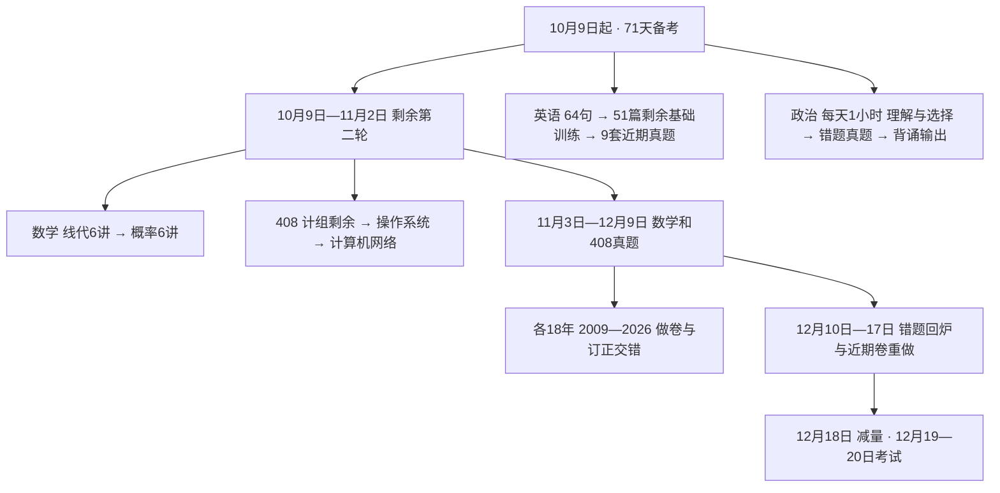

# 2027考研全科学习总计划

## 思维导图式结构

每天执行看 [[01-2026-10-09至12-20每日任务表]]；逐章验收看 [[02-第二轮完整知识点与验收清单]]；找书和查资料缺项看 [[03-资料索引与使用限制]]。

## 一、计划起点和日期

| 科目 | 10月9日的真实起点 | 本计划接下来的主任务 |
|---|---|---|
| 数学一 | 高数十八讲第二轮已完成；线代、概率学过一轮，但要求从头完整复习 | 线代六讲、概率六讲知识与刷题；高数错题维护；18年数学一真题 |
| 408 | 数据结构第二轮已完成；计组第三章正在刷；OS、网络二轮未开始 | 计组第三章未完成部分及第四至七章；OS、网络；18年真题 |
| 英语一 | 88句已完成24句；58篇已完成7篇 | 第25—88句、第8—58篇；写作等题型；2018—2026九套真题 |
| 政治 | 今天正式开始 | 从零启动，每天60分钟，不把旧计划上的任务算成已完成 |

你全天备考，上午约3—3.5小时、下午4—4.5小时、晚上3.5—4小时有效学习。本计划采用下限 **10.5小时/日**，不要求每天顶到12小时。7:30起床，23:00—23:30睡觉；12月18日明显减量。

**考试是2026年12月19—20日，学习任务排到12月18日，共71天。** 数学、408各2009—2026年，共18套。这里的2026真题是已经举行的2026届考试资料，不是尚未举行的2027届试题。

考试日期与科目顺序据[教育部通知](https://www.moe.gov.cn/jyb_xwfb/gzdt_gzdt/s5987/202609/t20260924_1451846.html)和[研招网转载《2027年全国硕士研究生招生工作管理规定》](https://yz.chsi.com.cn/kyzx/jybzc/202609/20260924/2293971511.html)。具体进场要求、科目和时间最终核对自己的准考证。

## 二、每天怎么用时间

### 1. 普通学习日：630分钟

| 时间 | 有效学习 | 主任务 |
|---|---:|---|
| 08:00—09:30 | 数学90分钟 | 二轮：从定义、条件到方法完整复习；真题期：独立做卷/订正 |
| 09:30—09:45 | 休息 | 起身、喝水 |
| 09:45—11:15 | 数学90分钟 | 二轮：刷题70分钟+订正20分钟；真题期：继续做卷/重做 |
| 11:15—13:00 | 吃饭、休息 | 不计算为有效学习 |
| 13:00—15:00 | 408 120分钟 | 知识回忆、独立选择/综合题，或做真题 |
| 15:00—15:30 | 休息 | 不把坐在桌前都算学习 |
| 15:30—17:30 | 408 120分钟 | 完成试卷、订正、遮答案重做 |
| 17:30—18:30 | 吃饭、活动 | 不计算为有效学习 |
| 18:30—20:30 | 英语120分钟 | 阅读/长难句/题型；单词照你的习惯自管，实际用时计入英语总预算，不另排词量 |
| 20:30—20:40 | 休息 | 放松 |
| 20:40—21:40 | 政治60分钟 | 按阶段执行；包含订正与背诵 |
| 21:40—21:50 | 休息 | 放松 |
| 21:50—22:20 | 数学30分钟 | 高数错题维护；数学套卷当天可用于标记和快速批改 |
| 22:20以后 | 收尾、放松 | 在各科记录栏确认明日任务，不新增一轮学习；23:00—23:30睡觉 |

数学210+408 240+英语120+政治60=630分钟。单词若在早午碎片背，其用时仍计入英语120分钟；不再叠加在10.5小时之上。英语具体任务以当日剩余时间为准，少做拓展也要保留阅读订正。

### 2. 限时模考日

数学套卷改为 **08:30—11:30连续180分钟**；下午408套卷为 **14:00—17:00连续180分钟**，该科剩余时间用于标记和快速批改。连续考试中按真实考场节奏安排，不中断查资料。

英语整套模考在11/29、12/1、12/3、12/5、12/7、12/9、12/11、12/13、12/15的 **14:00—17:00，连续180分钟**。当天408由4小时减为3小时，放在13:00—14:00及18:30—20:30；数学3.5小时、政治1小时。英语自主单词用时再从当天408机动时间中等量扣除，总时间仍不超过630分钟。翌日英语2小时集中订正。

## 三、阶段目标

| 阶段 | 日期 | 数学 | 408 | 英语 | 政治 |
|---|---|---|---|---|---|
| 剩余二轮 | 10/9—11/2，25天 | 线代12天、概率12天、补漏1天；每天维护高数 | 计组8天、OS9天、网7天、补漏1天 | 长难句至10/30完成；继续每日1篇基础训练 | 核心知识+肖1000代表题，回忆从今天开始 |
| 真题前半 | 11/3—11/28，26天 | 2009—2021套卷与订正 | 2009—2021套卷与订正衔接 | 11/28完成第58篇；加翻译、写作、完形、新题型 | 核心补齐；11/6加分析框架，11/13开始写单小问 |
| 真题后半 | 11/29—12/9，11天 | 2022—2026及薄弱题订正 | 2022—2026及最后订正 | 2018—2023套卷和订正 | 错题/真题+分析题，12/4起每日书写 |
| 最后回炉 | 12/10—12/17，8天 | 错题、知识漏洞、近期卷限时重做 | 同上 | 12/16结束2026卷订正；12/17回炉 | 时政、分析框架和选择错题 |
| 减量 | 12/18，1天 | 标记题、公式和条件 | 易混概念、解题流程 | 写作结构和错题句 | 已背框架；准备考试物品 |

**11/2是目标交接日，不以翻完页数代替验收。** 当天查完整清单：能够闭卷说条件、独立做代表题的打勾；未通过项进入11/3之后该科每周的机动订正时段。若某一整章概念仍无法说清，先用1—2天补基础并顺延最早的一套旧卷，把12/10—11缓冲拿回来；不把18套改成“看过答案就完成”。

## 四、数学：从头复盘线代概率，高数保持手感

### 1. 二轮的210分钟怎么做

每天知识90分钟+独立刷题70分钟+订正20分钟+高数维护30分钟。90分钟按“定义和条件→公式推导/关系→典型题方法→闭卷复述”走，内容对应完整清单。理解不足时优先回教材和现有讲义，再看对应片段；有过一轮基础，不强制重看每一段完整视频。

本地教材线代六讲章末习题共76题；概率六讲章末共86题，其中习题6.12标仅数学三，数学一主线85题。完整概念都复盘，章末习题独立做；例题先判方法，再独立做不会或标记的题，不能把“看答案懂了”当掌握。两天一讲是进度目标，遇到复杂证明或统计题时从同章重复正确题回收时间。

| 日期 | 数学主任务 | 验收 |
|---|---|---|
| 10/9—10 | 线代1：行列式 | 性质、展开、代数余子式、特殊行列式、参数题、Cramer条件 |
| 10/11—12 | 线代2：矩阵 | 运算、逆与伴随、初等变换、秩、分块和矩阵方程 |
| 10/13—14 | 线代3：向量组 | 相关性、秩、极大无关组、等价；数一基/坐标/过渡矩阵 |
| 10/15—16 | 线代4：线性方程组 | 解存在条件、基础解系、通解、公共解、含参数讨论 |
| 10/17—18 | 线代5：特征值与特征向量 | 相似、可对角化、实对称正交对角化、矩阵幂 |
| 10/19—20 | 线代6：二次型 | 配方与正交变换、标准形规范形、惯性、正定判别 |
| 10/21 | 概率1：随机事件与概率 | 事件关系、计数、条件、全概率、Bayes、独立与重复试验 |
| 10/22—23 | 概率2：一维随机变量及分布 | 分布函数、离散连续、常见分布、函数分布 |
| 10/24—26 | 概率3：多维随机变量及分布 | 联合边缘条件、独立、二维积分域、变量函数分布 |
| 10/27—28 | 概率4：数字特征 | 期望、方差、协方差、相关系数、矩、条件期望 |
| 10/29 | 概率5：大数定律与中心极限定理 | 条件、标准化、Bernoulli/独立同分布型、近似 |
| 10/30—11/1 | 概率6：数理统计 | 样本统计量、抽样分布、点估计、评价、区间、均值检验 |
| 11/2 | 线代概率混测+未勾知识补漏 | 两科各选典型题，列尚未通过项及补漏日期 |

详细知识、对应题号与完整验收动作见 [[02-第二轮完整知识点与验收清单]]。高数30分钟：前5分钟闭卷写本日公式和适用条件，中间20分钟重做1道已有错题（难题只做1道），末5分钟记错因和再测日期。按十八讲循环，薄弱讲可替换当日轮转，不再从头新增一套高数题库。

### 2. 真题如何做与订正

数学18套做卷在11/3、11/5、……、12/7，翌日订正；每套用180分钟，30分钟快速批改/定位。订正日180分钟集中处理错误、猜对题和未完成题，夜间30分钟维护高数或闭卷重做关键错题。

每卷记录总分、各部分失分、用时、未完成题、熟悉题。先看自己步骤，找错误发生点；需要时回讲义；遮答案重新完整解，D+3和D+7再抽检仍错题。已有分章真题导致见过的题标“熟悉”，分数只反映当前完成情况，不当首次模拟预测。

## 五、408：剩余二轮25天，再做18套真题

计组10/9—16，OS10/17—25，网络10/26—11/1，11/2补漏。计组第三章从真实未完成位置接着刷，已掌握的小节只闭卷验收。数据结构已完成，放在每天4小时里做维护，不重排整本第二轮。

240分钟：旧错题20+知识图回忆与定向补缺30+独立刷题100+订正55+遮答案重做25+记下明日重点10。首次两天可参考20—30道选择、1—2道综合题；PV、存储、TCP等复杂大题占用增加时减少选择题，不能删掉订正。旧错题20分钟内轮换DS与其他到期题，每周至少有一次20分钟专做DS标记题。

各章完整知识检查见 [[02-第二轮完整知识点与验收清单]]；每日具体拆分见 [[01-2026-10-09至12-20每日任务表]]。OS教材五章，分类真题把调度死锁单列为第3章，不混用章号。

408真题在11/4、11/6、……、12/8，翌日订正，12/9完成2026卷订正。做卷180分钟+剩余60分钟批改、标出失分知识；订正日先独立重做再看解释。2024选择题当前只有答案，遇到疑惑回查2027教材核理由；2025—26机构版按题干核对，不只比答案字母。

## 六、英语：保留基础任务，逐步加入全部题型

单词继续照你当前习惯进行，不排新词数量；你已确认 **可以边背词边做真题**，不以词书全部背完推迟11/29真题。

### 1. 10/9—10/30

每天第25句起3句新长难句，10/30仅最后1句，加回顾已学2句；每天从第8篇起1篇基础训练。一次训练：先限时独立做题15—20分钟→题干和选项定位→翻译关键句/段→核对精讲和错因→隔天回看。暂按英语120分钟中的新句25+阅读60+自主词汇及回顾机动35；若单词用时更长，先减少逐词全文翻译，保留核心句翻译和订正。

长难句每句须能划主干、修饰层次与逻辑，再独立翻译，不能只看中文。基础材料中有英语二、完形等混排；每天“1篇”指继续书中下一训练单元，不能把英语二单元计为英一套卷。

### 2. 10/31—11/28

每天仍1篇基础训练，直到11/28第58篇。长难句新课完后，时间改为循环回忆旧句及阅读中的困难句。每周增加两次写作输出、一次新题型、一次完形、一次翻译专项，使用2009—2017已有英一试卷，避免提前拆最近九年。

英语120分钟参考：基础训练60+补充题型30+自主词汇/旧句30。**作文从10/31开始动笔**：先写100词左右应用文，逐步写160—200词议论文/图画图表题；整理可迁移句型与常犯语法错，按具体题目改内容，不背万能全文。补充任务见每日表，每次在30分钟内完成一个小任务，长作文可拆为写作与次日改写。

### 3. 11/29—12/16

2018—2026九套，每两天一套：第一天完整180分钟（四篇阅读、完形、新题型、翻译、大小作文均做）；第二天120分钟订正，重点看证据句、干扰项、翻译给分信息和作文遗漏。未掌握的篇章放入当日/下一订正日机动回炉，不要求所有文章都逐词翻译。

每套可从以下时间试起：四篇阅读70+新题型15+翻译20+作文50+完形15+涂卡/检查10=180分钟，再按真实耗时调整。不是固定要求每题必须用同一时间。

2018—21本地仅试卷，2023—24不能仅凭索引认定完整解析；已给原教研发布方网页入口，做前先确认答案能显示，阅卷不靠自己猜。2022、2025、2026有本地题解。见 [[03-资料索引与使用限制]]。

基础58篇本身取材于真题，部分年卷阅读可能见过。每次模考标熟悉篇；不要把熟悉篇高分解释成首次实战水平。12/17集中回炉，12/18只看作文结构、错题句。

## 七、政治：每天60分钟，从今天开始

以本地《考点清单》作知识主线、肖1000作选择训练、2027背诵手册上册与500句作回忆补充。500句是选择题的正确/干扰选项归纳，不能代替分析题答案；下册只有片段，不能按旧逐日表要求把未持有页码背完。

| 日期 | 主线 | 每天60分钟分配 |
|---|---|---|
| 10/9—10/22 | 马原：导论、哲学、政经、科学社会主义 | 回忆5+理解15+题20+订正15+回忆5 |
| 10/23—10/29 | 毛中特理论与历史阶段 | 同上 |
| 10/30—11/5 | 习思想各主题 | 同上；主体主题按每日表，手册回忆辅助 |
| 11/6—11/12 | 史纲；开始分析题框架 | 回忆5+理解10+题20+订正15+框架10 |
| 11/13—11/19 | 思法；每周至少两次单小问输出 | 同上；框架10分钟内完成写提纲/小问与核对 |
| 11/20—12/3 | 错疑题二刷，2022—2025选择分日练 | 回忆5+题20+订正15+主观/时政20 |
| 12/4—12/17 | 分析题、当年时政、选择错题保持 | 回忆5+选择15+订正10+背诵20+书写10 |
| 12/18 | 已背框架和考前准备 | 错题15+时政词15+框架25+准备5 |

前六周是时间有限的**核心覆盖**，不承诺把全部教材和1000题两遍刷完。先完成当日主题的代表题与订正，容易且已解释清楚的题不反复机械刷。第一天可用现有7道马原导论题。周复盘替换当天15分钟，不额外加时。

分析题按“读设问→选知识→写关键层次→结合材料→对照要点改写”练。马原可用“原理要点→材料对应→结论”；其余模块根据具体设问组织，不硬套同一模板。11/13、11/16、11/20、11/23、11/27、11/30明确动笔；12/4起每天写一个小问。

本地2026政治回忆版选择题缺多数题干，仅看考点与设问，不算做完一套。肖八肖四与完整年度时政本地未发现：后续取得后替换对应时间块；取得前用已有错题、2022—2025真题、解析册与稳定原理练输出。11/20先检查时政/分析资料，12/4再检查一次；年度热点不能用旧年答案直接替代，具体缺项见资料索引。

## 八、数学和408的18年真题日历

数学与408错开一天开卷；同一科隔日一套，间隔日订正，避免每天双科连续开新卷。表中的年份均为独立年度PDF。

| 年份 | 数学做卷 | 数学订正 | 408做卷 | 408订正 | 数学完成 | 408完成 |
|---|---|---|---|---|---|---|
| 2009 | 11/03 | 11/04 | 11/04 | 11/05 | 待做/待订正 | 待做/待订正 |
| 2010 | 11/05 | 11/06 | 11/06 | 11/07 | 待做/待订正 | 待做/待订正 |
| 2011 | 11/07 | 11/08 | 11/08 | 11/09 | 待做/待订正 | 待做/待订正 |
| 2012 | 11/09 | 11/10 | 11/10 | 11/11 | 待做/待订正 | 待做/待订正 |
| 2013 | 11/11 | 11/12 | 11/12 | 11/13 | 待做/待订正 | 待做/待订正 |
| 2014 | 11/13 | 11/14 | 11/14 | 11/15 | 待做/待订正 | 待做/待订正 |
| 2015 | 11/15 | 11/16 | 11/16 | 11/17 | 待做/待订正 | 待做/待订正 |
| 2016 | 11/17 | 11/18 | 11/18 | 11/19 | 待做/待订正 | 待做/待订正 |
| 2017 | 11/19 | 11/20 | 11/20 | 11/21 | 待做/待订正 | 待做/待订正 |
| 2018 | 11/21 | 11/22 | 11/22 | 11/23 | 待做/待订正 | 待做/待订正 |
| 2019 | 11/23 | 11/24 | 11/24 | 11/25 | 待做/待订正 | 待做/待订正 |
| 2020 | 11/25 | 11/26 | 11/26 | 11/27 | 待做/待订正 | 待做/待订正 |
| 2021 | 11/27 | 11/28 | 11/28 | 11/29 | 待做/待订正 | 待做/待订正 |
| 2022 | 11/29 | 11/30 | 11/30 | 12/01 | 待做/待订正 | 待做/待订正 |
| 2023 | 12/01 | 12/02 | 12/02 | 12/03 | 待做/待订正 | 待做/待订正 |
| 2024 | 12/03 | 12/04 | 12/04 | 12/05 | 待做/待订正 | 待做/待订正 |
| 2025 | 12/05 | 12/06 | 12/06 | 12/07 | 待做/待订正 | 待做/待订正 |
| 2026 | 12/07 | 12/08 | 12/08 | 12/09 | 待做/待订正 | 待做/待订正 |

最后一套数学12/7做、12/8订正；408 12/8做、12/9订正。12/10—17继续错题和近期卷重做，不再塞一套新题库。

## 九、验收、机动和掉队时怎么改

每天只记：实际用时、完成到哪、一个最主要错误、明天第一任务。错题最少记录“来源题号—错误原因—遗漏条件—关键步骤—D+1/D+3/D+7结果”。正确但靠猜、不会解释或看过答案的也标记。

| 情况 | 当天或次日调整 |
|---|---|
| 少于计划1—2小时 | 保留独立题和订正、政治60分钟、英语1篇主任务；削减重复正确题及额外拓展；不延迟睡觉 |
| 某章比预计慢1天 | 用11/2补漏；计组已掌握部分、轻章和重复题回收时间；完整概念清单仍逐条核 |
| 11/2一整章基础缺口大 | 先用1—2天补基础；对应最早旧卷顺延，并用12/10—11回收；18套覆盖目标保留 |
| 真题订正超过该科时间块 | 先做导致整题失分的关键点；剩余登记，放次日额外批改/周机动；不跳过订正直接开新卷 |
| 连续3天欠任务 | 当周末用30分钟重算剩余量，替换原学习块；删重复和拓展，不把欠账简单叠到第二天 |
| 资料缺页/解析不全 | 改用完整章节、原始题干和已核解析入口；在记录中写“待核”，不打完成勾 |

每7天复盘一次（10/15、10/22、10/29、11/5、11/12、11/19、11/26、12/3、12/10、12/17），占数学/408既有复盘时间各10分钟，政治既有15分钟。看完成量和仍错题，确认下一周是否需要交换难章/缓冲。不要把每周复盘又当成额外作业。

12/18建议只学约4小时：数学60、408 60、英语60、政治60；整理准考证/证件、路线和物品，保持睡眠。12/19政治与英语，12/20数学与408，具体当天执行看每日表。

## 十、今天先做什么

- [ ] 数学：线代行列式完整知识复盘，刷章末前半；晚间高数第一讲错题。
- [ ] 408：从计组第三章当前未完成位置接着做，优先核主存、地址与扩展；若该部分已掌握，提前进入Cache。
- [ ] 英语：第25—27句；第8篇，独立作答、关键句翻译、订正；单词自主继续。
- [ ] 政治：马原导论和现有第一天7题，完成后才勾。
- [ ] 当天实际用时填入每日表，后续按真实速度微调。

本计划基于本次用户回答和真实本地目录；已读说明、教材目录/部分扫描页与抽样真题，未逐页读完所有教材、未重看所有视频、未逐题校审机构答案。资料缺项与核对范围集中记录在资料索引。
