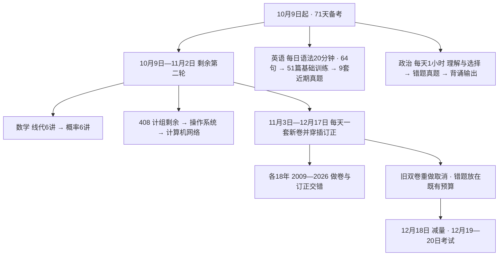

# 2027考研全科学习总计划

## 思维导图式结构

每天执行看 [[01-2026-10-09至12-20每日任务表]]；逐章验收看 [[02-第二轮完整知识点与验收清单]]；找书和查资料缺项看 [[03-资料索引与使用限制]]；未固定安排的资料选择看 [[04-全部资料覆盖审查与待选清单]]。

## 一、计划起点和日期

| 科目 | 10月9日的真实起点 | 本计划接下来的主任务 |
|---|---|---|
| 数学一 | 高数十八讲第二轮已完成；线代、概率学过一轮，但要求从头完整复习 | 线代六讲、概率六讲知识与刷题；高数错题维护；18年数学一真题 |
| 408 | 数据结构第二轮已完成；计组第三章正在刷；OS、网络二轮未开始 | 计组第三章未完成部分及第四至七章；OS、网络；18年真题 |
| 英语一 | 88句已完成24句；58篇已完成7篇；语法学到第三章第三节 | 每日语法20分钟；第25—88句、第8—58篇；写作等题型；2018—2026九套真题 |
| 政治 | 10月9日正式开始 | 从零启动，每天60分钟，不把旧计划上的任务算成已完成 |

2026-10-26起所有学习只安排08:00—18:00。普通有效7.5小时；午餐午休1小时、短休共1小时、晚餐半小时。18点后休息，不补作业，12/18减量。完整执行版见[[豆包每日提醒参考/02-豆包每日学习计划完整参考]]，未确认的学习进度不按日期推断。

**考试是2026年12月19—20日，学习任务排到12月18日，共71天。** 数学、408各2009—2026年，共18套。这里的2026真题是已经举行的2026届考试资料，不是尚未举行的2027届试题。

考试日期与科目顺序据[教育部通知](https://www.moe.gov.cn/jyb_xwfb/gzdt_gzdt/s5987/202609/t20260924_1451846.html)和[研招网转载《2027年全国硕士研究生招生工作管理规定》](https://yz.chsi.com.cn/kyzx/jybzc/202609/20260924/2293971511.html)。具体进场要求、科目和时间最终核对自己的准考证。

## 二、每天怎么用时间（2026-10-26版）

| 时间 | 安排 | 有效学习分钟 |
|---|---|---:|
| 08:00—09:15 | 数学：完整知识复盘／上套真题重点订正 | 75 |
| 09:15—09:30 | 休息用餐：起身、喝水、远眺 | — |
| 09:30—10:45 | 数学：独立题35＋订正20＋高数维护20分钟 | 75 |
| 10:45—11:00 | 休息用餐：休息 | — |
| 11:00—12:00 | 政治：当天知识、选择题、订正和回忆输出，合计60分钟 | 60 |
| 12:00—13:00 | 休息用餐：午餐30分钟＋午休30分钟 | — |
| 13:00—14:15 | 408：到期旧错题15＋知识恢复30＋独立题30分钟 | 75 |
| 14:15—14:30 | 休息用餐：休息、活动 | — |
| 14:30—15:45 | 408：独立题30＋订正30＋遮解重做10＋记录5分钟 | 75 |
| 15:45—16:00 | 休息用餐：休息 | — |
| 16:00—16:20 | 英语：语法20分钟 | 20 |
| 16:20—17:00 | 英语：当天阅读／真题重点订正40分钟 | 40 |
| 17:00—17:15 | 英语：长难句／旧卷题型／作文小任务15分钟 | 15 |
| 17:15—17:30 | 英语：自主背词和旧词复习15分钟，不固定词量 | 15 |
| 17:30—18:00 | 休息用餐：晚餐；18:00结束当天安排 | — |

普通日数学150＋408150＋英语90＋政治60＝450分钟；其他150分钟为午餐午休、休息、晚餐。模考日每日至多一套180分钟，改用[[豆包每日提醒参考/01-每日固定时间表]]，18点后无学习。

## 三、阶段目标

| 阶段 | 日期 | 数学 | 408 | 英语 | 政治 |
|---|---|---|---|---|---|
| 剩余二轮 | 10/9—11/2，25天 | 线代12天、概率12天、补漏1天；每天维护高数 | 计组8天、OS9天、网7天、补漏1天 | 长难句原目标10/30，未完接续；继续每日1篇基础训练 | 核心知识+肖1000代表题，回忆从10月9日开始 |
| 真题前半 | 11/3—11/28，26天 | 2009—2021套卷与订正 | 2009—2021套卷与订正衔接 | 第58篇原目标11/28，未完接续；加翻译、写作、完形、新题型 | 核心补齐；11/6加分析框架，11/13开始写单小问 |
| 真题后半及回炉 | 11/29—12/17，19天 | 后五年新卷与错题穿插 | 后五年新卷与错题穿插 | 9套整卷、重点订正与作文回炉 | 错题/真题、时政与分析题每日书写 |
| 减量 | 12/18，1天 | 标记题、公式和条件 | 易混概念、解题流程 | 写作结构和错题句 | 已背框架；准备考试物品 |

**11/2是目标交接日，不以翻完页数代替验收。** 当天查完整清单：能够闭卷说条件、独立做代表题的打勾；未通过项进入11/3之后该科每周的机动订正时段。若整章概念仍不清，先替换该科新卷补基础，按实际进度重新排剩余年卷，不把看过答案算完成，也不延长到晚间。

## 四、数学：从头复盘线代概率，高数保持手感

#### 1. 二轮的150分钟怎么做

每天知识75分钟＋独立题35分钟＋订正20分钟＋高数维护20分钟。75分钟按“定义和条件→公式推导/关系→典型题方法→闭卷复述”走，内容对应完整清单。理解不足时优先回教材和现有讲义，再看对应片段；有过一轮基础，不强制重看每一段完整视频。

本地教材线代六讲章末习题共76题；概率六讲章末共86题，其中习题6.12标仅数学三，数学一主线85题。完整概念都复盘，章末习题独立做；例题先判方法，再独立做不会或标记的题，不能把“看答案懂了”当掌握。两天一讲是进度目标，遇到复杂证明或统计题时从同章重复正确题回收时间。

| 日期 | 数学主任务 | 验收 |
|---|---|---|
| 10/9—10 | 线代1：行列式 | 性质、展开、代数余子式、特殊行列式、参数题、Cramer条件 |
| 10/11—12 | 线代2：矩阵 | 运算、逆与伴随、初等变换、秩、分块和矩阵方程 |
| 10/13—14 | 线代3：向量组 | 相关性、秩、极大无关组、等价；数一基/坐标/过渡矩阵 |
| 10/15—16 | 线代4：线性方程组 | 解存在条件、基础解系、通解、公共解、含参数讨论 |
| 10/17—18 | 线代5：特征值与特征向量 | 相似、可对角化、实对称正交对角化、矩阵幂 |
| 10/19—20 | 线代6：二次型 | 配方与正交变换、标准形规范形、惯性、正定判别 |
| 10/21 | 概率1：随机事件与概率 | 事件关系、计数、条件、全概率、Bayes、独立与重复试验 |
| 10/22—23 | 概率2：一维随机变量及分布 | 分布函数、离散连续、常见分布、函数分布 |
| 10/24—26 | 概率3：多维随机变量及分布 | 联合边缘条件、独立、二维积分域、变量函数分布 |
| 10/27—28 | 概率4：数字特征 | 期望、方差、协方差、相关系数、矩、条件期望 |
| 10/29 | 概率5：大数定律与中心极限定理 | 条件、标准化、Bernoulli/独立同分布型、近似 |
| 10/30—11/1 | 概率6：数理统计 | 样本统计量、抽样分布、点估计、评价、区间、均值检验 |
| 11/2 | 线代概率混测+未勾知识补漏 | 两科各选典型题，列尚未通过项及补漏日期 |

详细知识、对应题号与完整验收动作见 本文件相关部分。高数20分钟：前3分钟回忆公式条件，中间14分钟重做已有错题关键步骤，末3分钟记错因和再测日期。按十八讲循环，薄弱讲可替换当日轮转，不再从头新增一套高数题库。

#### 2. 真题如何做与订正（以本版新日历为准）

数学2009—2026共18套按第八部分新日历逐套做；每次180分钟独立卷＋15分钟快批。订正分配到下一次数学105/150分钟块；未清的关键错误优先于下一套新卷。

每卷记录总分、各部分失分、用时、未完成题、熟悉题。先看自己步骤，找错误发生点；需要时回讲义；遮答案重新完整解，D+3和D+7再抽检仍错题。已有分章真题导致见过的题标“熟悉”，分数只反映当前完成情况，不当首次模拟预测。

## 五、408：剩余二轮25天，再做18套真题

计组10/9—16，OS10/17—25，网络10/26—11/1，11/2补漏。计组第三章从真实未完成位置接着刷，已掌握的小节只闭卷验收。数据结构已完成，放在每天408预算内做维护，不重排整本第二轮。

普通日408150分钟：旧错15＋知识30＋独立题60＋订正30＋遮解重做10＋记录5。复杂题减少新题数量，保留订正，不强制原题量。旧错题15分钟内轮换DS与其他到期题，每周至少一次15分钟做DS标记题。

各章完整知识检查见 本文件相关部分；每日具体拆分见 本文件相关部分。OS教材五章，分类真题把调度死锁单列为第3章，不混用章号。

4082009—2026共18套按第八部分新日历，180分钟做卷＋15分钟快批。深入订正在下一408105/65分钟块分段处理，先独立重做再看解释。2024选择题当前只有答案，遇到疑惑回查2027教材核理由；2025—26机构版按题干核对，不只比答案字母。

## 六、英语：保留基础任务，逐步加入全部题型

单词继续照你当前习惯进行，不排新词数量；你已确认 **可以边背词边做真题**，不以词书全部背完推迟11/29真题。

#### 1. 10/9—10/30

原目标每天3句、10/30结束；本版以15分钟内能独立分析的1—3句接续，未完记录下一句编号；每天从第8篇起1篇基础训练。一次训练：先限时独立做题15—20分钟→题干和选项定位→翻译关键句/段→核对精讲和错因→隔天回看。普通日16:00—16:20语法、16:20—17:00阅读、17:00—17:15句子/题型、17:15—17:30词汇；复杂长难句按1—3句弹性接续，保留关键句翻译与订正。

长难句每句须能划主干、修饰层次与逻辑，再独立翻译，不能只看中文。基础材料中有英语二、完形等混排；每天“1篇”指继续书中下一训练单元，不能把英语二单元计为英一套卷。

#### 2. 10/31—11/28

每天一个基础单元为目标，原目标11/28第58篇；未完按真实编号接续，不为赶日期跳订正。长难句新课完后，时间改为循环回忆旧句及阅读中的困难句。每周增加两次写作输出、一次新题型、一次完形、一次翻译专项，使用2009—2017已有英一试卷，避免提前拆最近九年。

英语90分钟参考：语法20＋基础训练40＋补充题型/旧句15＋词汇15。**作文从10/31开始动笔**：先写100词左右应用文，逐步写160—200词议论文/图画图表题；整理可迁移句型与常犯语法错，按具体题目改内容，不背万能全文。补充任务见每日表，每次在15分钟内完成一个小任务，长作文可拆为写作与次日改写。

#### 3. 11/29—12/16

2018—2026九套，每两天一套：第一天按E表：完整180分钟，含全部题型；另语法20、词汇20。次日英语90分钟含语法20、词汇15，其余55分钟重点订正，未完部分接下一英语块，不逐词翻译整卷。

每套可从以下时间试起：四篇阅读70+新题型15+翻译20+作文50+完形15+涂卡/检查10=180分钟，再按真实耗时调整。不是固定要求每题必须用同一时间。

2018—21本地仅试卷，2023—24不能仅凭索引认定完整解析；已给原教研发布方网页入口，做前先确认答案能显示，阅卷不靠自己猜。2022、2025、2026有本地题解。见 本文件相关部分。

基础58篇本身取材于真题，部分年卷阅读可能见过。每次模考标熟悉篇；不要把熟悉篇高分解释成首次实战水平。12/17集中回炉，12/18英语60分钟内用语法20、词汇10、作文结构与错题句30分钟。

#### 4. 每天语法20分钟：从第三章第三节继续

主资料：[[英语一/06-长难句与语法/不就是语法和长难句吗.pdf|《不就是语法和长难句吗》]]。你已学到第三章第三节“名词性从句的考点分析”，从这里接着学，不重排第一、二章新课。**第三节起点为印刷第82页、PDF第92页**，已核扫描页；其他每日页码是按目录标出的定位范围，不要求20分钟通读范围内全部例句。

| 日期 | 语法主线 | 验收方式 |
|---|---|---|
| 10/9—10/16 | 第三章第三节及课后：写作应用、四类名词性从句的长难句分析 | 解释从句在主句的位置、引导词功能；重译/改写2句 |
| 10/17—10/27 | 第四章：定语与定语从句、引导词/先行词/特殊用法、与同位语比较 | 先判从句缺成分，再选关系词；画修饰关系 |
| 10/28—11/9 | 第五章：状语、各类状语从句、时态、分词与as、写作/长难句 | 说明逻辑关系与逻辑主语；独立翻译代表句 |
| 11/10—11/17 | 第六章：强调、虚拟、倒装、插入及课后 | 还原主干，写规则适用条件，再改写 |
| 11/18—11/28 | 附录词性查漏、六篇作文改错；第一/二章旧知识回查 | 找错、解释原因并重写；补旧知识薄弱项 |
| 11/29—12/17 | 最近已练卷/既有错句回查本书；新卷日语法用旧句，不预看当天新卷 | 分析1—2句并重新翻译/改写 |
| 12/18 | 已记录的语法错点 | 只回忆，不新开章节 |

普通新课20分钟可用“回忆3+读规则7+独立分析/改写8+闭卷总结2”。复杂例句占用增加时当天做1句；未懂规则登记并在下个语法块先补，不把所有课后题硬塞进20分钟。语法任务每日写入英语那一行，不另加第五科；配套视频目前只按需查漏，是否固定排课由你选择。

所有专题日期均是原目标窗口，10/26实际位置以本人反馈为准，不按日期默认学完。

## 七、政治：每天60分钟，基准从10月9日开始

以本地《考点清单》作知识主线、肖1000作选择训练、2027背诵手册上册与500句作回忆补充。500句是选择题的正确/干扰选项归纳，不能代替分析题答案；下册只有片段，不能按旧逐日表要求把未持有页码背完。

| 日期 | 主线 | 每天60分钟分配 |
|---|---|---|
| 10/9—10/22 | 马原：导论、哲学、政经、科学社会主义 | 回忆5+理解15+题20+订正15+回忆5 |
| 10/23—10/29 | 毛中特理论与历史阶段 | 同上 |
| 10/30—11/5 | 习思想各主题 | 同上；主体主题按每日表，手册回忆辅助 |
| 11/6—11/12 | 史纲；开始分析题框架 | 回忆5+理解10+题20+订正15+框架10 |
| 11/13—11/19 | 思法；每周至少两次单小问输出 | 同上；框架10分钟内完成写提纲/小问与核对 |
| 11/20—12/3 | 错疑题二刷，2022—2025选择分日练 | 回忆5+题20+订正15+主观/时政20 |
| 12/4—12/17 | 分析题、当年时政、选择错题保持 | 回忆5+选择15+订正10+背诵20+书写10 |
| 12/18 | 已背框架和考前准备 | 错题15+时政词15+框架25+准备5 |

前六周是时间有限的**核心覆盖**，不承诺把全部教材和1000题两遍刷完。先完成当日主题的代表题与订正，容易且已解释清楚的题不反复机械刷。10月9日已确认完成，当日用了现有7道马原导论题。周复盘替换当天15分钟，不额外加时。

分析题按“读设问→选知识→写关键层次→结合材料→对照要点改写”练。马原可用“原理要点→材料对应→结论”；其余模块根据具体设问组织，不硬套同一模板。11/13、11/16、11/20、11/23、11/27、11/30明确动笔；12/4起每天写一个小问。

本地2026政治回忆版选择题缺多数题干，仅看考点与设问，不算做完一套。肖八肖四与完整年度时政本地未发现：后续取得后替换对应时间块；取得前用已有错题、2022—2025真题、解析册与稳定原理练输出。11/20先检查时政/分析资料，12/4再检查一次；年度热点不能用旧年答案直接替代，具体缺项见资料索引。

## 八、新卷日历：每天最多一套，替换旧双卷安排

11/3—11/28的数学/408交替日期不变；11/29起英语9个整卷日期不变，数学/408顺延到剩余日期。取消原12/12、14、16的“双科整卷重做”，取消额外整套回炉；关键错题在现有订正块做。全部新卷保留为目标，订正不能为了赶日期跳过。

| 日期 | 当天唯一完整卷 | 模板 | 其他科任务 |
|---|---|---|---|
| 2026-11-03 | 2009年数学一 | M | 按模板预算订正/维护，政治60分钟 |
| 2026-11-04 | 2009年408 | C | 按模板预算订正/维护，政治60分钟 |
| 2026-11-05 | 2010年数学一 | M | 按模板预算订正/维护，政治60分钟 |
| 2026-11-06 | 2010年408 | C | 按模板预算订正/维护，政治60分钟 |
| 2026-11-07 | 2011年数学一 | M | 按模板预算订正/维护，政治60分钟 |
| 2026-11-08 | 2011年408 | C | 按模板预算订正/维护，政治60分钟 |
| 2026-11-09 | 2012年数学一 | M | 按模板预算订正/维护，政治60分钟 |
| 2026-11-10 | 2012年408 | C | 按模板预算订正/维护，政治60分钟 |
| 2026-11-11 | 2013年数学一 | M | 按模板预算订正/维护，政治60分钟 |
| 2026-11-12 | 2013年408 | C | 按模板预算订正/维护，政治60分钟 |
| 2026-11-13 | 2014年数学一 | M | 按模板预算订正/维护，政治60分钟 |
| 2026-11-14 | 2014年408 | C | 按模板预算订正/维护，政治60分钟 |
| 2026-11-15 | 2015年数学一 | M | 按模板预算订正/维护，政治60分钟 |
| 2026-11-16 | 2015年408 | C | 按模板预算订正/维护，政治60分钟 |
| 2026-11-17 | 2016年数学一 | M | 按模板预算订正/维护，政治60分钟 |
| 2026-11-18 | 2016年408 | C | 按模板预算订正/维护，政治60分钟 |
| 2026-11-19 | 2017年数学一 | M | 按模板预算订正/维护，政治60分钟 |
| 2026-11-20 | 2017年408 | C | 按模板预算订正/维护，政治60分钟 |
| 2026-11-21 | 2018年数学一 | M | 按模板预算订正/维护，政治60分钟 |
| 2026-11-22 | 2018年408 | C | 按模板预算订正/维护，政治60分钟 |
| 2026-11-23 | 2019年数学一 | M | 按模板预算订正/维护，政治60分钟 |
| 2026-11-24 | 2019年408 | C | 按模板预算订正/维护，政治60分钟 |
| 2026-11-25 | 2020年数学一 | M | 按模板预算订正/维护，政治60分钟 |
| 2026-11-26 | 2020年408 | C | 按模板预算订正/维护，政治60分钟 |
| 2026-11-27 | 2021年数学一 | M | 按模板预算订正/维护，政治60分钟 |
| 2026-11-28 | 2021年408 | C | 按模板预算订正/维护，政治60分钟 |
| 2026-11-29 | 2018年英语一 | E | 按模板预算订正/维护，政治60分钟 |
| 2026-11-30 | 2022年数学一 | M | 按模板预算订正/维护，政治60分钟 |
| 2026-12-01 | 2019年英语一 | E | 按模板预算订正/维护，政治60分钟 |
| 2026-12-02 | 2022年408 | C | 按模板预算订正/维护，政治60分钟 |
| 2026-12-03 | 2020年英语一 | E | 按模板预算订正/维护，政治60分钟 |
| 2026-12-04 | 2023年数学一 | M | 按模板预算订正/维护，政治60分钟 |
| 2026-12-05 | 2021年英语一 | E | 按模板预算订正/维护，政治60分钟 |
| 2026-12-06 | 2023年408 | C | 按模板预算订正/维护，政治60分钟 |
| 2026-12-07 | 2022年英语一 | E | 按模板预算订正/维护，政治60分钟 |
| 2026-12-08 | 2024年数学一 | M | 按模板预算订正/维护，政治60分钟 |
| 2026-12-09 | 2023年英语一 | E | 按模板预算订正/维护，政治60分钟 |
| 2026-12-10 | 2024年408 | C | 按模板预算订正/维护，政治60分钟 |
| 2026-12-11 | 2024年英语一 | E | 按模板预算订正/维护，政治60分钟 |
| 2026-12-12 | 2025年数学一 | M | 按模板预算订正/维护，政治60分钟 |
| 2026-12-13 | 2025年英语一 | E | 按模板预算订正/维护，政治60分钟 |
| 2026-12-14 | 2025年408 | C | 按模板预算订正/维护，政治60分钟 |
| 2026-12-15 | 2026年英语一 | E | 按模板预算订正/维护，政治60分钟 |
| 2026-12-16 | 2026年数学一 | M | 按模板预算订正/维护，政治60分钟 |
| 2026-12-17 | 2026年408 | C | 按模板预算订正/维护，政治60分钟 |

45天日历已经排满，没有整日缓冲。最后一套408在12/17，12/18的40860分钟优先处理该卷核心失分，不保证深度订正一次完成。必要时在12/18总240分钟内从数学/英语非核心回忆等量调配，保留英语语法20，不能延长总量或安排晚课。若12月中旬已有明显订正积压，提前停开旧年卷补缺，不能等最后一天突击。缩时后的新卷日历是覆盖目标，不等于保证所有套卷均已掌握。
## 十、10月9日历史首日任务（已确认完成，非今天）

- [x] 数学：线代行列式完整知识复盘，刷章末前半；当天数学预算内高数错题。
- [x] 408：从计组第三章当前未完成位置接着做，优先核主存、地址与扩展；若该部分已掌握，提前进入Cache。
- [x] 英语：语法第三章第三节主语从句写作20分钟（印刷82/PDF92）；第25—27句；第8篇，独立作答、关键句翻译、订正；单词自主继续。
- [x] 政治：马原导论和现有第一天7题，完成后才勾。
- [ ] 当天实际用时填入每日表，后续按真实速度微调。

本计划基于本次用户回答和真实本地目录；已读说明、教材目录/部分扫描页与抽样真题，未逐页读完所有教材、未重看所有视频、未逐题校审机构答案。资料缺项与核对范围集中记录在资料索引。
